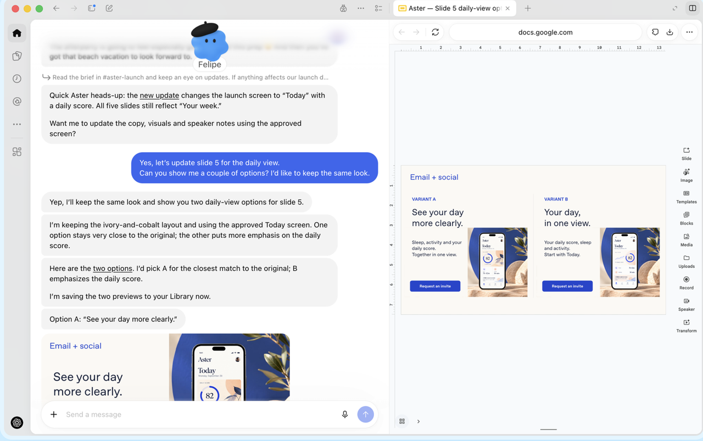
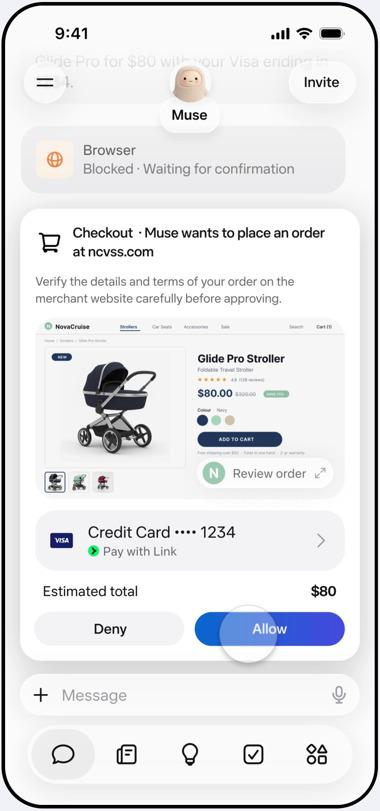
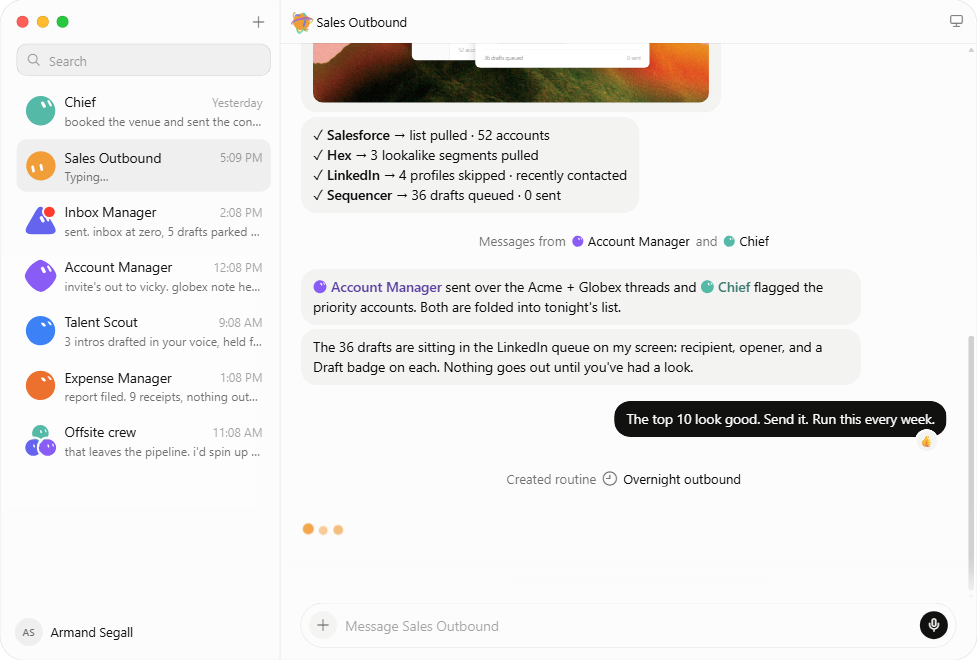
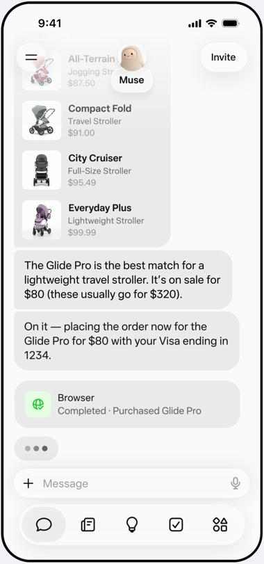
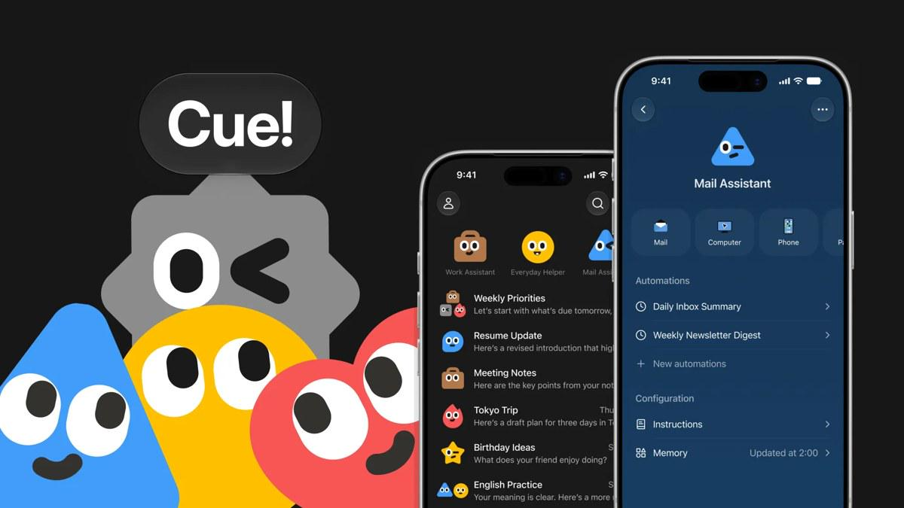

> **增补课时**　·　**学习指南与路线**　·　约 1–1.5 小时
> 同步自飞书原文 2026-10 更新：1.2 2026年 Agent 新形态
>
> 学完标准：合上笔记，能讲清本节在问什么、你怎么答、以及如何套到自己的项目上。

---

### 1.2 2026年 Agent 新形态

Agent 行业的发展非常迅速。技术栈在更新，产品形态在迭代，业界也在不断探索：Agent 到底应该以什么方式进入真实工作和生活，怎样才能从“看起来很厉害”走向真正落地？因此，学习 Agent，不能只停留在工具调用、多 Agent 协作等技术概念上，还需要理解最新产品在解决什么问题，以及它们背后的设计理念。

从找工作的角度，这件事有两方面的价值。

**第一，理解 Agent 的发展趋势和产品形态，能让你更有深度地讨论产品与开发。** 对开发者来说，这能帮助你理解需求、判断技术方案，而不只是把功能实现出来。对产品岗位来说，这更是本职工作：理解用户如何使用 Agent、现有产品有什么不足、新的设计为什么出现，才能判断应该做什么，而不只是追随热门概念。

**第二，它能让你的项目更有辨识度。** 在快速迭代的行业里，Agent 项目的形态也容易过时。如果项目仍然只是一个聊天窗口，加上工具调用或简单的多 Agent 编排，就容易与其他候选人的项目相似。相比之下，如果你能跟上发展趋势，针对实际问题设计新的交互方式、工作机制或协作体验，并讲清楚为什么这样设计，就更有机会与其他候选人形成鲜明对比，脱颖而出。当然，重点不是堆砌新功能，而是让新的设计真正解决问题。

这一小节，我们会**弱化技术实现，以 2026 年 10 月为观察时间点，讲解近期出现的新 Agent 形态**。主要讲“它的设计新在哪里”，这些变化体现了怎样的发展理念和技术方向 以及对我们的项目设计有一些什么启发。

希望学习之后，你在与面试官探讨 Agent 功能时，能给出更有亮点、有依据的回答。如果还能把其中适合的设计融入自己的项目，并解释它带来的价值，那就更棒啦！

在本本节笔记之中，我也直接是用我们的[ForgePilot项目](https://my.feishu.cn/docx/GikId1snboM6LyxxGPXc0kDdnub#doxcn0qkzrGRSbtqaIAIWrUekJc)，来表示我在写这个文档的时候，对应的内容如何启发我的ForgePilot项目的设计的。我相信到时候我们写ForgePilot的设计文档的时候，你能看到和我们今天内容相关的影子。

同时，我也组织了一些面试题，告诉你在阅读了这个章节后，对于这些真题，你可以找到更多的角度去思考和回答。

通过这两个例子，你能直观体会到今天的素材对于你面试的帮助。

#### 1.2.1 四款代表产品

先明确一个观察角度：**这些产品的入口仍然主要是聊天，但它们不再只围绕“一次提问、一次任务”组织体验，而是尝试让用户拥有持续工作的代理。** 有的强调同一个代理跨任务、跨入口接着工作；有的给代理配上独立身份；有的把多个代理做成通讯录里的同事；还有的把授权、审批和执行过程放到更重要的位置。

今天讲的产品主要在 2026 年 8—9 月发布：

**公司 / 品牌**

**产品**

**主要场景**

**最值得关注的设计**

**OpenAI**

**dots**

产品发布、研发、研究、销售、内容制作等持续性工作

围绕同一个代理维持上下文，减少用户在任务线程和不同入口之间搬运背景

**Manus**

**Cue**

电话与邮件沟通、出行预订、购物、日常事务，也包括工作协作

给代理配电话、邮箱、钱包和电脑，让它拥有对外办事的身份

**Meta**

**Muse**

购物、旅行、日程、长期个人目标等事务

持续工作环境与独立安全审核结合，把“替我做事”和“允许它做事”分开

**xAI / Grok**

**Grok Bot**

销售拓展、收件箱、客户管理、招聘、费用、产品与研发流程

把具名、持续工作的 Bot 做成可直接联系的同事，并通过群聊交接工作

上面的主要场景，是我从各个产品的官网的演示示范总结的，可以大概体现出官方主推的功能。不过Agent 产品本身就是没有明确的边界，就像ClaudeCode，虽然他的主要定位是Coding Agent，但是其实它可以用来剪视频，做AI 自动化等其他功能。上面的这些Agent也是一样。

**OpenAI dots：持续共事**

**公司与场景。** dots 是 OpenAI 于 2026 年 9 月 29 日发布的 Agent 产品，入口在 ChatGPT，也可以通过 Slack、Teams 等渠道沟通。它面向的不是某一种单点工具，而是需要不断接收新信息、修改结果、推进进度的工作，例如产品发布、客户方案、研究分析和内容制作。

**结合图片看设计。** 左侧是与 Felipe 的对话，任务是把演示文稿的第 5 页改成 daily view，并保持原有风格、提供两个方案；右侧展示 `See your day more clearly.` 和 `Your day, in one view.` 两个方案预览，还标有邮件、社交素材。对话中提到把预览保存到 Library。它不是只有一段聊天回答，而是把“和代理沟通”与“检查代理正在修改的工作成果”并置起来。

**💡最核心特点**

**上面介绍的是 dots 的界面与交互方式。但我认为，dots 最核心的特点，是把持续的上下文放在同一个代理身上，而不要求用户每次围绕任务重新组织对话。**

这个判断来自官方产品说明：用户可以不断带来新任务、新想法，不必来回管理不同线程，也不必指挥每一步；同一个 dot 还可以同时推进多个项目，并在 ChatGPT、Slack、Teams 之间携带上下文。

比如，你正在负责一次产品发布。上午告诉它定位变化，下午让它修改邮件，第二天再反馈社交素材的风格。产品希望你是在持续指导“同一个了解这次发布的代理”，而不是分别找三个聊天记录，再把背景复制过去。它也会从反馈中学习你对“做得好”的标准。

**dots 并没有取消背后的文件和任务管理，而是减少了用户亲自管理它们的必要。** 用户可以持续与同一个 dot 沟通，由它维护工作上下文、组织执行过程，不必为每个新任务重新整理对话、重复交代背景。需要时，用户仍可以查看成果、通过 Activity View 检查进度，或打开它的电脑介入调整。**不用管理每个执行细节，不等于完全不用监督：用户仍需给出方向，并在重要决策或操作上审核、确认。**

这一改动，减少了用户的使用门槛。之前用户还需要手动管理不同任务的文件夹。现在即使用户要推进多个任务，也只需要和主Agent对话，

**Manus Cue：独立身份**

**公司与场景。** Cue 是 Manus 在 2026 年 9 月 28 日随 Manus 2.0 公布的独立应用。它与 Manus 使用相同基础设施，但产品重心是个人代理：打电话、处理邮件、预订出行、购物和安排日常事务，也能通过多个代理协作处理工作项目。

*图 2：Manus 2.0 发布页 Cue 小节的官方展示图。来源：*[*Introducing Manus 2.0*](https%3A%2F%2Fmanus.im%2Fblog%2Fintroducing-manus-2-0)*，获取于 2026-10-11；官方演示素材，非独立实测。*

**结合图片看设计。** 这张图把多个界面并置：中间能看到 `Work Assistant`、`Everyday Helper` 分类，以及 `Weekly Priorities`、`Tokyo Trip` 等会话条目；右侧是 `Mail Assistant` 的配置界面。它把 `Mail`、`Computer`、`Automations` 和 `Configuration` 显式列出来，自动化中包括 `Daily Inbox Summary`、`Weekly Newsletter Digest`，配置中则有 `Instructions` 和 `Memory`。这说明用户不只是向助手提问，还能配置它有哪些资源、遵循什么指示、承担哪些例行工作。

**核心设计：不是给一个聊天机器人增加工具，而是给代理配置一套身份。** Cue 官网把 Phone、Wallet、Computer、Mail 单独列出来：代理可以拥有自己的电话号码、邮件地址、钱包，以及使用应用与工具的工作空间。这让它在用户授权下，不只在聊天框里给建议，还能通过外部服务把事情接着办下去。

举个官网中的场景：你需要酒店的连通房。代理先找候选酒店，再从自己的邮箱发邮件询问哪些酒店能够保证连通房，最后汇总回复。或者你暂时无法接电话，把来电转给代理，让它了解对方的事项，再把摘要交给你。这里值得注意的不是“能查酒店”，而是**代理有一个外部服务可以联系、回复的身份，沟通不再只发生在你与模型之间**。

Cue 还把协作放进群聊：多个代理可以围绕同一个目标交接工作，例如一个研究场地，一个整理候选清单，一个准备介绍材料。与单纯后台调用子 Agent 相比，这种设计更强调用户可以直接认识和组织自己的代理。

**一句话记住：Cue 最鲜明的特点是做了一个聊天工具，工具里的联系人是一个个Agent，你可以设置每个联系人的权限，身份信息，还可以拉群让他们讨论和协作**

**Meta Muse：执行与授权**

**公司与场景。** Muse 是 Meta 于 2026 年 9 月 8 日公布的个人 Agent 产品，用户可以在 Muse 应用或 WhatsApp 中与它沟通。它面向购物、旅行、邮件、个人计划等事务。

*图 3：Meta 官方购物演示约 18 秒处的购买确认界面。来源：*[*Introducing Muse*](https%3A%2F%2Fabout.fb.com%2Fnews%2F2026%2F09%2Fintroducing-muse%2F)*，获取于 2026-10-11；官方视频截帧，非独立实测。*

**结合图片看设计。** 图中出现了 `Blocked · Waiting for confirmation`，购买操作以 `Checkout` 卡片呈现，并提供 `Deny` 和 `Allow`。卡片列出金额与付款信息，方便用户在操作发生前做决定。它展示的不是“已经买好了”的一句回答，而是一个明确的交接点：**代理已经把购买推进到可执行阶段，但是否执行，交回用户决定。**

从官网介绍和图片上看，仅从产品最核心的功能设计上来看，**我没有看出特别新颖的地方**。因为生活助手类似的早已有之（千问过年推出的自动点外卖的app就和他有点像）。这里更值得分析的是，Meta 怎样把持续工作与安全授权组合起来。

**Grok Bot：AI 同事**

**公司与场景。** Grok Bot 是 xAI / Grok 品牌于 2026 年 8 月 11 日发布的产品。使用入口是桌面应用和 iOS 应用，主要交互仍然是聊天。官网展示的工作场景包括销售拓展、客户管理、招聘、费用处理、收件箱管理，以及产品与研发流程。

*图 4：Grok Bot 官网交互演示截图。来源：*[*Grok Bot*](https%3A%2F%2Fx.ai%2Fbot)*，获取于 2026-10-11；官方演示，非独立实测。*

**结合图片看设计。** 左侧不是只有按日期排列的聊天记录，而是一组有名字、有职责的联系人：`Chief`、`Sales Outbound`、`Inbox Manager`、`Account Manager`、`Talent Scout`、`Expense Manager`，还有 `Offsite crew` 群聊。它们分别对应总助、销售拓展、收件箱管理、客户经理、招聘搜寻和费用管理等角色。

右侧是与 `Sales Outbound` 的工作对话。截图中的执行结果包括 Salesforce 的 `52 accounts`、Hex 的 `3 segments`，以及 Sequencer 的 `36 drafts queued · 0 sent`：36 份草稿已经排队，但尚未发送。接着，用户说 `Send it. Run this every week.`，界面出现创建 `Overnight outbound` 例行任务的记录。**在这一段演示中，任务从准备成果、等待指示，接着变成持续运行的工作流程。**

这个形态其实和上面的Cue有点像，都属于“把多个持续代理做成可联系的角色，并通过聊天组织协作”的形态；Grok Bot 更强调同事分工，Cue 更强调代理身份与对外办事。

#### 1.2.2 五大发展趋势

上一小节介绍的是这几款产品在UI上的最典型特点，这一小节我们从他们的设计上来提炼出一些2026年Agent 功能设计的趋势和方向。
掌握了他们的设计之后，非常推荐能够把他们的设计理念和特点，加入到我们自己的Agent产品形态当中。

**持续的云端环境**

**Agent 不再只是当前聊天窗口里的临时执行者，而是有一个可以继续工作的地方。** 这个地方可以是云端电脑，也可以是其他托管的执行环境。让用户离开后，已委托的任务能否继续推进

例如，Meta 为 Muse 提供 Muse Secure VM，也就是云端的专用虚拟电脑。按照官方说明，Muse 可以在其中使用浏览器处理事务，用户关闭应用后仍能继续工作，等任务有变化或需要批准时再联系用户。这里的变化是：**用户不必为了让任务继续，一直开着自己的电脑和聊天窗口。**

Grok Bot 也强调持续存在的云端电脑。一个用户的多个 Bot 共享这台电脑上的文件、浏览器和登录状态，方便交接工作。例如，一个 Bot 整理资料，另一个接着处理，不必每次重新准备环境。

OpenAI dots 则提供自己的云端电脑，用户可以打开它检查工作；Cue 官网也说明代理在用户退出后仍可继续工作。它们共同指向的需求是：**把持续执行所需的环境准备好、维护好，减少用户自己部署服务、保持设备在线的负担。**

可以用一个例子理解：你让 Agent 收集一批供应商的报价，晚上关闭电脑。它仍可以继续处理已经获准的工作，第二天你回来查看阶段性结果。

**可以看出，上述产品的设计理念相近：由产品提供持续可用的云端工作环境，将任务执行与用户自己的电脑分离。** 用户不必一直保持本机和应用开启，已委托的任务也可以继续推进。至于底层是否采用 VM，以及工作环境如何共享与隔离，各家的实现并不一定相同。

> **💡 项目灵感｜ForgePilot：把 Bug 修复做成云端闭环**

> 我们能否把 ForgePilot 的亮点，从“输入问题、输出代码”进一步发展为一套面向企业的修复流程：**需求与问题分析 → 复现定位 → 代码修复 → 测试验证 → 提出 PR，交给用户审核**？把这条流程做成产品默认提供的完整体验。

> 结合云端工作环境，用户交代修复任务后就可以关闭窗口，执行不必依赖用户电脑。下次打开时，看到的可能已经是待审核的 PR、测试结果，或者明确的阻塞原因与介入请求。**用户离开后工作仍能推进，回来后有成果可验收**，可以成为一个直观的设计亮点；是否合并、上线，仍按企业的审批规则处理。

**主动跟进**

**持续工作解决“能不能接着做”，主动性解决“什么时候开始做、什么时候再来找你”。** 如果一个 Agent 只是一直在线，但所有工作仍要用户重新发一句指令，它还没有减少多少跟进负担。

主动性可以分成三个层次：

- **按时间启动。** 例如每天早上整理收件箱，或每周准备一次销售线索。
- **按事件启动。** 例如收到新邮件、某个 Slack 线程有更新后，开始执行约定的任务。这需要产品支持对应的事件与连接工具。
- **结合上下文提出下一步。** 根据此前的目标和新信息，主动给出建议、准备材料，或询问用户是否继续。
Grok Bot 的官网演示就展示了从单次任务到例行工作的转换：销售拓展 Bot 先准备候选客户和邮件草稿，用户检查后说“Run this every week”，界面随后出现 `Created routine — Overnight outbound`。用户不是每周重新交代一遍，而是把工作变成了持续的安排。

结合这张图，可以注意右侧下方的例行任务记录。它能说明官方展示了“设置后重复执行”的交互，但不能仅凭截图证明后续每周执行的质量和稳定性。

Cue 也有 Automations，支持定时或受支持的事件、条件触发；它的 Mail Assistant 界面列出了每日收件箱摘要、每周简报摘要。dots 则描述了另一种主动性：在已连接的信息来源中进行主动研究，发现可能需要关注的事情，再准备建议或材料。

**主动不等于擅自行动。** 比如 dots 的主动研究使用只读工具，不能通过这条机制自行发送消息或修改应用内容。主动发现问题、主动准备方案和获得授权后执行，是不同阶段。一个好用的 Agent，既要减少用户催促，也要知道何时停下来询问。

> **💡 项目灵感｜ForgePilot：主动找问题，遇到阻塞再找人**

> ForgePilot 能否不再只等待用户输入 Bug，而是定期检查已有的 Bug 列表，并从已授权的邮件、Issue 等来源中识别新的问题线索？例如，收到“导出报表后页面报错”的反馈后，先整理复现条件、判断是否与已有问题重复，再为符合处理规则的 Bug 启动修复和测试。

> **主动发现 → 分析筛选 → 按授权修复 → 汇报成果或请求介入**，可以成为另一条工作路径。不是发现任何线索都直接改代码：涉及需求不清、权限不足或高风险改动时，应主动找人确认，并说明缺什么信息、需要做什么决定。这样既减少用户反复催促，也避免把不可靠的反馈当成确定的修复指令。

**完整任务交付**

**用户希望交出去的是一件事，而不是一串点击步骤。** 这并不是说过去的 Agent 完全不能执行长任务，而是随着能力提升，产品越来越强调把任务推进到可检查、可使用的结果。

以购物为例，如果还需要用户逐步说“打开网站、搜索商品、选规格、进购物车”，那么 Agent 更多是在代替手动操作。Muse 的官方演示则展示了一个更完整的过程：给出旅行婴儿车候选、推荐合适的商品、打开商品详情、推进结账、等待用户批准，最后显示购买完成。

这张图是同一段官方视频约 22 秒处的截帧，界面显示 `Completed · Purchased Glide Pro`。与上一节的购买确认图连起来看，能理解“接受任务 → 推进操作 → 用户确认 → 交付结果”的过程；

工作场景也是一样。dots 官网的研发例子，不只是告诉用户“这个 Bug 可能怎么修”，而是描述它跟踪反馈、修改和测试代码，再准备带有变更演示视频的 PR，交给用户审核。

> **💡 项目灵感｜ForgePilot：不只交代码，还展示修复效果**

> dots 的官方设计例子给了我们一个具体启发：**修复完成后，能否自动生成演示视频，让审核者直接看到变化？** 对页面交互类 Bug，ForgePilot 可以在测试环境中复现问题、验证修复，并记录关键操作，随 PR 一起交付修复前后的对比或修复后的操作演示。

> 例如，“点击导出按钮后页面报错”被修复后，视频展示点击按钮、成功下载文件的过程；同时附上测试结果与修改说明。这样用户不用只凭“已修复”三个字判断，也不必为了初步验收先自己拉代码、搭环境。**让修复成果更容易检查，也是交付体验的一部分。** 视频不能替代测试；对于不适合录像的后端 Bug，则可以提供请求与响应对比、日志或回归测试报告。

这里的“交付”，也不一定意味着 Agent 做完全部最后操作。**一份等待审批的邮件、一组经过测试的代码修改、一个整理清楚的预订方案，都可以是有明确验收标准的阶段性成果。** 关键是用户收到的是可以检查和继续使用的结果，而不是还要自己组织大部分后续工作的建议。

这也改变了用户的角色：从不断指挥下一步，转向说明目标与约束、检查成果、处理关键决定。对项目设计来说，可以问一句：**我的 Agent 最后交给用户的，究竟是一段回答，还是一个真正可验收的成果？**

**跨任务记忆**

**长期委托需要的不只是“电脑一直在”，还需要“它知道我们做到哪里了”。** 否则，即使 Agent 可以运行很久，用户每次回来仍要重述目标、贴资料、解释偏好，使用成本依然很高。

**以 dots 为例，你可以持续把工作交给同一个 dot，不必每次都从头讲一遍。** 按照官方描述，它可以保留相关的工作背景、同时推进多个项目，减少用户翻找旧对话、复制资料和重复解释的负担。

比如，你先告诉 dot：“这次产品发布面向新手用户，文案要简单。”它帮你准备了宣传材料。第二天，你再说：“根据昨天的材料，写一封发布邮件。”产品希望它能接着使用此前的要求和成果，而不是让你重新说明目标用户、文案风格，再把昨天的材料贴一遍。这里强调的是**同一个 dot 能接着此前的工作往下做**，而不是只处理当前这一条消息。不过，这不代表它可以读取未授权的数据，也不保证记忆永远完整、准确。

Cue 的官方应用说明也提到 Memory and Dream，用来记住饮食偏好、旅行习惯、学习进度和计划；Muse 支持记住用户在意的事情，也允许用户要求它忘记具体内容。Grok Bot 则强调角色保留工作上下文、从反馈与流程示范中学习。

这一条可以分成两种记忆：**“这项任务做到哪一步”的进度，以及“你通常希望怎样做”的偏好。** 前者让任务能接着做，后者让代理逐渐减少重复确认。产品还需要考虑如何纠正过时或错误的记忆，而不是只追求记住得更多；各家的查看、修改和删除能力并不相同。

点评：Agent记忆一直是每个Agent的核心能力，Dots的这个理念很好，不用再让用户来通过文件夹的形式管理任务，而让一个Agent在全局的角度，记住所有事情。但我也非常好奇的是，以前我们设计记忆模块，让Agent能很好地记住一次任务，都是一件很难的事，现在我们让他记住多个任务，无疑对他背后的记忆模块的设计提出了更高的要求。 除了这个产品形态值得学习，他背后如何实现的，大家在如何继续卷记忆模块的设计，也是我们值得深入挖掘。

> **💡 项目灵感｜ForgePilot：一个入口，跟进多个 Bug**

> 我们的 Coding Agent 能否弱化用户对工作目录和独立任务会话的管理，提供一个统一的全局聊天入口？用户可以在同一处交代：“修复一下今天的bug”由 ForgePilot 找到对应项目、任务进度和相关材料，而不是让用户逐个打开目录、翻找聊天记录。

**开箱即用**

**很多能力早已有了，但普通用户不一定能把它们用起来。** 要自己部署常驻服务、接入模型、配置工具、设置触发器，再维护上下文，这些工作对开发者尚且有成本，更不用说只是想让 Agent 帮忙办事的用户。

两份文稿都强调了这个方向：把需要自行搭建的能力，变成可以直接交办的产品体验。这里的“开箱即用”不是完全不需要设置，而是产品替用户承担了更多搭建和管理工作。

Cue 的官方展示图里，右侧 `Mail Assistant` 将 Mail、Computer、Automations、Instructions、Memory 放在同一个助手的配置界面中。用户面对的是“这个助手能用什么、按什么要求工作、有哪些例行任务”，而不是自己拼接一套运行系统。图中的自动化条目说明这些能力被做成了可见入口，并不代表所有任务都无需配置就能成功运行。

Grok Bot 把具名角色和群聊放在界面上，还提供让 Bot 跟随用户操作、学习 routine 的方式；dots 让用户通过同一个代理沟通多个项目；Muse 则把执行状态、购买确认等节点呈现在聊天流程中。它们都在尝试让用户用更熟悉的方式交代、检查和调整工作。

点评：这一点是做personal agent（面向个人生活场景的Agent） 更应该考虑的，因为personal agent的用户通常不是程序员，所以降低他们的使用门槛是很重要的。可以参考这些Agent的设计，把产品做成一个类似于聊天软件的APP, 不用配置，不用部署，开箱即用。

#### 1.2.3 面试问题

**你如何看待现在Agent发展的趋势？**

**💡 思路：**这类问题没有标准答案，可以按“时间阶段 → 代表产品 → 主要特点”的顺序回答，最后总结 2026 年的趋势与自己的判断。阶段是为了讲清发展重点，不是严格的行业分类；不同形态会并行发展，也会互相吸收能力。这样既体现对发展过程的理解，也能落到近期产品与项目设计。

**🎤 参考答案：**

我会从几个时间阶段来看 Agent 的发展。

**第一，2025 年上半年，任务执行型应用受到更多关注。** 例如，2 月推出研究预览的 Claude Code，深入代码项目，读取代码、修改和测试；3 月推出的 Manus，则让用户通过网页交代目标，由它调用工具完成调研、文档等任务。这一阶段的重点，是从“给出回答”走向“执行任务”，编程与通用任务两条路线并行发展。

**第二，到 2026 年初，以 OpenClaw 为代表的个人代理更强调长期服务。** 它接入聊天软件，结合定时任务、主动检查和记忆，让用户随时交办，也能按约定持续跟进。但自行部署、配置和维护仍有门槛，其他 Agent 也在吸收这些能力。

**第三，2026 年 8—9 月，Grok Bot、Muse、Cue 和 dots 集中推出，更强调持续代理的产品体验。** 比如 dots 用同一个代理承接多个任务、减少重复解释；Cue 和 Grok Bot 把代理做成可联系、有分工的助手；这些产品也强调托管工作环境，让已委托任务不必依赖用户本机持续运行。

**我认为现在最新的Agent的发展形态朝着：持续的云端工作环境、主动跟进、完整任务交付、跨任务的上下文与记忆，以及开箱即用。**这些方向在发展 ，让用户少配置、少指挥，却得到可靠的成果，降低Agent的使用门槛，让更多的用户可以使用。

**为什么现在的通用Agent已经很强了，你还要继续开发新的Agent？**

**💡 思路：** 这个问题是有可能面试官在问自己的项目的时候问的，比如我们的ForgePilot项目，面试官就有可能问。这个问题真的是一个终极拷问：真的不光你会被问到，你的+1可能会被你的+2问到，为什么你要重新开发一个Agent，你的+2可能会被+3问到这个问题。 确实现在很多功能都是使用claudecode或者claudecode + SKILL就能完成的，但确实大家好像都在乐此不疲地开发新的Agent。 这个问题也没有一个标准答案，角度非常多。对于我们的ForgePilot项目，我希望找一些特别好的理由来回答这个问题（我会总结在**ForgePilot项目**当中）。 在本小节的这个问题中，我们这四个产品的角度，来给这个问题提供一个思考角度（为什么已经有了这么多成熟Agent，2026年12月这些公司还要发布这么多新的Agent形态）

**🎤 参考答案（约两分钟，可直接口述）：**

我认为，**通用 Agent 的能力已经很强，并不代表它的产品形态已经定型。** Claude Code 等产品仍在演进，业界也在探索：怎样让用户更容易交办任务，让 Agent 更持续地工作，并交付更容易验收的成果。近期的 dots、Cue、Muse 和 Grok Bot，就体现了几个值得关注的方向。

**第一，持续的云端工作环境。** 让已委托的任务不依赖用户本机一直开着，用户离开后仍能推进，回来查看成果或处理阻塞。

**第二，更强的主动跟进。** 不只是等用户发指令，还能按时间、事件启动约定的工作，结合上下文提出下一步，并在需要时找人确认。

**第三，从执行步骤走向完整交付。** 例如 dots 的研发场景，不只修改代码，还测试并准备带演示视频的 PR，让用户能直接审核修复结果。

**第四，跨任务的上下文与记忆。** 比如 dots 强调持续向同一个代理交办工作，减少翻找旧对话、搬运资料和重复解释。

**第五，更容易使用、开箱即用。** 比如 Cue 配置电话、邮箱和钱包，Grok Bot 把助手做成有固定职责的联系人，让用户用熟悉的聊天方式交办和协作，少搭环境、少管过程。

这些方向不一定是新产品独有的，Claude Code 也在吸收类似能力。**但能力重叠，不意味着产品设计没有继续探索的空间。** 开发新 Agent，可以复用已有执行能力，围绕具体用户和场景改善整套体验。

所以，我认为业界继续开发新的 Agent，不只是为了让它“能做更多事”，也是在探索“怎样让更多人真正用好这些能力”。**从需要用户不断组织和跟进任务，走向更容易交办、能够持续推进、成果便于验收，是这一轮产品形态发展的重要方向。**

**字节一面真题：其他厂商Agent产品**

真题来源：[2026年10月字节一面](https://my.feishu.cn/docx/GikId1snboM6LyxxGPXc0kDdnub#doxcngfFzn3Bi9iO4I11TAqdd7g) · [第5组原题](https://my.feishu.cn/docx/GikId1snboM6LyxxGPXc0kDdnub#doxcnnqM8uDnRt9CJUuF1v52uwk)

**除了开源 Agent，你是否调研或使用过其他厂商的 Agent 产品？**

**💡 答题思路**

这里就是我们讲的今年发布的4个Agent的核心特性，最后总结共同发展趋势收尾就行，专题笔记里都讲了。

**🎤 参考答案**

有关注，我就以今年（2026年）8—9月发布的四款产品为例，简单分享一下。

**OpenAI 的 dots**，主要面向产品发布、研究和内容制作等持续性工作，特点是让同一个代理持续维护上下文，减少用户反复交代背景。

**Manus 的 Cue**，主要处理邮件、电话、预订等个人事务，特点是给代理配上电话、邮箱、钱包和电脑，让它有独立的身份对外办事。

**Meta 的 Muse**，主要面向购物、旅行和日常安排，特点是持续执行与关键授权分开：代理可以先推进任务，但付款等重要操作交给用户确认。

**xAI 的 Grok Bot**，主要面向销售、招聘、客户管理等工作，特点是把代理做成按职责分工的 AI 同事，通过聊天和群聊协作。

整体看，我觉得它们有几个共同趋势：**从单次任务走向持续执行，从临时对话走向长期上下文，从通用助手走向有身份、有分工的协作者，同时把授权和审批做进执行流程。最后极大降低了使用门槛，惠及更多用户。**

**本节小结**

在国外公司推出了新的一系列Agent形态后，我们看到国内的公司，腾讯，字节也在大力加班推进（听说字节国庆有的组都没休息在赶这种像Personal Agent的产品）。

对于这些产品的研究，不论是产品还是技术同学，不论是产品方面还是实现的技术细节方面，都值得我们进一步去学习和深挖。今天通过粗略的的学习，已经对我带的个人项目和面试有很大帮助，继续深挖一定会有更多的收获。

最后从这一波行情来看，也告诉我了我们不是说Agent不值得做了，做不出新意了，整个大厂，行业都在继续探索和迭代。从个人的角度来说，我们紧跟大厂，行业的趋势，让自己的Agent的形态和技术和行业对齐，无疑会让我们的项目更有竞争力。

#### 1.2.4 讲解视频

https://www.bilibili.com/video/BV1kZp26bE6H/#reply320772547536

---
