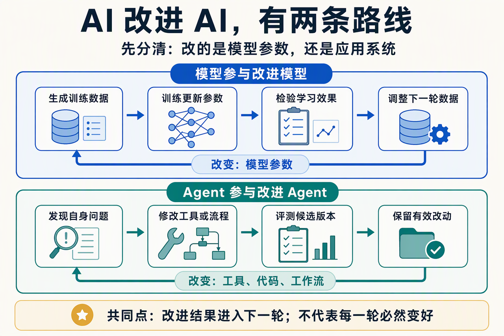
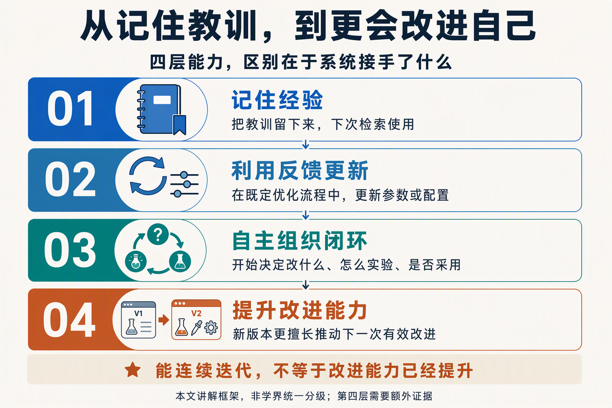
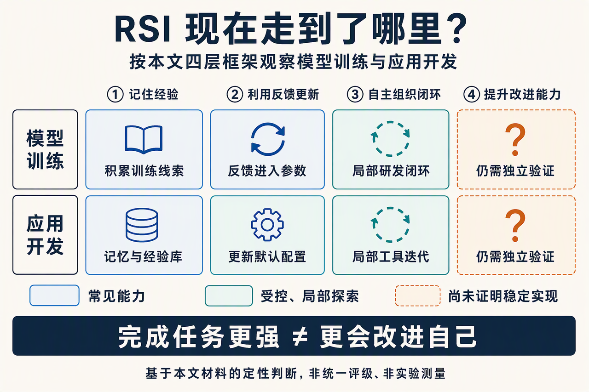
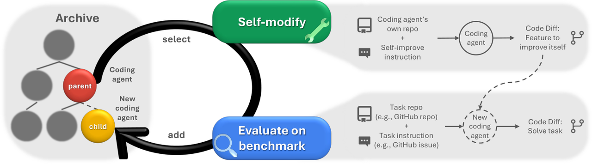
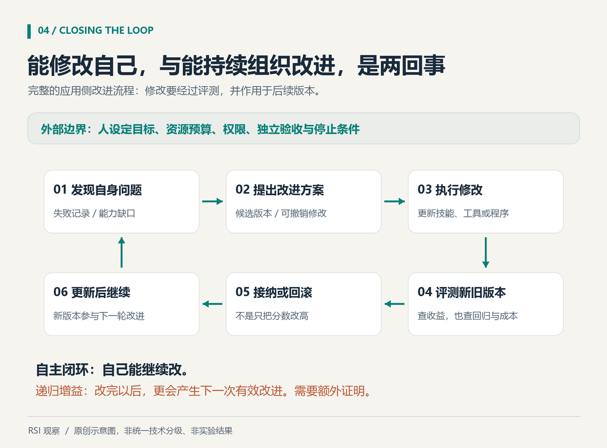

> **增补课时**　·　**学习指南与路线**　·　约 1 小时
> 同步自飞书原文 2026-10 更新：1.3 RSI 进展
>
> 学完标准：合上笔记，能讲清本节在问什么、你怎么答、以及如何套到自己的项目上。

---

### 1.3 RSI 进展

**前言**

最近（2026 年 10 月），有挺多朋友催我聊一聊 RSI：这个概念为什么突然这么热？AI 到底已经能自己改进自己了，还是大家又把一个遥远的设想讲成了现实？

RSI 的全称是 Recursive Self-Improvement，也就是“递归自我改进”。简单来说，就是 AI 利用现有能力改进自身，再由改进后的系统参与下一轮改进。

这并不是凭空冒出来的讨论。沿着“模型参与改进模型”和“Agent 参与改进 Agent”两条线，已经能看到一些更具体的尝试：

- **模型参与改进模型｜让模型学习“该给另一个模型出什么训练题”。** **2026 年 9 月 24 日**发布的论文 [《Self-Play Pretraining with Zero Data》](https%3A%2F%2Farxiv.org%2Fabs%2F2609.30063)，让两个模型从随机初始化开始共同学习：一个“生成器”模型编写程序，由程序产生训练数据；另一个“学习者”模型通过预测这些数据来更新参数。生成器再根据学习者当前的能力获得反馈，学习生成难度合适的数据，推动下一轮训练。直观地说，就是 **“模型生成训练数据 → 训练另一个模型 → 根据学习进展调整数据 → 继续训练”**。这展示了模型参与构建自适应训练课程的可能性。
- **Agent 参与改进 Agent｜不只修改用户的代码，也修改自己赖以工作的代码。** Sakana AI 与英属哥伦比亚大学团队的 [Darwin Gödel Machine（DGM）](https%3A%2F%2Fsakana.ai%2Fdgm%2F) 研究，论文[首发于 **2025 年 5 月 29 日**，最近一次修订于 **2026 年 3 月 12 日**](https%3A%2F%2Farxiv.org%2Fabs%2F2505.22954)。它让编程 Agent 修改自身的工具和执行流程，再用编程任务评估新版本；产生的版本进入候选库，后续迭代可以从这些版本继续分支，形成 **“Agent 修改自身代码 → 评估新版本 → 从已有版本继续改进 Agent”** 的链路。
这两个例子的区别很直观：**前者由模型参与生成训练数据，推动模型参数更新；后者由 Agent 修改自身代码，推动 Agent 系统迭代。** 这也是我们这个文章主要讲的两个思路，从模型和Agent应用两个路线来谈RSI。

*图 1｜两条自我改进路线：一条通过训练更新模型参数，另一条修改 Agent 的工具、代码或工作流。AI 生成示意图，用于解释本文概念，不代表具体实验结果。*

可以设想一下，如果这条路继续走下去，会是什么样子？在模型研发中，AI 不只帮忙写代码，还能参与准备训练数据、调整训练方案、运行实验和评估结果，再把有效的改进用于下一版模型。在 Agent 系统中，它也可能根据运行反馈，发现自身工具或执行流程的不足，修改代码、测试效果，把更好的版本保留下来，再用新版本继续改进。原本需要研究员和工程师不断推动的工作，就可能有越来越多的环节交给 AI 完成。

这也是 RSI 让人兴奋、又让人不安的地方。过去，我们更多是在问“AI 能替人完成多少工作”；现在，问题变成了“如果连研发更强 AI 的工作，也越来越多地由 AI 承担，会发生什么？”一旦改进能力本身能够持续提升，影响就可能不只是开发效率的提高：程序员的工作方式、软件团队的分工，乃至部分岗位的需求，都可能发生深刻变化。但从这些趋势直接推导出“软件开发岗位会消失”或“人类将被替代”，还缺少足够的依据。

相关研究不断推进，加上这件事潜在的巨大影响和一些巨头公司，自媒体的点火，RSI 的热度也就不难理解了。

**本文会讲清楚哪些问题？**

1. **概念：什么才算 RSI？**
1. **形态：从局部优化到持续自我改进，中间还有哪些层次？** 我们刚才谈到的模型，应用自己持续改进自己，不用人参与是理想的终极形态，但是从简单的RSI到终极形态，中间有哪些层次？
1. **进展：RSI 到底走到哪一步了？** 沿着应用开发和模型训练两条线，看看哪些环节已经形成闭环，哪些关键步骤仍然依赖人类。
1. **实践：对大模型应用开发有什么启发？** 哪些思路值得借鉴到自己的 Agent 项目中，让自己项目更新颖？
---

**💡 学习本篇内容，如何帮助你的面试？**

> **跟上行业热点，为项目找灵感，也为面试积累谈资。**

**① 聊热点，更有话可说**

RSI 是近期的热门话题。读完本文，当面试官聊起它时，你也能接得上话，而不只是听过这个名词。

**② 做项目，多一些灵感**

如果你正在构思自己的 Agent 项目，本文也能提供一些新思路，让项目设计更有特色，在面试中多一个亮点。

**③ 答开放题，多一些思路**

面对“现在如果让你做一个 Agent，你准备怎么做？（字节2026/10月秋招真题）”“你如何看待 Agent 的发展趋势？”这类开放性问题，本文可以为你积累回答素材，拓宽思考角度。

---

#### 1.3.1 什么是 RSI

RSI的英文名字是Recursive Self-Improvement，从英文名也可以看出有两个关键特性：Recursive（递归） Self-Improvement(自我改进)，理解了这两个词就理解了RSI。

**1. 自我改进：改的不是某个答案，而是系统自身**

平时我们让 AI 修改一篇文章、修复一个网站，它是在帮我们改进工作成果。自我改进关注的则是：**AI 能不能参与改进自己以后做事所依赖的能力和机制？**

比如说一次应用任务，Agent记录了处理问题的方式，发现不对，修改了提示词，下一次用新的提示词来完成。模型训练的时候，模型发现效果不改，改变了自己的训练参数，让下一次训练有更好的效果。这些都不是在改进任务本身，而是改进处理任务的方式，这样的改进就是大模型里面的RSI的自我改进的意义所指。

**2. 递归：改进后的系统，再参与下一轮改进**

只有一次改进，还不足以说明“递归”。RSI 更重要的一步，是让改进的结果重新进入改进过程：

> **当前系统 A₀ → 参与改进，产生 A₁ → A₁ 再参与改进，产生 A₂ → ……**

拿编程 Agent 来说，它先改进自己的代码编辑工具，得到一个新版本；新版本再利用改进后的工具，继续修改自身的其他功能。它不只是“被改好了”，还重新成为下一轮改进的参与者。

如果新版本不仅更会完成任务，也更擅长推动下一次改进，就进一步触及了 RSI 最受关注的可能性：**改进能力本身也在提升。** 不过，能连续迭代，并不意味着每一轮都会变好，更不意味着改进速度必然越来越快。这也是后面区分不同发展形态时，需要特别留意的边界。

---

#### 1.3.2 四层能力

提到 RSI，很容易直接想到“AI 完全不靠人，自己造出更强的 AI”。但在走到这种状态之前，系统已经可以接手一部分改进工作：先记住教训，再利用反馈更新，逐步把更多改进环节串起来。

为了方便理解，本文参考 [《这是一篇把“RSI”讲明白的科普级综述！》](https%3A%2F%2Fmp.weixin.qq.com%2Fs%2FrlfTKyWhALsNONhAwGih1A) 中关于 RSI 演进过程的讨论，按 **AI 接手改进工作的深度与自主程度**，重新整理成下面四层。需要说明的是，这不是学界统一的等级认证，而是本文作者根据相关讨论和行业发展现状整理出的讲解框架。下面分别用模型训练和应用开发举例，辅助说明这四个层次。

**第一层：记住经验——下次别再犯同样的错**

最简单的一层，不急着改模型或代码，先让有价值的经验留下来，供以后使用。可以理解为：**先给系统准备一本能翻阅的“错题本”。**

- **模型训练侧：** 模型分析自己答错的题，整理出“容易漏掉单位换算”“遇到多重条件时容易漏条件”等错误类型，保存为后续出题、筛选训练数据时的参考。这时只是积累了训练线索，还没有因此更新模型参数。
- **应用开发侧：** 一个数据分析 Agent 因为没有检查空值而执行失败。它把“统计前先检查缺失值”保存为经验，下次遇到类似任务时检索出来，加入上下文，而不是每次都从头试错。包括像自己沉淀SKILL，长期记忆的写入，这些内容其实就是已经蕴藏着RSI的思想了。
> 💡也就是说这一层的RSI是外化的，比如说Agent的长期记忆，如果文件丢了，那么改进就丢了。

**第二层：利用反馈更新——不只记下来，还改变以后怎么做**

再往前一步，系统开始利用反馈，更新模型参数、提示词或固定的执行策略，而不是仅在上下文里多放一条提醒。

- **模型训练侧：** 模型生成一批解题过程，按既定标准筛选出可靠样本，再由训练程序用这些样本微调模型。更新后的模型可以继续生成下一批样本。经验不再只存在“错题本”里，而是通过训练影响模型参数。
- **应用开发侧：** Agent 根据失败记录生成几个新版提示词，在固定测试集上比较效果，再把通过评估的版本写入产品的提示词配置或 Agent 驾具，作为后续任务的默认版本。也就是说，变化会持久地进入应用系统，而不是只存在于当前对话的临时上下文中；但它改的是应用层的配置，不是底层模型参数。
> 💡这一层的RSI是内化的，比如应用开发侧，发现了更好的提示词，我直接改变了这个应用的代码，下次编译出来的产品，本身就携带着这个优化后的提示词，自我改进内化到了产品本身。

**第三层：自主组织闭环——开始决定“改什么、怎么改、是否采用”**

它与第二层的真正区别，是系统接手了更上游的组织工作：在限定范围内，自己发现问题、选择改进对象、提出实验方案、安排测试，并根据结果决定保留、回滚还是继续探索。也就是说，第二层主要是在既定的优化流程中更新；第三层开始改进或重组这套流程本身。

> **第二层：人已经设计好“怎么优化”，AI 在流程中找一个更好的版本。**  

> **第三层：AI 开始参与决定“优化什么、怎么设计实验、下一轮往哪里走”。**

- **模型训练侧：** 系统发现模型在多条件推理上表现较差，自主提出调整训练数据配比或安排针对性练习，运行小规模训练实验，再用未参与训练的评测数据检查效果；通过验收的模型进入下一轮，并继续参与出题或实验方案生成。模型并不是直接“手改权重”，而是通过训练程序完成参数更新。
- **应用开发侧：** 编程 Agent 发现自己的代码编辑工具经常误改文件，于是修改工具实现、运行回归测试，保留有效的新版本；后续再由采用新工具的 Agent 继续改进自身。前言中的 DGM，就展示了这类修改自身代码、评估并继续迭代的链路。
> 💡第三层相比第二层，第二层是AI在人规定的框架中持续迭代，第三层是AI已经可以开始跳脱于人的框架，修改框架本身了。

**第四层：提升改进能力——不只更会做事，也更会改进自己**

前面几层即使已经连续产出更好的版本，也还需要回答一个问题：**新版本是否比旧版本更擅长推动下一次改进？**

这是递归增益的关键。下面两个例子描述的是需要验证的目标，而不是已经普遍实现的能力：

- **模型训练侧：** 新模型不只是答题分数更高，还能改进“如何改进模型”的流程：更准确地判断当前模型的主要瓶颈，选择更值得尝试的训练方案，设计对比实验，并根据结果决定下一轮应该继续哪个方向。
- **应用开发侧：** 新版 Agent 不只是更会完成业务任务，也能改进自己的“自我迭代流程”：更有效地发现自身缺陷，生成有区分度的修改方案，设计回归测试，识别评估结果是否可信，并决定哪些版本值得保留、哪些版本应该回滚。这里优化的是 Agent 如何发现问题、提出改动和筛选版本，而不只是某一次任务的执行效果。
**用一张表记住这四层**

*图 2｜先用图把握四层的核心区别，再用下表对照模型侧与应用侧的例子。这是本文的讲解框架，非学界统一分级；AI 生成示意图。*

层次

核心变化

模型训练侧的例子

应用开发侧的例子

**① 记住经验**

留下以后能用的教训

保存错误分析，供后续准备训练材料

保存失败复盘，下次检索使用

**② 利用反馈更新**

在既定机制中改变系统

按预设标准筛选数据并训练模型

按固定测试流程更新默认提示词

**③ 自主组织闭环**

开始决定改进对象和迭代流程

自主提出训练方案、运行实验并接纳新模型

自主选择修改工具或流程，测试后继续迭代

**④ 提升改进能力**

新版本更擅长改进“改进流程”

更有效地搜索和决策模型研发方案

更有效地发现缺陷、设计实验和筛选自身版本

> **一句话串起来：记得住教训 → 能利用教训改变自己 → 能组织自己的改进过程 → 连改进自己的本领也在提升。**

**本部分参考资料**

- [《这是一篇把“RSI”讲明白的科普级综述！》](https%3A%2F%2Fmp.weixin.qq.com%2Fs%2FrlfTKyWhALsNONhAwGih1A)
---

#### 1.3.3 行业进展

前面四层是一张判断地图。把它放回现实产品中，整体结论可以先说在前面：

> **不管是模型训练还是应用开发，行业能力目前主要集中在第二层，并在部分受控场景中出现第三层的局部闭环；第四层“改进能力本身持续增强”，仍主要停留在研究原型的探索阶段。**

*图 3｜把本文判断放回四层地图：常见能力、受控局部探索和尚待验证的递归增益。AI 生成示意图，仅整理本文论述，不是统一评级或实验测量，也不表示每个产品均具备相应能力。*

这里的层级判断，不看模型名称是否更新，也不看 Agent 是否能连续工作，而看公开资料是否证明系统接手了相应的改进职责：

- **第二层**：反馈能够进入参数、提示词、记忆、工具或工作流，形成持久变化；
- **第三层**：系统能够在限定范围内发现问题、选择改进对象、设计并执行实验，再决定保留或回滚；
- **第四层**：改进后的系统还要变得更擅长组织下一轮改进。
**1. 模型训练：第二层证据明确，第三层正在进入研发流程**

模型侧最典型的事实有三类。

第一，**反馈已经能够写入模型参数**。以 [DeepSeek-R1](https%3A%2F%2Farxiv.org%2Fabs%2F2501.12948) 为例，模型生成数学、代码和推理答案，程序或规则验证结果，再将奖励用于强化学习更新模型。这个“生成结果—自动验证—奖励反馈—参数更新”的闭环，直接对应第二层：模型不只是记录一次回答，而是把反馈写进下一版模型。

第二，**模型开始参与模型研发工作**。GPT 系列、Claude 以及相关 Codex 类系统已经能够承担更长的代码、实验执行和研究工程任务。Anthropic 关于 AI 参与自身研发的公开讨论，以及 OpenAI 关于研究加速的报告，都说明模型已经从“被训练的模型”进入“参与训练和研发的执行者”阶段。

这些事实说明，AI 在既定目标、评估标准和资源边界内，能够生成候选方案、运行实验并依据结果推进工作，因此在部分受控任务上出现第三层的局部能力。

但这里仍有明确边界：公开资料尚未证明 GPT、Claude 或 DeepSeek 能够稳定自主决定研究目标，改写整套模型研发流程，并让改进后的后继模型继续优化这套流程。模型性能变强，或者 AI 写了更多研发代码，都不能单独证明第四层。

**2. 应用开发：第二层已经产品化，第三层表现为局部的驾具闭环**

应用侧的代表性产品包括 Claude Code、Codex、DeepSeek Harness 和 Cue。它们公开展示的共同能力是：保存项目规则和任务经验，调用工具，修改代码或配置，运行测试，维护较长任务状态，并通过 Skills、Hooks、插件、工作流或多 Agent 协作扩展系统能力。

这些能力分别对应：

- **第一层**：记忆、项目文件、任务状态和工作空间让经验可以跨任务保存；
- **第二层**：经过验证的提示词、Skill、Hook、插件和工作流可以固化到应用系统中，成为后续任务的默认配置；
- **第三层的局部形态**：在限定的编程或自动化任务中，Agent 可以执行“发现问题—修改工具或流程—运行测试—保留结果”的闭环。
但这些产品的公开能力主要证明的是“Agent 能更稳定、更长时间地完成任务”，并不等于“Agent 会自主改进自己”。例如，Claude Code 和 Codex 可以在项目中修改代码并运行测试，DeepSeek Harness 可以通过插件、记忆和工作流扩展能力，Cue 可以让具有独立身份和工作空间的个人 Agent 持续处理事务；这些都说明应用层的驾具越来越丰富，但尚未公开证明它们会自主重写自己的核心驾具，评估改动是否提升了“自我改进能力”，并据此进入下一轮。

**3. 第四层：研究原型已有探索，产品还没有公开的稳定证据**

目前更接近第四层的代表，是 [Darwin Gödel Machine（DGM）](https%3A%2F%2Fsakana.ai%2Fdgm%2F)。它不是普通产品，而是一个受控研究系统：Agent 可以修改自身代码，用编程基准评估新版本，再从已有版本继续产生后续分支。它改进的对象已经不只是某个用户任务，而是 Agent 自身的工具和工作方式。

DGM 因此比通用产品更接近第四层，但仍不能直接宣布“第四层已经实现”。还需要在独立任务、固定资源、多个后继版本和循环外评估中证明：新版本不仅表现更好，而且确实更擅长发现、设计和验证下一次改进。

*图 4｜DGM 的自修改与评测循环：从版本库中选择 Agent，修改自身代码，评测后将新版本加入版本库。来源：Darwin Gödel Machine 论文 Figure 1，原图沿用目录内已保存素材，非 AI 生成；该图不单独证明第四层已经实现。*

**4. 当前瓶颈**

行业还没有进入开放式 RSI，主要受以下问题限制：

1. **研究目标仍由人设定**：系统能执行“把模型训得更好”，但还不能稳定决定“下一步应该研究什么”。
1. **评估器可能被利用**：同一系统同时生成答案、奖励和版本选择，容易把指标做高，却没有真正变强。
1. **实验成本仍然很高**：模型训练、长时间 Agent 运行和真实环境验证都需要大量算力、时间和权限。
1. **泛化能力不足**：固定测试集上的提升，不代表对未见任务有效，更不代表改进能力本身提升。
1. **复杂度和安全风险会累积**：自我修改可能带来行为漂移、权限扩大、死代码、评估污染和难以回滚的问题。
因此，目前最稳妥的判断是：

> **第二层已经成为模型和应用产品的常见能力；第三层正在以受控、局部的形式进入工程实践；第四层还主要是研究问题。行业已经出现有界的自我改进闭环，但尚未证明改进后的系统能够稳定地、开放式地改进“改进本身”。**

---

#### 1.3.4 项目启发

看完了上述内容，我让AI帮忙结合现在的Agent产品，总结一些我们也可以加入到自己项目当中的，具有一些RSI相关特质的一些功能。我们不妨想想，我们能不能按这个思路，在自己的Agent特性中加入一点点RSI的特质，并且在简历上写自己的Agent具备RSI的特点，这样简历项目看上去会不会更有含金量呢？

**1. 自我沉淀：把做对的任务变成下次能调用的 Skill**

Agent 完成一类有复用价值的任务后，可以把操作步骤、适用条件、输入输出和注意事项整理成 Skill；经过测试和审查后加入技能库，下一次遇到类似任务时按需调用。重点不是“自动写了一份文档”，而是这份经验能否稳定改善后续任务。

**2. 自动探索提示词：不是觉得写得更好，而是测出来更好**

Agent 可以根据执行结果和失败原因生成多个提示词候选，再在验证集上比较效果。例如，信息抽取 Agent 反复把“未披露”填成“0”，就可以提出“缺失信息必须保留为空，并附上原文证据”的候选指令。但新提示词必须经过跨样本评估，不能因为修好一个例子就直接发布。

**3. 长期记忆：让用户纠正真正影响下一次任务**

长期记忆属于第一层能力，但它是实用的起点。应区分用户偏好、项目规则、任务事实和失败经验，记录来源、时间和适用范围，并允许用户查看、修改和删除。记忆不是越多越好，错误或过时的记忆会反过来污染后续任务。

**4. 工具和驾具的可修改性：让 Agent 有机会改进自己的工作方式**

如果工具、提示词和工作流全部硬编码在系统内部，Agent 很难参与改进。可以把这些部分模块化，让 Agent 在权限边界内提出配置或代码变更，再通过静态检查、回归测试和人工审批决定是否启用。

**5. 失败驱动的局部优化：先优化一个窄环节**

不要一开始就追求“Agent 自己重写自己”。更稳妥的做法是选择一个可度量的局部问题，例如工具调用失败率、结构化输出通过率或代码测试通过率，建立“收集失败样本—提出候选改动—离线比较—小范围发布”的闭环。

**6. 经验库要会做减法**

长期运行后，技能、规则和记忆会重复、过时甚至互相冲突。可以定期合并重复内容，标记失效规则，把长说明拆成按需检索的参考资料；删除或替换前保留版本，并检查相关任务是否退化。自我改进不应等于无限堆积历史。

**7. 持续执行与主动复盘：不用每次都等用户提醒**

定时运行日报只是自动化；定时分析失败、提出改动、验证后更新系统，才是在自动化之上建立自我改进流程。可以安排 Agent 周期性整理失败样本，生成改进提案，但最终采用仍应经过明确的评估门槛。

**8. 多 Agent 分工：把执行、复盘和验收适当拆开**

可以让执行 Agent 处理业务，复盘 Agent 整理问题，优化 Agent 提出候选方案，而独立的程序或规则负责验收。换一个 Agent 当裁判，不等于裁判就可靠；评估器应尽量不允许候选版本随意修改，并保留人工抽检和回滚机制。

**9. 验证与版本选择：让改进真正进入下一轮**

完整闭环应当是：发现问题，提出改动，评估候选版本，保留有效结果，再由采用了改动的新版本处理后续任务。对同一批评估任务比较旧版与候选版，记录成功率、成本、耗时和安全违规情况；通过门槛后再小范围启用，退化则恢复旧版。用于优化的样本和最终验收样本应当分开。

*图 5｜可以借鉴到 Agent 项目中的有界改进闭环。沿用已有原创示意图：先验证改动是否有效，再决定采用或回滚；能够持续迭代，不等于已经证明递归增益。*

---

#### 1.3.5 面试问答

**❓ 1. 你知道什么是RSI吗？聊聊你的看法？**

**💡 答题思路：**先介绍概念，再从**模型和应用侧**举例举例这个概念-再讲一下**四层能力**-最后结合现有产品讲行业现状-最后展望未来。

**🎤 参考答案：**

我理解的 RSI，就是**递归自我改进**：AI 利用现有能力改进自身，再由改进后的系统参与下一轮改进。

在大模型方向，它主要体现在模型训练和 Agent 运行系统的迭代上。模型侧可以利用反馈改进训练数据和方案，通过训练更新参数；应用侧则可以优化提示词、工具或工作流，不一定需要重新训练模型。

为了方便理解，我会把它分成四种程度：首先是记住经验，下次能够复用；其次是根据反馈更新系统，改变以后的默认做法；再进一步，是自主发现瓶颈、设计实验、筛选版本，组织自己的改进过程；更进一步，是改进能力本身也提升，越来越会发现问题和验证方案。

成熟产品目前更多体现前**两种能力**。比如** Claude Code 的自动记忆、Codex 的技能复用**，体现经验积累；模型侧，DeepSeek-R1 利用强化学习，根据答案的验证反馈更新参数，体现反馈驱动的能力提升。但是对于改变组织自己的方式，提升自己改进系统的能力，这些特性，目前还体现在研究层面。例如 DGM 让 Agent 修改自身代码、评估新版本，再继续迭代，展示了受控环境中的自主改进，但是目前投入生产使用的Agent并没有体现出相关特质。

我认为这些的主要瓶颈是评估是否可靠、提升能否泛化，以及实验成本和自我修改风险。这也是未来模型侧和 Agent 侧需要继续突破的方向。

**❓ 2. 你认为Agent发展的新的形态，或者说未来的趋势是什么？**

**💡 答题思路：** 开放性问题，我们可以使用我们笔记里讲的2026年Agent新特性，结合最近发布的Agent来谈近期趋势，然后结合RSI的特性来回答长远的趋势。二者结合，组成这个答案。

📎 参考：[笔记「1.2 2026年 Agent 新形态」](https://my.feishu.cn/docx/GikId1snboM6LyxxGPXc0kDdnub#doxcnbcZcXGOZo3DXukTULZ5Rmc)，其中[「1.2.1 四款代表产品」](https://my.feishu.cn/docx/GikId1snboM6LyxxGPXc0kDdnub#doxcnoFTBQEjZG6AIlelJqlm4jN)介绍了 dots、Cue、Muse 和 Grok Bot。

**🎤 参考答案：**

我会分**近期产品形态和长期能力**演进两个层面来看。

近期，从最近26年发布的Agent, dots ,Cue等等，他们一些共同特点比如** 添加持续的云端环境**，用户关闭电脑后，已委托的任务仍能继续推进；**主动跟进**，不再每一步都等用户催，而是按时间、事件启动，或根据上下文提出下一步，比如 Grok Bot 把销售拓展设置成每周例行工作；**跨任务记忆**，记住多个项目的进度和用户偏好，减少重复交代。**开箱即用**，产品替用户承担更多部署和配置工作，比如 Cue 把邮件、电脑、自动化和记忆放进同一个助手配置界面。 让我看出近期Agent发展的**形态趋势**： **更加注重完成长时持续任务**，**降低Agent的使用门槛**。

长期演进来看，我觉得Agent发展会 Agent **从执行任务，走向自主改进自身的工作方式，实现RSI的特性**。它不再只是按照人设定的流程优化，而是**自己发现能力瓶颈，判断优先改哪里，提出方案、设计实验**，再根据结果决定保留还是回滚，并由新版本继续下一轮迭代。更进一步，**它提升的不只是业务能力，还有改进自己的能力**：能更准确地定位问题，用更少的实验找到有效方案，在相同资源下推动更高效的下一轮改进。最终不用人的干预，也能不断地进化，衍生出更强的能力。

#### 1.3.6 讲解视频

https://www.bilibili.com/video/BV14anA66Eo4/?spm_id_from=333.1387.homepage.video_card.click&vd_source=144bec9c3f54e465073138bed788be1b

---
