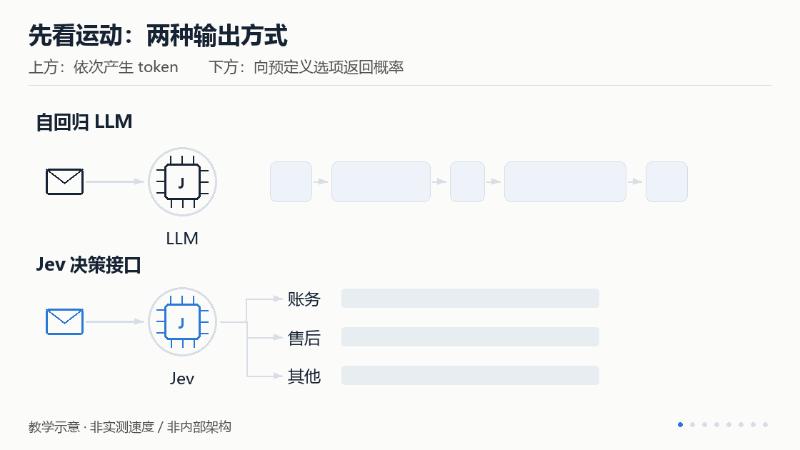
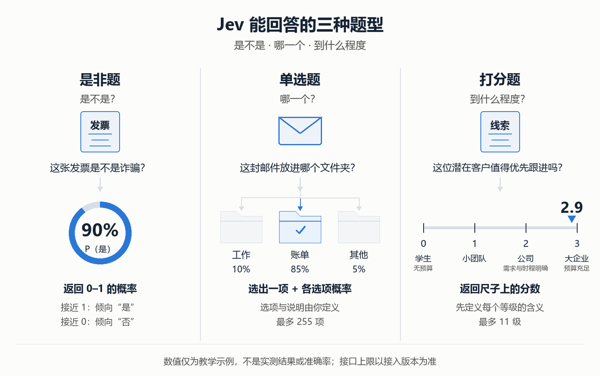
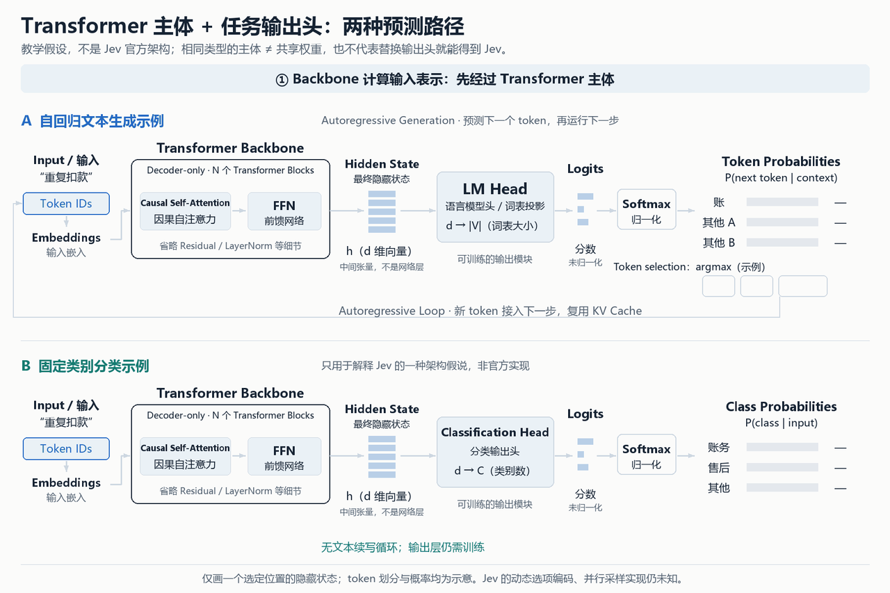
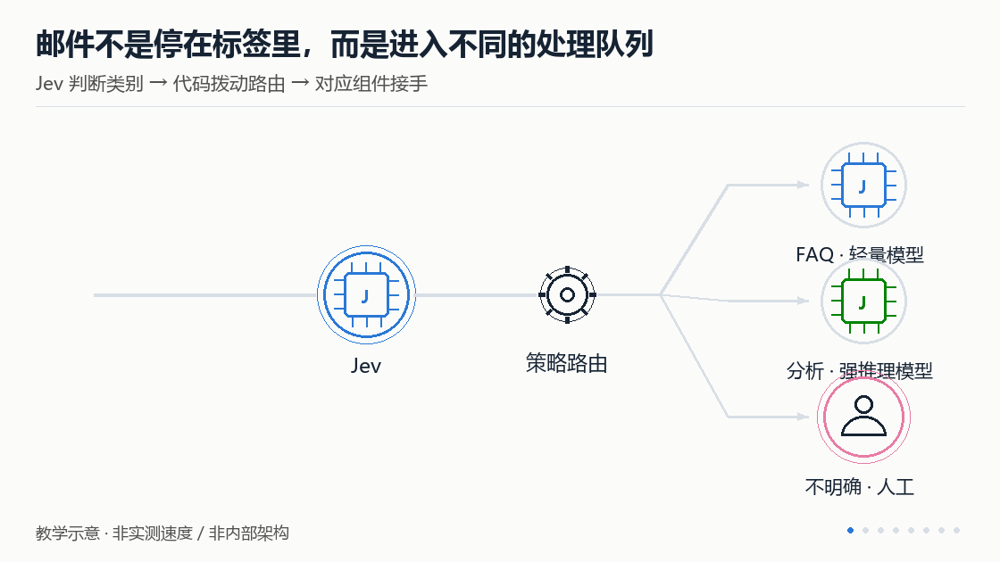
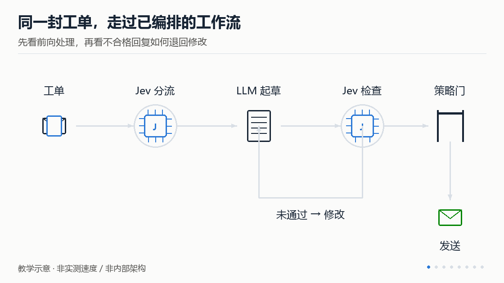

> **课时** 25/132　·　**LLM 模型结构**　·　约 50 分钟
> [上一课：7. 不同模型的对比和选择](04-7. 不同模型的对比和选择.md)　·　[下一课：RAG · 4. 常见的向量数据库](../03-RAG/01-RAG · 4. 常见的向量数据库.md)
>
> 学完标准：合上笔记，能讲清本节在问什么、你怎么答、以及如何套到自己的项目上。

---

#### 7.3.2 Jev ：面向软件的快速概率决策模型

Jev是2026年9月份快速火起来的一个模型，如我们一直说的，大模型圈，爆火的内容你不能不会。面试几乎一定会问到。所以2026年9月份，面试前，建议学习一下Jev。 大家也不用担心学不过来，最开始我们只要先理解最基本的内容，最简单的面试问题就够了。如果他持续爆火，我们再深入学习。

这一期视频我就总结的内容都是Jev最核心的内容：**是什么，特点，设计理念，使用方式，技术架构和面试真题**，希望大家可以用1小时的时间，结合视频和文档快速理解Jev是什么，如果后续面试对Jev的考察持续加深，我们也会持续跟进的。

##### 7.3.2.1 概念：Jev 是什么

###### 7.3.2.1.1 和 Opus、GPT 最大的不同

**Jev 是 TypeSafe AI 推出的一个决策模型。** 和我们熟悉的 Opus、GPT 系列相比，它不是为了写出一段回答，而是为了快速回答软件中的具体选择题。

Opus、GPT 这类模型的典型文本生成方式是**自回归生成**：根据输入和已经生成的内容，预测下一个 token（next-token prediction），再把新 token 接到上下文后面，继续预测，直到回答结束。哪怕要求只返回一个分类标签，典型生成接口也会把它作为 token 序列输出。

Jev 则要求你先定义问题和允许的结果。例如，给它一封邮件，再给出“账务、售后、技术支持”三个选项，它返回类别及对应概率，而不是逐 token 写一段解释。这种方式的定位是**并行采样的、有类型约束的概率决策**；底层架构尚未完整披露。

简单说：**通用 LLM 擅长“组织和生成答案”，Jev 专注于“在定义好的结果空间里做判断”。** LLM 也能分类、返回结构化结果，区别不在于谁能输出 JSON，而在于模型针对什么任务优化。



*动图 1：观察逐 token 输出与返回选项概率的差异。动画是接口行为示意，不表示实测速度或已知的内部计算步骤。*

###### 7.3.2.1.2 为什么能火：把高频小决策做得快、做得便宜

我们常用 Opus、GPT 做分析、写代码，也会通过 Claude Code 这样的工具完成多步骤任务。但如果只是给上千封邮件分类，关心的往往不是能否写出精彩解释，而是**多久处理完、花多少钱、标签是否可靠**。这里 Claude Code 是应用，Opus、GPT 是模型，不能把两者当作同一层级的基准对象。

一次千封邮件分类演示中，处理 **1,000 封邮件**时，Jev 初版流程耗时 **70 秒、费用 $0.09**，对照模型 Luna 约需 **5 分钟（300 秒）、$0.62**。按这组数字计算，Jev 的处理速度约为 Luna 的 **4.3 倍**，**耗时减少约 76.7%，调用成本降低约 85.5%**。

调整后端并行和请求组织后，Jev 又做到 **6 秒、仍为 $0.09**：相较于上述 Luna 流程，批处理速度约为其 **50 倍，耗时减少约 98%，调用成本仍降低约 85.5%**。其中，50 倍包含了工程优化的贡献，并非同等配置下的模型速度对比；对照模型可核验的完整 ID 尚不明确，不能直接把数字改写成“比 Opus／GPT 快多少倍”。

其他演示包括**实时玩 Doom、让 50 个小镇居民在约 0.6 秒内完成一轮决策**。这些演示吸引人的地方，是把原本需要等待的模型调用，变成游戏或业务流程中可以频繁发生的一步。70–500 ms 的响应范围属于待按任务和配置验证的性能指标，并非任意负载下的延迟保证；加上创始人发布帖接近 3,000 万次浏览的热度，“快速、低成本决策”就成了它传播的核心卖点。

**因此，它的看点不是全面胜过 Opus、GPT，而是在分类、路由等窄任务上提供另一种速度与成本选择。** 上述演示缺少完整的同条件准确率测试，不能由“更快”推出“更聪明”或“不会判断错”。

###### 7.3.2.1.3 能做什么，不能做什么？

**通用大模型像在写申论题，Jev 则是在回答事先设计好的题目。** 它能回答的主要是三种：**是非题、单选题、打分题**，对应“是不是”“哪一个”“到什么程度”。

**第一种，是非题：问“是不是”。** 给它一个命题，它返回 0 到 1 之间的概率，越接近 1 越倾向“是”，越接近 0 越倾向“否”。例如，问“这张发票是不是诈骗？”，它可能返回 90%。程序再根据这个概率和业务规则决定是否转人工检查。概率是模型的判断，不是事实保证；阈值也需要按业务验证，不能直接照搬示例。

**第二种，单选题：问“哪一个”。** 先列出候选选项，Jev 从中选出最合适的一项，同时返回各选项的概率。选项及说明由你定义，选项上限为 255 项，实际以接入版本接口为准。例如，自动整理信箱时，先定义文件夹及其收录规则，再让 Jev 判断每封邮件应归入哪个文件夹。

**第三种，打分题：问“到什么程度”。** 有些事情不适合只分“是”或“否”，需要先定一把尺，写清楚从低到高每一级的含义；评分最多可分 11 级，实际以接入版本接口为准。例如筛选潜在客户：0 分是没有预算的学生，1 分是小团队，2 分是有明确需求和时程的公司，3 分是预算充足的大企业。某条大企业咨询可能得到 2.9 分，程序就可以按预设规则，将高于 2.5 分的线索优先通知业务主管。**这里的 2.9 是程度分数，不是概率。**



**对于这类高频、简单、答案范围明确的判断，动用昂贵的通用大模型，往往有些“杀鸡用牛刀”。** Jev 的价值是把这些小决策做得更快、更便宜：上述千封邮件分类演示中，耗时从对照模型的 5 分钟缩短到 70 秒，成本从 62 美分降到 9 美分。在一个技能选择案例中，加入 Jev 预筛选后，错误率从 17% 降到 7.3%。这说明专门化方案在特定任务上也可能更准，但该案例缺少完整评测条件，不能据此说 Jev 在三类任务上的准确率都“秒杀”大模型。

**Jev 的出发点是：软件不总需要一个会长篇思考的助手，很多时候只需要一个快速、可靠的判断。** 因此，它不以更长的思考链和更强的通用推理为主要目标，而是面向高频决策，优化延迟、成本和概率的可靠性，返回程序能直接使用的结果。可以用 System 1（快速、直觉式判断）对比 System 2（审慎推理）来理解这一定位；这是设计比喻，不是模型架构的划分。

这种设计也带来明确的取舍：**把更多流程设计留给开发者，把运行时的局部判断交给模型。** 开发者定义问题、候选结果和流转规则，Jev 根据当前输入判断，程序据此选择分支。与大模型驱动的 Agent 在运行时规划、调整过程相比，这种方式需要更多前期编排，但在流程相对确定的任务中，有望换来更低的运行成本和更强的可控性。

**但快判断不等于强推理，Jev 也无法替代 LLM 的开放式生成能力。** 需要多步推理、复杂分析、方案构思，以及写文章、总结内容、生成代码时，仍应交给通用大模型。快棋场景就能说明这点：Jev 即使凭响应快让对手超时，也不代表棋力更强；客服场景也一样，它能判断工单该转给谁，但最终安抚客户的回复仍需大模型来写。两者应当分工：**Jev 负责快速判断，大模型负责推理和生成，程序负责执行。**

---

##### 7.3.2.2 技术实现：已知边界与 RLCD

###### 7.3.2.2.1 模型架构：尚未公开

**TypeSafe AI 尚未公开 Jev 的完整网络结构，无法确认它是否基于 Transformer，也不知道参数规模和具体输出头设计。** 已公开的技术描述包括新模型架构和并行采样器，但不足以还原其内部实现。

一种推测是：**Jev 仍用 Transformer 处理输入，但不让模型接着写文字，而是由专门训练的输出层直接计算类别概率或分数。** 例如，输入一封邮件后，直接返回“账务 90%、物流 10%”，而不是逐步生成“这是一封账务相关的邮件”。这种做法不要求把模型改成 Encoder-only；保留 Decoder-only 的主体结构，也可以通过训练专门的分类输出层来实现。



*架构动图：用 Decoder-only 作为共同的教学例子，不表示 Jev 已确认采用该结构，也不表示两者共享权重。下方仅展示固定类别分类；动态选项如何编码、并行采样如何工作仍未知。*

**注意：这个是一个架构的推测哈，因为现在Jev的架构尚未披露，上图和下面文字都是推测！**

看图时跟随上方蓝色、下方绿色光点：**两条路径都先经过 Transformer Backbone（主干网络），得到 Hidden State（隐藏状态），再进入不同的任务输出头。** 隐藏状态是计算得到的中间张量，不是独立的“表示层”；图中仅画出一个选定位置的 d 维向量。

上方的 **LM Head**把隐藏状态映射为词表 Logits（未归一化分数），再经 Softmax 转为下一个 token 的概率。图中用 argmax 选择 token 作示例，选出的 token 经 Autoregressive Loop（自回归生成循环）接入下一步，直到遇到结束标记。生成会复用已有 KV Cache，不是每一步重算完整输入。

下方的 Classification Head（分类头）把隐藏状态映射为固定类别的 Logits，再经 Softmax 得到类别概率，返回结果后结束。**两条路径都有分数和概率，区别是预测 token 还是预测类别，以及是否继续运行文本生成循环。**

所以，推测中省去的是**逐 token 生成的循环**，不是把 Decoder 模块删掉。输出头需要训练，不能把现有 LLM 的输出层随意替换就得到 Jev；这也不能证明其实际推理只需一次前向计算。

（以上内容，应用开发的同学看不懂算了。抓住最核心的就行：**推测Jev也是基于Transformer结构做的，但是网络改变了自回归生成形式，不用循环生成，而是一次预测最终的概率**。）

###### 7.3.2.2.2 后训练：RLCD 与 RLHF 有什么不同？

**Jev 的核心训练方向是 RLCD（Reinforcement Learning for Calibrated Decisions），即“面向校准决策的强化学习”。** 它的重点不只是让模型选对答案，还要让输出概率准确表达不确定性，便于软件据此做决策。

我们熟悉的 **RLHF（Reinforcement Learning from Human Feedback）**，通常先收集人类对不同回答的偏好，再通过奖励模型等方式指导策略优化，使回答更有帮助、更符合人的要求。**RLCD 则把优化重心放在决策结果和概率校准上：不仅问“选得对不对”，还问“给出的概率是否可信”。** 前者侧重人类偏好反馈，后者强调校准目标，两者并非互斥，也不能简单理解为 RLCD 完全不使用人类反馈。

**RLCD 最值得关注的创新方向，是把后训练的重点从“人更喜欢哪个回答”，转向“软件能否依据预测概率采取行动”。** 例如，程序可以结合误判成本，决定自动处理还是转交人工。不过，其具体奖励函数、训练数据和策略更新算法尚未公开；目前能明确的是训练目标，不能把它写成已知的完整算法，也不能由此推导出“零错误”或“零幻觉”。

---

##### 7.3.2.3 使用方式：分类路由与工作流节点预测

下面的两种模式是**应用架构模式**，不是 Jev 提供的两个独立产品。

###### 7.3.2.3.1 模式一：先分类，再交给合适的大模型处理

这一模式把 Jev 放在较昂贵的生成或推理步骤之前。

```
用户请求 / 邮件 / 内容
        ↓
Jev：分类、评估复杂度、识别处理要求
        ↓
策略代码：选处理分支与模型
        ↓
便宜模型 / 强推理模型 / 专用工具 / 人工审核
        ↓
生成回答或执行任务

```



*动图 4：跟随编号 1、2、3 的邮件，观察它们如何在路由处分道，进入不同下游。颜色之外也保留编号和终点标签；实际分支由代码策略控制，Jev 不自动拥有执行权限。*

典型例子是客服：

- 简单 FAQ → 经过验证的知识库检索与轻量生成流程；
- 账务争议 → 账务专用流程，需要时由更强模型整理证据；
- 明确要求人工 → 进入人工队列；
- 无法可靠判断 → 回退到更强模型、澄清或人工。
也可以让 Jev 在一个工具目录中选择候选工具，再由下游组件构造参数。**工具选择不是完整 function calling**：选择 `refund_lookup`，并不等于已正确提取 `order_id`、完成鉴权或调用工具。

###### 7.3.2.3.2 模式二：提前编排工作流，只在关键节点让模型预测

这一模式由开发者规定状态与流转规则，Jev 负责原本难以用纯规则完成的语义判断。

```
新工单 → 补齐上下文 → Jev 分类 → 代码路由
                              ↓
                  查账 / 收集证据 / 提交人工
                              ↓
                      通用模型起草回复
                              ↓
                  Jev 检查语气、覆盖度等
                              ↓
              硬规则校验 + 权限检查 + 审批策略
                              ↓
                      发出回复 / 退回处理

```



*动图 5：同一份文档沿固定路径前进，第一次检查未通过时退回修改，之后仍需经过独立策略门才能发送。回退路线由程序预先设计，不是 Jev 自己生成工作流；模型检查也不是完整安全保证。*

“分类—路由—生成—检查”的设计可以覆盖识别退款诉求、紧急程度、客户情绪，以及检查回复是否回应问题、是否泄露内部规定等节点。

与通用自主 Agent 的主要区别是：

**预先编排的工作流 + Jev**由开发者定义允许的状态与转换，模型只负责当前节点的具体判断。其可控性来自显式策略、类型、权限和状态机，适合稳定、重复、结果空间可定义的任务。

**开放式 Agent**则可能由模型动态形成计划和路径，并承担规划、选工具、构造参数、解释结果等职责。它依赖 Agent 框架、工具约束和运行时治理来保持可控，更适合路径难以事先穷举的探索性任务。

**我相信这个对我设计项目是一个新的启发，之前我们很多人设计的项目都有，**用一个主Agent做思考，判断，分类给不同的Agent去做。现在我们可以思考的一点，用一个Agent(LLM) 去做一个简单的分类任务，是不是从速度，成本，准确性上都不如Jev模型，是属于大炮打蚊子。我们是否可以在我们的架构设计中，使用Jev来做这种分类的决策？

---

##### 7.3.2.4 面试问题

###### 7.3.2.4.1 最近很火的 Jev 模型你看了吗？谈谈你的理解。

💡 **答题思路**
从**Jev是什么（模型）**，相比于普通LLM的**核心和特点**（设计理念，速度，花费）对比，对我们的**设计启发**（对于很多分类，判断，评分问题可以用Jev，而不用llm)

📝** 参考答案**

看过相关资料。我的理解是，Jev 是一个面向软件自动化的决策模型，不是另一个聊天模型。它主要解决分类、是非判断和评分问题，比如工单该交给哪个部门、邮件是否紧急。它的重点不是写一段回答，而是根据预先定义的问题，输出程序可以直接使用的判断结果和概率。

它和通用 LLM 的区别，我觉得主要在优化目标。通用 LLM 强调生成、推理和开放式任务，Jev 则专注高频、结果范围明确的小决策，追求更低的延迟和调用成本。传统 LLM 当然也能分类，但只是判断一封邮件的类别，就调用昂贵的推理模型，可能没有必要。

它给我们带来的分工思路：简单的语义分类、判断和评分，可以考虑交给 Jev；复杂分析和内容生成，仍然交给通用模型。这个思想可能会对我们的工作模式，项目设计会带来很大的改变，今后可能会大量运用在我们的生活中。

###### 7.3.2.4.2 Jev 模型对于你的工作有什么启发？

💡** 答题思路**
可以从项目设计的角度来回答一下，之前没有Jev的时候，我们的设计：会思考确定性的东西用代码来做，不确定的东西用llm做。现在设计项目我们可以从三点出发：**什么时候用代码做，什么时候用jev做，什么时候用Llm做**，以及再谈谈上面讲到的jev的两种使用方法。

📝** 参考答案**

它对我最大的启发，是项目设计时可以把任务分得更细。以前我们常说，确定性的逻辑用代码，不确定的语义问题交给 LLM。现在我会进一步区分：需要理解语义，但答案范围明确的任务，不一定要用通用大模型。

具体来说，**规则校验、计算和权限控制，优先用代码**；**工单分类、紧急程度判断、内容评分，可以考虑 Jev**；**复杂推理、方案规划和回复生成，仍然交给 LLM**。不是为了用新模型而增加组件，而是给每个任务选择合适的实现方式。

在用法上，我会考虑两个方向。**第一是前置路由**，让 Jev 先判断请求类型和复杂度，再由代码把请求分给轻量模型、强推理模型或人工，避免所有请求都调用最贵的模型。**第二是在预先编排的工作流里承担局部判断，**比如客服流程中，先判断诉求和紧急程度，再由 LLM 起草回复，最后用 Jev 检查回复是否覆盖问题、语气是否合适。真正发送仍由代码和审批规则控制。

这两种方式可以组合。我的核心思路是把判断、生成和执行分开，再用业务评测验证收益；对于不确定或高风险的结果，保留人工复核。

##### 7.3.2.4 讲解视频

https://www.bilibili.com/video/BV15zah6fEWq/?spm_id_from=333.1387.homepage.video_card.click&vd_source=144bec9c3f54e465073138bed788be1b
