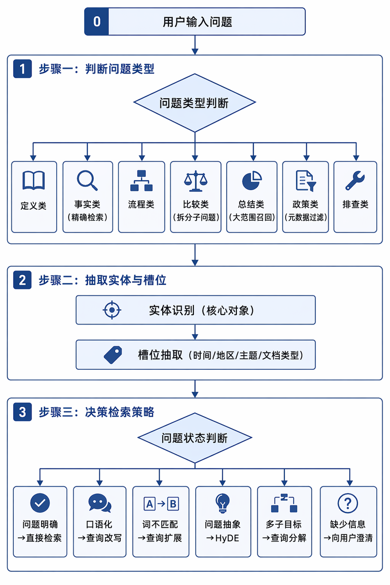
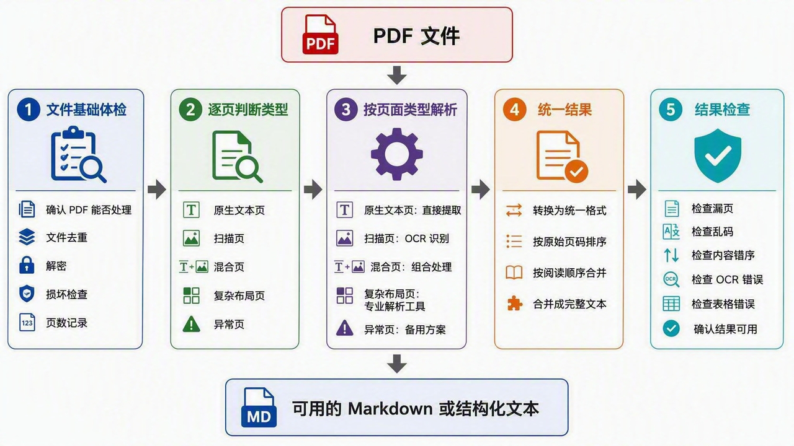

> **课时** 27/132　·　**RAG 八股**　·　约 50 分钟
> [上一课：RAG · 4. 常见的向量数据库](../03-RAG/01-RAG · 4. 常见的向量数据库.md)　·　[下一课：5.3 切割 · 5.3.3 分块选型技巧和原则](../03-RAG/03-5.3 切割 · 5.3.3 分块选型技巧和原则.md)
>
> 学完标准：合上笔记，能讲清本节在问什么、你怎么答、以及如何套到自己的项目上。

---

### 5. RAG的重要步骤 

参考视频

[嵌入内容](https://www.douyin.com/video/7522119790514998591)

---

#### 5.1 意图识别

意图识别位于 [RAG全局总览](https://my.feishu.cn/docx/GikId1snboM6LyxxGPXc0kDdnub#doxcn9RRtHvEfD8vCVdmb6U5ite)的第3，4（图中橙色的部分）

**是什么？**

意图识别位于 RAG 的检索前处理阶段，核心作用是先理解用户到底想问什么，再决定后面应该如何检索。它不是简单给用户问题打一个分类标签，而是要把用户的自然语言问题转成后续 RAG 可以执行的检索计划。

在实际场景中，用户的问题经常是不完整、口语化、依赖上下文的。比如用户问“这个怎么申请？”“它和那个有什么区别？”如果直接把原句送进向量数据库，很容易召回错误内容。因此在正式检索前，系统需要先判断用户的真实意图、问题中的关键对象、时间地点等限制条件，以及这个问题是否需要先澄清。

**怎么做？**

意图识别通常会做三件事。

第一，**判断用户的问题类型**。比如用户是在问定义、查事实、问流程、做比较、要总结、查政策，还是排查问题。不同类型的问题适合不同的处理方式：事实类问题通常适合精确检索，比较类问题适合拆成多个子问题，总结类问题需要召回更大范围的上下文，政策类问题则通常需要结合地区、时间、政策类型等元数据过滤。

第二，**抽取实体和槽位**。实体是用户问题中真正关心的对象，槽位是检索时需要用到的限制条件。例如“2024 年上海人才补贴怎么申请？”中，主题是“人才补贴”，地区是“上海”，时间是“2024 年”，问题类型是“申请流程”。这些信息可以直接用于过滤文档集合，避免在整个知识库里盲目检索。

第三，**决定检索策略**。如果用户问题已经明确，可以直接检索；如果问题表达口语化或依赖上下文，可以先做查询改写；如果用户用词和文档用词可能不一致，可以做查询扩展；如果问题比较短、抽象，可以用 HyDE 生成假设性文档辅助召回；如果问题包含多个子目标，可以进行查询分解；如果缺少关键信息，就应该先向用户澄清，而不是强行检索。

比如用户问“这个怎么申请？”，如果上一轮正在讨论“上海人才租房补贴”，系统就可以把它改写成“上海人才租房补贴怎么申请？”再检索。如果没有上下文，系统就应该追问“你想申请的是哪类事项？比如人才补贴、项目申报、发票报销，还是其他业务？”这就是意图识别在多轮 RAG 中的价值：能补全的自动补全，不能确定的先澄清。



在工程实现上，可以用规则、小模型分类器，也可以直接用大模型做结构化理解。现在**更常见的方式是让大模型输出一个结构化结果**，例如：

```json
{
  "intent": "policy_query",
  "entities": ["人才补贴"],
  "filters": {
    "region": "上海",
    "year": "2024"
  },
  "needs_clarification": false,
  "route": "policy_knowledge_base",
  "retrieval_strategy": "metadata_filter",
  "rewrite_query": "2024年上海人才补贴政策的申请条件、补贴标准和办理流程是什么？"
}
```

这个结果比单纯输出一个 `policy_query` 更有用，因为它可以直接驱动后续流程：`intent` 决定问题类型，`filters` 用于元数据过滤，`route` 决定去哪个知识库，`retrieval_strategy` 决定是直接检索、改写、扩展、HyDE、分解还是澄清。

**如何判断意图识别做得好不好？**

我们需要从意图分类，槽位抽取，是否需要澄清，路由是否正确这几个维度来综合评估。

**意图分类**可以看 整体准确率、精确率、召回率、F1；

**实体和槽位抽取**可以看 Slot 精确率、Slot 召回率、Slot F1；

**是否需要澄清**可以单独看澄清判断的准确率和召回率；

**路由是否正确**可以看 Route Accuracy；

最终还要看加入意图识别后，正确文档**是否更容易进入 Top-K，答案准确率是否提升。**

> **指标释义**：**❗如果还不明白就问AI，都是标准指标，也确实有点难绕。**
>
> **整体准确率 (Accuracy)**：所有判断里预测对（包括对和错两类判定都对）的样本占总体的比例。
>
> **精确率 (Precision)**：模型预测为“是”的结果里，真正正确的比例（主要防误报、防乱判）。
>
> **召回率 (Recall)**：在实际为“是”的所有样本中，模型成功找出来多少的比例（主要防漏报、防漏判）。
>
> **F1 值 (F1-Score)**：精确率和召回率的调和平均值，两者双高才能拿到高分，反映综合好坏。
>
> **槽位 (Slot)**：从用户提问里抽出来的结构化属性约束条件，如时间、地区、主题。
>
> **前 K 个检索结果 (Top-K)**：指搜索引擎按相关性排序最终返回给用户的前 K 个文档片段。
>
> **平均倒数排名 (MRR)**：评判第一个正确结果排在第几名，排名越靠前（第一名倒数为1，第二名倒数为0.5）分值越高。
>
> **前 K 个命中率 (Hit@K)**：测试样本集中，检索前 K 个文档包含有正确答案的样本比例。
>
> **归一化折损累计增益 (nDCG)**：不仅衡量找回的文档是否相关，还非常看重最相关的文档是不是排在最前排
>

---

#### *5.2 输入文件处理*

在进行文档分割前，我们先要对输入的各种类型的文件进行处理，转换成文本内容，进行切块。这个地方倒是算不上是RAG里面的重要内容，属于传统方法的内容。不过我们的项目是以PDF作为输入，转换成Markdown的文本，进行后续切块的，根据粉丝朋友们反馈，**这里面面试被问的很多**，所以我干脆把这里沉淀成专题笔记：PDF到MarkDown的处理，相关的面试真题可以参考这里：[PDF处理问题](https://my.feishu.cn/docx/GikId1snboM6LyxxGPXc0kDdnub#doxcnUD3exWk27zMnhJCjslqRCg)。 

我觉得这个知识点**纯粹是为了应付你使用我们笔记RAG项目，面试官可能会问到的相关的问题。**如果你没有用我们项目，我觉得你可以放一放这个问题，这个问题不算是RAG里面很重要的知识点。

##### **5.2.1 整体处理逻辑**

整体处理逻辑很清晰，我们把工业化的处理分成5个连续的阶段：

**文件体检**：检查 PDF 是否重复、加密、损坏或方向异常，确认文件可以正常处理。

**逐页判断**：判断每页属于原生文本、扫描、混合、复杂布局还是异常页面。

**按页面类型解析**：为不同类型的页面选择对应的解析方法。

**统一结果**：将不同解析结果按页码和阅读顺序整理成统一格式。

**结果检查**：检查漏页、乱码、重复、错序及表格错误，确保最终内容完整、准确、可用。



很好理解对吗？接下来我们逐一讲解。

---

##### 5.2.2 步骤一：文件基础体检

基础体检只负责文件级别的准入和预处理，不负责提取正文。

- **文件哈希已经存在**：视为重复文件，跳过处理或复用已有结果。
- **文件哈希发生变化**：视为文件新版本，重新处理。
- **PDF 有密码**：先获取密码或解密；无法解密则停止处理并记录原因。
- **PDF 损坏或无法打开**：尝试修复；修复失败则要求重新提供文件。
- **页面方向错误**：在文字提取或 OCR 前进行方向校正。
- **总页数可以读取**：记录总页数，处理完成后用于检查是否漏页。
文件通过基础体检后，进入逐页分类。

##### 5.2.3 步骤二：逐页判断类型

页面类型通常通过程序规则判断。可以使用 PyMuPDF 读取每页的文字、图片和位置信息，再综合判断：

- 页面中有多少可正常读取的文字；
- 页面是否主要被一张或多张图片覆盖；
- 提取出来的文字是否存在大量异常字符；
- 少量文字是否只是跨页重复的水印、页眉或页脚；
- 页面是否存在多栏、表格、表单等复杂布局。
根据这些信息，将页面分为以下类型。

**原生文本页**

页面存在完整、可正常读取的文字层。文字通常可以在 PDF 阅读器中选中、复制和搜索

**扫描页**

页面主体是一张扫描图片，没有可靠的正文文字层。人可以看到图片中的文字，但普通 PDF 文字提取工具无法直接读取。

有些扫描页可能带有页码或水印文字层，因此不能仅根据“是否提取到文字”判断，还需要结合有效正文数量和图片覆盖情况。

**混合页**

页面既包含可以直接提取的正文，又包含图片中的重要文字或信息。

例如正文是原生文字，但页面中插入了带文字的软件截图。普通装饰图片或 Logo 不会使页面自动成为混合页，关键是图片中是否存在需要提取的信息。

** 复杂布局页**

页面包含多栏、表单、复杂表格、重要图表、公式或大量图文混排内容。虽然可能存在文字层，但普通提取方式容易打乱阅读顺序，或者丢失表格、图片和公式所表达的信息。

**异常页**

页面出现文字乱码、解析报错、内容为空，或者无法可靠判断属于上述哪种类型。

页面分类不一定百分之百准确。规则能够明确判断的页面自动处理，判断不清的页面交给更强的解析工具、多模态模型或人工复核。

##### 5.2.4 步骤三：按页面类型解析

第二步得到页面类型后，第三步与其逐项对应。

**处理原生文本页**

使用 **PyMuPDF** 提取页面文字及基本位置信息。如果还需要识别标题、正文、列表等文档结构，可以使用 **Unstructured、LlamaParse** 等工具。

**PyMuPDF 更擅长快速获取 PDF 中已有的文字、图片和坐标**；**Unstructured、LlamaParse **更擅长将内容整理成标题、正文、列表和表格等结构化元素。

**处理扫描页**

先将 PDF 页面渲染成图片，再使用 OCR 识别图片中的文字。中文文档应选择支持中文的 OCR 模型。

如果扫描质量较差，可以先进行旋转校正、去噪、倾斜校正或对比度增强，再执行 OCR。OCR 结果应保留页码，低质量页面需要重新识别或人工检查。

**处理混合页**

混合页需要同时使用两种方式：

1. 直接提取页面中已有的原生文字。
1. 提取或截取包含重要信息的图片区域。
1. 对这些图片区域执行 OCR，或者使用多模态模型理解图表内容。
1. 合并原生文字和图片识别结果，并删除重复内容。
PyMuPDF 可以发现和提取图片，但通常不能理解图片内容；OCR 负责识别图片中的文字，多模态模型可用于理解图表、流程图等更复杂的视觉信息。

**处理复杂布局页**

复杂布局页可以先交给 Unstructured、LlamaParse 等工具进行版面解析。这些工具会识别标题、正文、栏位、表格和图片区域，并返回元素类型、页面位置和大致阅读顺序。程序再按照这些结果组合内容，不应让大模型随意改写原文。

具体处理方法如下：

- **分栏页面**：使用 Unstructured、LlamaParse 或布局模型识别左右栏及各文本块的位置，按照“先读完一栏，再读取下一栏”的顺序重新排列文本。工具给出的顺序不正确时，可以根据文本块坐标补充排序规则。
- **表格**：原生 PDF 中边界较清楚的表格可以使用 Camelot 提取；扫描表格先通过 OCR 或表格识别模型识别单元格；图文混排文档也可以直接使用 Unstructured 或 LlamaParse 提取表格。提取结果转换成 Markdown、HTML 或 CSV，并抽查表头、合并单元格、跨页表格和关键数字。如果自动提取破坏了行列关系，则保留表格截图并进入人工复核。
- **含文字的图片**：先用 PyMuPDF 或版面解析工具确定并提取图片区域，再使用 OCR 识别其中的文字，最后按照图片在页面中的位置插回正文。
- **流程图、架构图和统计图**：普通 OCR 只能读取图中的文字，无法完整理解节点、箭头和数据关系，因此可以将图片及附近正文交给多模态模型生成说明，并保留原图和页码以便核对。
- **公式**：使用支持公式识别的 OCR 或文档解析工具转换为 LaTeX；识别不可靠时保留公式图片，并将它与前后正文关联。
自动工具仍然无法正确恢复阅读顺序或内容结构时，将该页标记为需要人工复核。

** 处理异常页**

- **文字乱码**：先更换一种 PDF 解析器重新提取；仍然乱码时，将页面渲染成图片并使用 OCR。
- **空白页面**：保留页码和页面记录，不输出正文。
- **解析报错或类型无法确定**：使用多模态模型辅助判断；仍无法可靠处理时进入人工复核。
无论页面采用哪种解析方式，得到文字和位置信息后，还要处理页眉、页脚、页码和水印。具体方法是比较连续页面中处于相同顶部或底部位置的文本；如果同一内容反复出现，就将其识别为页眉、页脚或水印并从正文中移除。页码可以通过固定位置和连续数字识别。处理完成后再进入统一结果阶段。

##### 5.2.5 步骤四：统一结果

走过不同解析路线的页面，可能分别产生普通文字、OCR 文字或结构化元素。最后一步不再重新判断和处理页面问题，只负责把这些结果整理成统一形式：

1. 将不同工具的输出转换成相同的文本结构。
1. 按 PDF 原始页码排列所有页面。
1. 将同一页内已经确认顺序的标题、正文、列表和特殊元素组合起来。
1. 输出为 Markdown 或带页码的结构化文本。
最终结果建议至少保留：

- 原始文件名；
- PDF 页码；
- 标题和正文；
- 列表结构；
- 可以可靠恢复的表格；
- 图片或公式的说明及对应位置；
- 需要人工复核的页面标记。
无论输出成哪种格式，都应能从文本追溯到原始 PDF 页面。

##### 5.2.6 步骤五：结果检查

PDF 转文本完成后，应进行一次简单验收：

- 输出页数是否与原 PDF 对应，是否漏页；
- 是否仍存在大量乱码；
- 页眉、页脚和水印是否大量残留；
- 多栏页面的阅读顺序是否正确；
- OCR 是否遗漏整页或大段内容；
- 表格的表头、行列和关键数字是否正确；
- 原生文字与 OCR 文字是否重复；
- 标记为异常的页面是否已经复核。
检查通过后，才得到可供后续系统使用的最终文本。

##### 5.2.7 讲解视频

https://www.bilibili.com/video/BV1gF8Z6WEGW/?spm_id_from=333.1387.homepage.video_card.click&vd_source=144bec9c3f54e465073138bed788be1b

---
