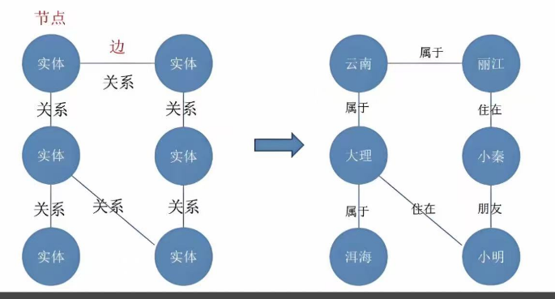
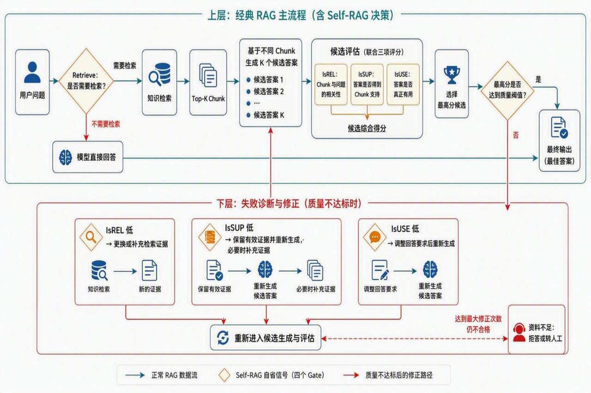

> **课时** 33/132　·　**RAG 八股**　·　约 50 分钟
> [上一课：6.嵌入向量](../03-RAG/07-6.嵌入向量.md)　·　[下一课：9.RAG的趋势探讨 · 9.5 面试题](../03-RAG/09-9.RAG的趋势探讨 · 9.5 面试题.md)
>
> 学完标准：合上笔记，能讲清本节在问什么、你怎么答、以及如何套到自己的项目上。

---

### 7. RAG进阶

此部分为RAG进阶部分，如前所述，一般岗位可能不会考察这么深，除非你自己简历写了Graph Rag, Agentic RAG或者本身就是专门做RAG的组，可能会考到这里。 我的原则是，该部分概念要会，问RAG有啥新方向，相关概念答得出来，但没有深入研究。

#### 7.1 RAG新方向

（这俩新方向，虽然可能没深入研究，但是得知道，概念要能讲出来）

目前典型的RAG的新方向是 Agentic RAG和Graph RAG, 具体来讲：

**Agentic RAG**的核心是把RAG从一个固定流水线变成一个有决策能力的Agent。传统RAG就是检索一轮、生成答案、结束了。但很多复杂问题一轮检索根本不够，Agentic RAG让模型自己判断——检索结果够不够？不够就再检索一轮，或者换个检索策略。像Self-RAG、Corrective RAG都是这个思路，本质就是让**检索过程变得更智能、可以自我纠错**。

**Graph RAG**解决的是另一个问题——**传统向量检索擅长找语义相似的内容**，但很难处理跨文档的关联推理。比如问人物之间的关系，信息散落在十几个段落里，靠embedding相似度很难串起来。Graph RAG的做法是先从文档里抽取实体和关系建成知识图谱，检索时在图上做关系遍历，特别适合需要全局理解的问题。"

我觉得这两个方向是互补的——一个解决检索策略的智能化，一个解决知识关联和推理，未来可能会结合起来用。

####   7.2 RAG与知识图谱

（知识图谱也能和RAG结合使用。但是其实对于可能80%的问题，靠高质量的切片和双路召回就能够解决，只有20%的问题，需要跨文件全局关联的硬核需求，值得花200%的精力去建立图谱。总结来说，知识图谱较为复杂，不是每个企业都会用，成本高。也属于进阶路线。 所以如果你没有学好传统的双路召回RAG，先不用来学这个结合图谱的RAG，这里的建议依旧是作为概念，先理解什么是知识图谱，为什么和RAG能结合？优势和劣势是啥？我就只学到这里。如果哪天他变得很火了，考的多了，可以继续学）

##### 7.2.1 什么是知识图谱？

知识图谱是一种结构化的知识表示形式，通过图模型来描述现实中的实体及其之间的关系：核心包括：

**节点：**表示实体或者概念，如'北京'，'小刘'

**边：**表示实体间的关系，比如'小刘-就职于-阿里'

**属性：**描述节点的额外信息，如'北京-人口-2154万'等。

知识图谱通过三元组的形式组织数据，从而构建出一个庞大的网络。



##### 7.2.2 知识图谱在RAG的应用？

传统的RAG是基于分块，向量召回的思路来对输入数据增强的。但是对于强调跨文档/多文档综合，需要多跳推理/链路关系的时候，可以将知识图谱和RAG结合，即KG-RAG。 它的做法是先用普通语义检索拿到一批chunk，然后把这些chunk映射到知识图谱的实体上，沿着图的边做扩展检索，把原本关联的文本片段补齐成一条/多条与问题相关的关系链，最终把组织起来的片段按图结构交给LLM（简单说，向量召回的结果作为起点，KG扩展把点连成线，再将整合结果送入LLM）

##### 7.2.3 知识图谱vs普通RAG？

普通RAG **落地快，成本低，适合'答案就在某几段文档里'的定位性问题**，但是它的弱点是需要**跨多段/多条文档做综合，需要多跳推理和关系链路时**，他只能拿到碎片，此种场景适合使用KG-RAG, 但是它的缺点是：**需要抽取/维护实体关系、做图扩展与组织，构建与维护成本更高**。

####  7.3 Self-RAG

Self-RAG, 我认为是一个还挺有价值的技术。学好这个，对面试的帮助也很明显，当面试官问你：[**如何保证RAG系统生成的答案是准确的？ **](https://my.feishu.cn/docx/GikId1snboM6LyxxGPXc0kDdnub#doxcnX52l2Gb9nFrclDaPo9ifgc)以及 [你的RAG系统中有什么高级技术？可以介绍一下吗（英伟达面试真题）？](https://my.feishu.cn/docx/GikId1snboM6LyxxGPXc0kDdnub#doxcnyN62VA9yyS2RWfo1ZO0jag) 我们都可以从Self-RAG的角度出发。这两个问题也是真实的面试问题，我也附上了跳转链接。 

同时这也确实是一个有价值的事：我们学了RAG的评估方法，比如RAGAS，这个是已经吐出了回答后的检测，有没有办法能够在运行的时候，就能动态检测生成质量，实时调整呢？那么就得靠我们的Self-RAG技术了。

##### 7.3.1 Self-RAG是什么？

Self-RAG（Self-Reflective Retrieval-Augmented Generation，**自省式检索增强生成**）是在传统 RAG 基础上加入“自我判断和自我评估”能力的一种 RAG 范式。

传统 RAG 通常采用固定流程：

```
用户问题 → 检索知识 → 生成答案
```

它存在两个问题：一是无论问题是否需要外部知识都进行检索；二是即使检索到了知识，也不能保证知识与问题相关，更不能保证生成答案严格受到知识支持。

Self-RAG 将流程改为：

```
判断是否需要检索
→ 检查检索内容是否相关
→ 生成候选答案
→ 检查答案是否得到证据支持、是否有用
→ 评分并选择最终答案
```

因此，Self-RAG 的重点不是简单地增加一次检索，而是让质量评估直接参与检索和生成决策。

从下图中可以清晰地理解Self-RAG和传统RAG的区别：图片上方是经典的RAG，而Self-RAG就是在上方经典RAG下面引入了自我检查：**从要不要检索，到输出分数是否达标各个方面检测，及时做出调整或者拒答。**



---

##### 7.3.2 Self-RAG 检测什么？

经典 Self-RAG 使用四类自省信号：

1. `Retrieve`：在检索前判断当前问题是否需要检索外部知识。
1. `IsREL`：在检索后、生成前判断检索到的文档或 Chunk 是否与问题相关。
1. `IsSUP`：在生成后判断答案是否得到检索证据支持。
1. `IsUSE`：在生成后判断答案是否有用、是否真正解决了用户的问题。
其中，`IsSUP` 可以进一步分为完全支持、部分支持和无支持或冲突；`IsUSE` 通常可以采用分级评分。

---

##### 7.3.3 经典 Self-RAG 如何实现？

经典 Self-RAG 会把上述判断表示为特殊的“自省 Token”，例如：

```
[Retrieve]
[Relevant]
[Fully Supported]
[Utility:5]
```

训练阶段先使用 **Critic 模型为训练样本生成这些评价标签**，再使用带标签的数据微调 **Generator**。完成训练后，Generator 不仅能够生成答案，还能够在适当位置生成自省 Token。

推理时，程序读取这些 Token 及其生成概率，以决定是否检索、是否保留某个 Chunk，以及应该选择哪个候选答案。自省 Token 不需要展示给用户，它们相当于模型提供给程序的标准化控制信号。

简化后的运行过程如下：

```
用户问题
  ↓
Retrieve：需要检索吗？
  ↓
检索多个 Chunk
  ↓
IsREL：逐个判断 Chunk 是否相关
  ↓
使用相关证据生成候选答案
  ↓
IsSUP + IsUSE：评价候选答案
  ↓
选择得分最高的答案并输出
```

如果要形成更严格的生产级闭环，还可以增加质量阈值：**答案未达到阈值时，不直接输出，而是重新检索、重新生成或拒答。**

---

##### 7.3.4 用RAGAS 替换传统Self-RAG

这一节纯粹是我自己加的。因为我们看到上面的Self-RAG的 自评估方法是要使用专门的模型进行训练的。如果我们要包装，我害怕面试官问你的模型训练的细节，加上我们项目中做了RAGAS的评估，RAGAS的评估和Self-RAG的三个指标是一样的，干脆我们讲的时候就用RAGAS集成到Self-RAG好了，这样问到我们如何实现的细节，我们更加胸有成竹。我在相关面试真题:[如何保证RAG系统生成的回答是准确的](https://my.feishu.cn/docx/GikId1snboM6LyxxGPXc0kDdnub#doxcnX52l2Gb9nFrclDaPo9ifgc)？，也是用这个思路来组织最终参考答案的。

我们可以保留 Self-RAG 的"检索—生成—评估—修正"流程，用 RAGAS 作为外部评估器替代模型内部的自省 Token。

两者可以近似映射为：

1. `Retrieve`：RAGAS 没有直接对应指标，可以使用 LLM 分类器或业务规则判断是否需要检索。
1. `IsREL`：可以使用 Context Relevance 或 Context Precision 判断检索内容是否相关。
1. `IsSUP`：可以使用 Faithfulness 判断答案是否得到检索上下文支持。
1. `IsUSE`：可以使用 Answer Relevancy 判断答案是否解决了问题；有参考答案时，还可以增加 Answer Correctness。
替换后的流程为：

```
用户问题
  ↓
规则或 LLM 判断是否需要检索
  ↓
检索并生成答案
  ↓
RAGAS 评估上下文相关性、答案忠实度和答案相关性
  ↓
达到阈值 → 输出
未达到阈值 → 过滤噪声、重新检索、重新生成或拒答
```

这种实现并不是原始论文中依靠自省 Token 的经典 Self-RAG，更准确的称呼是“借鉴 Self-RAG 思想、以 RAGAS 为外部评估器的自反思 RAG 工作流”。它不需要重新训练 Self-RAG 模型，更容易接入现有工程，但会增加额外的模型调用、延迟和成本。

##### 7.3.5 讲解视频

https://www.bilibili.com/video/BV1gF8Z6WEGW/?spm_id_from=333.1387.homepage.video_card.click&vd_source=144bec9c3f54e465073138bed788be1b

---

### 8. RAG场景题

如果我做 rag 召回的相关内容里，会有人恶意注入了一些错误的信息， 你觉得会影响大模型的生成内容吗？怎么避免？

会影响生成内容。 我认为：

1. 可以限制拿到的数据的来源，只选择可靠的数据源。
1. 可以对拿到的数据进行安全性检验，检验是否包含恶意指令
---
