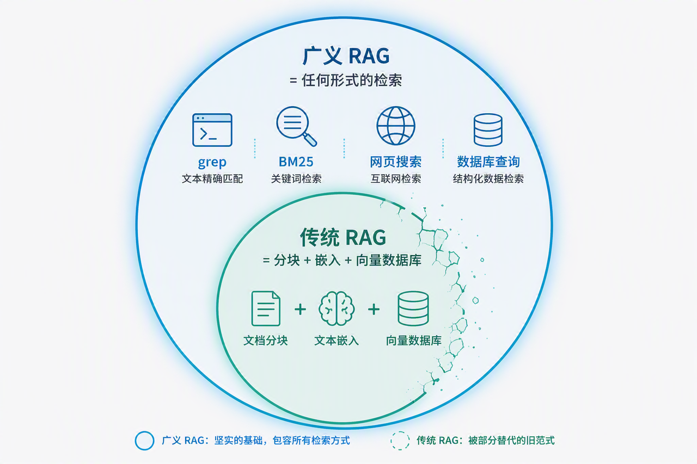
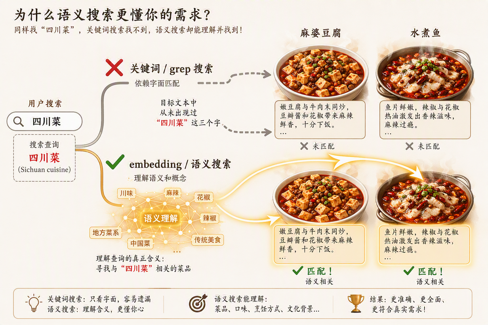
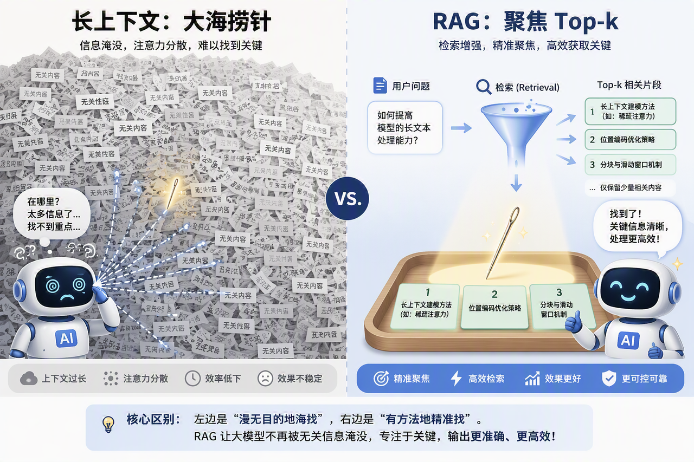
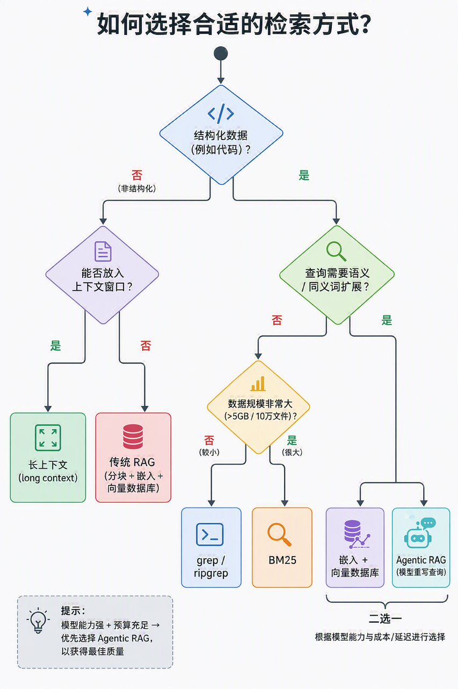

> **课时** 34/132　·　**RAG 八股**　·　约 1 小时
> [上一课：7. RAG进阶 · 8. RAG场景题](../03-RAG/08-7. RAG进阶 · 8. RAG场景题.md)　·　[下一课：Agent 开发框架](../04-Agent/01-Agent · 1.Agent开发框架 · 1.1.1 框架速览 · 1.1.3 框架核.md)
>
> 学完标准：合上笔记，能讲清本节在问什么、你怎么答、以及如何套到自己的项目上。

---

### 9.RAG的趋势探讨

在2026年，我相信大家听过很多论调和讨论：**RAG已死**。**我们现在Agent都不用RAG了**。包括还有各种面试题：**为什么ClaudeCode不用RAG了？你设计Agent架构的时候，到底要不要用RAG（**202606滴滴面试真题）。包括还有一些你和面试官聊天的时候的讨论：**你如何看待RAG的趋势，你觉得现在还需要不需要RAG？**

今天这个小节，我想全面，客观的来帮助大家分析一下这个问题。大家不要背答案，而是真的去理解，去思考，去看看我说的是不是这么一回事？有了自己的思考，对于上面的各种问题的回答其实也是自然而然就知道如何回答了。

本文参考的资料为：

1. **长上下文视角**——《[Is RAG still needed? Choosing the best approach for LLMs](https://www.youtube.com/watch?v=UabBYexBD4k&t=35s)》（YT视频）
1. **结构化数据视角**——《[Why the best AI coding tools abandoned RAG (and what they use instead) / Is RAG Dead?](https://www.youtube.com/watch?v=60G93MXT4DI&t=124s)》（YT视频）
1. **系统作者视角**——Boris Cherny(Claude Code 核心作者)在 Latent Space 播客的访谈
1. **Harness 工程视角**——飞书「大模型笔记」[2.4.1 Retrieval 章节](https://my.feishu.cn/docx/GikId1snboM6LyxxGPXc0kDdnub#doxcnin5oPgc9pBp6tW9Ypyqmuf)(检索工具谱系 + Agentic RAG 实验)
注意，其实我并不是说大家一定要去看对应的视频，为了严谨性我列出来源。笔记已经总结了上面的资料的各个方面的要点，已经是比较全面的了。看懂了笔记和我的视频，可以不用再去专门看上面的视频了。

---

#### 9.1 背景 - 先把RAG这个词说清楚

**RAG 是什么?**

RAG = **R**etrieval **A**ugmented **G**eneration(检索增强生成)。

它要解决的是 LLM 的一个根本缺陷:**模型被冻结在训练时刻**——它不知道 5 分钟前发生的事,更不知道你的私有数据、内部 wiki、专有代码库。要让模型「知道」这些,就必须解决**上下文注入(context injection)**:在正确的时间,把正确的数据放进模型的上下文窗口。

经典(传统)RAG 的管线是:

```
文档 → 切块(chunking) → embedding 模型编码成向量 → 存入向量数据库
用户提问 → query 向量化 → 语义搜索(semantic search)召回最相关的若干 chunk → 注入上下文窗口 → 生成答案
```

**关键澄清:大家吵的RAG 已死,死的是哪个 RAG?**

这是全篇最重要的区分,不厘清就会全程鸡同鸭讲:

- **传统 RAG / 语义搜索**:指切块 + embedding + 向量库 + 语义召回这套**具体管线**。现状是在**部分场景**(尤其编程)被替代。
- **广义 RAG**:指**任何**把外部信息拉进上下文的检索行为(grep、BM25、向量搜索、web 搜索都算)。现状是不可能死,是所有 Agent 的地基。
- **RAG 的本意** 就是抓取任何外部信息,拉进 LLM 上下文,增强它的回答。所以广义上,agent 用 grep 翻代码、用工具查数据库,**本质都是 RAG**,只是没有向量库那一套。
- 网上RAG is dead的暴论,几乎都在偷换概念:用**传统 RAG 在编程场景被淘汰**这个局部事实,去论证**RAG 整体过时**这个错误结论。
- 更进一步:**Agentic RAG(智能体检索)本身仍然是 RAG**,只是把一次性检索换成了模型自己迭代地、多轮地检索。
> **一句话定调**:讨论RAG 是否过时,只有把范围收缩到**传统的、切块 + 向量库的语义搜索管线**才有意义。广义 RAG(检索)永远不会过时。
>



---

#### 9.2 四个思维点

咱们可以先不讨论结论，先从4个方面去思考，我想思考清楚了这四个思维点，那么结论也呼之欲出。

##### 9.2.1 大家说的RAG已死，死的是什么？

- RAG 已死是一个被 LinkedIn / X 放大的**伪命题**。视频作者直言:这个叙事大部分不成立,只是**在编程这个特定场景**有一点点为真。
- Klein 原创者 Nick Pash 甚至把盲目上 RAG 的风气称为**mind virus(思维病毒)**:2023–2024 年,只要 agent 需要搜索,大家就无脑套语义相似 + 向量库,严重过度工程化。
- 但反过来,把传统 RAG 在编程被淘汰推广成RAG 全面过时,是同一枚硬币的另一面错误。
- Harness 视角给出了最精准的定性:**Agentic RAG 本身就是 RAG**,只是把一次检索换成迭代检索。所以从范式上讲,RAG 根本没被取代,而是**换了形态继续存在**。
> **小结**:与其问RAG 死没死,不如问**在我的场景里,那套沉重的切块 + 向量库管线还有必要吗?**——这才是能回答的问题。
>

---

##### 9.2.2 数据的结构化程度

传统 RAG 唯一真正值钱的超能力,是处理**自然语言的模糊性**——找到意思相近但字面不同的内容。判断要不要它,就看你的数据需不需要这个超能力。而数据需不需要,取决于它的**结构化程度**。所以先要把结构化和非结构化这两个词说清楚。

**什么是非结构化数据?**

指**没有固定组织形式、以自然语言为主**的数据——散落在 Google Drive、SharePoint、Confluence、wiki、SQL 里的海量文本。它的三个核心特征:

1. **语言是模糊的**:同一个意思有无数种表达,同义词、近义词、指代、隐喻满天飞。
1. **靠概念含义而非字面组织**:你想找的东西,常常和文档里的字面写法对不上——需要按意思相近来找,而不是按字一样来找。
1. **没有天然的导航结构**:一份文档可能埋在成千上万份文档里,没有文件路径、语法这类现成地图帮你定位。
这类数据里,你想要的信息可能**藏在几千甚至几百万份文档中**,而且**字面上根本没出现你搜的词**。要跨同义词、跨概念把它们捞出来,就必须靠 embedding 捕捉语义相似。**这正是传统 RAG 不可替代的场景。**

**什么是结构化数据?**

指**有精确语法、精确标识符、且自带组织结构**的数据,代码是最典型的例子。它的三个核心特征:

1. **拼写/标识符是精确的**:能正常运行的代码,函数名、变量名一定拼写精确——`getUserProfile` 全项目就叫这个,不存在另一种说法。
1. **不依赖语义近似**:你要找的东西字面就是确定的,不需要靠同义词或概念含义去猜,关键词/正则(grep、ripgrep)就能精确命中。
1. **自带导航结构**:文件夹、路径、架构本身就是现成地图,agent 用文件导航工具逐层 hone in 即可,不需要语义帮它理解大概在讲什么。
这类数据用精确匹配又快又准,再套一层语义搜索反而更不准、还多一堆维护负担。**所以结构化数据不用 RAG。**

两类数据的选型对比如下:

- **非结构化数据**:特征是自然语言、模糊有歧义,同义词/指代多,靠概念含义组织,无天然导航结构,信息埋在海量文档里。**该用传统 RAG(语义搜索)**——因为靠 embedding 捕捉概念相似,才能跨同义词、跨字面把埋藏的内容召回。
- **结构化数据**:特征是精确标识符、语法确定,字面即确定、无需猜意思,自带文件/路径/架构结构。**不用 RAG,用 grep / 文件导航**——因为字面就是确定的,精确匹配又快又准,再上语义反而更差且要维护索引。
**经典例子——川菜**:在知识库里搜川菜有哪些,库里那几段可能只写了麻婆豆腐,花椒配辣椒,麻辣鲜香,**完全没有出现川菜两个字**。关键词搜索按字面逐字匹配,搜川菜根本匹配不到这些段落,一条都召回不了;只有靠 embedding 的语义相似,才能认出麻婆豆腐，水煮鱼在意思上就是川菜,把这些段落召回。这就是非结构化数据离不开 RAG 的原因。



**为什么代码(结构化)不用 RAG**,三条:

1. **精确,不需要猜意思**:能跑的代码拼写一定精确,`getUserProfile` 全项目就叫这个 → grep 直接 100% 命中,再上语义搜索反而更不准。
1. **自带组织结构**:文件夹、路径、架构就是现成地图,agent 逐层导航即可,不需要语义帮它理解大概在讲什么。
1. **索引维护是负担**:代码改动极频繁,向量索引很快漂移失同步;而普通文档几个月不变,索引好维护。
> **检索工具是一条谱系,不是二选一**(Harness 视角补充): `grep(词法/精确)` → `BM25(词法/倒排)` → `embedding(语义)` → `结构化 DB(带 metadata)` 从左到右,能力更强但成本更高。**能用轻的就不上重的。**
>

---

##### 9.2.3 规模 vs 上下文窗口

传统 RAG 的第二个对手不是 grep,而是**百万 token 的长上下文**(直接把文档全塞进去,不做检索)。二者各有胜场:

**长上下文赢在简单——三个理由:**

1. **砍掉基础设施(no-stack stack)**:不需要切块策略、embedding 模型、向量库、reranker、同步逻辑——少了一堆会坏的环节。
1. **没有检索彩票**:语义搜索是概率性的,可能**静默失败(silent failure)**——答案在库里,但没被召回,模型压根没看到。长上下文让模型看到全部,不存在这个失败点。
1. **整本书问题**:RAG 只能检索**存在的内容**,无法回答**缺了什么**。比如对比需求文档和发布说明,哪些安全需求被遗漏了——RAG 只能召回零散片段,看不到两份文档之间的空缺;长上下文把两份文档整体喂进去才能做这种全局对比。
**但 RAG 依然不可替代——三个理由:**

1. **重复读取成本**:长上下文每次查询都要重新处理整份文档(500 页 ≈ 250k token,每次都付这个税);RAG 只在建索引时处理一次。(prompt caching 能部分抵消静态数据,但动态数据仍要全额付费。)
1. **大海捞针(needle in haystack)**:上下文越长(50 万+ token),模型注意力越**被稀释**,埋在中间的单段信息经常漏掉或幻觉;RAG 只给 top-k 相关块,**降噪聚焦**,反而更准。
1. **无限数据集**:企业数据是 TB / PB 级,百万 token 只是杯水车薪。要在无限数据里定位,**必须有检索层**先过滤到能塞进窗口的量。
> **该视角的结论**:
>
> - **有界数据 + 需要全局推理**(分析单份合同、总结一本书)→ 用**长上下文**。
> - **无限的企业级知识** → **向量数据库(RAG)仍是唯一可行的仓库**。



---

##### 9.2.4 工程成本与按需外挂

**Boris Cherny(Claude Code 核心作者)的第一手复盘**:早期 Claude Code **真的用过 RAG**——用 Voyage embedding 给代码库建索引,但后来整个放弃,转向 agentic search(glob + grep 的常规代码搜索)。原因三条:

1. **性能**:agentic search**outperformed everything. By a lot.**(全面碾压,大幅度)。他很坦诚地补充,这个判断主要是**just vibes**(内部凭感觉),也有一些内部 benchmark。
1. **索引复杂 + 代码漂移**:RAG 需要建索引步骤,而**the code drifts out of sync**(代码不断变化,索引很快对不上)。
1. **安全 / 责任**(视频里普遍忽略的一条):索引必须**存在某个地方**,**what if that provider gets hacked?**(存索引的服务商被黑怎么办)——对公司是**a lot of liability**(巨大的责任风险)。Anthropic 不愿把敏感代码上传第三方。
他对这个权衡的总结:

> **at the cost of latency and tokens, you now have really awesome search without security downsides.** (代价是牺牲一点延迟和 token,但换来极棒的搜索,且没有任何安全隐患。)
>

**Harness 工程视角把这条思路一般化**:

- **不要把通用 AI 工具当万能工具**。Claude Code 内置 grep,但 CC 是通用的,而你的业务是定制的——代码库可能 100GB、文档跨多仓库、查询带 metadata 过滤。这时通用工具会慢甚至搜不到。
- 关键的实证:视频里 Raj 的实验中,**Agentic + 纯 BM25**反超了**One-shot + embedding 切块**。这说明随着模型变强,语义近似这层**不一定非要靠 embedding**,模型自己重写 query 就能补上。但这是**embedding 从必选变可选**,不是BM25 取代 embedding。
- 所以最精准的定性是:**RAG 没被取代,而是从默认必选降级成按需启用的一档。**
---

#### 9.3 总结&结论

**先把 RAG 的账算清楚——它的优点和缺点各是什么。**

传统 RAG(切块 + embedding + 向量库)的**核心优点**有三:

1. **能做语义搜索**:靠 embedding 捕捉概念相似,能跨同义词、跨字面把埋在海量文档里、字面根本没出现搜索词的内容召回——这是 grep 这类字面匹配做不到的。
1. **又快又省成本(核心优势)**:预先切块 + 建索引,查询时只拉几个小 chunk,而不是把整个知识库/整份文档塞进上下文。这一个机制同时带来两个好处——
    - **省成本**:喂给模型的输入 token 大幅减少,大知识库下比让模型读整份文档或多轮 agentic 扫描便宜约 **100 倍**。
    - **快 / 低延迟**:检索直接走索引(向量 HNSW `O(log N)` / BM25 倒排 `O(K)`)秒级命中,加上塞进上下文的内容少、模型推理也快;相比让 agent 用 grep/cat 在海量非结构化文档里逐个遍历(视频原话:慢到爆、贵到爆),定向拉 chunk 快得多。
    - 一句话:**只取最相关的一点点,而不是处理全部——省的是钱,快的是这同一件事的另一面。**
1. **降噪聚焦**:只返回 top-k 相关块,把大海捞针里的草堆先扔掉,给模型的是信号而非噪声,反而比长上下文全塞进去更准。
它的**核心缺点**也有三:

1. **要维护一套重基础设施**:切块策略、embedding 模型、向量库、reranker、同步逻辑——环节多、都可能坏;索引还会随源数据变化而漂移失同步,代码这种高频变动的数据尤其吃亏。
1. **检索是概率性的,会静默失败**:语义召回不保证命中,答案可能就在库里却没被检索到,模型压根没看到——而它不会告诉你我没找到。
1. **只能召回存在的片段,做不了全局推理**:它给的是零散 chunk,回答不了两份文档之间缺了什么这类需要看全局的问题。
**再下结论——它在哪被取代、在哪没被取代。**

**传统 RAG 已在两类场景被更优方案取代:**

1. **结构化数据(尤其代码)**:字面精确、自带文件结构,`grep / 文件导航`又快又准还免维护,不需要语义那一层——Claude Code 弃用 RAG 正是这个原因(性能更好 + 无索引漂移 + 无安全负担)。
1. **有界 + 需全局推理的数据**(单份合同、整本书对比):`长上下文`直接全塞进去,省掉整套检索栈,还避开了静默失败,反而更适合。
此外,即便需要语义,提供语义的活也**不再由 embedding 独家承包**:模型够强时,`Agentic + BM25`(模型自己重写 query,把语义翻译成关键词)也能达到甚至反超传统切块 RAG——所以 embedding **从必选降为可选**。

**但传统 RAG 在这些场景仍不可替代**

1. **海量非结构化知识库**(客服、法律、合规、企业 Wiki,乃至 TB/PB 级数据湖):长上下文只是杯水车薪,必须靠检索层先把数据过滤到能塞进窗口的量,向量库是目前唯一可行的仓库。
1. **延迟 / 成本有硬约束的生产环境**:面向大量用户的语义问答系统、有明确延迟与成本 SLA(如高并发客服问答),既不能对每个 query 跑多轮 agentic 检索(太慢、2–5x token),也不能每次把知识库塞进长上下文(装不下、更贵)。预建索引的 RAG 一次检索、毫秒级命中、每查询成本固定且低——这时它是唯一能同时扛住并发与预算的方案。
**RAG 仍具显著优势(虽未到不可替代)的场景:**

**强依赖语义搜索、但同时在意成本与速度**:这类任务 `Agentic + BM25` 确实能取得相同甚至更好的效果——所以谈不上不可替代。但 agentic 方案**强依赖顶级模型能力**(query 重写要够聪明才补得出语义),还要付出多轮迭代的 **2–5x token 和更高延迟**。相比之下,传统 RAG 把语义**预先烧进索引**,一次检索即得,**更快、更省、且不挑模型**(不需要 Opus/GPT-5 级也能跑)。所以当语义需求强,但你不愿为 agentic 买单时,RAG 虽非不可替代,仍是**性价比更优的一档**。

**一句话:**传统 RAG 从默认必选降级为**按需启用的一档**——**在小型/结构化/有界场景被 grep、长上下文、agentic 搜索取代**;**在海量非结构化、以及对延迟成本有硬约束的生产场景仍不可替代**;即便在 agentic 可替代的语义场景,它也常因更快、更省、不挑模型而保有优势。而广义 RAG(检索)作为一切 Agent 的地基,永远不会过时。

---

#### 9.4 场景题小测试

我们上面讲了，狭义的RAG变成了按需取用，它只是Agent检索能力的一种实现方式。那么对于不同的场景，我们应该如何选择方案呢？这里给一些场景和选型策略供大家参考。

思路统一为三步——**看数据结构化程度 → 看规模 → 看查询形态**,能用轻的就不上重的。



**最佳实践清单**

1. **默认 grep 起手**:90% 的代码搜索靠 grep 就够,别一上来就上向量库。
1. **量级到了再加 BM25**:代码库 >5GB 或 >10w 文件,包一个 Skill 封装 `ripgrep --index` 或 BM25 库。
1. **跨同义词才用 embedding**:日常代码定位别用,跨语言 / 跨概念查找才上语义搜索。
1. **模型够强就上 Agentic RAG**:让模型自己重写 query、按文件级迭代,比预切 chunk 更准(代价 2–5x token)。
1. **文件级 > chunk 级**:能不切块就不切块,整文件交给模型,避免上下文撕裂。
1. **需要 metadata join 才迁数据库**:纯文本搜索别上 DB。
**Q:我在做一个 coding agent,要在中小代码库里定位函数/改代码,用什么?**

A:用 `grep / ripgrep`,不建任何索引。代码是结构化数据,字面精确,grep 现扫就 100% 命中且免维护;本地项目规模不大,线性扫盘足够快。这正是 Claude Code 的选择。

**Q:代码库超大(比如 100GB、上千万文件),grep 扫盘太慢了怎么办?**

A:加一层 `BM25 倒排索引`(包成 Skill 挂给 agent)。它查询 O(K)、与库大小无关,解决 grep 线性扫盘的慢;仍是词法匹配,不碰 embedding。这是规模把你从零索引推到轻索引,不是因为需要语义。

**Q:要查用户鉴权相关的代码,但关键词散在 auth / login / session / jwt 里,grep 搜不全?**

A:这是跨同义词/跨概念的查找,字面匹配天然漏召回,有两条路都能走,按模型强度 vs 成本/延迟权衡:

- **`embedding 语义搜索`**:预建向量库,靠向量捕捉概念相似,一次召回稳定拿到结果,查询快、单次成本低——适合成本/延迟敏感或高频查询。
- **`Agentic + grep/BM25`**:让模型自己把用户鉴权重写成 `auth|login|session|jwt` 一组关键词、多轮迭代搜。省掉建索引,但要求模型能力够强,且多轮迭代 token 和延迟更高。
注意:日常精确定位(已知函数名)别用这两种,grep 直接命中就好。

**Q:要分析一份合同、或对比两份文档找出遗漏了什么,用 RAG 吗?**

A:不唯一,看数据量和关联复杂度选:

- **数据塞得下 → ****`长上下文`****直接全塞进去**:需要全局推理,让模型看到全貌才能发现文档之间的空缺,还省掉检索栈、避开静默失败。这是有界数据的首选。
- **数据太大塞不下 → 仍要 ****`RAG`**** 先过滤**:普通向量 RAG 只给零散 chunk 容易看不到全局,可退而用它把范围缩到能塞进窗口的量再做对比。
- **实体/条款间有复杂关联 → ****`GraphRAG`**:先把文档抽成实体-关系图,用图结构显式建立这条需求 ↔ 那条发布说明的关联,比纯向量召回更能支撑缺了什么这类跨文档推理。
**Q:要给公司几十万份客服/法律/Wiki 文档做问答系统,用什么?**

A:标准 `传统 RAG`(切块 + embedding + 向量库)。典型的海量非结构化数据:字面对不上、靠概念含义组织、塞不进上下文——必须靠语义检索 + top-k 降噪,这是 RAG 的主场。

**Q:企业数据到了 TB / PB 级,长上下文完全装不下,怎么办?**

A:必须有 `RAG 检索层`。百万 token 在这种量级只是杯水车薪,得先用向量检索把数据过滤到能塞进窗口的量;向量库是目前唯一可行的仓库。

**Q:查询需要按作者过滤 + 按提交时间排序 + 按路径匹配这种带条件的检索?**

A:上 `结构化 DB / metadata 索引`(可与 RAG 混合)。这已经不是找相关内容而是按字段筛选 join,grep 和向量都做不了,需要数据库式的字段过滤。纯文本搜索则别上 DB。

**Q:模型够强(Opus / GPT-5 级)、预算也够,想要最好的检索质量?**

A:上 `Agentic RAG`——让模型自己重写 query、按文件级迭代检索,底层用 BM25 / embedding / 混合都行,坚持文件级 > chunk 级避免上下文撕裂。代价是多花 2–5x token 和延迟,换来更高准确率。

---

#### 9.5 面试题

希望大家能真的理解上面说的，有自己的思考。那么如果从这些维度想清楚了，下面的面试问题的答案其实就非常明显了。

##### Q1:你认为 RAG 过时了吗?

**A:我的判断是——传统 RAG 在部分场景被降级,但整体没有过时,更准确地说是换了形态。回答这个问题,必须先厘清在讨论哪个 RAG。**

大家喊RAG 已死时,死的是**切块 + embedding + 向量库 + 语义召回这套传统管线**;而 RAG 的本意是把外部信息检索进上下文,这个**广义 RAG 是所有 Agent 的地基,不可能死**。连 Agentic RAG 本身也仍然是 RAG,只是把一次检索变成迭代检索。

传统 RAG 确实在退位,有两股力量:

- **一是长上下文**:百万 token 窗口让有界数据 + 全局推理的场景(如分析单份合同、对比两份文档找缺漏)可以直接把文档全塞进去,省掉整套检索基础设施,还避免了语义搜索的静默失败。
- **二是 Agentic 搜索**:模型变强后,它能自己重写 query、多轮迭代检索,有实验(Raj)显示Agentic + 纯 BM25能反超One-shot + embedding 切块——说明语义近似这层不一定非靠 embedding。
**但传统 RAG 在三类场景仍不可替代**:

- **① 海量数据(企业 TB/PB 级)**:这种量级下长上下文根本装不下,只是杯水车薪;而且如果不上 RAG、改用 agentic 现扫,面对无限数据每次查询都要海量扫描,**速度会慢到不可用**。必须靠检索层先把数据过滤到能塞进窗口的量,向量库是目前唯一可行的仓库。
- **② 非结构化 + 跨同义词**:内容靠概念含义组织、字面对不上,关键词根本搜不到,只有 embedding 捕捉概念相似才能召回。虽然Agentic + 语义检索(让模型自己重写 query)理论上也能达到,**但这要求模型能力足够强,且多轮迭代的 token 成本和延迟都很高**;用预建的 embedding 向量库,一次召回就能稳定拿到结果,更省更快。
- **③ 成本 / 延迟敏感的场景**:当你需要严格控制查询成本和响应速度时,**事先建好索引**的优势就出来了——切块 + 建索引只在离线做一次,查询时只拉 top-k 个小 chunk,近似最近邻 O(log N) 一次命中;相比每次都让模型读整份文档或多轮 agentic 扫描,**延迟更低、单次查询成本可低约两个数量级**。
**所以结论是:RAG 从默认必选降级为按需启用的一档,而不是被淘汰。** 判断要不要用,看三个条件:**文档规模、查询是否需要跨同义词、以及对成本 / 延迟的要求。**

##### Q2:你如何选择用不用 RAG?如何设计项目的检索模块?

**A:核心原则是——不要把通用工具当万能工具,而要按场景在检索谱系上选一档;能用轻的就不上重的。**

我会分三步走:

**第一步,看任务量级和查询形态。** 先问两个问题:数据多大(单项目 / 超大代码库 / 企业级数据湖)?查询是纯文本、跨同义词、还是带字段过滤?

**第二步,在检索谱系上选档。** 检索工具从词法到语义是一条谱系,不是二选一,从轻到重依次是:

- **词法 · 精确(grep / ripgrep)**:适用于结构化数据、中小代码库(默认起手,90% 够用)。
- **词法 · 倒排(BM25)**:适用于超大代码库(>5GB / >10w 文件)。
- **语义(embedding + 向量库)**:适用于非结构化、跨语言 / 跨同义词。
- **结构化(DB + metadata)**:适用于需要 join 的场景(按 author 过滤、按时间排序)。
具体判据:

- **默认 grep 起手**;结构化数据 + 精确匹配,根本不用 RAG。
- **规模上去了加 BM25**;跨同义词才上 embedding。
- **有界数据 + 全局推理** → 优先考虑长上下文,而非 RAG。
- **海量非结构化** → 传统 RAG 是唯一可行仓库。
- **需要 metadata join** → 结构化 DB + RAG 混合。
- **模型够强 + 预算够** → 上 Agentic RAG(底层 BM25 / embedding / 混合均可),让模型自己迭代,并坚持**文件级 > chunk 级**,避免上下文撕裂。
**第三步,用 Skill / 工具封装,交给 agent 按需调用。** 更前沿的做法是**给 agent 同时配好精确搜索 + 语义搜索两种工具**,让它根据具体 query 自己决定走哪条路——这就是桥接思路。

一句话:**检索模块的设计,本质是 harness 工程——agent 的能力上限不只取决于模型,更取决于你给它配的工具链。**

##### Q3:Claude Code 为什么不用 RAG?

**A:先纠正一个常见误解——不是不能用,而是核心不内置那套向量库管线。原因来自数据环境和工程权衡两方面,Claude Code 核心作者 Boris Cherny 给过第一手复盘。**

**先说根本原因:决定用不用 RAG 的是数据环境,不是任务类型。** Claude Code 虽然是通用 agent,但它面对的数据环境永远是**本地文件系统 + 终端**——有界(单个项目)、天然结构化(文件夹 / 路径 / 文件名)、可直接 grep。这种环境用 agentic search + 长上下文就够了。而 RAG 的刚需场景是海量 + 非结构化 + 无法直接导航的企业级知识库,Claude Code 的工作目录一条都不占。

**再说 Boris 的三条具体理由**(早期 Claude Code 确实用过 Voyage embedding 建索引,后来放弃):

1. **性能**:agentic search全面碾压,大幅度(他坦承主要凭内部 vibes,也有内部 benchmark)。
1. **代码漂移**:代码改动极频繁,向量索引很快out of sync,维护成本高。
1. **安全 / 责任**:索引要存在某处,服务商被黑就是巨大的责任风险,Anthropic 不愿上传敏感代码。
他的总结:**代价是延迟和 token,但换来极棒的搜索,且没有安全隐患。**

**补充两点让回答更完整**:

- 代码是**结构化**数据,拼写精确、自带文件结构,grep 能精确命中,本就不需要 embedding 的语义近似超能力。
- Claude Code 不内置 RAG,**不代表它做不了 RAG**——它可以通过 MCP / 工具外挂一个语义检索能力。**RAG 对它是按需外挂,不是出厂内置。** 为了少数场景让所有用户默认背上索引复杂 + 漂移 + 安全责任这套包袱,不划算;核心保持精简,谁真需要谁再插上去。
#### 9.6 讲解视频

https://www.bilibili.com/video/BV1YdMp6kEEf/?spm_id_from=333.1387.homepage.video_card.click&vd_source=144bec9c3f54e465073138bed788be1b

---

