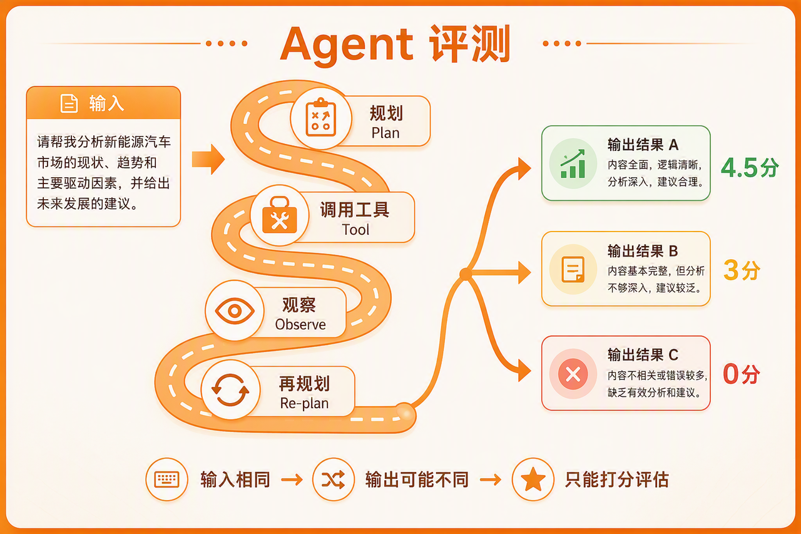

> **课时** 38/132　·　**Agent 八股**　·　约 50 分钟
> [上一课：1.1.5 框架选型策略 · 1.1.7 讲解视频 · 1.4 面试真题 · 2.Function Callin](../04-Agent/03-1.1.5 框架选型策略 · 1.1.7 讲解视频 · 1.4 面试真题 · 2.Fun.md)　·　[下一课：3.2 Agent评估全景图](../04-Agent/05-3.2 Agent评估全景图.md)
>
> 学完标准：合上笔记，能讲清本节在问什么、你怎么答、以及如何套到自己的项目上。

---

## 3.Agent评测

这份笔记整理自四类资料：**《AI Engineering》**、**《AI Agents in Action》**、**《Agentic Design Patterns》**，以及美团 LongCat 团队的 **VitaBench** 论文与相关资料。整理完以后，我最深的感受是：**Agent 评估没有一个放之四海而皆准的标准答案**。它必须结合**具体业务场景来设计，业务目标不同、工具链不同、风险边界不同，评测指标和测试方式也会不同**。

**Agent 评估本身也相当复杂**。一个项目如果真的要做一套非常健全的 Agent 评估体系，可能需要一小波人专门投入来设计评测集、指标、自动化 Pipeline、线上监控、红队安全测试和反馈闭环。现实里，很多企业项目对 Agent 评估这一块其实还没有非常健全，并不一定已经做到“用完善的测试指标指导开发”。我基于和面试官的沟通也有一个判断：绝大多数面试官会问 Agent 测试，但问得并不总是很深入，这也侧面说明很多团队自己对这块的体系化理解还在建设中。

所以，这份笔记希望先帮你建立一个**完整的大框架**：沿着 Agent 开发的生命周期去理解，在每个阶段哪些地方应该测、测什么、怎么测、有哪些常见方法。你顺着这个思路，就能把 Agent 测试和评估的大部分内容理清楚。

每一个小的测试环节，我都根据参考资料总结了一些方法或思路。但还是要强调：这里没有绝对标准答案。真正落地时，应该结合你的业务、你的 Agent 架构、你的工具链和你的风险边界来设计。如果你希望面试回答听起来更贴近实践，而不是只停留在理论层面，可以把本节理论和你自己的项目结合起来想一遍：比如你的项目里应该如何评估工具调用、如何评估多 Agent 协作、如何设置上线前发布闸门、上线后如何监控质量。也可以把你的项目背景和这一节理论一起交给 AI，让它帮你总结成更贴合你项目的回答。

这份笔记希望你达到三个目的：

1. **先掌握理论框架**：理解 Agent 评估为什么复杂，以及它和传统软件测试有什么不同。
1. **能应对面试问题**：当面试官问到 Agent 评估、测试、上线监控、安全、成本延迟、多 Agent 协作时，你的回答能清晰、有条理、有深度。
1. **能反推项目测试体系**：如果你真的想给自己的项目设计一套比较完善的评估流水线，这份笔记能帮你知道应该从哪些模块入手。
最后再次强调，我仍然认为 Agent 评测是一个非常复杂、专业、且高度工程化的事情。如果想深入学习，可以自己再仔细阅读这四份参考资料，如果想更加偏向于学习实战，那么可以结合今天的理论，在自己项目去设计一个评估流水线。

自信地说，如果你能消化好本节笔记，对于绝大部分面试里涉及 Agent 评测的问题，已经足够应付，而且能答得比很多泛泛而谈的回答更完整，更有条理性。

> 本报告基于以下四份资料综合编写：
>
> - **《AI Engineering》**（Chip Huyen, O'Reilly 2025）—— 评估方法论与工程体系
> - **《AI Agents in Action》**（Michael Lanham）—— 评估的工具落地与动手实践（后面文章里我们把这个简称为实战书）
> - [**《Agentic Design Patterns》**](https://github.com/xindoo/agentic-design-patterns)（智能体设计模式）—— 评估作为设计模式与生产治理
> - [**美团 LongCat VitaBench**](https://arxiv.org/abs/2509.26490)（ICLR 2026 / arXiv:2509.26490）—— 真实场景下的评测基准实战
> 全文每个评测点均标注资料出处，便于追溯。
>
> 前面两本是书籍，没有找到在线观看的链接，如果想要看，可以自己购买书籍，或者电子资源。第三个是一本google的书籍，网上有免费阅读版本。最后一个是论文，也可以直接阅读，链接已经附上。
>

---

### 3.1 Agent评估vs传统行业评估

#### 3.1.1 从TDD到EDD

在传统软件里，测试是写完代码之后的一道工序；但在 Agent 系统里，**评估本身就是开发的起点和方向盘**。

《AI Engineering》提出了一个核心主张——**评估驱动开发（Evaluation-Driven Development）**，它类比于测试驱动开发（TDD）：在你动手搭一个 Agent 之前，应该**先把"怎么算成功"定义清楚**。原因很现实：大模型是概率性的，同样的输入两次运行可能给出不同结果，你无法像传统程序那样"读一遍代码就知道它对不对"，唯一能依靠的就是一套可量化、可重复的评估体系。

这本书甚至直言：**"评估是 AI 工程中最难的问题"**，并用了整整两章（第 3、4 章）来讲它。换句话说，谁掌握了评估，谁才真正掌握了 Agent 的质量。评估的价值贯穿全生命周期：

- **选型时**：靠评估在一堆模型里选出最合适的；
- **开发时**：靠评估判断每次改动是变好还是变坏；
- **上线时**：靠评估做 A/B 测试、灰度放量；
- **生产时**：靠评估（监控）发现线上退化、漂移和安全问题。
> 一句话：在 Agent 时代，**评估不是质检环节，而是研发的指南针**。
>
> 💬 **【面试卡片】** **Q：TDD 你了解过吗？你自己用 TDD 做过完整开发吗？**（这个题目是**202606社招 雄帝科技Agent二面的题目**，是粉丝朋友在小红书上分享面试题。本篇所有笔记几乎就是在讲TDD，想告诉大家的是如果学好了这篇笔记，如果问到TDD的内容你就可以引经据典了）
>
> **A：** TDD 我了解，也实践过。传统 TDD 就是测试先行：先写测试用例让它失败，再写最小代码让它通过，然后重构，靠测试来驱动设计，而不是写完再补测试。不过在 Agent 项目里它没法直接照搬，因为大模型是概率性的、输出又是开放式的，同一个输入跑两次结果都可能不一样，没法像传统代码那样断言"输出等于期望值"。所以我用的是它在 Agent 时代的升级版——评估驱动开发（EDD），内核和 TDD 一样：动手之前先把"怎么算成功"定义清楚，再用一套可量化、可重复的评估来驱动每次改动，只是"断言相等"换成了打分、相似度、通过率这类度量。
>
> 具体落地，我是顺着三个阶段做的。第一个阶段是模型确定，先选对地基模型：用成本、延迟、隐私这些硬约束把候选缩小，再用业务私有数据集做终筛，避免被公开榜单的数据污染带偏。第二个阶段是开发阶段，这一段最能体现 TDD 的思想——我会先把各个环节怎么评估定清楚，再去搭 Pipeline。先做组件级评测，把 Prompt、RAG、工具调用、规划推理各自的失败模式逐个测出来；再做集成级评测，用端到端成功率、轨迹评测、多轮对抗、多 Agent 协作验证整机能不能稳定完成任务；等这些维度的测法和指标都定清楚了，我才把评测集和评估 Pipeline 一起组装出来，并设一道发布闸门，质量、延迟、成本、安全都过线才能上。第三个阶段是上线，把同一组指标搬到真实流量里持续监控，做 A/B 灰度、盯漂移和成本安全告警，一旦发现新问题就回灌评测集重新跑回归。
>
> 总结来说，传统 TDD 我用过，在 Agent 里我用它的升级版 EDD，把评估贯穿到模型确定、开发、上线这三个阶段——尤其在开发阶段是先把各环节怎么评估定清楚、再组装 Pipeline 和发布闸门，让评估全程驱动开发，而不是事后补测。
>

---

#### 3.1.2 Agent评估和传统评估的不同

为什么不能拿传统软件测试那一套来测 Agent？四份资料从不同角度指出了同一件事：**Agent 打破了传统测试赖以成立的前提**。可以从五个维度看清两者的根本差别：

- **确定性**：传统软件测试同样输入必得同样输出、可断言相等；Agent 评测则是概率性输出，同一输入多次结果不同。
- **任务性质**：传统测试是封闭式（close-ended），输出落在预定义值域内（如分类只能输出有限的几个类别）；Agent 评测是开放式（open-ended），同一输入有无数种可能的正确回答。
- **判定方式**：传统测试有唯一/可枚举的标准答案，把输出与它比对、相等即对（可自动断言）；Agent 评测无法枚举所有正确答案，只能用打分、相似度、通过率去度量"好不好"。
- **评测对象**：传统测试看单个函数的返回值；Agent 评测看一条多步"轨迹"：规划→调工具→观察→再规划。
- **失败形态**：传统测试的失败是抛异常、返回错值；Agent 的失败是工具用错、目标跑偏、自以为完成、绕圈子……
最关键的一条是：**传统测试断言"输出 == 期望值"，而 Agent 的输出根本无法这样断言**。《Agentic Design Patterns》明确指出，正因为 Agent 是非确定性的，传统"通过/失败"的测试不足以保证可靠性，必须转向"对效能、效率、合规做持续测量"的思路。

> 💬 **【面试卡片】** **Q：你觉得 Agent 行业的测试和传统行业有哪些不同？**
>
> **A：** Agent 的测试和传统软件测试有几个根本不同。
>
> **第一，确定性不同**：传统软件同样的输入必然得到同样的输出，可以直接断言"输出等于期望值"；而 Agent 是概率性的，同一个输入多次运行结果都可能不一样，没法这样断言。
>
> **第二，任务性质不同**：传统软件多是封闭式（close-ended）任务，输出只能落在预定义的值域里，有唯一或可枚举的标准答案，可以直接拿输出和标准答案比对、相等就算对；而 Agent 是开放式（open-ended）任务，同一个输入有无数种可能的正确回答，无法列出一份完整的标准答案来比对，所以只能用打分、相似度、通过率这类方式度量"好不好"，而不是简单地判"对不对"。
>
> **第三，评测对象不同**：传统测试看的是单个函数的返回值，而 Agent 要看的是一条"规划→调用工具→观察→再规划"的多步轨迹。
>
> **第四，失败形态不同**：传统软件的失败是抛异常或返回错值，而 Agent 的失败是用错工具、目标跑偏、自以为完成、绕圈子等。归根到底，传统测试能拿输出和标准答案断言"相等即对"，而 Agent 开放式输出列不出标准答案，所以必须从"通过/失败"转向对效能、效率、合规的持续度量。
>

---

#### 3.1.3 Agent评估5大困境

综合四份资料，Agent 评测之所以难，集中在五个"坑"上。这五条建议在面试里能直接说出来：

1. **非确定性，传统 pass/fail 失效。** 同一输入多次运行结果不同，无法用"等于期望值"来判定对错。
1. **不能只看结果，要看"会怎么失败"。** 《AI Engineering》提出一个关键视角：**评估 Agent = 识别它的失败模式，并量化每种失败发生的频率**。一个 Agent 可能最终答对了，但中间用错了工具、绕了远路——只看结果会漏掉这些。
1. **失败面更多、更新。** Agent 比单纯的 LLM 多出了规划、工具调用、多轮交互、多智能体协作等环节，每个环节都是新的失败来源。任务越复杂，失败点越多。
1. **Benchmark 会被"污染"，榜单不可尽信。** 公开 benchmark 的题目可能已经混进了模型的训练数据（数据污染 / contamination），导致分数虚高。选型时不能只看排行榜名次。
1. **"裁判"本身也有偏见。** 现在普遍用 LLM 给 Agent 打分（LLM-as-a-judge），但《AI Engineering》系统揭示了裁判模型自身的偏差：**自我偏好**（偏向自己生成的答案）、**首位偏差**（偏向排在前面的选项）、**冗长偏差**（偏向更长的回答）。还有一条警告——**比较式评估里"偏好 ≠ 正确"**：人类投票选出的"更喜欢"，不等于"更正确"，如果投票者不是内行，甚至会把 Agent 训练成"讨好型"而非"正确型"。
> 这五条困境，正是后面所有评测方法要去解决的问题。可以把它们当成贯穿全文的"问题清单"。
>
> 💬 **【面试卡片】** **Q：Agent 行业的测试面临着哪些困难？**
>
> **A：** Agent 测试主要面临五大困难。第一，非确定性导致传统的"通过/失败"判定失效，同一输入多次运行结果不同，无法用"等于期望值"来判对错。第二，不能只看最终结果，还要看它"会怎么失败"——评估 Agent 本质上是识别它的失败模式、并量化每种失败发生的频率，因为一个 Agent 可能答对了，但中间用错了工具、绕了远路。第三，失败面更多也更新，Agent 比单纯的大模型多了规划、工具调用、多轮交互、多智能体协作等环节，每一个都是新的失败来源，任务越复杂失败点越多。第四，公开 benchmark 会被数据污染，测试题可能已经混进了训练数据导致分数虚高，所以选型时不能只看排行榜名次。第五，用来打分的"裁判"本身也有偏见，LLM-as-a-judge 存在自我偏好、首位偏差、冗长偏差，而且比较式评
>

---
