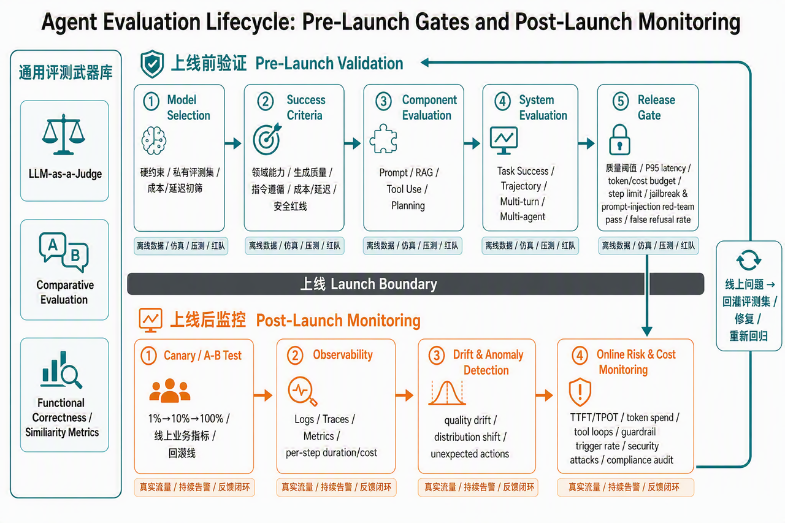

> **课时** 39/132　·　**Agent 八股**　·　约 40–45 分钟
> [上一课：3.Agent评测 · 3.1 Agent评估vs传统行业评估](../04-Agent/04-3.Agent评测 · 3.1 Agent评估vs传统行业评估.md)　·　[下一课：3.3 评测细节 · 3.3.2 选型期：选基模](../04-Agent/06-3.3 评测细节 · 3.3.2 选型期：选基模.md)
>
> 学完标准：合上笔记，能讲清本节在问什么、你怎么答、以及如何套到自己的项目上。

---

### 3.2 Agent评估全景图

在深入每一种具体的评测方法之前，我们先建立一张“评测全景地图”，让你直观地看清：**一个 Agent 从立项、开发到上线运行，评测到底分布在哪些环节？**

本章是全篇报告的“指引篇”──它先明确解答“哪里要测”**，第 3.3 章再对仗讲清楚**“怎么测”。

#### 3.2.1 一条主线

为什么评测会散布在开发的每一个角落？《AI Engineering》在第 1章极富洞见地指出，评测之所以贯穿始终，是因为要达成以下 **四个核心目的**：

```
① 挑选模型 ───→ ② 标记进展 ────→ ③ 决定上线 ───→ ④ 生产监控
 (选型期)         (开发期)          (发布期)         (运行期)
```

这些目的恰好落在开发时间线的不同位置上，把它们半闭环地串联起来，就是一条**完整的评测生命周期**。

这本书还有一个更根本的主张，被称为：

> 💡 **核心观点：评估驱动开发（Evaluation-Driven Development）** 在你动手搭建一个 Agent 之前，**必须先定义“怎么才算成功”**。类比于传统软件的测试驱动开发（TDD），**先定义评估标准，再动手开发；待各维度测法清晰后，再把它们组装成可自动运行的评估 Pipeline。**
>

因此，评测决不是开发末尾临时拥抱的防黑天鹅工序，而是一路延续到下线的主航道。其余三份资料也各自深度呼应了这条“评估主线”：

- **《Agentic Design Patterns》**：强调评估要“贯穿到线上生产监控，并最终沉淀为可问责的工程治理”；
- **《AI Agents in Action》**：直接把“评估”做成了与推理、记忆、规划并列的 **Agent 四大核心组件**之一；
- **美团龙猫**：示范了如何将这套系统性评估思想凝结成一个真实场景下的生活服务评测基准（VitaBench）。
#### 3.2.2 上线前验证 → 上线后监控

沿着真实交付生命周期，评测不应该简单分成"开发期测质量、上线后测稳定和安全"。更准确的分法是两层：

- **上线前验证**：用离线评测集、仿真环境、压测、红队用例和发布闸门判断"能不能上线"；
- **上线后监控**：用真实流量、日志、trace、metrics、用户反馈判断"上线以后有没有退化、漂移、成本失控或被攻击"。
成本、效率、延迟、安全、合规不是生产期才出现的指标，而是**横向贯穿两层**：上线前它们是准入门槛，上线后它们是持续监控项。

下面按这条主线，逐一穿透每个阶段测什么、对应第 3.3 章哪一节：



**🛠️ 贯穿全程的「通用武器库」（对应 §3.3.1）**

在探讨具体阶段前，必须先掌握三件"通用武器"（LLM-as-a-judge、比较式评估、基础度量）。它们没有固定归属，而是在模型选型、组件调试、发布闸门和生产监控里被反复调用。

**✅ 上线前验证：回答"能不能上线"（对应 §3.3.2 ~ §3.3.6）**

上线前不是只测"答案对不对"，而是要把模型、组件、整机、资源消耗和安全红线一起放进发布闸门。

- **选型期：挑对地基模型（对应 §3.3.2）**
公开榜单只作粗筛；用 License、限价、延迟、隐私等硬约束缩小候选池；最后用业务私有数据集终筛。这里已经要看成本和延迟，不能等上线后才发现用不起、太慢。
- **开发期前置标准：先定义"怎么算好"（对应 §3.3.3）**
按《AI Engineering》的四类标准圈定方向：领域能力、生成能力、指令遵循、成本与延迟；同时补上 Agent 项目必须有的安全/合规红线。
- **组件评测：逐个测零件（对应 §3.3.4）**
Prompt、RAG、工具调用、规划推理分别隔离评估。Prompt 安全、RAG 忠实度、工具乱调、规划绕路，都属于上线前必须暴露的问题。
- **系统评测：测整机能不能稳定完成任务（对应 §3.3.5）**
用端到端成功率、轨迹评测、多轮用户模拟、多 Agent 协作评测，检查系统整体可靠性。效率也在这里进入评分：步数过多、绕远路、超时，不能算真正可用。
- **评测集 + Pipeline + 发布闸门（对应 §3.3.6）**
把前面各维度的测法组装成可自动回归的评估流水线，并设上线阈值：质量分、Pass^k、P95 延迟、token/成本预算、最大步数、安全红队通过率、误拒率等。
**📡 上线后监控：回答"真实流量下有没有变坏"（对应 §3.3.7）**

上线不是开始测试成本和安全，而是把上线前已经定义好的指标迁移到真实流量里持续观测。

> 🎯 **警言：监控的目标和评估的目标，本质上是同一个。** 区别在于：上线前主要用准备好的数据、仿真和压测；上线后用真实用户流量、日志、trace、metrics 和反馈。
>

- **A/B 测试与灰度发布**：小流量分发，用留存率、转化、满意度、投诉率等线上业务指标作终审，并设置回滚线；
- **监控与可观测性**：用 logs、traces、metrics 记录每次运行，并在这套观测底座上持续监控质量、漂移、异常、成本、延迟、安全和合规。
把两层主线连起来读，就是一个 Agent 评测的完整故事：

> 💡 **全景流串联：** **上线前先把"能不能上线"测透**：选模型 → 定成功标准 → 测组件 → 测整机 → 组装评测集和 Pipeline → 用质量、成本、延迟、效率、安全、合规做发布闸门；
**上线后再把同一组指标搬到真实流量里持续监控**：A/B 灰度 → logs/traces/metrics → 漂移和异常检测 → 成本/延迟/安全告警 → 回灌评测集重新回归。
>

> 💬 **【面试卡片】**
**Q：你认为在 Agent 系统中，应该测试/评估哪些东西？**
>
> **💡 答题思路：**
先以“Agent 系统与传统软件的根本不同（如概率性、开放式输出、无唯一标准答案）”作为宏观背景切入，说明为什么无法靠单一测试满足要求。接着，不要把"成本/延迟/安全"误归成上线后才测，而要按 **上线前验证 → 上线后监控** 展开：上线前它们是发布闸门，上线后它们是持续监控项。重点把开发期的次序讲清——**真正前置的只有一份轻量的"成功标准清单"，而评测集和评估 Pipeline 要等组件、集成各维度怎么测定完，才一起组装出来**（因为评测集的标注依赖这些指标）。
>
> **👨💻 标准回答：**
在 Agent 系统中，由于大模型天然是概率性的、且其输入输出是开放性的，我们没有办法像传统软件那样依靠唯一的标准答案进行 `assert` 断言。因此，Agent 系统不能采用单纯的“黑盒通过性测试”，而是需要将评估与测试融入到**整个开发的生命周期中**。我会按 **上线前验证** 和 **上线后监控** 两层来组织：
>
> 1. **【选型期·模型自身评测】**：挑选合适的地基大模型。我们会使用硬性约束（如成本、延迟、隐私等）进行初筛，然后再使用业务私有数据集对模型的推理和专项能力进行终审测试，防止公开榜单的“数据污染”虚高。
> 1. **【开发期·组件级评测（零件测试）】**：对构成 Agent 的核心零件进行独立单测，核心是识别各组件特有的失败模式。这里主要包含四大零件的测试：**Prompt**（测试鲁棒性）、**RAG检索**（测试召回与回答忠实度）、**工具调用**（测试调错率与填参率）和**规划推理**（测试反思与多步规划）。
> 1. **【开发期·集成级评测（整机测试）】**：把零件拼装起来，对 Agent 作为整机端到端表现开展高压集成测试。主要包括：任务最终端到端成功率（通过高压 Passk^*k* 指标测试稳定性）、关键工具行动路径对齐的轨迹评测（Trajectory）、引入用户模拟器的多轮对抗鲁棒性测试、以及多智能体协作时的分工损耗及协同效率评估。
> 1. **【上线前·组装评测集 + 评估 Pipeline + 发布闸门】**：当上面组件、集成各维度"怎么测、用什么指标"定完，才把**评测集**与**评估 Pipeline** 一起组装出来——先据这些指标标注评测数据集（单测 `test file` + 全场景回归 `evalset`），再选打分法、绑定业务北极星指标、设定可用阈值。发布闸门不只看质量，还要看 P95 延迟、token/成本预算、最大步数、安全红队、提示注入、误拒率等。**之所以放在最后，是因为评测集每条样本的期望输出/评分标准，正是用前面各维度的指标标注的——指标先行，数据才有依据。**
> 1. **【上线后·真实流量监控】**：
>     - 上线时，采用 **A/B 测试 / 灰度发布**分流，用线上真实业务指标进行版本裁决，并设置回滚线。
>     - 上线后，建立以 Logs、Traces、Metrics 为核心的 **可观测性系统**，持续监控质量漂移、异常行为、TTFT/TPOT、token 成本、工具循环、越狱/提示注入攻击、guardrail 触发率、误拒率和合规审计记录。
> 总结来说，Agent 的测试并不是单一指标能解决的，它是由“上线前验证发布闸门”和“上线后真实流量监控”共同构成的**全生命周期闭环评估网络**。成本、效率、延迟、安全、合规都不是上线后才测，而是上线前先验收，上线后持续盯。
>

越往后走，评测的场景便越具体，直接接触生产中极易在 Edge Cases 上坍塌的“深水区”。**接下来的章节，就把这条主线上的每个环节逐一摊开，讲清每一处"怎么测、用什么工具"。**

---
