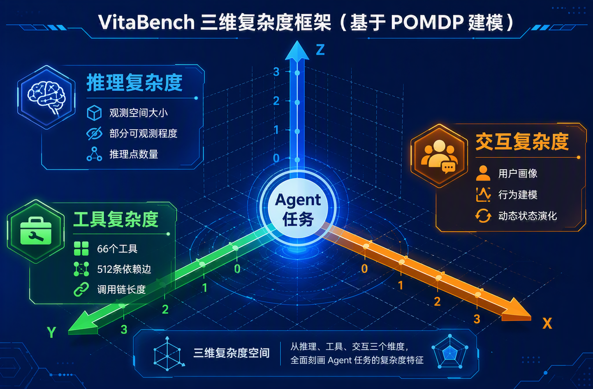
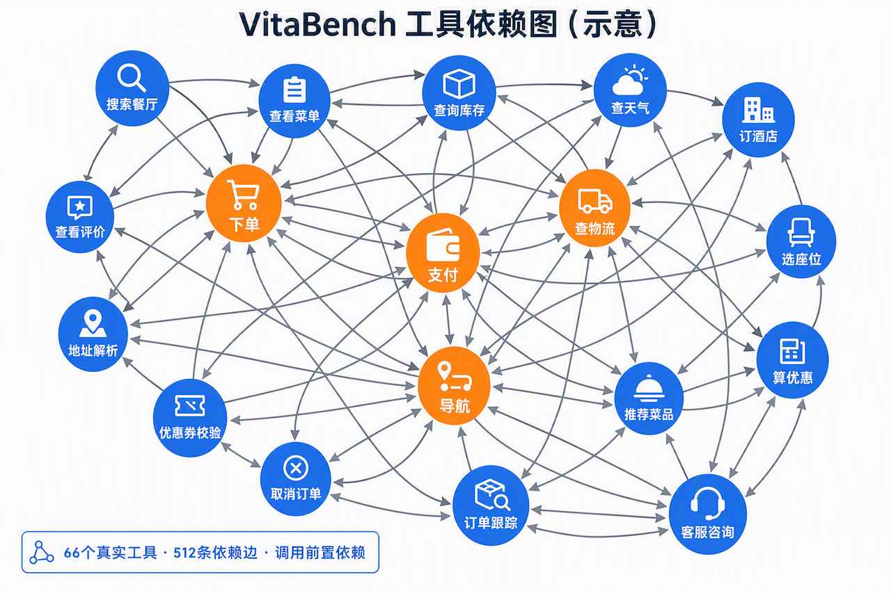

> **课时** 44/132　·　**Agent 八股**　·　约 1 小时
> [上一课：3.3.5 上线前收口:Pipeline 与发布闸门](../04-Agent/09-3.3.5 上线前收口-Pipeline 与发布闸门.md)　·　[下一课：4.MCP](../04-Agent/11-4.MCP.md)
>
> 学完标准：合上笔记，能讲清本节在问什么、你怎么答、以及如何套到自己的项目上。

---

#### 3.3.6 上线后监控

§3.6 已经把成本、延迟、效率、安全、合规纳入上线前发布闸门。Agent 一旦上线，评估并不结束，而是换了一种形态——**持续监控**。《AI Engineering》一句话点破：**"监控的目标和评估的目标是同一个。"** 区别只在于：上线前主要用准备好的数据、仿真和压测；上线后使用真实流量、用户反馈和系统遥测。

##### 3.3.6.1 A/B 测试与灰度发布

**【是什么】** 把新版本 Agent 只放给一部分真实用户，对比新旧版本的线上表现，再决定是否全量。

**【为什么测】** 离线评测分数高，不代表真实用户买账。A/B 测试是用真实流量做的最终裁决。注意它和 3.1.2 的比较式评估不同：**A/B 是把不同版本分给不同用户群看线上业务指标**，比较式评估是同一批输出给评委比。

**【怎么测】**

> 定性：**一个方法、分 3 步**（切流量 → 比线上指标 → 设回滚线），按顺序执行。
>

- **【步骤】** 按用户/流量切分实验组与对照组，灰度放量（先 1% 再 10% 再全量）；
- **【步骤】** 对比线上业务指标（留存、转化、满意度）而非离线分数；
- **【步骤】** 设好回滚阈值，一旦新版指标掉了立即回退。
##### 3.3.6.2 监控与可观测性

**【是什么】** 建立一套线上可观测性系统，对运行中的 Agent 做持续跟踪：它现在表现如何、有没有退化、有没有漂移、慢不慢、贵不贵、是否被攻击、能不能回溯每一步。

**【为什么测】** 上线前评测只能覆盖已知场景。真实流量会带来开发期没见过的输入、模型或数据分布变化、更长上下文、工具异常、成本放大和安全攻击。不持续盯着，等用户投诉时通常已经晚了。

**【怎么测】**

> 定性：这一节不是和"漂移 / 成本 / 安全"并列，而是它们的**统一观测底座**。先搭 logs / traces / metrics，再在这套数据上监控质量、漂移、异常、成本、延迟和安全。
>

1. **【底座】可观测性三件套**
    - **Logs（日志）**：记录每次请求、输入摘要、输出状态、错误、guardrail 命中、拒答原因；
    - **Traces（调用链追踪）**：记录一次 Agent 任务经过了哪些 Agent / 工具 / 模型调用，每一步耗时、token、成本和结果；
    - **Metrics（指标）**：把关键数值按时间聚合，形成 dashboard 和告警。
1. **【监控对象一】质量与行为**
    - 格式错误率：JSON 解析失败、schema 不合规；
    - 事实一致性、生成质量：可用 AI judge 抽样评估；
    - 拒答率、误拒率、guardrail 触发率；
    - 工具调用成功率、错工具率、异常工具路径。
1. **【监控对象二】漂移与异常**
    - **输入分布漂移**：用户问法、主题、query embedding 分布是否偏离历史基线；
    - **输出质量漂移**：事实一致性、满意度、拒答率是否持续变差；
    - **行为异常**：工具调用次数突然翻倍、某类任务失败率突增、Agent 出现循环；
    - **处置闭环**：发现漂移后触发重新评估 / 重新训练 / 回滚，并把线上样本回灌 §3.6 的评测集。
1. **【监控对象三】成本 / 效率 / 延迟**
    - **延迟**：TTFT、TPOT、总延迟、P95/P99，按用户、场景、模型版本拆分；
    - **成本**：输入/输出 token、每任务成本、每用户成本、工具/API 调用费用、缓存命中率；
    - **效率**：平均步数、最大步数、重复工具调用、工具循环、单动作耗时；
    - **处置**：超过预算时触发降级、模型路由切换、上下文裁剪、缓存策略、回滚或人工兜底。
1. **【监控对象四】安全 / 合规**
    - **攻击监控**：越狱、直接/间接提示注入、异常查询、工具越权、远程代码执行风险；
    - **护栏监控**：guardrail 触发率、漏拦率、拒答率、误拒率、人工升级率；
    - **内容与数据风险**：毒性、有害内容、事实不一致、PII / 敏感信息输入输出、品牌与合规风险；
    - **治理审计**：Contractor / 合约式治理，把可交付物、范围、成本、审计记录固定下来，保证线上行为可追责。
1. **【响应指标与工具】**
    - **MTTD / MTTR / CFR**：平均检测时长、平均修复时长、变更失败率，用来衡量团队发现和修复问题的速度；
    - **落地工具**：指标落到时序数据库（InfluxDB / Prometheus），接 Datadog / Grafana 等可观测性平台；Agent 专用的有 AgentOps，适合看交互 trace、token 和成本。
> ⚠️ **公共短板提示**：安全/合规是四份资料里整体覆盖最薄弱的一环（龙猫几乎不涉及）。真实项目里这块往往需要额外引入专门的安全测试体系，不能只靠通用评测资料。
>
> 💬 **【面试卡片】** **Q：你的项目上线以后，你如何保证和监测上线质量？**
>
> **A：** 我会把上线后的质量保障分成两层：**灰度发布控制风险，可观测性持续监控质量**。上线不是评测结束，而是把上线前定义好的质量、成本、延迟、安全指标搬到真实流量里持续验证。
>
> 第一，**上线时做 A/B 测试和灰度发布**。新版本不会直接全量，而是先放 1% 或小流量，对比旧版本的真实业务指标，比如任务成功率、用户满意度、转化率、投诉率，同时设置回滚线。如果关键指标下降、错误率升高或安全告警增加，就立即暂停放量或回滚。
>
> 第二，**上线后建立 logs / traces / metrics 三件套**。Logs 记录请求、错误、拒答和护栏命中；traces 记录一次 Agent 任务经过哪些模型、工具和子 Agent，每一步耗时、token、成本和结果；metrics 把关键指标聚合成 dashboard 和告警。这样既能看总体趋势，也能回溯单次失败到底卡在哪一步。
>
> 第三，**持续监控四类核心指标**：质量指标看格式错误率、事实一致性、生成质量、拒答率、工具调用成功率；漂移与异常看用户输入分布、输出质量、异常工具路径和 Agent 循环；成本延迟看 TTFT、TPOT、P95/P99、token、平均步数和工具耗时；安全合规看越狱/提示注入、guardrail 触发率、误拒率、PII 泄露和审计记录。
>
> 第四，**把监控变成响应闭环**。我会设置 MTTD、MTTR、CFR 这类响应指标，保证问题能及时发现、定位和修复。线上发现的新失败、新攻击、新高成本 case，会回灌到离线评测集，重新跑 §3.6 的发布闸门，避免同类问题下次再上线。
>
> 总结来说，我保证线上质量的方式是：**灰度发布控风险，logs/traces/metrics 看得见，质量/漂移/成本/安全指标持续告警，线上问题回灌评测集形成闭环**。
>

**第 3 章小结**：到这里，我们已经把生命周期主线上的每一环都讲完了——从通用武器（LLM-judge、比较评估、基础度量），到上线前验证（选型 → 成功标准 → 组件 → 集成 → 评测集 / Pipeline / 发布闸门），再到上线后监控（A/B 灰度发布 → 监控与可观测性覆盖质量、漂移、成本、延迟和安全）。**下一章用美团龙猫这个真实项目，看这些思想是怎么被打包成一套完整评估系统落地的。**

---

### 3.4 实战

#### 3.4.1 实战一：美团 LongCat VitaBench

**【背景】** 现有的 Agent benchmark 大多是"玩具任务"，和真实生活差距很大，区分不出顶尖模型到底差在哪。VitaBench 的目标是：**用贴近真实生活的复杂场景，量化现有 Agent 与实际应用需求之间的差距。**

**【场景】** 聚焦美团最熟悉的三大生活服务场景：**外卖点餐、餐厅就餐、旅游出行**。

**【为什么难】** 这些场景天然具备真实世界的复杂度：一个任务可能涉及 5–20 个服务商、100 多个候选商品，用户还会中途改主意。VitaBench 号称是"迄今最复杂的生活服务模拟环境"。

##### 3.4.1 整体思想

这是本章的核心。下面把**VitaBench 的每个设计，对应回第 3 章的哪个评测思想**一一列出——你会看到它几乎是第 3 章的一次"综合落地演练"：

- **3.4.4 规划/推理评测** → VitaBench 用**推理复杂度**维度落地：观测空间大小、部分可观测程度、推理点数量。
- **3.4.3 工具调用评测** → VitaBench 用**工具复杂度**落地：66 个真实工具，跨场景含 512 条依赖边的工具图。
- **3.5.3 多轮交互评测** → VitaBench 用**交互复杂度**加 **GPT-4.1 用户模拟器**落地，模拟用户改主意、模糊表达。
- **3.1.1 LLM-as-a-judge** → VitaBench 用 **Rubric 滑动窗口评估器**落地：用 Claude-3.7-Sonnet 当裁判，κ=0.828。
- **3.5.1 任务结果评测** → VitaBench 用 **Avg@4 / Pass@4 / Pass^4** 落地（每任务跑 4 次，温度 0）。
**几个特别值得讲的设计亮点：**

1. **三维复杂度框架**：VitaBench 把 Agent–用户–工具的交互建模成 POMDP（部分可观测马尔可夫决策过程），拆成**推理 / 工具 / 交互**三个可独立调节的复杂度维度。这是它最大的学术贡献——**第一次让任务复杂度变得"可控、可量化"**。

1. **Rubric 滑动窗口评估器**：把任务目标拆成一个个原子化的判定准则，用"全有或全无"方式严格判定，和人类评判的一致性高达 Cohen's κ=0.828——说明这套自动评估很可信。这正是 3.1.1 LLM-as-a-judge 的高质量工程实现。
1. **故意去掉"规则文档"**：传统 benchmark 会给 Agent 一份 policy 文档说明规则，VitaBench 反其道而行——**把领域规则编码进工具依赖图里，逼模型自己推理**，而不是照着说明书抄。这让评测更接近真实（现实中没人给你完整说明书）。
1. **真实工具图**：66 个真实工具之间有 512 条依赖边（调用 A 工具前必须先调 B），构成一张复杂的依赖网络。

##### 3.4.2 结果与启示

**【结果很扎心】** 即便是当时最强的模型 o3，在 VitaBench 上：

- 跨场景 **Avg@4 仅 30%**，单场景 < 50%；
- **Pass^4 ≈ 0%**（连续 4 次全做对的概率几乎为零，说明极不稳定）；
- 失败主因是**推理错误（占 61.8%）**。
**【启示】**

1. **顶尖 Agent 离"真实可用"还很远**——在玩具 benchmark 上的高分有水分，一到真实复杂场景就现原形。
1. **推理是当前最大瓶颈**（61.8% 失败源于推理），印证了 3.4.4 规划/推理评测的重要性。
1. **稳定性比单次成功更难**——Pass^4≈0% 说明 Agent 偶尔做对容易、稳定做对极难，这也是为什么龙猫要用 Pass^k 这种严格指标。
> **这个实战案例的最大借鉴**：当你要为自己的业务（尤其是有真实工具、多轮交互的复杂场景）做评估时，VitaBench 提供了一套可抄的范式——**用三维复杂度刻画任务难度、用真实工具图考工具调用、用用户模拟器考多轮、用 Rubric+LLM-judge 严格判分、用 Pass^k 考稳定性**。
>
> 💬 **【面试卡片】** **Q：介绍一个你了解的 Agent 评测 benchmark，它是怎么设计的？（或者问题可以是介绍一个你看过的论文，你就说你看了美团龙猫讲Agent评测的论文）**
>
> **A：** 我了解美团 LongCat 的 VitaBench。它聚焦外卖点餐、餐厅就餐、旅游出行三大真实生活服务场景，目标是量化现有 Agent 和真实应用需求之间的差距。设计上它几乎把一整套评测思想综合落地：
>
> ① 把 Agent–用户–工具交互建模成 POMDP，拆成推理 / 工具 / 交互三个可独立调节、可量化的复杂度维度——这是它最大的贡献；
>
> ② 用 66 个真实工具加 512 条依赖边的工具图考工具调用；
>
> ③ 用 GPT-4.1 用户模拟器考多轮交互，模拟用户改主意、模糊表达；
>
> ④ 用 Rubric 滑动窗口评估器（Claude-3.7-Sonnet 当裁判、和人类一致性 κ=0.828）严格判分；
>
> ⑤ 用 Avg@4 / Pass@4 / Pass^4 考稳定性。它还故意去掉规则文档、把规则编码进工具依赖图，逼模型自己推理。结果很扎心：最强的 o3 跨场景 Avg@4 只有 30%、Pass^4 几乎为 0%，61.8% 的失败源于推理——说明顶尖 Agent 离真实可用还很远、推理是最大瓶颈、稳定做对比偶尔做对难得多。
>

---

#### 3.4.1 实战二：算法项目二阶段

我们的大模型项目，二阶段完成的内容就是一个Agent评估的东西。

即使你不做算法，也可以去看一下这块对应的讲解视频，跟着去做一下，学习Agent评估的实战。

具体细节[ 大模型算法项目学习方法](https://my.feishu.cn/docx/GikId1snboM6LyxxGPXc0kDdnub#doxcn5AyOlyIEzs2qQjx0xziqMc)中，二阶段的介绍。

---

### 3.5 面试问题汇总

> 本章汇总全文出现过的面试问题。**每道题的问法都与前文对应小节的面试卡片完全一致**，答案可直接回到该卡片查看。
>

** 概念理解类**

1.  **TDD 你了解过吗？你自己用 TDD 做过完整开发吗？** （见[3.1.1 面试卡片](https://my.feishu.cn/docx/GikId1snboM6LyxxGPXc0kDdnub#doxcnD7BD6KmxvvtkYKdtcPjrsd)）
1.  **你觉得 Agent 行业的测试和传统行业有哪些不同？** （见 [3.1.2面试卡片](https://my.feishu.cn/docx/GikId1snboM6LyxxGPXc0kDdnub#doxcnhyLcyifxcVdvAb9aWvuGHl)）
1. **Agent 行业的测试面临着哪些困难？** （见[ 3.1.3 面试卡片](https://my.feishu.cn/docx/GikId1snboM6LyxxGPXc0kDdnub#doxcnYqvzknOBZow3gkHsLoaAGc)）
1. **一个 Agent 最终答对了，但你为什么还要看它的"轨迹"？** （[见 3.3.4.3 面试卡片](https://my.feishu.cn/docx/GikId1snboM6LyxxGPXc0kDdnub#doxcn61Fzru1EFEhZeJxevvrl4b)）
**方法与指标类**

5. **在 Agent 评测中用 LLM-as-a-judge（大模型当裁判）很火，请客观评价一下它的优缺点？如果由你负责实际项目落地，应该怎么科学避坑？** （见[ 3.3.1.1 面试卡片](https://my.feishu.cn/docx/GikId1snboM6LyxxGPXc0kDdnub#doxcnrz6alvyvMtwXEPN5TFJZWz)）
1. **评估一个 RAG 系统，你会从哪些维度入手？用什么指标？** （见 [3.3.3.2 面试卡片](https://my.feishu.cn/docx/GikId1snboM6LyxxGPXc0kDdnub#doxcnLUlciMQbC83UOZckuCSfZe)）
1. **怎么评估 Agent 的工具调用能力？它有哪几个层次？** （见 [3.3.3.3 面试卡片](https://my.feishu.cn/docx/GikId1snboM6LyxxGPXc0kDdnub#doxcng2rQ3DbELu3KftRwqT4o7g)）
1. **功能正确性、相似度、LLM-judge 三类指标怎么选？** （见 [3.3.1.3 面试卡片](https://my.feishu.cn/docx/GikId1snboM6LyxxGPXc0kDdnub#doxcnJFiNU9G653LE1t1eWNo1Xb)）
**工程实践类**

9. **你认为在 Agent 系统中，应该测试/评估哪些东西？** （见 [ 3.2.2 章面试卡片](https://my.feishu.cn/docx/GikId1snboM6LyxxGPXc0kDdnub#doxcnmfWMt9MgeZ6Vk5zd1Nu5me)）
1. **你是如何确定你的模型的？** （[见 3.3.2 面试卡片](https://my.feishu.cn/docx/GikId1snboM6LyxxGPXc0kDdnub#doxcnw8cS03fV6ItSUYJFRA6Tyc)）
1. **多 Agent 系统中，你应该如何评估多个 Agent 之间的协作？** （见 [3.3.4.4 面试卡](https://my.feishu.cn/docx/GikId1snboM6LyxxGPXc0kDdnub#doxcnwR1j2SoawBMLfbbf952Ixh)片）
1. **你的项目上线以后，你如何保证和监测上线质量？** （见 [3.3.6 面试卡片](https://my.feishu.cn/docx/GikId1snboM6LyxxGPXc0kDdnub#doxcnRdAX4Ub60SV6hl5lbmsOAe)）
1. **你会怎么评估 Agent 的安全性？** （见 [3.5.3 面试卡片](https://my.feishu.cn/docx/GikId1snboM6LyxxGPXc0kDdnub#doxcnOn9Zm8Sl5SU96kYTtyxpJh)）
**案例分析类**

14.  **介绍一个你了解的 Agent 评测 benchmark，它是怎么设计的？** （见 [3.4 面试卡片](https://my.feishu.cn/docx/GikId1snboM6LyxxGPXc0kDdnub#doxcnOxPwJeTkfzGOPOyPqc3lDc)）
1. **你的项目是如何做Agent评估的？**
（推荐思路，要么你就按照今天的理论，做一遍Agent评测，然后按照你的做法适度包装。要么你可以把今天的笔记输入给AI，然后把你的项目也让AI可见。让AI结合你的项目和这个Agent评估思路包装一套方法，然后自己多想想细节，修改润色下，提前准备好相关问题细节，和面试官说）

16. 评估一个 AI Agent，除了准确率还看哪些指标？

💡 **思路：** 关于Agent评测我们专门讲过，这个题就是纯八股。建议看完专题笔记，理解了思路后，然后再掌握/背诵这个标准答案。

📝 **答案：**

除了准确率，我还会关注**任务成功率、稳定性、工具调用和执行轨迹、鲁棒性、延迟、成本、安全合规以及线上业务指标**。

任务成功率主要看 Agent 最终有没有真正完成用户目标，而不只是回答内容是否正确。由于模型具有随机性，还要把同一个任务重复运行多次，通过 **Pass@k** 或 **Pass^k** 观察它能否稳定完成，而不是偶然成功。

**工具调用**方面，要看**工具选择是否正确、必填参数是否完整、参数值是否准确**，以及是否存在不该调用工具却乱调用的情况。**执行轨迹**方面，则要看**规划步骤和工具调用顺序是否合理**，有没有遗漏关键步骤、违反用户约束、重复调用或者陷入循环。

**鲁棒性**主要看 Agent 面对用户改口、信息缺失、模糊表达、长上下文和工具异常时，能否正确追问、调整计划或进行降级。效率方面会统计**平均执行步数**、**工具调用**次数和**重复动作率**；延迟方面关注 **TTFT**、总响应时间以及 **P95**、**P99**；成本方面关注单任务 **Token 消耗**和外部 API 调用费用。

安全合规方面，要评估**提示注入**、**越狱**、**工具越权**、**敏感信息泄露**和有害内容等风险，同时监控**护栏漏拦率**和**误拒率**。Agent 上线以后，还要看**用户满意度、转化率、投诉率和人工兜底率**等真实业务指标。

如果是多 Agent 系统，还需要看 **Agent 选择正确率、交接字段完整率、协作冲突率**，以及增加某个 Agent 后带来的成功率收益是否值得额外的成本和延迟。

总体来说，除了准确率，我会同时评估 Agent 的**成功率、稳定性、执行过程、鲁棒性、效率、延迟、成本、安全合规和业务效果**。

选自[202607 宇树科技Agent开发一面](https://my.feishu.cn/docx/GikId1snboM6LyxxGPXc0kDdnub#doxcnoTobKM60V0JViDKCSHRuie)

---

### 3.6 视频讲解

https://www.bilibili.com/video/BV1QMTg6AE52/?spm_id_from=333.1387.homepage.video_card.click&vd_source=144bec9c3f54e465073138bed788be1b

---
