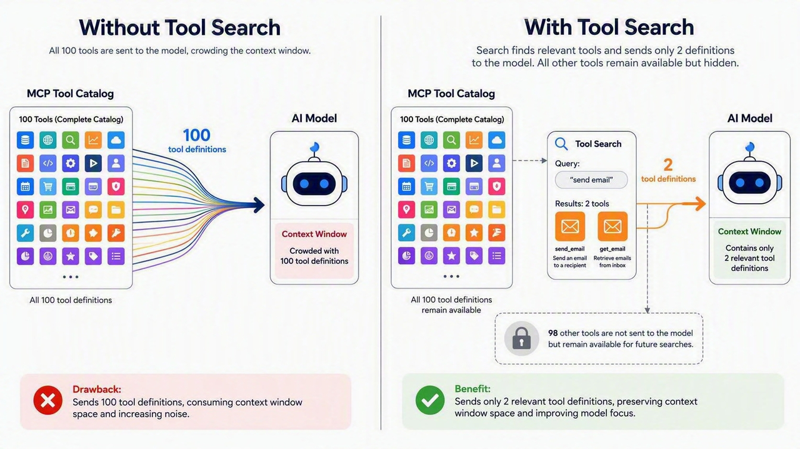
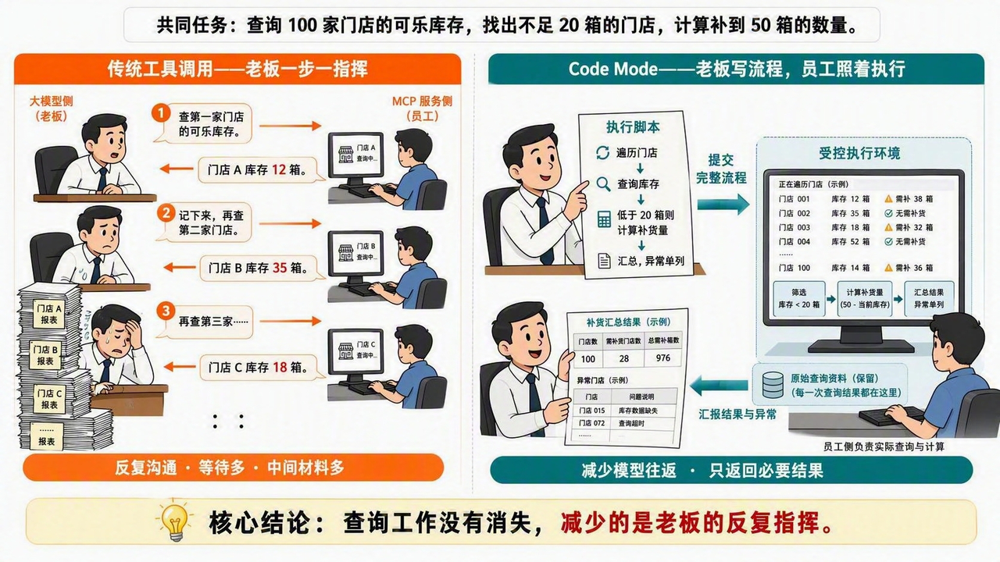

> **课时** 46/132　·　**Agent 八股**　·　约 1 小时
> [上一课：4.MCP](11-4.MCP.md)　·　[下一课：5 Agent的记忆功能](12-5 Agent的记忆功能.md)
>
> 学完标准：合上笔记，能讲清本节在问什么、你怎么答、以及如何套到自己的项目上。

---

### 6.5 MCP的新技术&趋势

2026年8月份，[阿里淘天秋招大模型开发一面面试](https://my.feishu.cn/docx/GikId1snboM6LyxxGPXc0kDdnub#doxcnFokAY5rbVuTAk7f8ZVSu1b)官问了这么三个MCP的问题： MCP 是为了解决什么问题提出的？ - 考察MCP的基本理解，概念和定义。 MCP 的工具形式给通用 Agent 带来了什么问题？有没有了解替代传统 MCP 调用形式的方法？ - 这两个问题考察了，有没有关注MCP的技术发展，替代技术和局限性。 从26年Agent SKILL 火起来以后，MCP确实受到了挺大的冲击，热度没有去年那么大。 但诚然MCP并没有完全消失，面试中也会出现。这三个问题，问的也很符合时代的趋势，在当前环境下，MCP受到了哪些冲击，又有哪些迭代？ 为了讲清楚这些问题，我要给大家介绍4个技术：

- **Tool Search：工具已接入，需要时才把相关工具的说明加载给模型。**
- **Code Mode：模型写流程，程序执行流程，不必每一步都让模型重新决定。**
- **Agent Skills：把某类任务的做法、脚本和资料封装起来，按需复用。**
- **MCP 2026 年演进：协议继续向易部署、可缓存、可授权和支持长任务的方向发展。**
弄明白了这4项技术后，对于MCP的面试问题回答，我们的回答会更有深度，也更加与时俱进。

#### 6.5.1 Tool Search 

**痛点**

接入的 MCP 工具多了，如果客户端把所有工具说明都放进模型上下文，就会浪费 token，也增加模型选错工具的可能。

比如用户只是想查一封邮件，模型却收到了邮件、日历、CRM 等 100 个工具的说明，大部分都用不上。

**解决方案**

Tool Search 可以主要在客户端实现，不必修改 MCP Server：

- **MCP Server 端**：继续提供原来的工具，通过 `tools/list` 返回工具定义，通过 `tools/call` 执行调用。
- **客户端**：获取并保存完整工具目录，向模型提供搜索入口；根据任务检索相关工具，只把需要的工具说明加入模型上下文。模型选定工具后，客户端照常通过 MCP 调用。
例如处理邮件任务时，客户端只加载“搜索邮件”和“读取邮件”的说明，其他工具暂时不加载。常用工具可以直接提供，不必每次搜索。

**收益**

- **少占上下文**：不用加载大量无关工具说明，减少输入 token 开销。
- **更容易选工具**：模型主要面对与当前任务相关的工具，减少干扰。
搜索本身也有开销，并可能漏掉工具，因此更适合工具较多的场景；只有几个简单工具时，直接加载即可。



#### 6.5.2 Code Mode

> Code Mode 本质上是一种MCP 协议的用法，是2026年**美国的IT公司 Cloudflare 提出的一种使用方法。**协议本身内容没变，改变了MCP Server暴露的工具的思想，让客户端（大模型端）负责整个流程的脚本编排，把脚本的编排放在MCP Server侧。减少大模型多轮调用次数和等待时间。
>

MCP 解决了 Agent 如何统一接入外部工具的问题，但**工具接进来了，不代表多步任务就能高效完成。** 传统MCP的用法是：MCP Server 把查询客户、查询订单等业务操作分别暴露成工具，模型选择工具，客户端通过 MCP 发起调用，再把结果交给模型决定下一步。

只有一两次查询时，这种方式很直接。但当一个任务需要连续调用很多工具、反复查询分页、处理大量中间数据时，这种使用方式的痛点就出现了：**服务端只负责执行一个个业务操作，模型却要反复承担步骤编排和中间结果处理。**

上一章的 Tool Search 能减少一开始加载的工具说明，却不能单独解决执行阶段的这些往返。假设我们让 Agent 完成一个任务：**“查一下这 100 位客户的订单，找出本月消费超过 1 万元的人。”** 模型先通过 MCP 工具请求客户名单，拿到结果后再决定查谁的订单；订单返回后，又继续决定下一次调用。如果接口还有分页，就要继续取下一页，最后再汇总。

在这个过程中，**大量普通程序就能完成的机械步骤，也让模型反复参与了**：

- **等待多**：每轮都要等待模型读取结果、生成下一步操作。
- **上下文长**：大量订单作为工具结果交给模型，但用户真正需要的只是筛选后的名单。
- **处理不划算**：循环、求和、排序、去重本来就适合普通程序，不必让模型靠阅读原始数据完成。
既然模型会写代码，我们能不能让它把处理流程写出来，交给程序连续执行，而不是每一步都回来问它？**这就是 Code Mode 的核心思路：模型负责生成处理逻辑，运行时负责执行，只把必要结果返回模型。**

对于刚才的任务，模型可以生成这样的脚本逻辑：

```
查询客户列表；
循环处理每位客户：
    查询本月订单，如果有下一页就继续查询；
    计算订单总额；
    如果总额超过 1 万元，加入结果；
返回符合条件的客户及总额。
```

根据这样的逻辑：**模型不需要预先知道具体有多少页、要调用多少次，只需要写清楚处理规则。** 大量订单留在执行环境里，最终只有筛选后的名单进入模型上下文。

那么，这段程序由谁执行，它又怎么知道能调用哪些业务能力？Cloudflare 演讲中的实现给了一个具体答案：**服务端不再把每个业务 API 都单独暴露成 MCP 工具，而是提供“能力发现”和“代码执行”两个入口：****`search`**** 与 ****`execute`****。**

以前，MCP Server 可能直接暴露 a、b、c、d、e 五个业务工具，模型分别发起调用。现在，面向客户端的 MCP 工具列表可以只有 `search` 和 `execute`，而 a、b、c、d、e 仍然存在，只是作为执行环境中的函数，供模型生成的脚本调用。

模型、客户端和服务侧的协作过程是：

1. **先查接口。** 模型调用 `search`，客户端通过 MCP 把请求发给服务端，获取本次需要的业务函数及参数说明。视频中的 `search` 接受代码，用它查询 OpenAPI 规格，并不是把全部接口文档交给模型。
1. **再写流程。** 模型根据说明，写出“查客户、循环查订单、求和、筛选”的脚本。它写的是组合已有能力的逻辑，不是重新实现订单查询服务。
1. **提交执行。** 模型调用 `execute`，客户端通过 MCP 提交整段脚本，服务侧的受控运行时执行代码。代码中的业务函数可以直接调用相应 HTTP API。
1. **返回结果。** 服务侧完成查询和统计后，把脚本输出返回客户端，再交给模型回答用户。中间每一次订单查询不必都让模型参与。
```
模型通过 search 了解需要的接口
              ↓
模型写脚本，通过 execute 提交
              ↓
服务侧执行：查客户 → 循环查订单 → 计算 → 筛选
              ↓
只把必要结果返回模型
```

这里有两个不同的收益：`search` 让接口说明按需加载，避免开局塞入大量工具定义；`execute` 让多个业务操作在程序里完成，减少执行期间的模型往返和中间上下文。**搜索是配套机制，生成并执行程序才是 Code Mode 的核心。**

最后总结来说，CodeMode这个技术，并没有改变MCP协议本身，而是改变了使用方式。 MCP Server不暴露具体的业务接口，而只暴露让客户端（大模型侧）能够进行流程编排的必要接口，让客户端写整个过程的运行脚本，交给MCP Server侧统一执行。 省去模型多轮推理，等待，也减少不必要的上下文（只将最后结果送给大模型）。

**面试时可以这样总结：Code Mode 把可程序化的工具编排和中间数据处理，从模型逐步决策转移到外部运行时。模型写流程，程序执行流程，从而减少模型往返和上下文开销。Cloudflare 的 search/execute 是它与 MCP 结合的一种服务侧实现，而不是替代 MCP 的新协议。**

如果看了上面的内容你还一知半解，我们用这个图来做一下类比，希望你可以通过这个图明白Code Mode的优势。



#### 6.5.3 Agent Skills

Agent Skills 的基础用法就不展开了。在之前的 Skills 笔记和讲解视频中，我们已经拿它和 MCP 做过对比。围绕 Skills，也经常能看到“MCP 是不是被淘汰了”这样的讨论，但不能把这种说法直接当作技术结论。

相信大家对 Skills 和 MCP 都不陌生。这一节之所以仍然讲 Agent Skills，主要是因为它们太容易被放在一起比较。包括面试官问的“**有没有了解替代传统 MCP 调用形式的方法？**”，Skills 也是一个回答的出发点。这里就集中总结它们的区别、优缺点和适用场景，作为一道常见的面试对比题来准备。

**SKILLS VS MCP**

**Skills 主要教 Agent“这类事情应该怎么做”，MCP 主要解决“怎样以统一方式接入外部能力”。它们不是同一层的技术，所以既可以配合，也会在某些具体场景中形成替代选择。**

还是拿“生成月度经营报告”举例。MCP Server 可以提供查询订单、查询退款、读取客户信息等工具，但有了这些工具，Agent 不一定知道公司要求使用哪种统计口径、怎样排除异常、按什么模板输出。Skill 则可以把这些做法写清楚，并附带统计脚本和报告模板。

**从提供的内容来看，Skill 更像一份可以附带工具材料的操作手册。** `SKILL.md` 写明任务步骤，旁边可以放脚本、参考资料和模板，重点回答“这类任务应该怎么完成”。MCP 则约定外部能力如何被发现和调用，包括工具定义、参数 schema 和结果格式等，重点回答“有哪些能力可用，以及怎样调用”。

**从执行方式来看，Skill 本身不是执行器。** Agent 读完指南，仍要依靠宿主提供的工具、CLI 或脚本运行时干活，也可以按指南调用 MCP 工具。而通过 MCP 调用时，由客户端发送请求，服务器执行对应操作，再返回结果。

**从复用方式来看，Skills 复用的是做事方法和资源，MCP 复用的是服务接入。** 一份 Skill 可以交给兼容的 Agent 使用，但对方仍需具备相应的工具和环境；一个 MCP 服务可以让多个兼容应用接入，不必各自重新实现一套业务系统适配。

两者也都有边界：**写了 Skill，不代表自动获得了业务数据、账号权限或执行环境；接了 MCP，也不代表自动获得了完整业务流程，或者模型一定能选对工具。**

**为什么大家会觉得 Skills 能替代 MCP？因为有些任务原本就不需要额外包装一层 MCP。**

比如“查 GitHub Issue，再整理成周报”，可以有两种做法：

- 接入 GitHub MCP，让 Agent 调用相关工具。
- 写一个 Skill，指导 Agent 使用已经安装并授权的 `gh` 命令查询，再运行脚本整理结果。
如果命令行工具已经成熟可用，第二种方式可能更轻量，不必为了同一套操作再搭建、配置和维护一个 MCP Server。处理本地文件、生成文档、运行测试等任务，也经常适合“Skill + 现有工具或脚本”。

**但反过来，如果没有现成的访问能力，只写一个 Skill 就替代不了 MCP 接入。** 比如，公司内部有一套订单系统，数据库不允许员工电脑直接连接，也没有提供可用的 CLI。公司已经通过一个受控的 MCP Server 提供订单查询：服务端核验员工身份，只返回其有权查看的店铺订单，并记录查询日志。

这时候，即使写一个 Skill，告诉 Agent“先查订单，再扣除退款，最后生成经营报告”，Agent 也不会因此获得订单数据。**Skill 提供了操作指南，但查询入口、身份校验和数据权限仍然依赖已有的业务服务。** 实际方案应该是 Skill 规定统计方法，Agent 通过已授权的 MCP 工具取数，再完成报告。

**优缺点**

从优缺点看，Skills 的优势是容易编写、容易随项目版本管理，能够把团队经验、模板和经过测试的脚本一起复用；按需加载也避免了把完整操作指南一直放在上下文中。代价是仍要维护指南和脚本，并处理运行环境、依赖版本、凭据和权限。把 Skill 复制给另一个 Agent，不代表对方就有相同的工具和环境；模型读取了指南，也不保证每一步都正确执行。

MCP 的优势则是标准化接入：如果多个 Agent 应用都需要访问同一个业务系统，可以让它们复用同一个 MCP 服务，而不是每个应用各写一套适配。服务端也便于集中实现业务校验、权限检查和审计。代价是需要维护客户端与服务端的接入、鉴权、兼容性和运行环境；对于简单任务，额外包装服务可能不划算。如果全量加载工具说明、逐步回传大量结果，还会遇到前两章讨论的效率问题。

**实际选型**

- **已有工具，但缺少做事方法：优先考虑 Skills。** 例如统一代码审查步骤、固定报告口径、套用文档模板。
- **缺少业务系统接入，或者要让多个 Agent 应用复用同一服务：考虑 MCP。** 例如统一访问内部订单、CRM、工单系统。它不是唯一接入方式，但能减少各应用重复适配。
- **既需要接入能力，又需要业务流程：Skills + MCP 配合。** 例如 Skill 规定报表口径和检查步骤，MCP 查询真实订单，脚本负责计算，再按模板输出。
#### 6.5.4 2026新特性

因为MCP 是24年11月就推出的技术，现在如果再考它，回答的时候，我不想你的回答还和2025年那会烂大街，所以这里讲一下2026年MCP的演进，新的技术，在我们下次介绍的时候，可以把这些技术加进去。让答案与时俱进，与众不同。 这里我们不会特别展开，因为其实问的不多，热度也不算很高，我也没看到面试官专门问这个新特性，所以我的策略是大致理解一下，记一下就够了，不深入，然后下次面试官问到我MCP的内容的时候，我在会介绍MCP的内容的时候，把它的新特性带进去。

这里不背版本更新清单，只记三个与 Agent 发展趋势有关的方向：

1. **长任务：从回答一个问题，到持续完成一件事。**
Agent 的工程重点不再只有怎么写 Prompt，还包括工作流／图编排、任务状态和长时间执行。例如做一次深度调研、跑完整个测试流程，都不是一次调用马上就能返回的。

MCP 也在完善 Tasks 等任务机制，让服务端能够返回任务标识，供客户端查询状态、获取结果或补充输入，并继续推进事件通知等机制的协同。**它正在适应“工具在后台持续干活”，而不只是“一问一答”。** MCP 承接这些任务交互，但不替代 Agent 自身的工作流编排。

1. **按需发现：从堆工具、堆上下文，到只提供当前需要的能力。**
通用 Agent 接入的服务越来越多，不能把所有工具说明一直塞给模型。上下文管理越来越强调“需要什么，再加载什么”。

MCP 生态已有客户端 Tool Search、渐进式披露等实践，协议路线图也在推进服务器侧渐进发现。**方向是让 Agent 面对大量工具时，也能按任务找到需要的能力，而不是先读完整个工具目录。**

1. **身份与权限委托：从人在旁边操作，到 Agent 代表人自主执行。**
当 Agent 开始后台运行、操作企业系统，甚至把任务交给子 Agent，就必须回答：它代表谁？能操作什么？交给子 Agent 的权限能不能更小？

MCP 正在加强授权机制，并推进 Agent 身份、身份联合与权限委托等方向。**目标是让自主执行有明确的权限边界，而不是把人的全部权限直接交给每一个 Agent。**

介绍 MCP 时，可以用下面这段话收尾：

> MCP 也一直在跟着 Agent 的发展演进：任务越来越长，它就完善长任务机制；工具越来越多，它就朝按需发现发展；Agent 越来越自主，它就加强身份和权限委托。所以它不只是一个早期的工具接入协议，也在向长期运行、大规模工具使用和企业落地的需求靠近。
>

记住三个关键词就够了：**长任务、按需发现、身份与权限委托。** 这些方向中既有现成机制，也有仍在推进的标准化工作，不代表所有产品已经全部支持。

#### 6.5.5 面试真题

以下三个问题，都是选自[202608 阿里淘天秋招大模型开发一面](https://my.feishu.cn/docx/GikId1snboM6LyxxGPXc0kDdnub#doxcn5npVDzQMG9nEJYiuSkKlGb)

1. 谈一谈你对MCP的理解？
 （子问题）MCP 是为了解决什么问题提出的？

**💡 思路**

2026年了，这个问题的介绍，我就希望可以答一点不一样的，答一点符合时代趋势的内容。其实阿里202608 阿里淘天问的这个三个MCP的问题，就是一个很好的介绍MCP技术的一个思路，我们可以从 **概念 - 局限性 - 替代方案 - 发展趋势（新技术）**这四个方面递进讲解，结合时代最新趋势回答。

**📝 参考回答**

【概念】MCP 最初解决的是 AI 应用接入外**部工具和数据时，接口不统一、适配重复的问题**。比如多个 Agent 都要接 GitHub、数据库和企业订单系统，没有统一协议时，每个应用往往都要做自己的适配。MCP 把能力描述、工具发现和调用方式标准化，让服务提供方实现一次 MCP Server，不同的兼容应用就能复用。它的核心价值不是让模型突然会用工具，而是降低工具接入和复用的成本。

【局限性】它也有它的局限性：**统一了接入方式，并不意味着工具使用就一定高效。**工具多的时候，**如果把所有工具说明都塞进上下文，会增加 token 开销和选择难度**；复杂任务如果每一步都让模型调用工具、读取完整结果，也会带来很多等待和中间数据，增加了延迟。

【替代方案】针对这些问题，现在有几类改进或替代方案。**Tool Search** 按任务搜索并加载需要的工具定义；**Code Mode **让模型写脚本，把多步调用、循环和数据处理交给运行时，减少模型往返；**Skills 则封装做事方法**，配合现成 CLI 或脚本，在部分场景下可以不再专门接 MCP，但也可以与 MCP 配合。所以这些方案不代表 MCP 整体被替代，很多改变的是它的使用方式。

【发展趋势（新特性）】MCP 本身也在适应 Agent 的发展：**任务越来越长，就完善长任务机制；工具越来越多，就推进按需发现；Agent 越来越自主，就加强身份和权限委托。这些方向既有现成能力，也有仍在推进的标准化工作，目的都是让 MCP 更适合长期运行、大规模工具使用和企业落地**。

【总结】所以我理解，MCP 最初解决的是“让不同 AI 应用用统一的方式接入外部能力”，现在关注的则是“接入之后，怎样更高效、更可靠、更可控地使用这些能力”。它并没有因为新技术出现就失去价值，而是在与工具搜索、程序化执行和 Skills 等方案配合，适应越来越复杂的 Agent 任务。

1. MCP有哪些局限性？
**💡 思路**

这个题思考点，我们就可以从上面，我们定义的各个和MCP类似/配合使用的技术出发来回答，比如： 1.Agent SKILL - 它更轻量， 相应地就对应MCP的流程比较重。 2.Code Mode - 对应模型和MCP Server多次交互，延迟高的问题。 3.Tool Search - 工具太多，污染上下文。

**📝 参考回答**

主要有三个问题：简单场景下接入和维护偏重，复杂任务中多轮交互延迟高，以及工具数量多时上下文开销大。

**【接入和维护偏重】**首先，MCP 虽然统一了接入方式，但仍然需要配置和维护服务、处理连接、鉴权与兼容性。如果任务本来通过已有命令或脚本就能完成，再包装一层 MCP 服务，可能增加不必要的工程成本。所以像 Agent Skills，可以封装任务指南和脚本，让模型直接使用已有执行能力。这可以简化部分场景的接入。

**【多轮交互延迟高】**其次，传统逐步调用方式下，工具每执行一步，都可能要把结果交回模型，再由模型决定下一步。任务链路越长，模型推理和等待的次数就越多，大量中间数据也会反复进入上下文。Cloudflare今年提出，**Code Mode **的技术，让模型先生成包含调用和处理逻辑的脚本，再由外部运行时连续执行，只返回必要结果。就很大程度缓解了这个问题。

**【上下文开销大】**最后，通用 Agent 的工具数量和种类往往比较多。如果把所有工具描述和参数说明一次性加载给模型，就会占用大量上下文，增加 token 成本；相似工具之间还可能互相干扰，让模型更难选对。针对这一问题，Tool Search：先根据任务检索相关工具，再加载需要的定义，避免把无关说明全部塞给模型，缓解了MCP的这个局限性。

1. 有没有了解过替代传统 MCP 调用形式的方案？ 
**💡 思路**

这个题思考点，还是可以从我们上面讲的**SKILL**, **Code Mode, Tool Search **来出发讲解。 虽然严格意义上来说，Code Mode 和 Tool Search不是MCP的替代方案，不过这个比较沾边，我估计面试官不会那么**较真**。如果说替代方案，目前我想的就是SKILL这个技术，也暂时没想到更多。

**📝 参考回答**

有了解过，主要有三类：用代码组织多步调用、按需搜索工具，以及用 Skills 配合现成 CLI 或脚本完成任务。这里我会区分一下：有些替代的是传统的工具调用方式，有些则是在具体场景下不再使用 MCP 接入。

**【程序化调用】**第一类是让模型生成一段程序，而不是每调用一个工具都重新决定下一步，这种方式通常叫 Code Mode。模型把调用、循环、判断和数据处理写进脚本，由受控运行时执行，只回传必要结果，减少模型往返和中间数据占用。比如 Cloudflare 的一种实现，是通过 MCP 提供 search 和 execute 两个入口，模型先查需要的接口，再提交脚本，由服务侧完成多步操作。底层仍然可以使用 MCP，改变的是调用的组织和执行方式。它适合多步骤、批量处理的任务，但需要做好执行隔离和权限控制。

**【按需发现工具】**第二类是工具搜索，也就是 Tool Search。不再把所有工具说明一次性交给模型，而是根据当前任务检索相关工具，再加载需要的定义。这可以在客户端完成，MCP Server 继续提供原来的工具，实际调用方式不变。它适合工具数量多、任务类型不固定的通用 Agent，也可以和 Code Mode 配合：先找到工具，再用代码组织执行。

**【Skills 配合现有工具**】第三类是把任务指南、脚本和资源封装成 Agent Skills，让 Agent 直接使用已有 CLI、SDK 或脚本。如果执行能力已经具备，就不一定需要再包装一层 MCP 服务，接入和维护可能更轻量。但真正访问外部系统的是这些工具，不是 Skill 本身；如果缺少数据访问通道和授权，仍然需要 MCP 或其他 API 接入。

【总结】所以我不会把这些方案理解为谁全面淘汰谁，而是按场景选择：流程长、机械步骤多，就考虑程序化调用；工具多，就考虑按需搜索；已有成熟命令和脚本，就用 Skills 组织复用。核心是减少不必要的模型参与和接入成本，同时保留所需的权限与可靠性保障。

#### 6.5.6 讲解视频

https://www.bilibili.com/video/BV1aahz6kETD/?spm_id_from=333.1387.homepage.video_card.click

---
