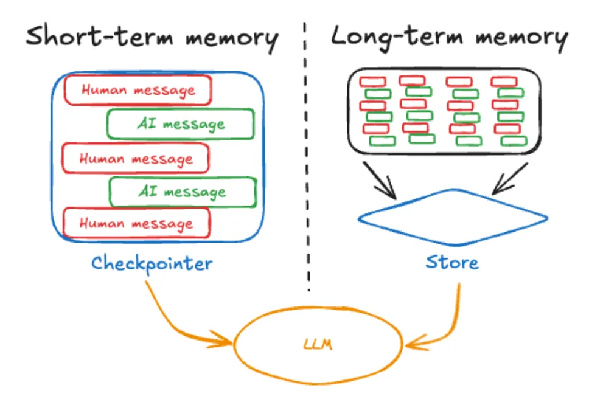
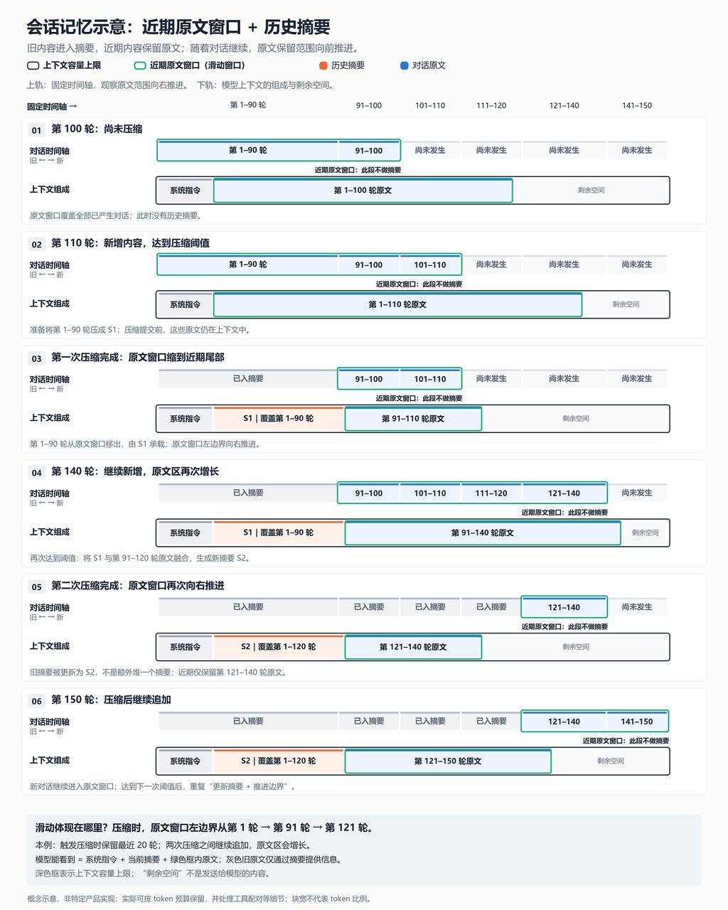

> **课时** 47/132　·　**Agent 八股**　·　约 50 分钟
> [上一课：6.5 MCP的新技术与趋势](11a-6.5 MCP的新技术与趋势.md)　·　[下一课：6 Multi-Agent 架构](13-6 Multi-Agent 架构.md)
>
> 学完标准：合上笔记，能讲清本节在问什么、你怎么答、以及如何套到自己的项目上。

---

## 5 Agent的记忆功能

（属于**必考内容**，熟练掌握

[《Agentic design pattern》第八章](https://github.com/xindoo/agentic-design-patterns/blob/main/chapters/Chapter%208_%20Memory%20Management.md)有对这一问题专门讲解。我把这个经典面试问题，结合了理论知识和现在最火的Openclaw结合，我相信这个回答会更让面试官眼前一亮。然后你这么回答其实把话题引到了Openclaw，所以Openclaw的知识要好好看，接着面试主动权就在我们手里了！）

Agent 的记忆功能通常分为**短期记忆**和**长期记忆。**

**短期记忆**通常存在于上下文窗口，包含最近的对话消息，智能体回复，工具调用结果，以及当前交互的反思内容。但是上下文窗口的容量有限，所以当多轮对话时，我们可以通过总结旧对话片段、强调关键细节等技术来维护这个上下文窗口。以 OpenClaw 为例，它的 Compaction 机制就是一个典型实现：当上下文 token 接近模型窗口上限时，系统会把最近约 20,000 tokens 的消息原样保留，更早的旧消息则用 LLM 分块生成结构化摘要来替代，摘要中会强制保留任务状态、决策理由、TODO 和关键标识符等信息，压缩后上下文变为"摘要加上最近原文"的结构，这样既释放了空间又尽量减少了信息损失。

当会话结束，短期记忆会丢失，**所以我们通常也会让 Agent 支持长期记忆。**我们通常使用一个知识库，存储智能体在各种交互场景、任务执行过程中需要长时间保存的信息。数据通常存在智能体运行环境之外，比如数据库，知识图谱，或者向量数据库中。当智能体需要使用长期记忆时，会查询外部存储，检索相关信息和数据并整合到上下文窗口中然后进行使用。**还是以 OpenClaw 为例**，它的长期记忆就是工作空间里的 Markdown 文件——`MEMORY.md` 存策展过的持久知识和偏好，`memory/YYYY-MM-DD.md` 按日期存追加式日志。在检索侧，系统会对这些文件建立混合搜索索引，同时使用向量语义搜索和 BM25 关键词搜索，按 7:3 权重做混合排序。Agent 需要回忆历史时，通过 `memory_search` 工具按需检索相关片段再拉进上下文，而不是把全部记忆都塞进去，这就是典型的 RAG 式长期记忆方案。

此外还有一个值得一提的设计，**就是短期记忆向长期记忆的自动沉淀机制**。OpenClaw 在压缩前会静默触发一轮 agent 回合，提醒模型把当前对话中重要的信息写入记忆文件，这样短期记忆中真正有价值的内容能在被压缩丢弃之前沉淀为长期记忆，保证了记忆的连续性。

### 5.1 介绍Langchain中的记忆功能的实现。

(短期记忆）Langchain中通过**ConversationBufferMemory**的接口，可以实现只保存几轮对话，或者使用LLM总结历史对话的短期记忆功能。

（长期记忆）通过**VectorStoreRetrieverMemory**可以将信息变成嵌入向量，存入Chroma, weaviate , FAISS的数据库中，并且支持语义搜索。

### 5.2 介绍Langgraph中的记忆功能的实现。

(参考https://mp.weixin.qq.com/s/XhFbLTLcSjDj0r3KGT9EOg， 这个文章对Langgraph的各方面写的很详细，想深入学可以仔细阅读，想简单学习可以当字典查。比如这个Langgraph的记忆功能，这里面就有现成答案，我直接照抄，不理解的可以看原文，里面也有讲解，原文里还有代码。）

 记忆是智能体运行中记住先前交互信息的组件，是能够连贯对话的核心能力，LangGraph中提供了**短期记忆和长期记忆。**

**1、短期记忆：**存储当前对话上下文的信息，作用于单次会话或线程，通过thread_id（会话id）区分，通过**图状态**（State）和**检查点**（Checkpoint）实现。

**2、长期记忆：**长期记忆用于存储那些需要在不同会话间保留的信息。它通过 **存储库（Store）** 接口实现，类似于一个键值数据库，并支持基于向量嵌入的语义检索。与线程范围的短期记忆不同，长期记忆保存在自定义的“命名空间”中。

### 5.3 长期记忆的常见应用场景

（依旧是从我推荐的书籍《Agentic design pattern》中给大家总结， 在面试聊到长期记忆的时候，我们可以给面试官举一些常见应用场景下具体的长期记忆的例子，这个问题倒是不会直接被问。不过记忆部分是重点，很多场合其实会聊到。聊到了能清晰有条理的列举一些长期记忆典型例子就很好。）

https://github.com/fzy2012/rhzl-Agentic-Design-Patterns-cn/blob/feature/interactive-website/14-Chapter-08-Memory-Management.md

常见的长期记忆的例子是：

1. 聊天机器人 / 对话式 AI：

**存储内容：**用户偏好、过往对话摘要、关键话题记录。

**作用**：提供个性化且连贯的交互体验，避免用户重复自我介绍，让对话更自然流畅。

2.个性化服务AI：

**存储内容：**用户偏好、历史行为模式、个人画像信息

**作用**：动态调整响应策略和推荐内容，提供更精准的个性化服务。

3.智能客服 / 售后 AI

**存储内容：**历史工单、问题解决记录、用户满意度反馈

**作用**：快速定位老用户的历史问题，避免重复排查，提升服务效率。

### 5.4 面试真题

#### 5.4.1 请介绍一下Agent 记忆的常见类型与作用。

💡 **思路：** 这个就是最典型的八股问题了。大的分类上来说，Agent记忆分**长期记忆**和**短期记忆**，我参考了一些书籍，再把**长期记忆**分成：**语义记忆**，**情景记忆**，**程序性记忆**三类，方便大家理解。 答题的的时候从这个角度出发，分类型讲解。同时我在**长期记忆**这里加入了举例，以最近比较火的DSH框架为例，写了例如 DSX xx，让答案更具体，侧面表明了自己看过DSH 框架，也可以把话题引导DSH上。当然这里可以替换成用你自己的项目举例，或者其他的开源项目举例。 另外，这个回答也是另一个典型的八股：**长期记忆**主要存哪些东西 的参考答案。

📝 **答案：**

Agent 的记忆从生命周期上主要分为**短期记忆和长期记忆**。其中，**长期记忆**还可以根据信息内容进一步分为**语义记忆、情景记忆和程序性记忆**。

**短期记忆**也叫**工作记忆**，主要保存当前**对话历史、任务目标**、最近的**工具调用**结果以及执行过程中的中间状态。它的作用是**保持当前任务的上下文连续性**，支持 Agent 进行多轮对话和多步推理。例如在 DSH 中，用户消息、模型回复、**工具调用**和工具执行结果都会记录在当前 Session 中，并用于构造模型下一轮看到的上下文。当对话过长时，DSH 会通过 **Compaction** 将较早的历史压缩成摘要，从而控制上下文长度。

**长期记忆**用于**跨任务、跨会话地保存信息**，可以进一步分为三类：

第一类是**语义记忆**，**保存相对稳定的事实、概念和用户偏好，主要用于事实召回和个性化**。例如，DSH 可以通过 **Memory MCP** 接入外部记忆系统，保存“用户习惯使用 TypeScript”“用户希望使用中文回答”等信息，并在新的会话中重新检索和使用。

第二类是**情景记忆**，保存过去**发生的事件**、**对话和任务经历**，**主要用于回顾历史经验和避免重复犯错。**例如，DSH 可以通过 **JSONL** 或 **SQLite** 持久化过去的 Session，其中包括对话内容、修改过的文件、调用过的工具以及执行结果。后续可以通过会话查询能力，查找“上一次修复登录问题时采用了什么方案、测试是否通过”。

第三类是**程序性记忆**，保存完成任务的方法、操作步骤和执行策略，主要用于**复用已经形成的技能和工作流程**，提高执行效率与稳定性。例如，DSH 通过 **Skill**、**AGENTS.md** 和 **Workflow** 保存“修改代码前先读取仓库规范”“修改完成后运行对应测试”“遇到特定任务时加载相应 **Skill**”等执行规则。从功能上看，这些规则承担了**程序性记忆**的作用。

总结来说，**短期记忆**保存 Agent 当前正在做什么；**语义记忆**保存它知道什么；**情景记忆**保存它经历过什么；**程序性记忆**保存它应该怎么做。

需要注意的是，DSH 的跨会话**语义记忆**需要额外启用 **Memory MCP**，并不是默认内置开启的。

面试问题选自[202607 宇树科技Agent开发一面](https://my.feishu.cn/docx/GikId1snboM6LyxxGPXc0kDdnub#doxcnfAEmxts1ZSwoSeSrQHgFBc)。

#### 5.4.2 多轮对话状态管理要考虑哪些关键要素

💡 **思路：** 多轮对话管理，其实就是说**短期记忆**。问题翻译过来就是**短期记忆**要考虑什么因素。这倒是一个很好的问题，我们设计Agent的时候，也不妨从这些角度想想，弄清楚这个问题，有帮助于我们把Agent产品想的比较彻底，把技术角度考虑全面。

📝 **答案：**

多轮对话状态管理主要是管理当前 Session 中的**短期记忆**，我认为需要考虑五个方面。

第一是**保存什么**。除了必要的对话历史，还要保存当前任务目标、用户已经确认的关键信息和约束、任务执行进度，以及最近的**工具调用**和执行结果。这样 Agent 才能理解上下文，并知道当前任务进行到了哪一步。

第二是**如何更新**。**用户可能在后续对话中补充或修改需求**，例如把预算从 5000 元改成 3000 元。外部框架需要提取这些变化，更新结构化的会话状态。对于明确修改，可以使用新值覆盖旧值；如果信息存在歧义，则让 Agent 向用户确认。因此，状态管理不能只是不断追加历史消息**，还需要外部框架进行提取、更新和校验。**

第三是**如何控制上下文长度**。对话轮数增加后，不能把所有历史无限加入模型上下文。通常可以保留最近的消息，把较早的对话**压缩成摘要，**同时单独保留任务目标、关键约束和未完成事项，从而兼顾信息完整性、Token 成本和响应速度。

第四是如何**隔离和恢复**。系统需要通过**用户 ID**、**Session ID** 或**任务 ID** 隔离不同会话，避免不同用户或不同任务之间发生状态串扰。同时，会话状态最好能够持久化，以便服务中断或**工具调用**失败后继续恢复任务。

第五是**何时清理**。会话结束或超时后，短期状态应该被清理或归档。只有稳定、以后仍有复用价值，并且允许长期保存的信息，才需要提炼后写入**长期记忆**。

总结来说，多轮对话状态管理需要回答五个问题：保存什么、如何更新、如何压缩、如何隔离和恢复，以及何时清理或沉淀为**长期记忆**。它不是简单地追加上下文，而是由外部框架维护一份**准确、精简并且可恢复的当前会话状态**。

面试问题选自[202607 宇树科技Agent开发一面](https://my.feishu.cn/docx/GikId1snboM6LyxxGPXc0kDdnub#doxcnfAEmxts1ZSwoSeSrQHgFBc)。

---

### 7.5 滑动窗口与摘要压缩

真题来源：[2026年10月字节一面](https://my.feishu.cn/docx/GikId1snboM6LyxxGPXc0kDdnub#doxcngfFzn3Bi9iO4I11TAqdd7g) · [第2组原题](https://my.feishu.cn/docx/GikId1snboM6LyxxGPXc0kDdnub#doxcnv8qzflAn39eAbd7bOpeC1c)

**主问题：企业 AI 助手项目中，基于滑动窗口和摘要压缩的会话记忆是怎么实现的？**

**💡 答题思路**

这个问题我先讲一下什么是滑动窗口，AI上下文压缩里面的滑动窗口通常是指：**随着对话不断进行，保留近期一段对话的原文，让模型能够直接参考最近的交互细节；更早的对话则移出原文保留范围，必要信息通过摘要继续提供。** 所谓“滑动”，就是这个原文保留范围会随着对话推进，逐渐从较早的对话移向较新的对话。

**下图展示的是一种“近期原文窗口＋历史摘要”的实现方式。** 当上下文达到压缩阈值时，保留最近 N 轮对话原文，将更早的内容压缩成摘要；如果已经有旧摘要，就将旧摘要和本次需要压缩的内容融合为新摘要。压缩完成后，新对话继续追加，直到下一次触发压缩，再次推进原文窗口的边界。

通过滑动窗口保留近期原文+历史信息压缩的方式，是现在Agent管理上下文的一种思路。各家Agent产品遵循这个思路，但是具体实现仍然要考虑很多细节，各个Agent产品的记忆管理模块的差异也体现在这些细节，比如：

1. 滑动窗口的内容是按照token数还是N轮对话数，如果是N轮对话，如果一轮对话就巨长无比要怎么处理？

2. 什么时候进行压缩？因为我们不能等窗口完全塞满，还要给模型输出、工具结果以及摘要生成留余量。

3. 在哪里切断历史？如果要切断的地方，前后语义是连贯的，切断会导致语义断裂怎么办？

4. 怎么给旧的信息做摘要？

5. 某些信息是否要单独保留，不能被摘要掉？比如硬性规则之类的？这样的话就需要先存到外部，然后做完摘要后再召回。

6. 工具结果超长，或者压缩失败怎么办，要不要重试？

这个问题估计就是同学简历写的Agent的压缩机制：基于滑窗和压缩摘要做的管理，面试官问他怎么做的。通过这个问题，希望大家理解这个滑动窗+摘要的机制以及在做策略的时候，我们要考虑哪些因素。至于具体的答案，我们完全可以直接以[Claude Code 的压缩机制](../07-AI素养/13-4.4.3.4 压缩 · 4.4.3.7 讲解视频.md)来当做这个问题的回答。

**追问：1. 滑动窗口大小是怎么确定的？大概设置多少轮？**

**💡 答题思路**

其实通常我们说滑动窗保留最近几轮对话，是为了表达方便，但是在实际项目中，通常是以Token为度量单位，保留近期多少个Token。原因也很好理解，因为一轮对话可能很长也可能很短，定死保留最近N轮对话，最后保留的长度差异会巨大。 近期的上下文窗口保留的太长：会占用太长的上下文，压缩给到工具，检索等其他场景的空间，同时每次带着太大的上下文也会导致Token花费太大。但是如果保留的窗口太小，会导致最近交互的细节容易丢失，指代、纠错、工具结果可能衔接不上，表现为Agent容易忘事，很笨。

以DSH为例，他的上下文滑动窗口是floor((上下文容量 − 输出预留) × 16%)，比如模型上下文窗口最大200,000 token，要保证预留20,000 token。默认近期原文预算就是(200,000 − 20,000) × 16% = 28,800 token。当然我相信这个DSH做过了实验，测试，做了各种取舍和权衡定的一个比较通用的数值。

具体到我们的回答，推荐以这个思路来回答：

1. **考虑留给滑动窗口的 token 预算。** 因为输出预留、历史摘要、固定规则，以及本次检索和工具返回的材料等，都会占用上下文容量，所以需要先给这些内容分配空间，并保留一定的安全余量，再确定近期对话原文可以占用多少 token。压缩后也不能把上下文塞满，还需要给后续新增对话留下增长空间。

2. **考虑自己的业务场景。** 主要判断：下一步任务对近期对话细节的依赖有多强，这些细节能不能通过摘要或结构化状态替代。

- 如果是简短、相对独立的客服问答，回答主要依赖当前问题和知识检索，历史只需要补充指代关系、产品型号、用户条件等，通常可以分配**较小的原文预算**。
- 如果是编程、故障排查等连续任务，后续操作经常需要对照之前的代码、报错、修改和测试结果，摘要可能遗漏关键细节，因此通常需要**较大的原文预算**。
- 如果是多步业务办理，要看订单号、已确认字段、当前流程等是否已经结构化保存。如果有独立的状态管理，就可以**减少对聊天原文的依赖**；如果这些信息全靠对话承载，就需要保留更多原文，但不能只靠扩大窗口来保证业务状态可靠。
3. **通过真实业务会话评测，确定最终大小。** 先设置几个候选预算，回放包含多轮指代、用户纠错、长工具结果、跨压缩继续任务等情况的会话，观察是否遗漏最新要求、重复询问、重复执行，以及任务成功率、成本和压缩频率如何。**最终选择能够满足任务质量、同时成本可接受的预算，而不是认为保留越多越好。**

**🎤 参考答案**

我认为这个问题应该结合具体的业务场景，结合真实评估值来确定，而不是直接采用行业默认值，具体来讲:

首先，**看能分给近期原文多少 token 预算**。模型上下文还要容纳固定规则、历史摘要、检索和工具材料，并预留输出和安全余量，所以不能全留给聊天历史。窗口太大会挤占其他材料的空间、增加成本，太小又容易丢失近期细节，压缩后也要给新对话留出增长空间。

其次，**根据业务对原文细节的依赖调整大小**。简短、相对独立的客服问答，通常可以少留一些；编程、排障需要连续对照代码、报错和测试结果，通常要多留一些。如果是业务办理，关键信息和流程进度已经独立保存、能准确提供给模型，也可以缩小原文窗口，主要保留理解指代和最近纠正所需的交互。

最后，**用真实会话评测确定参数**。设置几个候选预算，比较压缩后能否继续完成任务，有没有遗漏要求、重复询问或重复操作，同时看成本、延迟和压缩频率，选择满足质量要求且成本可接受的预算。

**2. 哪些场景适合滑动窗口？哪些场景更适合直接通过摘要进行上下文压缩？**

**💡 答题思路**

其实上面这个问题的思路里面，已经涵盖了这个问题的答案。核心思路是：对近期精确细节依赖强，就多保留原文；主要依赖历史结论、或关键信息能够可靠召回，就可以缩小原文窗口、更多依赖摘要。我也让AI查了一下目前的产品，基本上来说目前主流的做法都是滑动窗+摘要的形式，很少有完全抛弃滑动窗，只使用摘要来做的。

**🎤 参考答案**

我认为这两类方法通常不是二选一。现在主流做法仍然是“近期原文滑动窗口 + 历史摘要”，很少完全丢掉滑动窗口、只靠摘要。选择时主要看两件事：下一步对近期精确细节的依赖有多强，以及关键信息能不能通过摘要或外部状态可靠召回。

**更适合保留较大滑动窗口的，是后续还要对照近期原文细节的场景。** 比如编程和故障排查，后面经常要回看具体代码、报错、已经做过的修改和测试结果，这些内容一旦被摘要，很容易丢掉关键细节，导致模型重复尝试或改错位置。用户刚刚纠正过要求、对话里有未消解的指代，或者一轮工具结果还要被下一步直接使用时，也应该把这些内容留在原文窗口里。

**更适合缩小原文窗口、更多依赖摘要的，是后续主要使用历史结论，而不是逐字细节的场景。** 比如简短、相对独立的客服问答，回答主要依赖当前问题和知识检索，历史通常只需要补充指代关系、产品型号、用户条件等结论，就可以分配较小的原文预算。多步业务办理也类似：如果订单号、已确认字段和流程进度已经结构化保存，并能在需要时准确召回，就不必把整段办理对话都留在上下文里，摘要负责提供背景，结构化状态负责保证关键事实不丢。此种情况即使历史很长、但后面只需要记住已做决策、约束和结论时，也能保证Agent可以记住关键信息，提供稳定可靠的服务。

不过，即使是后一类场景，我也不会把近期窗口减到零。最近一两轮里的指代、纠正和尚未完成的操作，摘要很容易概括失真，所以通常仍保留一小段最新原文，再把更早的历史交给摘要。

---
