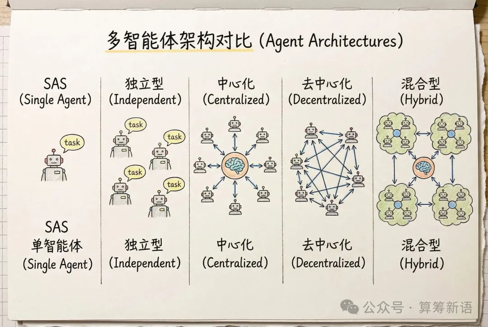
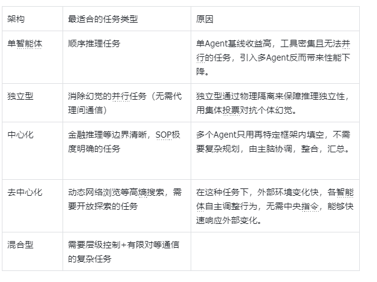
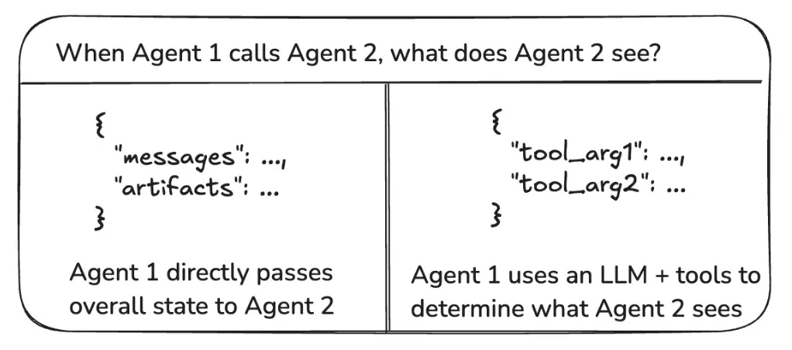
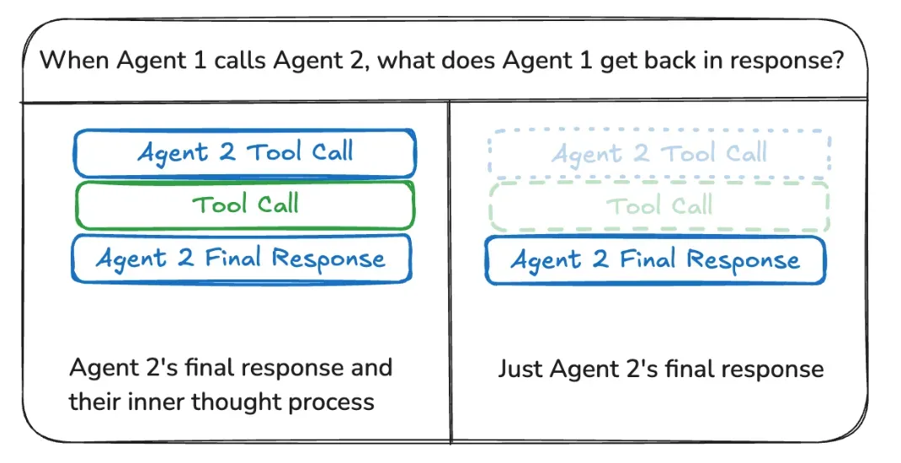

> **课时** 48/132　·　**Agent 八股**　·　约 1 小时
> [上一课：5 Agent的记忆功能](../04-Agent/12-5 Agent的记忆功能.md)　·　[下一课：7. 大模型参数设置 · 8 A2A](../04-Agent/14-7. 大模型参数设置 · 8 A2A.md)
>
> 学完标准：合上笔记，能讲清本节在问什么、你怎么答、以及如何套到自己的项目上。

---

## 6 Multi-Agent 架构

（Multi-agent 设计架构应该来说是Agent项目里最常用的设计方法了。面试的时候难免会和面试官讲到。面试时我也不止一次被问到， 多Agent 和 单Agent架构的区别。这里的重点就是弄清楚，多Agent 有哪些架构？各个不同架构的优缺点是什么？我们应该怎么设计架构？如果知道了这些，比如后面实战中，[小红书面试](https://my.feishu.cn/docx/GikId1snboM6LyxxGPXc0kDdnub#doxcnYbVemsCvEL7GT71on9zy0b)时和你讨论架构设计的时候，其实你就可以比较游刃有余了。 其实这些问题都在这个论文中（https://arxiv.org/pdf/2512.08296v1 ），这个论文不光回答了这些问题，回答的还很深入，从数学，实验数据的角度来分析的。本节整理了相关问题，和参考资料）

**参考资料：**

**https://github.com/fzy2012/rhzl-Agentic-Design-Patterns-cn/blob/feature/interactive-website/13-Chapter-07-Multi-Agent-Collaboration.md**（这个资料比较浅，对于多Agent架构设计这块显得不够，可以作为多Agent入门参考资料）

https://arxiv.org/pdf/2512.08296v1 （这个论文很权威，对于多Agent问题讲的非常深入，包括架构设计，如何选择Agent架构，非常建议阅读，**说实话你能把整个论文吃透，在Agent架构这里就掌握的差不多了**，但是直接看原文可能比较费力，可以看一些相关对这个论文的总结文章，比如下面推荐的文章。笔记部分也是根据这个论文内容来整理的。另外大家在讲这个Agent架构/多Agent的时候，也可以自信的告诉面试官，你是看了这个google的最新的论文来得到的知识，或者面试官让你分享最近看的论文的时候，也可以讲一篇，这篇是25年12月google刚发布的，具有时效性和权威性。）

以下是一些针对于这个论文的辅助资料，其实你能消化清楚这个论文

，可以不用看辅助资料，如果读论文吃力，可以配合一些辅助资料。

https://mp.weixin.qq.com/s/QD9oYVrD7mHKKZu802vovQ （上面这篇论文的辅助资料，论文原文可能太深奥，这个是对上面论文的总结）

https://zhuanlan.zhihu.com/p/1982756998425632940（辅助资料）

）

### **6.1 典型的Agent架构**

（看着就是几种模式，其实你更要想清楚，这几种模式为什么好/不好，使用什么场景，理解复杂度指标，这个需要一些理解成本的，不要以为这个很简单，请大家结合上面资料理解一下，另外这块确实很重要，也值得我们仔细理解）

1) **SAS（Single-Agent System）单体架构**

**交互类型**：一个 Agent 顺序地感知→推理/规划→行动→迭代。

**复杂度指标:**

- LLM调用次数:O(T)  (T为推理轮次)
- 顺序深度:T
- 通信开销:0
- 并行化能力:1
**特点**：**最简单、最稳**。当单体基线已经不错（论文里经验阈值≈**45%**），再加协调通常**收益递减或为负**。顺序型长链推理（一步错步步错）用单体更安全

**适用场景**:工具密集型任务、顺序推理任务、单Agent基线性能已经较高的场景。

2) **MAS（Independent）独立多体**

**交互类型**：多个 Agent **独立并行**做同一任务，最后做**聚合/投票/综合（Synthesis）**。

**复杂度指标:**

- LLM调用次数:O(N·T) + O(1)
- 通信开销:1(仅最终聚合)
- 并行化能力:N
**特点：并行度最高、协调成本最低**，但缺少互相纠错的机制；论文发现这种拓扑的**错误放大**最严重（**17.2×**），因为各自错误会在聚合时被“叠加/扩散”。

**适用场景**：**独立样本批处理**（如并行评审、并行方案生成），且**容错**要求不高的场景。若任务需要大量工具或严格一致性，谨慎使用。

3) **MAS（Centralized）中心化**

**交互类型**：有一个协调者/主管（Orchestrator）分解任务、分派子任务、收集结果、裁决与收敛。

**复杂度指标:**

- LLM调用次数:O(R·N)  (R为编排轮次)
- 通信开销:R·N
**特点**:**稳健性更好**，论文显示集中式能把错误放大从 17.2× 控到 **4.4×**；在**可并行的金融推理**等任务上，集中式提升可达 **+80.9%**。核心在于**有权威收敛与质量门控**。
**适用场景：**可拆分且需要**统一口径与质量控制**的任务（财务核对、批量报告编制、数据清洗流水线）。注意主管本身可能成为**瓶颈**，需把轮数 r 控制在合理范围。

4) **MAS（Decentralized）去中心化辩论**

**交互类型**：Agent 之间**点对点交流/辩论（Debate）**，通过多轮互相质询与改进，最终**多数表决或共识**。

**复杂度指标:**

- LLM调用次数:O(D·N)
- 通信开销:D·N²
**特点：**能带来多视角对齐与相互检验，在**动态网页导航**这类需要不断相互纠偏的环境中，论文观测到去中心化略优（+9.2% 相对集中式 +0.2%）。但辩论的通信/时延开销显著。

**适用场景**：信息动态、需要探索与互评的任务（例如复杂检索、策略博弈）；但在**工具密集或预算受限**时，通信税会拖累表现。

5) **MAS（Hybrid）混合式（层级 + Peer）**

**交互类型**：在集中式的**层级管控**之上，允许**定向的点对点交流（Peer）**——既有 Orchestrator，也允许子 Agent 之间按需互通。

**复杂度指标:**

- LLM调用次数:O(R·N + P·M)  (P为点对点轮次)
- 通信开销:R·N + P·M
**特点：**结合了**集中式的收敛**与**去中心化的灵活**，适合大型复杂任务，但要小心 **Peer 通信税**与**一致性管理**。设计时通常加**通信限流/白名单**，避免消息爆炸。

### 6.2 Agent架构设计原则

（在将这个给面试官之前，你可以直接说你是看了Google 《Towards a Science of Scaling Agent Systems》来总结的，也能体现你看论文的能力，而且你这个回答由google背书，足够经典）

我参考了Google 在25年12月发布的《Towards a Science of Scaling Agent Systems》论文，结合这一论文来回答这一问题。

谷歌的这篇论文的**核心思想**，不同架构下Agent性能受到 ： **Agent 数量、Agent架构、模型能力、任务属性  **共同影响，它在不同的场景下，统一了工具，提示词和预算，配置了180种对照模型，用一组可量化的协调指标 - 效率，开销，错误放大，冗余，创造了一个跨任务可泛化的预测指标，通过这个方法，我们可以从数据的角度，量化衡量和选择使用不同模型，来判断Agent性能的好坏。

抛开数据和推导，这项实验得出的原则Agent架构的设计原则是：

**1.首先确认多Agent/单Agent架构**

多Agent 不是一定比单Agent好。特别是在:

1.**强顺序**，长推理链，一步错，步步错的情况下。

2.**单体Agent能力已经比较强**，论文指出单体基线收益（>=45%时)

3.**工具密集且预算固定时**（因为引入多Agent，会有协调税，增加沟通成本，吞噬有效Token）

倾向于使用单Agent，盲目引入多Agent 架构反而会导致性能下降。

**2.如果使用多Agent架构，根据特点和场景进行有效选择**

### 6.3 单Agent和多Agent的对比

（如果你对这个知识点理解深入了，你发现下面的答案很多的点，你都知道为什么，可以深入解释，比如Agent适用的顺序调用，工具密集和单Agent基线收益较高的情况，比如选择错误架构方法误差的问题，这些都是我们上面看的论文和参考资料所写的，希望大家不光知道答案，还知道为什么，经得起和面试官深入交流里面的细节）

单Agent系统指的是整个系统的决策和上下文都使用一个智能体，多Agent系统指的是系统由多个智能体通过分工和并行来完成。 

单Agent的优势在于**不需要承担Agent之间的协调**，通信开销和拓扑带来的误差传播，在**顺序调用，工具密集，单Agent的基线收益已经较高**（达到45%的时候）使用单Agent效果会更好，盲目使用多Agent架构反而会性能下降。

多Agent的优势在于在复杂的任务中，特别是**需要分工和并行**的问题上，可以突破单Agent的**能力边界，提高效率和鲁棒性**，但是我们也需要注意在不同的任务系统中，需要选择合适的多Agent 的架构，**错误选择架构可能也会显著放大误差**，降低收益。

**快速测试：**

通过本章学习/论文，请你自测你能否回答清楚以下几个问题：

1.Multi-agent 有哪些架构，他们有什么特点？

2.MAS （独立多体）型架构，为什么会放大错误？如何避免？

3.如何设计一个Agent架构？你是拍脑袋想的吗？

4.中心化架构中，过度依赖中心Agent，会有什么弊端，怎么避免？

5.哪些场景更适合单Agent，为什么？

6.这篇论文中提到了不同场景：金融分析，网页导航，工作流，游戏规划，他们分别适用于什么架构，为什么？你能不能举一反三，在你的项目场景下，用什么架构最合适？为什么？

### **6.4 Agent之间通信和状态管理**

（这个知识点不是上面提到的论文中的内容，但是这个点和多Agent相关，有了多Agent同样要知道的它们之间是如何交互的，以及传递什么信息？虽然不算特别高频考点，但是也是被问到过的，需要准备。）

**常见的Agent的通信模式：**

**1.** **Agent 间通信有三种常见模式：**

- **移交（Handoff）**：一个 Agent 将执行上下文和执行权完整传递给另一个 Agent，自身退出。控制权转移，就像接力跑把棒交出去。
- **工具调用（Tool Call）**：一个 Agent（主管）将任务委托出去，保留控制权，等结果回来后自己决定下一步，负责最终输出。（ClaudeCode里面的SubAgent的做法）
- **消息协作**：多个长期驻留 Agent 持续交换消息并协同推进任务，允许横向通信与并行协作。（ClaudeCode里的AgentTeam的做法）

移交更适用于自主协作的场景，而工具调用则提供了更明确的层级控制和接口约束。

**2.** **消息传递内容：**Agent与Agent之间应该传递所有的消息还是部分消息，需要根据具体的业务场景权衡。

- **共享完整推理数据：**智能体将其所有中间步骤（如链式思考、工具调用）写入共享通道。相当于提供了一个共享区，用于其他智能体理解其推理过程，可以提升系统的整体协作与推理能力。但是这种方式的缺点是会导致状态空间快速膨胀，给上下文窗口和内存管理带来挑战。
- **仅共享最终结果：**智能体在私有空间内完成其计算，仅将最终结果写入到共享区。它能有效控制状态的复杂度，实现此策略需要为每个智能体定义独立的状态模式。
3. **通信介质**（怎么传）
- 内存通道（in-memory return）。子代理输出作为 tool_result 同步返回主上下文。（ClaudeCode里面的SubAgent的做法）
- 文件通道（file-backed mailbox）。成员把消息写入对方 inbox 文件，接收方在下一轮读取并注入上下文。（ClaudeCode里的AgentTeam的做法）
这一小节，对应的实战部分，可以看ClaudeCode的[Agent通信](https://my.feishu.cn/docx/GikId1snboM6LyxxGPXc0kDdnub#doxcnT6nxUAuWQVoxLKl7EHNpfe)章节。

### 6.5 Agent架构设计实战

（这个小节，我从**参考论文的例子**以及**面试真题**中抽取出来几个典型的例子和问题，帮助大家来掌握Agent架构设计相关的内容。现在很多面试都会考察一个小型的场景下的Agent架构设计题目，我会持续将架构设计相关内容汇总于此，这样大家复习更加方便。

在我整理了几个例子后，某种程度上，我觉得这个问题其实可以套模板，大家看一下是不是，如果你认为你的任务应该用去中心化架构，你就参考这个6.5.1,对于架构的好处，通信方式都可以复用，唯一不同的是Agent的设计和功能。）

#### 6.5.1 动态网络浏览问题

（此例子截取自论文）

**问题描述**：我们需要通过网络搜索，找到 **某公司2024年可持续发展报告中关于碳排放的问题**，请你针对这个问题设计一个Agent架构。

**架构设计：**

因为网页导航是**高熵，路径不唯一**的场景。 不同的来源（官网，媒体，报告）可以被并行搜索更快覆盖。在这种场景下，我会使用去中心化架构设计整个系统，使用**去中心化架构既能够提升并行速度**，可以**减少中心调度的串行瓶颈。**

具体来讲，整个系统各个Agent是平级的，他们自主并行探索。系统里面使用**事件总线/共享黑板**的方式，所有Agent订阅相关话题，他们可以**发布任务，认领任务，提供帮助，提交答案，**来实现点对点的协作。

具体来讲，系统里有：

 任务规划Agent，将用户目标拆分成子任务后，发布任务。

 然后官网探索Agent， 媒体报告等Agent认领任务后，各自探索，调用工具汇总任务，直到达到标准然后会提交任务，交给验收Agent验收。

验收Agent验证通过后，交付给汇总机器人汇总信息，如果汇总Agent认为目标达成，及时发布停止信息，终止流程进行交付。

#### 6.5.2 金融推理任务

（此例子截取自论文）

**任务描述：**设计一个分析某个上市公司的估值的Agent。

**架构设计：**金融估值的**流程通常比较规范**，天然具有**分而治之**的特点，多个子**问题之间相对独立，可以并行。**这种情况下我会使用**中心化**架构设计整个系统：由一个Orchestrator（中心指挥官）统一拆解，分派和收敛，降低并发协作带来的协调成本和不一致风险，**确保各步骤按既定顺序和策略并发执行。**

具体来讲：

我会先设计一个主管Agent, 他将任务分解成**多个阶段，设计并行窗口，验收，**将任务下发给子Agent去并行完成。

主管Agent下设置多个子Agent，比如**收集官网信息Agent, 收集市场监管信息Agent，收集友商信息做对比的Agent。**

整个过程由主管Agent负责验收，当Orchestrator验收通过，下发停止信号中止整个流程并交付。

#### 6.5.3 中心Agent架构子Agent膨胀问题

在[小红书一面](https://my.feishu.cn/docx/GikId1snboM6LyxxGPXc0kDdnub#doxcnYbVemsCvEL7GT71on9zy0b)中面试官对中心架构下子Agent膨胀问题进行了探讨，这里只做问题汇总，具体内容请转到面试实战，小红书一面

#### 6.5.4 时空冲突检测任务

（选自真题：夸克千问架构设计题目，我就准备直接套用6.5.2的模板）

**任务描述：**设计一个Agent系统，让它完成当用户创建一个行程后，判断这个行程是否和其它冲突，如果有冲突，给出重新规划的建议。

**架构设计：**行程冲突检测 和 规划本质是约束满足 + 顺序调整，**流程比较规范，**需要考虑**时间窗口，地点，偏好等特点，**这些因素也相对独立，可以并行。 这种情况下我会使用**中心化 **架构设计整个系统，由一个Orchestrator统一拆解，分派和收敛，降低并发协作带来的协调成本和不一致风险，**确保各步骤按既定顺序执行也能够并发。**

具体来讲：我会先设计一个Agent作为总指挥，根据当前阶段来分配下发任务，控制并发窗口，验收，和控制中止。

然后我会设计多个子Agent。 比如行程Agent：负责整理相关的行程，和行程时间相关的数据。 地点Agent：评估各个行程地点相关Agent的 通行时间等，冲突检测Agent, 用户喜好分析Agent 和 生成重新规划的Agent。 他们之间在某些阶段可以并行，某些阶段是串行，由主管Agent统筹规划和管理。

### 6.6 面试问题

### 多 Agent 协作系统需要考虑哪些架构问题？

选自 [202607宇树科技二面](https://my.feishu.cn/docx/GikId1snboM6LyxxGPXc0kDdnub#doxcnbMSPhK4iUXSL3kIxXaKplb)

💡 **思路：**

顺着 **“是否需要多 Agent → 如何组织和编排 → 如何通信协作 → 如何验证交付”** 这条主线思考，再从 **安全与权限、成本与延迟及可观测性** 两个方面检查整个设计。前四点回答系统怎样完成任务，后两点回答系统怎样安全、可控地运行，它们是贯穿全程的约束，不是最后才考虑。其中这六个方面，每一方面其实都可以展开，建议顺着这个思路，深入学习每一部分内容，都是重点，面试官追问的时候也可以回答的上来。

1. **是否使用多 Agent；使用什么架构，如何编排；Agent 之间如何通信、共享状态。 **这些都是**：**[笔记Multi-Agent架构章节](https://my.feishu.cn/docx/GikId1snboM6LyxxGPXc0kDdnub#doxcnWzlHjHRJlpPjzPBzXLJwMb)， 这个章节讲的，属于高频考点。
1. **安全与权限如何控制。 **在ClaudeCode安全机制里面讲过，讲了它的[权限系统和安全审查](https://my.feishu.cn/docx/GikId1snboM6LyxxGPXc0kDdnub#doxcnAPhtbCRzykLvvx2g3y6yre)。
1. **成本、延迟与可观测性如何设计.  **[属于Agent评估的内容](https://my.feishu.cn/docx/GikId1snboM6LyxxGPXc0kDdnub#doxcnV5z2w7ytCwdzOXx8kAIEMh)。
📝 **答案：**

我会从以下六个方面考虑：

1. **是否使用多 Agent。**
先判断单 Agent 或固定工作流是否够用。确实需要专业分工、并行处理或独立验证时，再引入多 Agent，并确认收益值得额外的通信和协调成本。

1. **使用什么架构，如何编排。**
明确各 Agent 的职责，以及谁分配任务、谁汇总结果。流程固定时用流水线，需要动态拆解时用协调者—工作者结构；按任务依赖决定串行或并行，并设置超时、有限重试和停止条件。

1. **Agent 之间如何通信、共享状态。**
约定输入输出格式，只传递必要的结果和上下文。区分私有信息与共享任务状态，明确共享数据由谁维护，避免重复劳动和相互覆盖。

1. **如何验证结果、保证任务完成。**
明确子任务和总任务的验收标准，通过规则、测试、证据或独立验证 Agent 检查结果。结论冲突时按证据裁决，验证失败时有限修正或转人工，不能把“执行结束”当成“任务完成”。

1. **安全与权限如何控制。**
按最小权限限制各 Agent 能访问的数据和工具，由执行层强制校验，不能只靠提示词。防范提示注入和数据泄露，删除、付款等高影响操作需要审批。

1. **成本、延迟与可观测性如何设计。**
设置全局时间、Token 和费用预算，通过合理并行、模型选型和减少无效通信优化开销。记录各 Agent 的调用链、任务状态和失败原因，并与单 Agent 比较成功率、延迟和成本，验证实际收益。

**总结：先判断要不要用，再设计怎么组织、怎么协作、怎么验收，同时保证权限有边界、资源有预算、过程可追踪。**

---
