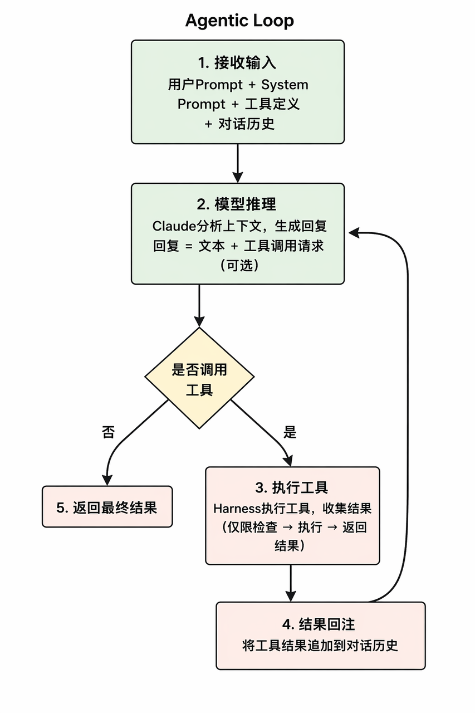

> **课时** 50/132　·　**Agent 八股**　·　约 50 分钟
> [上一课：7. 大模型参数设置 · 8 A2A](../04-Agent/14-7. 大模型参数设置 · 8 A2A.md)　·　[下一课：10. 大模型幻觉](../04-Agent/16-10. 大模型幻觉.md)
>
> 学完标准：合上笔记，能讲清本节在问什么、你怎么答、以及如何套到自己的项目上。

---

## **9. ReAct**

这是一个很简单的知识点，确实一个在各种框架里面都广泛运用的技术。这里讲的不多，但是都是精髓，配一个讲解视频，我觉得你应该可以理解这个概念。最常见的面试真题就是：ReAct如何实现的？我也附在了后面。

### 9.1 ReAct 是什么

ReAct 是 **Reasoning（推理）+ Acting（行动）** 的结合。它让 Agent 在完成任务时交替进行推理和行动，并根据行动结果继续判断下一步。

其核心过程是：

```
Reason → Act → Observation → Reason → …… → 完成任务
```

**关键概念**

- **Reason（推理）**：模型分析当前任务和已有信息，**制定计划**，或者根据上一次行动结果进行**反思**，判断下一步应该做什么。
- **Act（行动）**：模型决定调用某个工具，并提供调用工具所需的参数。
- **Observation（观察）**：外部框架执行工具后返回的真实结果。模型根据这个结果继续推理和行动。
---

### 9.2  ReAct 如何实现

几乎主流的框架，比如DeepSeekHarness，ClaudeCode，Openclaw，他们的Agent内核都是用的ReAct。面试最常考的是它是如何实现的。先看看这个图，理解它的流程：



核心思路：

1. 提示词告诉AI，让他思考下一步做什么，任务做完没有，要不要调用工具。
1. 外部写一个Harness循环，处理模型吐出的结果。如果模型认为没做完，要调用工具，那么就调用工具（这对应ReAct概念里**Act**)。**如果模型认为做完了，流程结束。**
1. 外部调用工具后，将结果返回给模型（这对应ReAct概念的**Observation），**模型继续思考：下一步做什么，任务做完了吗(对应ReAct里面的**Reasoning**)，进入循环。
```
while (任务未结束) {

    模型回答 = 调用模型(
        用户问题 + 对话历史 + 工具列表
    )

    if (模型要求调用工具) {
        工具结果 = 框架执行工具()
        把工具结果加入对话历史
        continue
    }

    // 没有工具调用，普通文本就是最终答案
    结束流程
}
```

### 9.3 面试真题

（选自[202607 宇树科技Agent开发一面](https://my.feishu.cn/docx/GikId1snboM6LyxxGPXc0kDdnub#doxcnirNkQybUvnuoq0Eh335aGf)）

#### **9.3.1 ReAct 的核心思想是什么？他是如何实现的？**

**💡思路：** 这个问题问的很具体了，如果面试官直接问，**你介绍一下什么是React**，也可以按这个提问的思路介绍（是什么，如何实现的。） 

答题思路是先把ReAct的概念讲清楚就好了，Resoning 和 Act，分别是什么，概念讲清楚。（答案中第一段）

 然后我这里补了一个工程上的实现（答案中第二段），以开源框架DSH为例，具体举例，引经据典，把话题引到你熟悉的框架上。当然你也可以替换成你熟悉的其他框架。

**📝答案：**

ReAct 是 Reasoning，也就是推理，和 Acting，也就是行动的结合。它的核心思想是让 Agent **把推理和行动交替进行**：模型先判断下一步应该做什么，再通过工具采取行动，然后根据行动结果继续判断，而不是只依靠模型内部知识一次性生成答案。

**这里的 Reason 主要包含两部分**：一部分是**规划**，也就是分析当前任务、判断下一步应该做什么；另一部分是**反思**，也就是拿到工具执行结果以后，判断结果是否有效、任务是否已经完成，以及是否需要调整原来的计划。

**Act 是采取行动**。在现在的 Agent 系统中，通常表现为模型选择一个工具，并生成对应的调用参数。比如模型发现缺少实时信息，就可以调用搜索工具；需要验证代码，就可以调用代码执行工具。工具执行后，外部框架会把真实结果返回给模型。

**在工程实现上**，外部框架会把用户问题、历史消息和可用工具交给模型。模型如果认为需要调用工具，就返回**结构化的 tool-call**；框架负责执行工具，并把执行结果加入对话历史，再次调用模型。如果模型认为信息已经足够，就不再调用工具，而是直接返回普通文本答案，这时框架结束流程。

比如 DSH 的 **ReactLoopAgent** 就是这样实现的：模型负责推理、选择工具以及判断任务是否完成，外部框架负责执行工具、回传结果和维持整个循环。这样 Agent 就可以在执行过程中根据真实结果不断调整，而不是从一开始就固定一套计划执行到底。

#### 9.3.2 ReAct 循环中，如何检测并跳出无效的“思考—行动”循环?

（选自[202607 宇树科技Agent开发二面](https://my.feishu.cn/docx/GikId1snboM6LyxxGPXc0kDdnub#doxcnirNkQybUvnuoq0Eh335aGfhttps://my.feishu.cn/docx/GikId1snboM6LyxxGPXc0kDdnub#doxcnuYTQ434ivfb2vu1w6b57hh)）

💡思路

我这里是参考《AI Engineering》中关于执行后评估、失败反思与重新规划的讨论，以及 DeepSeek Harness（DSH）和 OpenAI Codex 的开源实现，可以发现它们在应对重复执行和失败恢复上的思路相近。综合起来，可以按 **检测、纠偏、停止兜底** 三层回答。但它们的实际实现和覆盖范围不同，以下是综合整理的设计思路，不代表两个框架都完整实现了所有措施。

📝 **答案：**

我会分成三层处理： **检测发现问题，纠偏尝试解决，停止控制损失。**

**第一层：检测——判断是否陷入无效循环。**

ReAct 不断进行“思考—行动—观察”，但持续执行不代表任务持续推进。因此，需要记录每一步的工具调用、参数、Observation 和任务状态，关注两类信号：

- **重复行为**：相同工具和参数连续出现，或者在几个动作之间周期性往返。
- **没有有效进展**：连续多步没有获得有效的新信息、没有完成子目标，或者始终遇到同一个未解决的错误。
检测可以由 Harness 的程序逻辑完成，也可以由 LLM 辅助判断，或者两者结合。规则明确的重复调用、错误次数由程序检测；有明确任务指标时，可以检查测试通过数、子目标完成情况；对于“新信息是否有价值”“是否仍被同一个问题阻塞”等语义问题，可以由 Harness 收集执行轨迹，再交给 LLM 评估。

**判断“有没有进展、是不是卡住了”仍属于检测；决定“接下来换什么方法”才属于纠偏。** 不能只比较思考文本是否相似，也不能把正常轮询、分页查询等重复操作直接判定为无效循环。

实际案例：DSH 默认按“工具名＋规范化参数”统计连续重复次数，在第 **3、5、8** 次触发提醒。它不比较工具返回结果，因此属于重复调用检测，而不是完整的语义无进展检测。

**第二层：纠偏——改变当前策略，尝试继续完成任务。**

检测到异常后，不必立即终止整个任务，而是先打断原样重复，把已尝试的动作、返回结果和失败原因反馈给 Agent，根据原因调整：

- **参数错误**：根据工具返回的错误修正参数。
- **暂态故障**：有限重试，必要时退避等待。
- **策略错误**：分析失败原因，换查询条件、换工具或重新规划。
- **缺少关键信息**：请求用户澄清，而不是继续猜测和重试。
关键是 **下一步要有实际策略变化，而不只是思考文本换一种说法**。纠偏和重规划本身也应有次数限制，并继续受同一个全局预算约束，避免形成新的无限循环。

实际案例：DSH 会向后续模型请求注入提醒，要求分析上次结果，选择不同动作、不同参数，或在证据足够时结束。这与《AI Engineering》中根据反馈反思并生成新计划的思路相呼应。但它是软纠偏，不会直接阻止工具调用，也不能保证模型一定采纳。

**第三层：停止兜底——恢复无效时控制损失。**

如果纠偏后仍然无法推进，或者遇到不可恢复的问题，就需要停止路径，防止无限消耗时间、Token 和费用。设计上可以在 Harness 中设置最大执行步数、总耗时、累计 Token 或费用预算，以及同类失败和恢复尝试的次数上限，并支持用户取消。

达到条件后，由 Harness 停止继续执行，报告已完成部分、未解决问题、停止原因，以及需要用户补充的信息或人工处理的事项。**停止是控制损失，不代表任务成功完成。** 预算耗尽、用户取消或遇到不可恢复问题时，可以直接停止，不必等纠偏手段全部尝试完；预算耗尽本身也不等于证明任务陷入了无效循环。

实际案例：Codex 在特定场景下有真正的停止保护，例如 Goal 执行失败达到条件后停止自动续跑，Guardian 审批拒绝达到阈值后中断回合。但这些是局部保护，不能泛化为所有 ReAct 循环都有统一硬上限。DSH 的默认重复提醒器也没有“重复到一定次数就强制退出”的机制。

📝 **简化答案（面试照答版）：**

我会从 **检测、纠偏和停止兜底** 三层处理。核心是看任务有没有实际进展，而不是模型有没有一直在思考。这些机制需要由外部执行框架，也就是 Harness 配合实现，不能只靠提示词让模型自己避免死循环。

**第一，检测是否卡住。** 我会记录每一步的工具、参数、返回结果和任务状态，主要看两类信号：一类是重复，比如连续使用相同参数调用同一个工具；另一类是没有进展，比如多次搜索没有新信息，或者反复修改代码，测试仍然报同一个错误。明确的重复行为可以用程序规则判断，任务进展可以看测试结果、子目标完成情况，必要时再让模型辅助评估。但要结合场景，不能把正常轮询、分页查询误判成死循环。

**第二，发现问题后先纠偏。** 把已经尝试的方法和失败结果反馈给模型，让它分析原因，而不是原样再试。参数错了就修正参数，临时网络故障可以有限重试；方法不对就换工具、换查询条件或重新规划；缺少用户信息就主动澄清。比如连续搜索都没有找到资料，就应该调整关键词或数据源，而不是反复提交同一个查询。关键是下一步的行动要有变化，不能只是换一种说法继续思考，重新规划本身也要限制次数。

**第三，设置硬性停止条件。** 在框架中设置最大步数、总耗时、Token 或费用预算，以及同类失败的次数上限。如果纠偏后仍然无效，或者达到预算，就由框架停止执行，不能指望模型一定会主动停下来。停止后要告诉用户哪些已经完成、哪里卡住、还需要什么信息，必要时转人工，而不是把停止当成任务成功。

总结就是： **检测发现问题，纠偏尝试解决，停止控制损失。** 既给 Agent 调整和恢复的机会，也保证它不会无限消耗资源。

#### 9.3.3 用户问题模糊或有歧义时，如何做澄清性对话？

（选自[202607 宇树科技Agent开发二面](https://my.feishu.cn/docx/GikId1snboM6LyxxGPXc0kDdnub#doxcnYoyTDiSAM6bxrgBCEZmVbd)）

💡 **思路：**

采用 **“提示词约束 + 模型判断 + 工具调用”** 的方式，将澄清作为 ReAct 循环中的一种工具交互。 **模型负责决定“是否要问、问什么”，执行框架负责“展示问题、等待回答、将答案交回模型”。** 不一定需要单独训练歧义分类器。

📝 **答案：**

我会给 Agent 提供一个澄清工具，比如 `ask_user_question`，让模型在需求不明确时主动提问。具体分四步：

1. **提示词约束：明确什么时候需要澄清。**
在提示词中要求模型先看上下文，能自己查清楚的就不问；如果还有影响下一步的歧义，或缺少需要用户决定的关键信息，就提问，不要猜。

1. **模型判断：决定是否调用澄清工具，并生成问题。**
模型判断信息不足时，调用澄清工具。问题要具体，优先问最关键的信息，必要时给出选项，不要一次问太多。

1. **工具交互：界面展示问题，当前任务等待用户回答。**
执行框架把问题展示给用户，让当前任务等待回答。这里暂停的只是当前任务，不影响系统处理其他请求，也不是结束整个 ReAct 循环。

1. **结果回传：把答案作为工具结果，继续原任务。**
用户回答后，框架把答案作为工具结果放回上下文，模型根据补充信息继续执行。如果仍有关键歧义，就继续追问；信息足够就不再问。

比如，用户说“帮我增加报表导出功能”，模型看完现有代码仍不确定格式，就问“需要 CSV 还是 Excel？”用户选了 Excel，模型就根据这个结果继续处理。涉及高风险操作时，仍需单独确认授权。

**总结：提示词规定什么时候问，模型决定问什么，框架负责展示问题和回传答案。整个流程就是“提问 → 等待 → 回传 → 继续”。**

---
