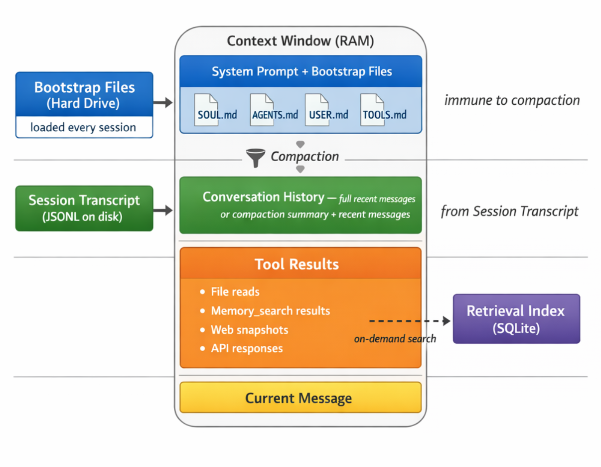
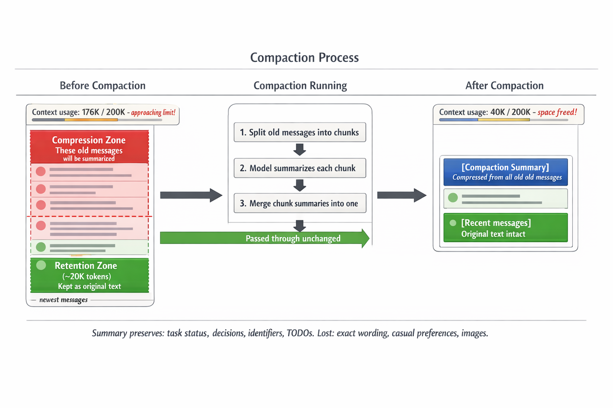

> **课时** 53/132　·　**Agent 八股**　·　约 50 分钟
> [上一课：11 开源框架解读 - Openclaw · 11.2 Openclaw 总体架构](../04-Agent/17-11 开源框架解读 - Openclaw · 11.2 Openclaw 总体架构.md)　·　[下一课：11.4 OpenClaw Agent 架构解析 · 11.5 安全风险](../04-Agent/19-11.4 OpenClaw Agent 架构解析 · 11.5 安全风险.md)
>
> 学完标准：合上笔记，能讲清本节在问什么、你怎么答、以及如何套到自己的项目上。

---

### 11.3 Openclaw 记忆

#### 11.3.1 导语

为什么这一小节我认为很重要，给大家先说明原因：

1.** ****首先记忆功能是常考的，甚至必考**，从面试的角度，Agent的记忆是如何实现的，这已经是背烂了的八股对吧，这部分就是这个问题的经典实现，所以你学习这一部分是对这个高频考点的补充，我会将Openclaw的记忆功能融入笔记八股部分，更新我们的回答，让我们的回答结合现在最火的Agent的例子去答，是不是就比干巴巴答概念要更好。

2. 如果你想玩openclaw的话，**Openclaw为什么总是忘记事情？**如果你学了本节，那你自己就能够尝试去解决，你也可以修改里面的记忆文件，手动确定让你的龙虾能记住什么，高效组织你的龙虾记忆。

3. 我想借助这个机会，学习Openclaw，大家可以理解这个产品的架构是怎么设计的，记忆模块是怎么组织的。这样的好处是**建立你的审美**，大家在设计自己的agent的时候，如果你去设计架构，你用上他这个**心跳机制，定时机制 **而不是干巴巴的只有一个用户输入作为触发，你用上它的4层记忆，哪怕你不改，你就去抄它的，是不是也比自己设计的高级一些，所以通过这个学习，也是为我们自己设计Agent项目打基础，站在他们的肩膀上设计你的项目，让面试官觉得你的项目是高级的，有想法，有深度的。

#### 11.3.2 四层记忆架构总览

OpenClaw 的记忆不是一个系统，而是 **四层独立机制** 协同工作，类似计算机的存储层次：

1. **Bootstrap Files**（≈ 硬盘）— Agent 的永久身份与规则，完全免疫 Compaction
1. **Session Transcript**（≈ 文件系统日志）— 完整对话历史存档，旧消息会被压缩为摘要
1. **Context Window**（≈ RAM 内存）— 模型当前能"看到"的所有内容，满了就触发压缩
1. **Retrieval Index**（≈ 搜索引擎）— 语义搜索记忆文件，独立于会话
> **知道哪一层出了问题，就能解决 90% 的"Agent 忘事"问题。**
>



#### 11.3.3 Bootstrap Files（引导文件）

**本质**：工作空间里的 Markdown 文件，每次会话开始时从磁盘读取、注入上下文。

**文件清单**

`SOUL.md` — 人格、语气、边界

`AGENTS.md` — 操作指令、行为规则

`USER.md` — 用户身份信息

`TOOLS.md` — 工具使用说明

`IDENTITY.md` — Agent 名称与风格

`MEMORY.md` — 策展的长期记忆（仅主会话加载）

`HEARTBEAT.md` — 心跳任务清单（可选）

`BOOTSTRAP.md` — 首次运行仪式（一次性）

位置：`~/.openclaw/workspace/`

**关键要点**

**每次会话重新从磁盘读取**，不存在对话历史中 → 免疫 Compaction

**字符限制**：单文件 20,000 字符，总计 150,000 字符，超出会被截断

**子 Agent 只收到** `AGENTS.md`、`SOUL.md`、`TOOLS.md`、`IDENTITY.md`、`USER.md`，拿不到 `MEMORY.md` 和 `HEARTBEAT.md`

用 `/context list` 可查看每个文件的注入状态

**所有 Bootstrap Files 都应尽量精简**——它们每轮都注入上下文，内容越多占用越大。实践中 `SOUL.md` 最容易被写得过长，建议各文件都保持简洁。

#### 11.3.4 Session Transcript（会话记录）

（我觉得这节还是挺重要的，他其实是你怎么组织Agent长短记忆的一些原理。我们做agent的时候都知道把历史对话记录每次拼接，放到下一轮对话。那么窗口满了，如何压缩，压缩保留什么东西，这时要把什么东西存到本地做长期记忆，这些技巧在本节都讲了，面试也是爱问的，建议掌握，要是能面试时候说出来，或者用到你的项目中，都会大大加分）

**本质**：完整对话历史，以 JSONL 文件追加写入磁盘。

**存储位置**

```
~/.openclaw/agents/<agentId>/sessions/
├── sessions.json          # 会话元数据
└── <sessionId>.jsonl      # 对话记录（包含消息、工具调用、压缩摘要）
```

**关键要点**

- **每条消息自动追加到 JSONL**，包括用户消息、助手回复、工具调用
- 继续会话时从 JSONL 重建上下文，**跨重启持久**
- 磁盘上的原始记录**始终保留**，但模型只看到上下文窗口中的部分
**Compaction（压缩）详解**

**两种触发方式：**

- **自动触发（Auto-Compaction）**：上下文使用量达到阈值时自动触发。有两种情况：
    - **溢出恢复**：模型返回 context overflow 错误 → 压缩 → 重试
    - **阈值维护**：成功完成一轮后，`contextTokens > contextWindow − reserveTokens` 时触发
- **手动触发**：输入 `/compact`，可带自定义指令如 `/compact 重点保留决策和待办事项`
触发公式：`上下文窗口 − reserveTokensFloor(默认20000) − softThreshold(默认4000)`，200K 模型 → 约 176K 时触发。

**压缩的具体过程:**

1. **划分保留区和压缩区**：最近的 ~20,000 tokens 消息被划为"保留区"，**原封不动保留**，模型看到的就是原文。保留区之前的所有旧消息进入"压缩区"
1. **分割压缩区**：把压缩区的旧消息按 token 数分成若干块（默认分 2 块，自适应调整块大小）
1. **逐块总结**：用模型对每个块生成摘要（调用 `generateSummary`，失败会重试 3 次）
1. **合并摘要**：如果有多个块的摘要，再用模型把它们合并成一个连贯的总摘要
1. **写入 Transcript**：在 JSONL 文件中写入一条 `compaction` 类型的条目，包含摘要文本和 `firstKeptEntryId`（保留区最早消息的 ID）
压缩后模型看到的上下文结构：`[压缩摘要] + [保留区原文（最近 ~20,000 tokens）]`



**什么时候触发**

总结过程有明确的指令，**必须保留**：

- 进行中的任务及其状态（进行中、阻塞、待办）
- 批量操作的进度（如"17 项中已完成 5 项"）
- 用户最后请求的内容以及正在做什么
- 已做出的决策及其理由
- TODO、开放问题和约束条件
- 承诺的后续行动
默认还会**完整保留所有不透明标识符**（UUID、哈希、ID、token、API key、主机名、IP、端口、URL、文件名），不缩写不重构。这由 `identifierPolicy: "strict"` 控制。

**Pre-Compaction Memory Flush**

压缩前 OpenClaw 会静默运行一轮，提醒 Agent 把重要内容写入 `memory/YYYY-MM-DD.md`，用户不可见（`NO_REPLY`）。每个压缩周期只触发一次。

> ⚠️ **聊天中说的指令不会自动保存到文件**——不写入文件就会被压缩丢掉。这是最常见的"Agent 失忆"原因。
>

#### 11.3.5 Context Window（上下文窗口）

**本质**：固定大小的 token 容器，大小由模型决定（如 Claude 200K、GPT-4 128K、Gemini Pro 1M），模型每轮推理时所有信息都要挤进来。

**关键要点**

- **每轮竞争空间的内容**：系统提示 + Bootstrap Files + 对话历史 + 工具调用结果（包括 `memory_search`/`memory_get` 检索到的记忆片段） + 当前消息
- **最大的 token 消耗者是工具结果**（文件读取、检索结果、网页快照、API 响应）
- Bootstrap Files 每轮都占空间，所以要尽量精简
- **满了就触发 Compaction**，旧对话被压缩
- 用 `/status` 监控使用量，建议在 75–80% 时手动压缩
#### **11.3.6 Retrieval Index（检索索引）**

**本质**：为记忆文件建立的搜索索引，Agent 通过工具按需检索，不用把所有记忆都塞进上下文。

索引范围

- `MEMORY.md` + `memory/**/*.md`（默认）
- 可通过 `memorySearch.extraPaths` 添加额外路径（如 Obsidian 笔记库）
- 存储在 `~/.openclaw/memory/<agentId>.sqlite`
检索工具与触发方式

OpenClaw 提供两个记忆工具：

- `memory_search` — 语义搜索，返回相关片段（文件路径 + 行号 + 分数）
- `memory_get` — 按路径读取指定记忆文件的具体内容
**检索不是每次对话自动触发的**。`memory_search` 是一个工具，由模型自己判断是否需要调用。系统提示中会指导模型"在回答关于过去的决策、日期、人物、偏好、待办等问题前，先调用 `memory_search`"，但最终是模型自行决定何时搜索、用什么关键词搜索。简单闲聊不会触发检索。

工作流是两步走：先 `memory_search` 找到相关片段 → 再 `memory_get` 读取完整上下文。

混合搜索

同时使用向量语义匹配（擅长同义词）+ BM25 关键词匹配（擅长精确 ID/代码符号），加权合并：

```
finalScore = 0.7 × vectorScore + 0.3 × textScore
```

关键要点

- **只索引文件**——聊天中说过但没写入文件的内容搜不到
- 文件变动后自动重新索引（去抖 1.5 秒）
- 支持 MMR 去重（过滤近似重复结果）和时间衰减（默认半衰期 30 天，新笔记排名更高）
- 常青文件（`MEMORY.md`、非日期命名的 `memory/*.md`）不受时间衰减影响
- **反复引用的重要知识**建议直接放在 `memory/` 目录下按主题组织（如 `memory/trading-system/`），而不是只存在外部
