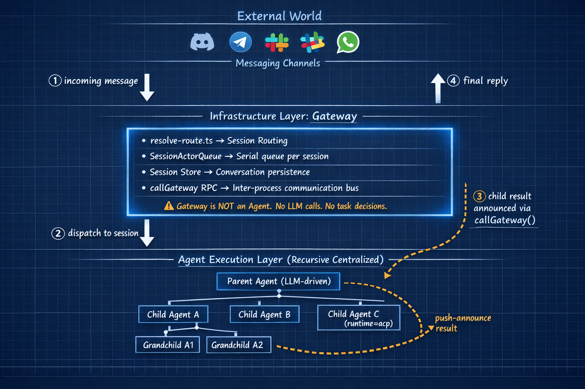

> **课时** 54/132　·　**Agent 八股**　·　约 50 分钟
> [上一课：11.3 Openclaw 记忆](../04-Agent/18-11.3 Openclaw 记忆.md)　·　[下一课：11.6 面试问题 · 11.7 参考资料](../04-Agent/20-11.6 面试问题 · 11.7 参考资料.md)
>
> 学完标准：合上笔记，能讲清本节在问什么、你怎么答、以及如何套到自己的项目上。

---

### **11.4 OpenClaw Agent 架构解析**

在10.2 小节中，我们分析了 OpenClaw 的整体架构，它由三层构成：

```
触发层  →  消息渠道（Discord、Telegram、Slack、WhatsApp 等）
网关层  →  Gateway（路由、session 管理、并发控制）
Agent 层 →  Agent（LLM 驱动，执行任务）
```

本文聚焦 **Agent 层**的内部架构。Agent的架构其实是面试官非常喜欢问的高频考点，我们在笔记中有了很详细的总结。要说我们之前学的是理论，那么我希望通过这一章来从实践上看看，Openclaw使用的Agent架构和我们之前的理论知识是否吻合。学习这一小节，除了从真正工程的角度加强对这个经典面试题的理解，另一方面其实也体现在自己的架构设计上，我们在设计自己的Agent的特性和架构上，能不能参考Openclaw的架构，把我们的项目做的更高级。

在我们笔记的 Multi-Agent 典型架构章节中，讲过常见的架构模式：**SAS、Independent、Centralized、Decentralized、Hybrid**，这里简单回顾一下：

- **SAS（单智能体）**：只有一个 Agent 独立完成所有任务

- **Independent（独立型）**：多个 Agent 并行运行，互不通信，各自完成独立任务

- **Centralized（中心化）**：一个中心 Agent 负责编排，将子任务分发给 Worker Agent 执行

- **Decentralized（去中心化）**：Agent 之间 P2P 直接通信协作，无固定中心

- **Hybrid（混合型）**：以上模式的组合

今天我们将理论变成实践，解析 OpenClaw 这个真实项目中到底使用了什么架构，看看和我们之前讲的理论能不能匹配得上。

#### **11.4.1 概述**

OpenClaw 的 Agent 框架本质上是一个 **递归 Centralized架构**：

- Parent Agent 作为中心，用 LLM 决策任务如何拆解，向下 spawn 子 Agent 执行
- 子 Agent 可以继续 spawn 孙 Agent，每一层都是该层的中心，形成一棵递归的 Orchestrator-Worker 树
- 路由和调度由无智能的 **Gateway**承担，不是 Agent。

**Agent框架图**



#### **11.4.2 Openclaw Agent架构详解**

OpenClaw 的多 Agent 能力没有专门的"调度引擎"或"编排框架"，而是完全基于 LLM 的标准 **Tool Use 机制**实现的：

- **工具（Tool）**：`sessions_spawn` 被注册为一个普通工具，和 `exec`、`web_search` 地位相同，调用它就会在系统层创建并启动一个子 Agent

- **提示词（Prompt）**：系统提示词注入一句触发规则，告诉 LLM 什么情况下应该使用这个工具

- **LLM 决策**：LLM 在每轮推理中自主判断是直接处理任务，还是调用 `sessions_spawn` 把任务委托给子 Agent

这意味着 OpenClaw 的多 Agent 编排能力，是从 LLM 的 tool call 能力"衍生"出来的，而不是独立构建的一套系统。架构简洁，扩展自然。

##### ** 11.4.2.1 为什么选 Centralized**

Openclaw的作者并没有说他自己为什么这么设计架构，不过我们之前笔记有讲不同的架构的抉择，我谈一谈我的理解，不过对于模型架构的选择，其实你很难说哪个是最好的，这没有固定答案，我觉得这一点就是你能够想清楚，面试能讲清楚，能自洽就行。

用户通过消息渠道发来一条消息，最终必须有一条连贯的回复发回去。这个"一进一出"的结构，天然要求有且只有一个 Agent 对最终回复负责——谁收到消息、谁整合结果、谁发出回复，必须是同一个主体。Centralized 的父子结构正好对应这个模型：Parent Agent 是唯一的回复责任人，子 Agent 只是它用来扩展执行能力的手段。

如果换成 Decentralized，多个 Agent P2P 协商，最终谁来发回复？没有确定的答案。如果换成 Independent，各 Agent 独立运行互不感知，结果根本无法拼合成一条完整的回复。

对话本身的结构就是中心化的——有一个确定的入口，有一个确定的出口，中间的执行可以分发，但责任链不能断。

##### **11.4.2.2 Spawn 的决策机制**

**维度一：决策规则——谁来判断，依据什么**

是否 spawn 子 Agent，完全由 **Parent Agent 的 LLM 自主判断**，没有外部调度器介入。OpenClaw 给 LLM 的判断依据只有系统提示词中的一句话（来源：`src/agents/system-prompt.ts`）：

```
If a task is more complex or takes longer, spawn a sub-agent.
Completion is push-based: it will auto-announce when done.
```

就这一句。没有复杂的拆分规则，"复杂"和"耗时长"的边界完全交给模型自己理解和判断。

**维度二：执行工具——spawn 是怎么实现的**

`sessions_spawn` 是系统注册给 Agent 的一个普通工具。LLM 决定 spawn 后，就像调用任何其他工具一样调用它。

**系统提示词如何把这个工具介绍给 Agent：**

```
- sessions_spawn: Spawn an isolated sub-agent session
```

工具名 + 一句描述，Agent 就知道它的存在和用途了。

**工具的调用参数：**

```
sessions_spawn(
  task,          // 子任务描述（自然语言，直接成为子 Agent 的 prompt）
  agentId,       // 目标 Agent ID（可选）
  runtime,       // "subagent"（轻量）或 "acp"（重量级，支持外部 CLI）
  mode,          // "run"（一次性）或 "session"（持久线程绑定）
  model,         // 模型覆盖（可选）
  thinking,      // 思考强度覆盖（可选）
  attachments,   // 文件附件（可选）
)
```

**两种 runtime：**

`sessions_spawn` 支持两种 runtime，决定子 Agent 以什么方式运行：

- **subagent**：轻量模式，子 Agent 在同一宿主进程中运行，继承父 Agent 的 workspace 目录，适合大多数常规任务拆分场景。来源：`src/agents/subagent-spawn.ts`

- **acp**：重量级模式，基于 OpenClaw 内置的 ACP（Agent Control Protocol）协议，子 Agent 在独立进程中运行，可以对接 Codex 等外部 CLI 编程工具，支持持久化 session 和恢复，适合需要长期运行或内嵌外部工具链的场景。来源：`src/agents/acp-spawn.ts`

**ACP 如何开启，LLM 如何选择：**

ACP 由配置项 `acp.enabled` 控制，默认开启，用户可以显式设置 `acp.enabled=false` 关闭。沙箱化 session 中 ACP 会被自动禁用。

开启 ACP 不代表每次 spawn 都会用 ACP。开启只是"解锁了这个选项"，并在系统提示词中额外注入一段触发规则告知 LLM：

```
For requests like "do this in codex/claude code/gemini", treat it as ACP harness intent
and call sessions_spawn with runtime: "acp".
```

也就是说，LLM 默认 spawn 的仍然是 `subagent`，只有当用户明确表达"用 Codex 做"、"用 Claude Code 做"之类的意图时，LLM 才会判断为 ACP 场景，切换到 `runtime="acp"`。选择哪种 runtime 和是否 spawn 的决策逻辑完全一致——都由 LLM 自主判断，提示词只是提供规则。

##### **11.4.2.3 子Agent限制条件**

LLM 发出调用后，系统还会做一系列硬性检查，任一不通过就返回 `forbidden`，LLM 的意图不会被直接执行：

- **深度限制**：当前深度 `>= maxSpawnDepth` 就拒绝，默认 `maxSpawnDepth=1`（即子 Agent 默认不能再 spawn）

- **子 Agent 数量上限**：单个 session 的活跃子 Agent 数 `>= maxChildrenPerAgent` 就拒绝，默认 `maxChildrenPerAgent=5`

- **Agent ID 白名单**：若配置了 `allowAgents`，只有列出的 agentId 可被 spawn

更底层的封锁是：叶子节点（leaf）的 Agent 工具列表里根本没有 `sessions_spawn`，LLM 物理上无法调用它（来源：`src/agents/pi-tools.policy.ts`）：

```
深度 0（main）        → 角色：main         → sessions_spawn ✅
深度 1（maxDepth>=2） → 角色：orchestrator  → sessions_spawn ✅
深度 1（maxDepth=1）  → 角色：leaf         → sessions_spawn ❌ 工具不存在
深度 2+              → 角色：leaf          → sessions_spawn ❌ 工具不存在
```

#### **11.4.3 Agent通信机制**

Agent的通信机制其实也是一个高频考点，面试官喜欢问的，你的Agent之间是如何通信的？

> 在我们之前笔记的「Agent 之间的通信与状态管理」章节中，已经介绍过 Agent 间的两种主要通信模式和消息传递策略。这里结合 OpenClaw 的实现，看看理论在真实项目中是如何落地的。
>

##### **11.4.3.1 通信模式**

**工具调用，而非移交**

Agent 间通信有两种常见模式（详细内容见 笔记 Agent之间通信和状态管理 部分）：

- **移交（Handoff）**：一个 Agent 将执行上下文和执行权完整传递给另一个 Agent，自身退出。控制权转移，就像接力跑把棒交出去。

- **工具调用（Tool Call）**：一个 Agent（主管）将任务委托出去，保留控制权，等结果回来后自己决定下一步，负责最终输出。

##### **11.4.3.2 消息传递**

**仅最终结果，不传推理链**

> 之前笔记的「Agent 之间的通信与状态管理」章节也介绍过消息传递内容的两种策略：**共享完整推理数据**（中间步骤全部写入共享通道，协作能力强但上下文膨胀快）和**仅共享最终结果**（私有空间内完成计算，只把结论写入共享区，状态复杂度可控）。OpenClaw 选择的是后者。
>

子 Agent 完成任务后，只把最终回复（`readLatestAssistantReply`）蒸馏成一条消息推回父 Agent，中间的 tool call 链、chain-of-thought 全部留在子 Agent 自己的私有 session 里，父 Agent 看不到。这有效控制了父 Agent 的上下文膨胀——每个子 Agent 都有独立的 session 状态，父 Agent 只收到一条结论性消息。

##### **11.4.3.3 结果传递机制**

**push-based announce**

具体实现上，子 Agent **不是**同步返回值，而是异步 push：

1. 子 Agent 完成任务
2. `subagent-announce.ts` 把蒸馏后的结果以"用户消息"形式注入父 Agent 的消息队列
3. 父 Agent 在 LLM 下一轮 turn 中感知到子 Agent 完成事件
4. 父 Agent 等所有期待的子 Agent 都 announce 后，才输出最终回复
这是工具调用模式的一个变体：spawn 时立刻返回 `accepted`（非阻塞），结果通过消息通知而非返回值传回。可以看到以下这个代码注释，当子agent完成了结果后，会把结果发送到gateway中，gateway会把这个结果当成一条用户消息发送给父agent，当父agent收到这个消息时，就知道子agent完成了，当所有子agent都完成了，父agent就可以整合结果输出了。

> 来源注释（代码原文）：  
>

>  *"After spawning children, do NOT call sessions_list, sessions_history, exec sleep, or any polling tool. Wait for completion events to arrive as user messages."*  
>

> — `subagent-spawn.ts: SUBAGENT_SPAWN_ACCEPTED_NOTE`
>

##### **11.4.3.4 结果的整合**

假设 Parent spawn 了 5 个子 Agent，它们各自完成后依次 push 消息回来，Parent 的对话历史里会陆续积累：

```
[消息] 子 Agent A 完成：结果是 X
[消息] 子 Agent B 完成：结果是 Y
[消息] 子 Agent C 完成：结果是 Z
...
```

每来一条 Parent 都被触发一次 turn，发现还没收全就等待，直到最后一条到达时，所有结果已经在上下文里了。这时提示词（`subagent-announce.ts` 的 Subagent Context）告诉 Parent：

>  *"Coordinate their work and synthesize results before reporting back."*
>

结合 `subagent-spawn.ts` 里的：

>  *"track expected child session keys, and only send your final answer after ALL expected completions arrive."*
>

Parent LLM 在这一轮 turn 里自由整合所有结果，输出最终回复。

---

### 11.5 安全风险

OpenClaw 之所以强大，是因为它深度接入了你的系统——它可以运行 Shell 命令、读写文件、执行脚本、控制浏览器。但 access 是一把双刃剑：同样的能力让它能帮你干活，也让它成为潜在的攻击面。

风险有多大

Cisco 的安全团队分析了 OpenClaw 的生态系统，发现 **26% 的可用 skill 包含至少一种安全漏洞**。他们称之为 "security nightmare"。主要风险包括：

- **Prompt Injection（提示词注入）**— 攻击者可以在邮件、文档、网页中嵌入恶意指令。当 Agent 读取这些内容时，可能被诱导执行非预期操作（比如泄露数据、发送消息、执行命令）。这是当前 AI Agent 最普遍且最难防御的攻击向量。
- **恶意 Skill / 插件** — Marketplace 上的第三方 skill 可能包含恶意代码。安装一个 skill 等于授予它 Agent 的全部能力——Shell 执行、文件访问、网络请求。一个看似无害的 "天气查询" skill 可能在后台做任何事。
- **凭证泄露（Credential Exposure）**— Agent 运行在你的机器上，可以访问环境变量、配置文件、SSH key、API token 等。如果 Agent 的行为被 prompt injection 劫持，这些凭证可能被外泄。
- **命令误解（Command Misinterpretation）**— Agent 可能误解你的意图，执行了你不想要的操作。比如你说"清理一下这个目录"，Agent 可能删掉你没打算删的文件。Shell 命令是不可逆的，`rm -rf` 不会问你确认。
官方怎么说

OpenClaw 的官方文档也承认**没有完美的安全 setup**。他们建议：

- **使用隔离账号（isolated accounts）**— 不要用你的主账号运行 OpenClaw，创建一个权限受限的专用账号
- **使用次要设备（secondary machine）**— 最好在一台非关键机器上运行，而不是你的主力工作机
- **限制 skill 数量** — 只安装你确实需要的 skill，减少攻击面
- **监控日志（monitor logs）**— 定期检查 Agent 的执行日志，了解它做了什么
本质矛盾

这是所有 AI Agent 平台面临的根本矛盾：**能力越强，风险越大。** OpenClaw 的价值在于它能深度操作你的系统，但这也正是它的风险所在。它不像一个沙箱里的聊天机器人——它拥有真实的系统权限，运行真实的命令，访问真实的文件。任何一次 prompt injection、一个恶意插件、一次命令误解，都可能造成真实的后果。
