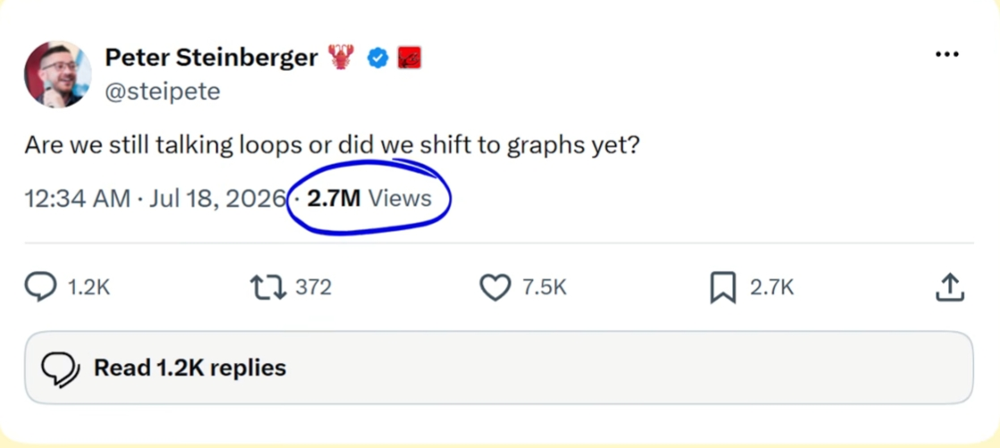
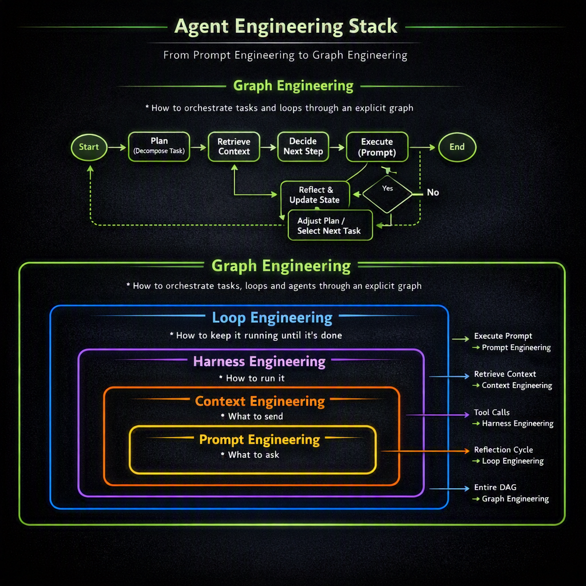
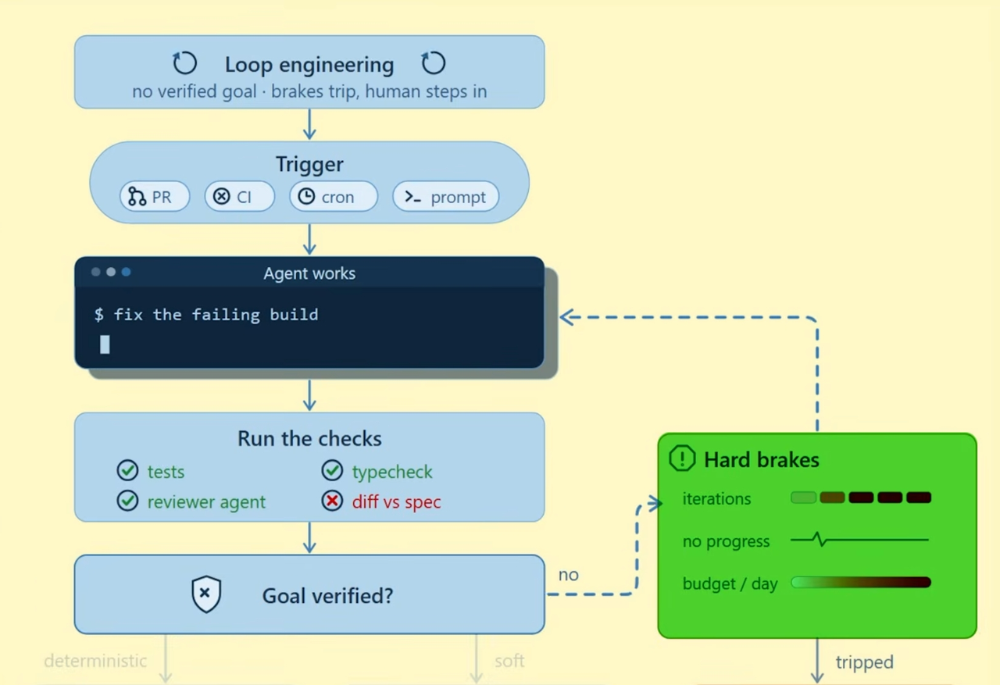
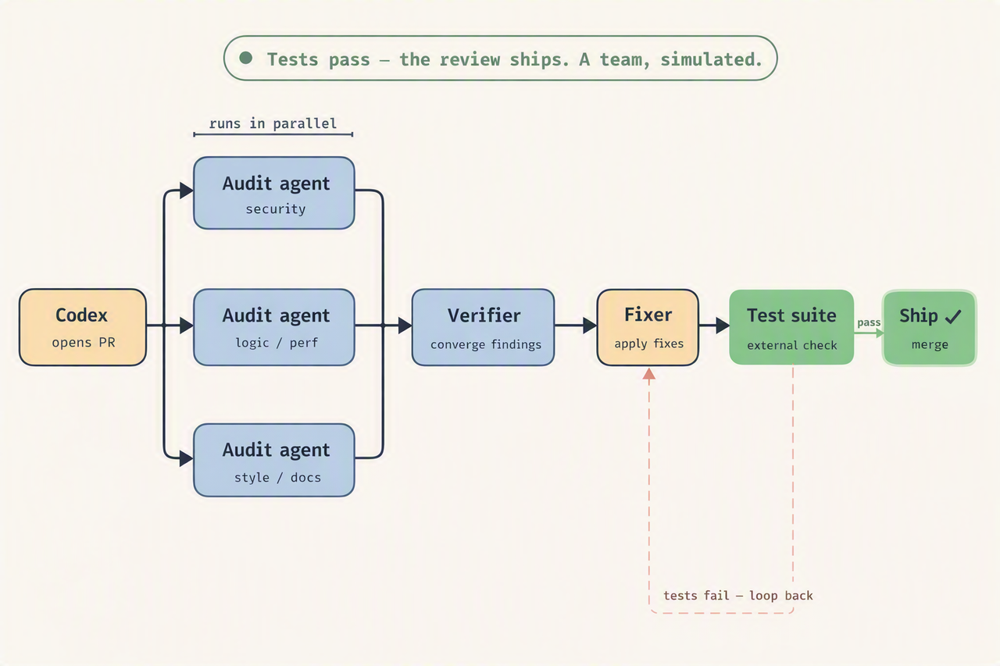
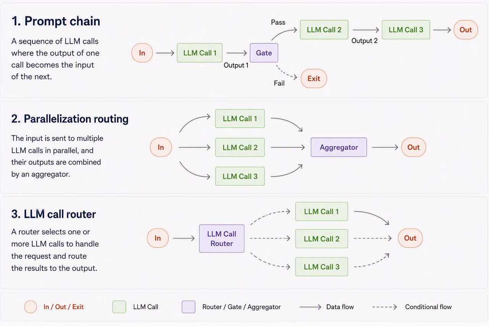
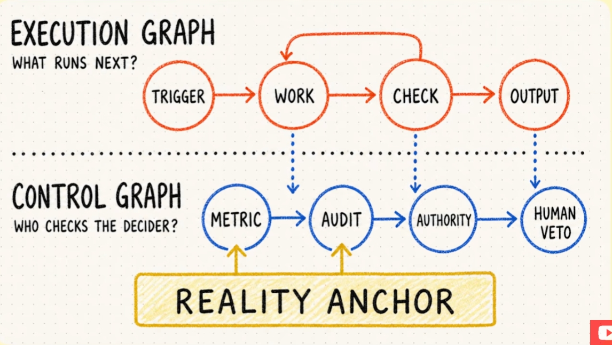

> **课时** 61/132　·　**Agent 八股**　·　约 50 分钟
> [上一课：13.1 Loop Engineering](../04-Agent/25-13.1 Loop Engineering.md)　·　[下一课：14 开源框架解读 - PI-Agent · 14.3 架构 · 14.3.4 Tools](../04-Agent/27-14 开源框架解读 - PI-Agent · 14.3 架构 · 14.3.4 Tool.md)
>
> 学完标准：合上笔记，能讲清本节在问什么、你怎么答、以及如何套到自己的项目上。

---

### 13.2 Graph 工程

最近，“Graph Engineering（Graph 工程）”突然成了 AI 圈的新热词。大家真的非常喜欢用这样一种说法来描述一些新技术： 提示词工程已死，上下文工程来了。 上下文工程已死，Harness工程来了。 Harness工程已死，Loop工程来了。 Loop工程已死，graph工程来了。 当时Harness Loop 出来，我都有比较早的去解析，包括今天的Graph工程，我觉得多少这些概念都有一些操作的概念。本身他们也不是一个全新的概念，其实多少都是新瓶旧酒。 不了解的人就很容易被唬住，觉得技术概念迭代这么快，感觉很难跟上对吗？我自己这里的看法是，首先这些概念真的不是一个新的概念，他只是我们已有技术，换了一个高级的说法，其实你自己都用过了，所以其实没有什么太多的学习成本。 第二点就是你也不能不会，因为即使是炒作，AI圈也很喜欢跟风，面试官甚至可能自己也不是特别懂，但是他看到这些火的概念就会问题知不知道，问你有没有关注前沿技术。所以从这个角度来说，我们还是需要花一些时间（但是通常可能1小时就够了）去理解这个词到底是什么，可以和面试官讨论，发表你的看法。

所以我的建议就是，看看我的笔记或者视频，**你知道这个东西是什么，来龙去脉是什么，然后我总结了相关的面试问题**，这些面试题是面试官问到这个概念会最先问的。**学到这里就够了，也没什么好深入学的**，因为他本质就是旧的技术。如果后面发展的更火，有更难的面试问题，我们也会跟进总结相关的面试问题的。

#### 13.2.1 Graph 工程的来源

这场讨论源于 Peter Steinberger 的一条玩笑推文：

> “我们还在讨论循环，还是已经转向图了？”（Are we still talking loops or did we shift to graphs yet?）
>

这条只有九个英文单词的推文获得了约 270 万次浏览。随后，Hamel Husain 又用一句“Loop engineering is dead. Enter graph engineering（Loop 工程已死，Graph 工程登场）”推波助澜。很快，整个信息流仿佛都认定一个新学科诞生了，大量解释“什么是 Graph 工程”的文章随之出现。

但这两条主要推文原本都是玩笑。Steinberger 调侃的是 AI 圈给概念改名的速度：Prompt Engineering 变成 Context Engineering，然后是 Harness Engineering、Loop Engineering——这些词在很大程度上描述的是同一件事不断扩大的不同层次。 我们将目前AI圈5个比较火的工程，用这种图来总结：

- **Prompt Engineering** 关心“问什么”（what to ask）。
- **Context Engineering** 关心“发送什么”（what to send）。
- **Harness Engineering** 关心“如何运行”（how to run it）。
- **Loop Engineering** 关心“如何让它一直运行，直到任务完成”（how to keep it running until it's done）。
- **Graph Engineering** 关心“如何让多个任务与循环按照明确的路径协同运行”（how to orchestrate tasks and loops through an explicit graph）。
从这个角度看，**Graph 工程并不是对 Loop 工程的取代，而是把单个循环扩展成由多个节点、分支、验证器和循环组成的完整工作流**。它关心的不只是 Agent 能否持续运行，还包括任务如何分解、结果如何流转、失败后回到哪里，以及整个系统何时停止。

#### 13.2.2 Loop vs. Graph

一般在讲Graph工程的时候，都会先讲Loop工程，很多人定义Graph工程是建立在loop工程之上的，对多个loop进行编排，就成了Graph

**Loop 工程：一个循环，一个任务**

相比只向模型发出一次提示，Loop 工程让 Agent 围绕一个目标持续行动，由外部验证器检查结果：如果失败，就把任务送回循环；如果达到目标或触发停止条件，则结束流程。

一个 Loop 通常包括：

1. 触发任务，例如 PR、CI、定时任务或提示词；
1. Agent 执行工作；
1. 运行测试、类型检查、Reviewer Agent 或规格差异检查；
1. 判断目标是否已经得到验证；
1. 未通过则继续迭代，通过则结束；达到迭代次数、无进展或预算上限等硬性限制时，停止并交给人类。

Loop 的关键，不只是让模型“再试一次”，而是把人从每一轮审查中移出，节省人的时间，或至少减少人的工作量。最简单的实现甚至可以直接写进提示词：要求 Agent 审查并修改自己的工作，直到代码测试全部通过。 大家使用ClaudeCode里面的/goal 其实就是一个典型的Loop工程的案例。

**Graph：当一个 Loop 不够时**

当一个 Loop 无法完成复杂任务时，Graph 的讨论就开始了。Graph 不是 Loop 的对立面，因为 **Graph 本身可以包含 Loop**。它只是比单一循环多了一层编排，让多个 Agent 像一个团队一样分工、交接、审查、返工。

以自动代码审查为例：

1. Codex 完成代码修改并创建 PR；
1. 系统并行启动多个审计 Agent，分别检查安全、逻辑与性能、代码风格与文档；
1. 多个审计结果汇聚到 Verifier；
1. 确认的问题交给 Fixer 修复；
1. 测试套件执行外部检查；
1. 测试失败则回到 Fixer，形成循环；测试通过则合并发布。

这相当于模拟多个员工共同工作：有人执行，有人审核，工作在不同角色之间来回流转。这种人类早已熟悉的工作结构，就是一张图。

所以，Loop 和 Graph 并不是非此即彼的替代关系：

> Loop 是完成一个任务的反馈闭环；Graph 是组织多个任务、角色、分支和反馈闭环的更高一层结构。
>

#### 13.2.3 Graph 工程是什么

Graph 工程，是把复杂的 Agent 工作过程显式画成并实现为一张执行图：节点承担任务，边决定下一步运行什么；系统可以分支、并行、汇聚、验证、返工或停止。

它与普通固定流水线的关键区别在于：普通流水线中的步骤遵循固定规则，而 Graph 中的 Agent 会解释任务。Agent 可能误解指令，也可能在下一次运行时做出不同选择，因此节点具有概率性。

过去，我们常把一切都塞进一个巨大的聊天上下文，让模型同时充当调度器、数据库、日志系统和项目经理。对于一次性的小任务，这种做法或许有效；但当工作持续数小时甚至数天、横跨多个代码仓库并涉及多个 Agent 时，它就会崩溃。

把 Graph 明确画出来，会迫使我们预先思考并固定这些问题：

- 哪些任务可以并行运行？
- 节点之间传递什么状态？
- 谁可以否决结果？
- 系统在停止之前最多可以花费多少成本？
一套完整的 Graph 不只有“执行图”，还需要“控制图”：执行图回答“接下来运行什么”，控制图回答“谁来检查做决定的人”。指标、审计、权限、人类否决权以及来自真实世界的反馈，共同为系统提供现实锚点。

其实我们之前学Agent编排的时候，学到的Agent的各种编排模式，像**prompt chain**, routing, parallelization 这些Agent编排模式，其实都是Graph。看到这里，你应该能理解，其实Graph工程也并不是什么新的概念。

#### 13.2.4 最佳实践和建议

**不要把“更多 Agent”误认为“更高质量”**

由 Agent 检查 Agent 的 Graph，可能产出极其有组织的胡说八道。20 个使用同一模型、读取同一份错误上下文的 Agent，可能会以工业化规模彼此赞同。模型本来就倾向于偏爱自己的回答，因此也容易彼此认同。

如果 Graph 中有多个 Agent，应精心设计评审系统：

- 使用来自不同模型的多个 Reviewer；
- 给 Reviewer 提供彼此独立的新鲜上下文；
- 合并多个 Judge 的判断，而非盲从单一多数意见；
- 在重要发布前，保留最后一次人工检查。
**至少保留一个 Graph 之外的现实锚点**

扩展 Agent 系统时，至少应有一种检查不属于同一套概率性自证循环，例如：

- 确定性的代码测试或代码审查规则；
- 人工检查与否决权；
- 可直接观测的业务指标，例如实际收入、成本或其他外部结果。
这些外部指标和检查用来确认系统没有只是在规模化地产出低质量内容。追求质量时，不可能把所有事情都自动化。

**从一个简单 Loop 开始**

不要因为一个新热词，就立刻搭建一个整夜运行的 40-Agent Graph。那很可能只会耗尽 Token，几乎没有真实进展。

更稳妥的顺序是：

1. 选择一个真实、重复发生的任务；
1. 为它设置一个真正有效的验证器；
1. 明确预期的状态；
1. 建立一个能快速查看关键指标的界面，并持续改进；
1. 设置真正的硬停止条件，包括迭代次数、无进展和预算上限；
1. 持续运行，直到理解它会如何失败；
1. 只有当工作负载确实要求扩展时，再增加 Reviewer、并行分支，或拥有否决权的安全检查。
到那时，你就拥有了一张 Graph。其实它可能一直都存在，只是过去没有被画出来，而且人承担了其中的大部分节点。随着自动化节点增加，人在图中的参与会减少，但仍然应该保有控制权。

#### 13.2.5 结语

Loop 工程并没有死。Graph 工程只是当 Agent 编排变得更容易之后，人们开始更严肃地看待编排问题的新名字。

真正长期有效的能力，不是追逐 Loop、Graph 或下一个热门术语，而是判断：

> 系统中的哪些部分值得交给概率性的 Agent，哪些部分应该继续保持朴素、确定且可验证。
>

**Graph 工程的价值，不在于让 Agent 越多越好，而在于把复杂协作显式化**：明确任务如何流转、状态如何传递、结果由谁验证、错误如何返回，以及系统何时必须停止。

#### 13.2.6 面试问题

**你最近了解的 Agent 里面的新技术是什么？**

我最近关注到的是 Graph 工程。它其实是从 Prompt 工程、Context 工程、Harness 工程、Loop 工程一路演进下来，AI 圈最近比较火的一个说法。

简单来说，**Loop 工程是让一个 Agent 围绕一个目标持续行动，由外部验证器检查结果，失败就回到循环，达标或触发硬停止条件才结束；而 Graph 工程是在 Loop 之上再加一层编排，把复杂的 Agent 工作过程显式画成一张执行图**：节点承担任务，边决定下一步运行什么，系统可以分支、并行、汇聚、验证、返工或停止。

一个典型例子就是自动代码审查：Codex 改代码建 PR，然后并行启动多个审计 Agent 分别查安全、逻辑性能、风格文档，结果汇聚到 Verifier，确认的问题交给 Fixer 修，测试通过就合并，失败就回到 Fixer 形成循环。本质上它模拟的是多个员工分工协作的结构。

**什么是 Graph 工程，你怎么看待 Graph 工程的诞生？**

Graph 工程就是把复杂的 Agent 工作过程显式地画成并实现为一张执行图：**节点承担任务，边决定下一步运行什么，系统可以分支、并行、汇聚、验证、返工或停止。**它和普通固定流水线的区别在于，流水线的步骤遵循固定规则，而 Graph 里的 Agent 会去解释任务，节点是概率性的，可能误解指令，也可能下一次运行做出不同选择。一套完整的 Graph 除了“执行图”（接下来运行什么），还需要“控制图”（谁来检查做决定的人），靠指标、审计、权限、人工否决这些现实锚点来兜底。

至于它的诞生，我的看法是它其实不是一个全新的概念。它最早来源于国外大佬的两条玩笑推文，本意是在调侃 AI 圈给概念改名的速度。我们之前学 Agent 编排的时候，**prompt chain、routing、parallelization 这些编排模式本身就是 Graph**。所以 Graph 工程更多是把我们本来就在用的东西换了个更高级的说法——这张图其实一直都存在，只是过去没有被显式画出来，而且大部分节点是由人来承担的。

**从 Prompt 工程到 Context 工程一直到 Graph 工程，你能聊一聊你对这些名词不断产生的看法吗？**

我觉得这些名词其实描述的是同一件事不断扩大的不同层次：**Prompt 工程关心“问什么”，Context 工程关心“发送什么”，Harness 工程关心“如何运行”，Loop 工程关心“如何让它一直运行直到任务完成”，Graph 工程关心“如何让多个任务和循环按明确的路径协同运行”。它们是逐层扩展的关系，而不是谁取代谁**——比如 Graph 并不是 Loop 的对立面，Graph 本身就可以包含 Loop。

所以我对这种名词不断迭代的态度是：**一方面不要被唬住，因为它们本质上不是全新概念，多少是新瓶旧酒**。**落到实践上，**我更认同的做法是不要因为一个新热词就去堆几十个 Agent 的大 Graph，而是从一个真实、重复发生的任务、一个真正有效的验证器和明确的硬停止条件开始，需要扩展时再逐步加 Reviewer、并行分支和安全检查。真正长期有效的能力，不是追逐下一个热门术语，**而是判断系统里哪些部分值得交给概率性的 Agent，哪些应该保持朴素、确定且可验证。**

---
