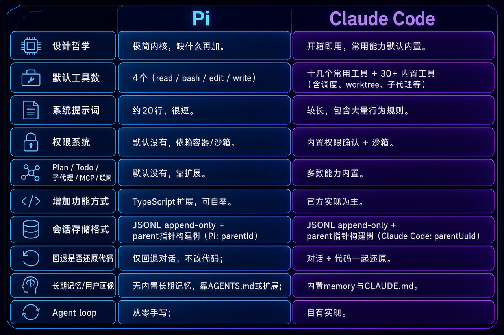
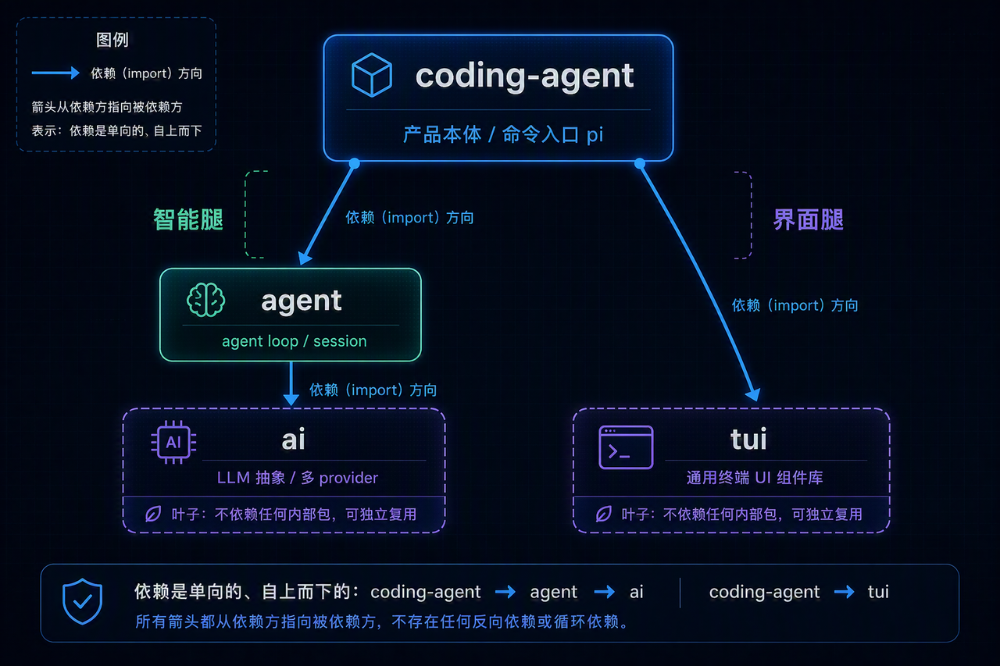
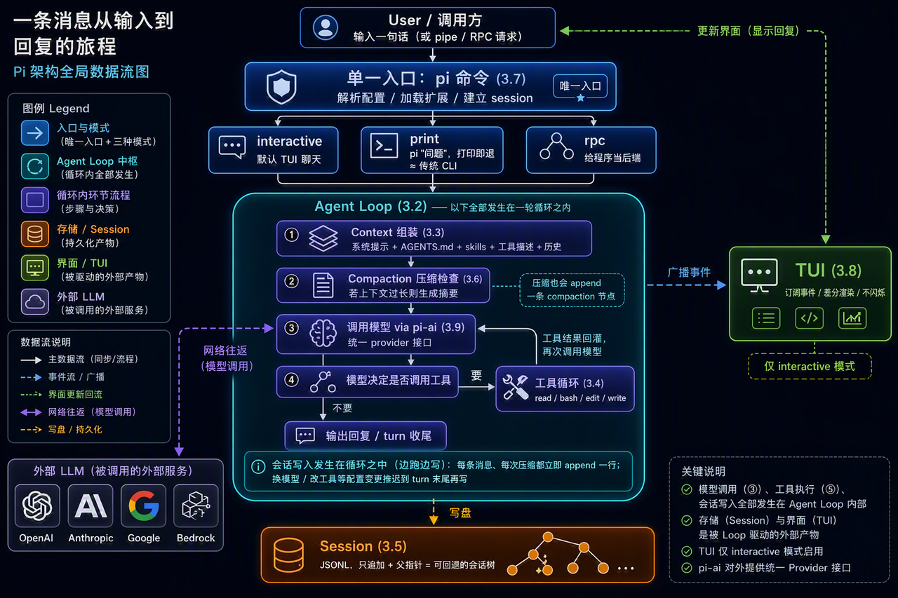

> **课时** 62/132　·　**Agent 八股**　·　约 50 分钟
> [上一课：13.2 Graph 工程](../04-Agent/26-13.2 Graph 工程.md)　·　[下一课：14.3.5 Sessions](../04-Agent/28-14.3.5 Sessions.md)
>
> 学完标准：合上笔记，能讲清本节在问什么、你怎么答、以及如何套到自己的项目上。

---

## 14 开源框架解读 - PI-Agent

当你学习完了理论部分，这里给出一个非常好的实战例子。有些同学问我，有没有推荐的开源的学习Agent的项目啊？那我的回答就是使用这个Pi-Agent。为什么？因为它足够简单，好上手。但是具备Agent项目的最核心的要素。同时他又支持扩展，官方给了很多扩展的例子。你通过这个项目，可以快速学习Agent，也给了你丰富的资料和空间去扩展，改造成自己的项目。另外他也足够权威，github上有快60k 的stars。包括也有博主说，Openclaw也就是使用它改造的，所以权威性和可学习性也不用担心。当然我们项目还有解析Hermes,解析[Openclaw](https://my.feishu.cn/docx/GikId1snboM6LyxxGPXc0kDdnub#doxcnRO3JEVYUxCpOFXhA3urpPc),[ClaudeCode](https://my.feishu.cn/docx/GikId1snboM6LyxxGPXc0kDdnub#doxcnYEDkHuCY4Og2ImdZ1ZyQgg)。 我的建议是先看这个项目，看明白再看其他的，因为其他项目复杂太多。

### **14.1. 总述**

#### **14.1.1 Pi 是什么,**

Pi 是一个很小的、可以自我扩展的 Agent Harness，也就是 Agent 运行框架。它的产品口号是 "grows with you"。直白一点说，就是先给你一个很小的内核，后面缺什么再加什么。

刚装好的 Pi 很克制：默认只有 4 个工具，分别是 `read`、`bash`、`edit`、`write`；系统提示词大约 20 行；没有 MCP，没有子代理，没有权限弹窗，没有 plan 模式，也没有内置 todo。第一次看会觉得功能少，但这正是它的设计选择：内核只保留必要部分，其他能力通过扩展补上。你缺一个能力，就可以让 Pi 写一个 TypeScript 扩展把它接进去。

Pi 是 TypeScript monorepo，主要由 4 个 package 组成：

- **pi-ai**：多供应商 LLM API 抽象，覆盖 OpenAI、Anthropic、Google、Bedrock 等。

- **pi-agent-core**：Agent 运行时，包含工具调用、状态管理、会话和压缩。

- **pi-coding-agent**：面向编码场景的交互式 CLI。

- **pi-tui**：自研终端 UI 库，支持差分渲染。

#### **14.1.2 Pi 与 Claude Code 的主要区别**

Pi 选择"小内核加扩展"，Claude Code 选择"默认带齐常用功能"。这个差异会影响工具数量、权限模型、提示词长度、扩展方式和会话结构。下面按维度对比，每条都先说 Pi、再说 Claude Code：



#### **14.1.3 为什么 Pi 适合学习**

我认为这个项目特别适合，你在学完Agent理论之后，第一个学习的实践项目。不论你是想要阅读开源代码，还是说找一个项目改装，扩展，这个项目都太合适了。

Pi 是一个很合适的样本。原因主要有四个：

1. 内核小，能读完。Claude Code 这类功能密集的工具，新手容易迷失在边缘功能里。Pi 的主干就是 agent loop，入口集中，读起来更容易抓住脉络。别看他小，但他五脏俱全。基本上面试Agent岗位的时候，围绕记忆，压缩，会话恢复，Agent Loop(React)这些是面试最常考的点，这些都有。即使他不算很复杂，但是你学会了以后，对于一个Coding Agent整体的架构的意识思想是完备的。
2. Agent loop 是手写的。市面上有 OpenAI Agents SDK、Vercel AI SDK 这类框架，导入后很快就能跑，但很多关键步骤被封装起来了。Pi 把初始化、压缩、模型调用和工具循环都写在明面上，更适合学习。
3. 模块边界清楚。4 个 package 各管一块，内核和交互层分开。Agent Core 可以脱离终端，被 RPC 或 SDK 调用，所以读一层时不必同时理解所有 UI 细节。
4. 他的思想"grows with you"，太适合你去改造了，添加了。比如他没有Plan功能，没有MCP功能。都适合你一边用，一边学，一边改造和扩展。
---

### **14.2 结构速览**

并知道接下来应该读哪几块。安装和日常使用细节不展开，官方视频里讲得更细

#### **14.2 仓库结构速览**

```
packages/
├── ai/            # pi-ai：多供应商 LLM 抽象，providers/ 下一家一个文件
├── agent/         # pi-agent-core：agent loop、harness、session、compaction
├── coding-agent/  # pi-coding-agent：CLI 入口、工具实现、扩展系统、交互模式
└── tui/           # pi-tui：通用终端 UI 组件库（Box / Text / List / Markdown…）
```

四个包，按"两类角色"来记最省事：

**产品本体：coding-agent。** 你在终端敲的 `pi` 命令，入口就是它（它的 `package.json` 里 `bin.pi` 指向 `dist/cli.js`）。它自己几乎不造轮子，而是把另外三个包装配起来用：要智能就用 `agent`，要画界面就用 `tui`，要连大模型最终落到 `ai`。

**被它使用的三个库：** `agent`（agent loop 与会话）、`tui`（终端 UI 组件）、`ai`（LLM 抽象，最底层）。

依赖方向只有一个朝向，记牢它能省掉很多困惑。下面箭头表示"谁 import 谁"：

```
coding-agent ─┬─→ agent ─→ ai
              └─→ tui
```

`coding-agent` 同时依赖 `agent` 和 `tui`；`agent` 再依赖 `ai`；而 `ai` 和 `tui` 是两个"叶子"——除了各自的外部 SDK，它们不依赖任何内部包，也都不知道 agent 的存在。



---

### **14.3 架构**

这一章回答"Pi 由哪些部分组成"。不按模块清单平铺，而是顺着数据流走一遍：你敲下回车后，一条消息经过哪些部件，最后怎么变成 Agent 的回复。

#### **14.3.1 架构总览**

这一节是整章的地图。先给一张全局视角，把后面 3.2 到 3.9 串成一条线，之后每一节再单独展开其中一站。这里只关心运行时这些部件怎么协作；各部件分属哪个 package、谁依赖谁，2.2 已经讲过，不再重复。

你在终端敲下一句话、按回车，到屏幕上一个字一个字冒出回复，中间大致经过这几站：

1. **CLI 入口（3.7）**：唯一的入口就是 `pi` 这个命令。它启动时先解析配置、加载扩展、建好会话，然后根据"现在是终端还是管道、带没带参数"**选一种运行模式**，再把消息交给 agent loop。模式有三种——交互界面（interactive，默认的 TUI 聊天）、一次性打印（print，`pi "你的问题"`，打印完就退，接近传统 CLI）、程序化后端（RPC，给别的程序当后端）。入口只有一个，这三种只是它之后的不同运行形态，细节见 3.7。

2. **Agent Loop（3.2）是中枢，而且下面 3 到 7 这些事都发生在它的一轮循环之内。** 一轮里它依次：组装上下文 → 检查要不要压缩 → 调用模型 → 看模型要不要调工具 → 把这一轮产生的东西写进会话。换句话说，"调用 LLM""执行工具""写 Session"不是 loop 之外的独立步骤，而是 loop 在一轮里亲自做的几件事。

3. **Context 组装（3.3）**：把系统提示词、AGENTS.md、skills 描述、工具描述、历史消息和你这次的输入，拼成一份完整上下文。模型本身没有记忆，每一轮都要重新喂。

4. **Compaction 检查（3.6）**：上下文要是太长，就先让模型把历史总结成摘要。注意这一步也会**往会话文件 append 一条"压缩"节点**——摘要本身也是会话树里的一个条目，之后取上下文时用它替换掉被压缩的那段历史。

5. **调用模型（3.9）**：通过 `pi-ai` 把上下文发给当前选中的 provider（OpenAI / Anthropic / Google…）。对 loop 来说，换模型只是换一个 provider，主流程不变。

6. **工具循环（3.4）**：模型若要调 `read`/`bash`/`edit`/`write`，loop 就执行工具、把结果回灌给模型；模型可能接着调，也可能收尾。读写代码、跑命令，真正发生在这一步。

7. **写入会话（3.5）**：这不是循环跑完才做的收尾，而是**边跑边写**——每产生一条消息（你的输入、模型回复、每个工具结果）、每做一次压缩，都立即按"只追加 + 父指针"往 JSONL 文件追加一行；只有换模型、改工具集这类配置变更，才推迟到一轮结束时统一写。所有这些条目靠 `parentId` 串成那棵可回退、可分叉的会话树。

8. **TUI 渲染（3.8）**：整个过程中，loop 不断广播事件，终端界面订阅这些事件，用差分渲染把消息流、工具调用和状态变化实时画出来，而且不闪烁。

顺带说一句它为什么能这么拆：中枢那套东西（loop、context、session、compaction）不碰终端，所以同一套内核既能驱动这里的 TUI，也能被 RPC 或管道调用——这一点 3.7 讲三种运行模式时还会再碰到。



---

#### **14.3.2 Agent Loop**

Agent loop 是 Pi 最核心的部分。每次你向 Pi 发送消息，背后都会跑一轮循环。主干大致是这样：

1. 初始化 context：把系统提示词、AGENTS.md、skills 描述、工具描述、历史消息和当前消息拼成完整上下文。
2. Transform / 压缩：检查上下文是否过长，过长就先做 compaction。
3. 调用大模型：把上下文发给当前选中的 LLM provider。
4. 工具调用循环：如果模型要调工具，就执行工具，把结果回灌给模型。模型可能继续调工具，也可能停止。
5. 回复：模型不再调工具时，输出最终回答，本轮结束。
这个流程看起来简单，但要写稳定并不轻松。实际实现里还要处理流式输出、运行中插话（steering）、收尾追问（follow-up）、工具并行或串行执行，以及中断（abort）。这些逻辑都集中在 `runLoop()` 附近。

这个就是一个非常标准的流程了，ClaudeCode,Hermes都采用了他。这个循环也可以理解成是一个标准的React循环。 面试官也问过原题：工业上一个React是怎么做的？**就是上面的内容，请牢记。**


> 源码入口：`packages/agent/src/agent-loop.ts` 的 `runLoop()`、`streamAssistantResponse()`、`executeToolCalls()`。
>

---

#### **14.3.3 Context 组装**

模型本身没有长期状态。每次调用，都要把它需要知道的内容重新放进 context。Pi 的 context 通常包含这些部分：

- 系统提示词：硬编码的极简模板，大约 20 行。可以追加 `append-system.md`，用 `--system-prompt` 覆盖，也可以用 `system.md` 完全替换。
- AGENTS.md：home 目录和当前工作目录里的项目说明会被追加进来。Pi 也兼容读取 `CLAUDE.md`。
- Skills 描述：所有已加载技能的 name、description、location。
- 工具描述：当前启用工具的说明。
- 历史消息或摘要：本轮之前的对话；如果已经压缩过，就使用摘要。
- 当前消息：用户这次输入的内容。
这里有个很重要的选择：系统提示词刻意保持短。把太多 AGENTS.md、skills 或行为规则塞进去，会撑大上下文，也会稀释模型注意力。

> ❓**思考题：读到这里，想清楚一个问题：Skills 到底是怎么"被调用"的？**
>
> 简答：Pi 不是把所有 Skill 全文都塞进上下文，也不是把 Skill 做成一个特殊工具。它先把每个 Skill 的 name、description、location 放进系统提示词，并提示模型：如果任务匹配某个 Skill，就用 `read` 工具读取对应文件。也就是说，Skill 的自动使用是"提示词引导 + 模型判断 + read 工具按需加载"。如果用户显式输入 `/skill:name`，Pi 才会直接把这个 Skill 文件展开进用户消息。
>

> 源码入口：`packages/agent/src/harness/system-prompt.ts`、`packages/coding-agent/src/core/system-prompt.ts`。
>

---

#### **14.3.4 Tools**

Pi 默认只给模型 4 个工具：

**read**：读文件。

**bash**：执行 shell 命令。

**edit**：编辑文件。

**write**：写文件。

工具很少，但组合起来够用。尤其是 `bash`，它能调用系统已有命令，很多搜索、列目录、检查项目状态的需求都可以通过它完成。

源码里还有 `grep`、`find`、`ls`，但默认不启用。它们主要给**只读模式用**。比如通过 `--tools read,grep,find` 启动时，Agent 可以查文件，但不能直接改文件或执行任意 shell 命令。这样同一套工具实现可以切换出"可写"和"只读"两种工作方式。因为在可写模式下，给到了Agent Bash工具，它本身就可以通过Bash来调用grep查找，不必要再给grep了。但是在只读环境下，不能给Agent bash工具，所以需要给他grep,find,ls.

> 源码入口：`packages/coding-agent/src/core/tools/index.ts`，看 `createCodingTools()` 和 `createReadOnlyTools()`。
>

---
