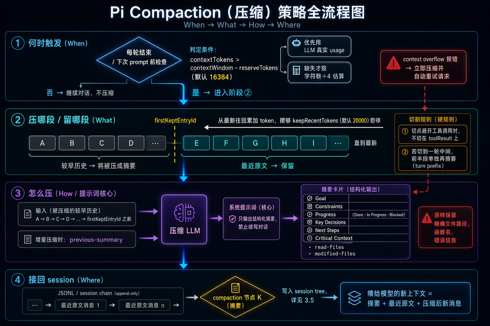
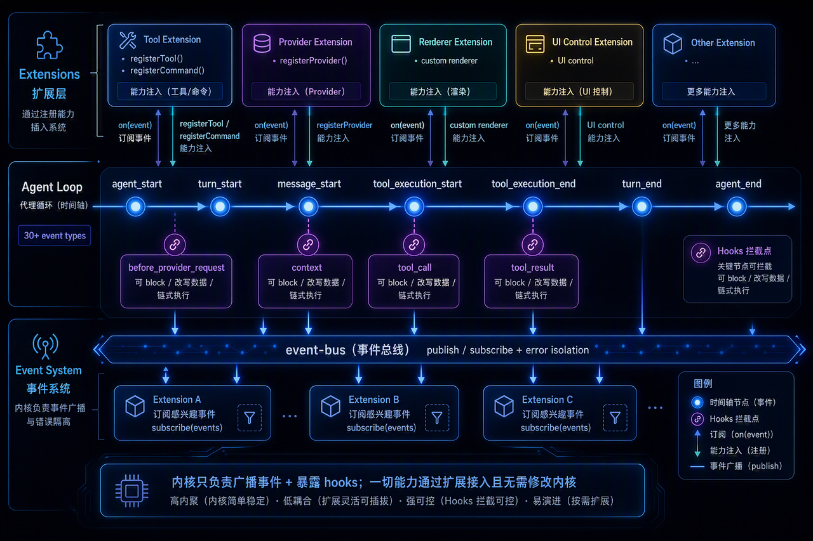

> **课时** 64/132　·　**Agent 八股**　·　约 1 小时
> [上一课：14.3.5 Sessions](../04-Agent/28-14.3.5 Sessions.md)　·　[下一课：14.5. 课后作业](../04-Agent/30-14.5. 课后作业.md)
>
> 学完标准：合上笔记，能讲清本节在问什么、你怎么答、以及如何套到自己的项目上。

---

#### **14.3.6 Compaction**

对话变长以后，Agent 不能无限把完整历史塞进模型。Pi 的做法是 compaction：把较早的一段历史总结成摘要，然后用"摘要 + 最近原文"继续对话。

**压缩节点在 session tree 里长什么样、爬链时怎么用摘要顶替历史，已经在 3.5 讲过**（就是那个 `compaction` 节点 + `firstKeptEntryId` 指针的机制）。所以这一节不再重复"存储形态"，只回答两个纯策略问题：**什么时候压、压哪一段。** 一句话接住 3.5：压缩不删历史，只是在链尾埋一个摘要节点，下一次爬链取上下文时用它顶替早期原文。

**什么时候压缩？——触发时**

Pi 不会在每个工具调用之间反复算上下文，而是只在**轮次边界**检查，主要是两个点：

1. 一轮 Agent 结束后（模型回复完、工具循环也跑完）。
2. 用户下一次发送 prompt 前，避免新一轮刚开始就把上下文撑爆。
除此之外，也可以手动触发，扩展系统也能在合适时机调用压缩。值得一提的是：****判断"要不要压"的逻辑不在内核 harness 里，而在应用层（`coding-agent`）。**** harness 只提供两样东西——一个纯函数 `shouldCompact()` 做判定、一个 `compact()` 执行动作；至于"每轮结束后该不该调它"，是 `coding-agent` 在每个 assistant 回合结束时决定的。这也呼应了 Pi"极简内核、策略外置"的一贯取舍。

**什么时候压缩？——触发阈**

判定函数 `shouldCompact()` 的条件很直白（`compaction.ts`）：

```
contextTokens > contextWindow − reserveTokens
```

也就是"当前上下文 token 数，超过了模型上下文窗口减去预留量"。`reserveTokens` 默认 **16384**，这块预留是留给压缩本身的——生成摘要要发一次请求、也要容纳摘要输出，不能等真的撑满了才动手。

`contextTokens` 用什么算？****优先相信模型返回的真实 `usage`****（`totalTokens`，或 `input + output + cacheRead + cacheWrite` 相加），这是最准的。只有两种情况退回字符数估算（约"字符数 ÷ 4"）：一是请求报错、根本没拿到 usage（比如 529）；二是需要估算"保留最近哪一段"时。还有一种是模型直接报 context overflow 错误，这时不等阈值、立即压缩，并自动重试一次刚才失败的请求。

**压缩哪一段？——保留窗口与切点**

Pi 不是把全部历史都压成摘要，而是**保留最近一段原文、只压更早的部分**。保留多少由 `keepRecentTokens` 控制，默认 **20000**。具体做法是从最新消息往回累加 token，攒够 2 万就停，这个点之后保留原文、之前交给摘要（对应 3.5 里那个 `firstKeptEntryId` 指针）。

> 这个下面的规则其实就比较细节了，和具体的存储力度（你是以整个提问-回答为力度存，还是以每一次小的llm返回为力度存），以及具体的细节，如何避免切坏语义。通常面试官不会问这么细致，这个也和具体业务场景要求相关。我们理解规则灵活运用。
>

但切点不能乱下刀，有两条硬规则：

- **不能切断工具调用对。** assistant 发起 tool call、紧跟着 tool result，这两者语义上是一组。Pi 选切点时只认合法边界（user / assistant 等消息边界），****明确不把 `toolResult` 当切点****，避免只留下半截调用链、把上下文弄坏。

- **回合被切到一半要补救。** 如果按 token 算出的切点正好落在某一轮任务中间，Pi 会把这一轮的前半段**单独再摘要一次**，让保留下来的后半段原文还能接得上，不至于"开头没了、中间突然冒出来"。

**摘要里写什么？——提示词的核心思想**

Pi 的摘要**不是一句"帮我总结上文"**，而是给压缩模型一份措辞严格的提示词，核心思想就一句话：**别续写对话，只产出一份"交接班用的结构化检查点"，让另一个 LLM 能照着它无缝接手工作。** 系统提示词开宗明义就强调这一点（原文大意）：

> 你是一个上下文摘要助手。读完这段对话后，**只**按指定格式输出结构化摘要。**不要**继续对话，**不要**回答对话里的任何问题。
>

为什么这么强调"不要续写"？因为压缩复用的是同一个对话补全接口，模型很容易把这段历史当成"该我接话了"而真的去回答问题——那摘要就毁了。所以提示词反复用大写 `Do NOT` 把它摁住。

> 这个模板也可以稍微记一下，如果面试问你是怎么压缩的，要记录哪些东西，就是从这里回答。
>

真正的摘要提示词要求模型按**固定模板**输出，骨架是这几节（这就是压缩策略的"信息取舍"——它规定了什么必须留下来）：

```
## Goal             目标：用户到底想完成什么
## Constraints & Preferences   约束与偏好：用户提过的要求、限制
## Progress         进度：### Done 已完成 / ### In Progress 进行中 / ### Blocked 卡住
## Key Decisions    关键决策：做了什么选择、为什么
## Next Steps        下一步：接下来该干什么（有序列表）
## Critical Context  关键上下文：继续工作必需的数据、引用
```

模板末尾还有一句对 Coding Agent 极其关键的硬要求:**"原样保留精确的文件路径、函数名、错误信息"**——这些细节一旦被模型"复述走样",接手的 Agent 就会找错文件、改错函数,所以提示词专门点名它们不许概括。

一句话抓住提示词策略:**它不是压缩文字长度,而是把一段冗长对话"蒸馏"成一份带固定栏目的工作交接单——目标、进度、决策、下一步、以及不许走样的路径/函数/报错。**

**同步还是异步？**

从 Agent 主流程看，压缩是一个**需要等待**的步骤——摘要本身要再调一次模型生成，没生成完就不能安全进入下一轮。所以一旦决定压缩，会先暂停对话，等摘要生成、写入 compaction 节点、重建上下文，再继续。但它不是每轮都阻塞：只有真到阈值才触发，平时到边界点检查一下、没超标就直接继续。区别在于——上下文已经溢出时，压完会自动重试刚失败的请求；只是预防性接近阈值时，压完让下一轮从新上下文继续即可。

下面这张图把整个压缩策略串成一条流程：从"何时触发"的判定，到"压哪段、留哪段"的切点选择，再到提示词把历史蒸馏成结构化摘要，最后接回 session tree。



总结：**Pi 的 compaction 是在轮次边界触发、由应用层按 `contextTokens > contextWindow − reserveTokens` 判定、会等待模型生成摘要的上下文重写步骤；它保留最近约 `keepRecentTokens` 的原文、只压更早的前缀，切点避开工具调用对，并把摘要作为新的会话节点接进 session tree（存储细节见 3.5）。**

> 源码入口：`packages/agent/src/harness/compaction/compaction.ts`（`shouldCompact` 阈值判定、`findCutPoint` 选切点、摘要 prompt 模板与生成）、`packages/coding-agent/src/core/agent-session.ts`（每轮结束的检查与自动压缩流程）、`packages/coding-agent/src/core/session-manager.ts`（保存 compaction 节点）。对应视频文稿见 `PI Architecture explained.txt` 的 Compaction 段。
>

---

#### **14.3.7 CLI 入口和三种运行模式**

> 在看这个章节前，我想请大家思考一个问题？如果你设计了一个coding Agent。你怎么设计这个架构，让他既可以作为一个独立的Agent产品用，又能够像一个插件一样，方便的给到其他的应用，比如Openclaw用，让其他进程能够快速集成Coding的能力？答案就在本小节PI的这个设计方法值得我们学习。
>

输入 `pi` 后，入口主要在两个文件：

- `cli.ts`：接住命令，设置进程标题等，然后调用 `main`。
- `main.ts`：解析参数，解析配置，找到工作目录，加载扩展，创建 agent session，然后按指定模式运行。
Pi 有三种运行模式：

- **interactive**：默认模式，终端聊天界面。

- **RPC**：程序化调用，给其他程序当后端。比如说你的**小龙虾**，你想外接一个 coding 的能力，就可以使用 PI 的 RPC 模式。

- **print-stdio**：`pi "你的问题"`，打印答案后退出，接近传统 CLI。

因为内核不绑定 UI，同一套 Agent Core 才能被这三种模式复用。

> 源码入口：`packages/coding-agent/src/cli.ts`、`packages/coding-agent/src/main.ts`。
>

---

#### **14.3.8 TUI**

> TUI这里是负责前端的内容，我没有特别关注。我自己写的项目，前端的内容，完全没有看代码，面试也没问。如果你也不想学前端，也可以基本浏览一下本章节，大概知道他是用什么技术栈实现的就好。
>

TUI 可以理解成"跑在终端里的前端"。但它不是我们平时说的 Web 前端，也不是 FastAPI 这种后端框架。FastAPI 是 Python 后端框架，通常负责 HTTP API；Pi 这里没有浏览器、没有 DOM、没有 HTML/CSS，也没有 React/Vue。

Pi 的 TUI 技术栈更准确地说是：

- **运行时**：Node.js。

- **语言**：TypeScript。

- **UI 库**：自研的 `@earendil-works/pi-tui`。

- **渲染目标**：terminal，也就是用户当前的命令行窗口。

- **渲染方式**：输出 ANSI escape sequences，控制光标、颜色、清屏、局部刷新等终端行为

所以它和 Web 前端的对应关系大概是这样（左边是 Web 前端，右边是 Pi TUI 里的对应物）：

- 浏览器 → 终端。
- DOM 节点 → 文本行和 ANSI 控制序列。
- React/Vue 组件 → `Component` 对象。
- CSS 样式 → ANSI 颜色、粗体、下划线等。
- 鼠标/键盘事件 → stdin 里的按键序列。
- 重新渲染页面 → 重新计算终端文本并差分刷新。
`@earendil-works/pi-tui` 里最核心的抽象是 `Component`。一个组件只需要实现 `render(width)`，返回一组字符串；如果它需要处理输入，就再实现 `handleInput(data)`。输入框、Markdown 消息、选择器、弹窗、底部状态栏，本质上都是这种组件。

Pi 没有用现成的 Ink 这类 React TUI 框架，而是自己实现了渲染器。这样做的好处是能更细地控制终端体验：比如差分渲染，只刷新变化的行；同步输出，减少闪烁；处理 bracketed paste；支持 Kitty / iTerm2 图片协议；处理复杂按键和终端尺寸变化。

在架构上，TUI 不直接负责 Agent 推理。它只是 interactive mode 的界面层：用户在编辑器里输入 prompt，TUI 把输入交给 Agent Session；Agent Session 在运行过程中发出事件，比如消息更新、工具开始、工具结束、压缩完成；TUI 订阅这些事件，把它们渲染成终端里的消息流、工具执行块、底部状态栏和各种弹窗。

一句话：**Pi 的 TUI 是 TypeScript + Node.js 写的终端前端，不是 Web 前端；它用自研组件系统和 ANSI 终端控制序列，把 Agent Core 的事件实时画到命令行里。**

> 源码入口：`pi/packages/tui/src/`（自研 TUI 框架，重点看 `tui.ts`、`terminal.ts`、`components/markdown.ts`）、`pi/packages/coding-agent/src/modes/interactive/interactive-mode.ts`（Pi 具体的交互界面如何组装）。
>

---

#### **14.3.9多供应商抽象**

> 这里用的是**策略+工厂模式**，和我们笔记里**RAG项目的思路**是一样的。我们RAG项目使用的是一次输入-输出，也没有ReAct，所以没有处理工具，流式SSE的内容，只用处理HTTP格式。不过思路是一样的。
>

最底层的 `pi-ai` 把不同 LLM 供应商统一成一套接口。OpenAI、Anthropic、Google、Bedrock、Mistral、Cloudflare 等供应商的 API 都不一样，但 Agent Core 不应该关心这些差异。它只需要调用一个统一入口：

```typescript
streamSimple(model, context, options
```

这里的核心思想就是策略模式：同一件事，也就是"调用模型并拿到流式回复"，底下可以有多种实现。Pi 不是用传统的"抽象基类 + 子类继承"来做，而是更 TypeScript 的写法：每个 provider 注册一组函数，比如 `stream` 和 `streamSimple`。运行时 `pi-ai` 根据 `model.api` 找到对应的 provider 函数，然后调用它。

可以把流程理解成：

```
Agent Core
  -> 调用 streamSimple(model, context, options)
  -> pi-ai 根据 model.api 找到对应 provider
  -> provider 把 Pi 的统一上下文转成供应商请求
  -> 供应商返回流式结果
  -> provider 再转回 Pi 的统一消息事件
```

这里要注意区分 `provider` 和 `api`。`provider` 是模型来源，比如 OpenAI、Anthropic、OpenRouter、GitHub Copilot；`api` 是调用协议，比如 `openai-completions`、`openai-responses`、`anthropic-messages`、`google-generative-ai`。真正决定走哪套调用策略的是 `model.api`。这也解释了为什么很多不同供应商可以共用 OpenAI-compatible 的实现：它们来源不同，但 API 协议相近

provider 主要做的是"适配"。Pi 内部有统一的 `Context`、`Message`、`Tool`、`AssistantMessageEventStream`，但每家模型 API 的字段结构都不同。provider 要负责几件事：

- 把 Pi 的统一消息格式转成供应商请求格式。
- 把**工具定义**和**工具调用**转成供应商支持的格式。
- 把供应商的 streaming chunk 转成 Pi 统一的文本增量、工具调用增量、结束事件。
- 把 token usage、stop reason、错误信息转成 Pi 内部统一结构。
- 处理每家特有的能力，比如 reasoning/thinking、prompt cache、图片输入、headers、OAuth、baseUrl 等。
所以对 Agent Core 来说，换模型就是换 `model`；对 `pi-ai` 来说，换模型就是根据 `model.api` 换一套 provider 策略。Agent loop 不需要知道底层是哪家模型，也不需要在主流程里写一堆 `if provider === "openai"` 这样的分支

一句话总结：**pi-ai` 用统一接口包住不同模型 API，provider 负责双向翻译：把 Pi 的统一格式翻译成供应商格式，再把供应商响应翻译回 Pi 的统一格式。**

> 源码入口：`pi/packages/ai/src/stream.ts`（统一入口）、`pi/packages/ai/src/api-registry.ts`（provider 注册表）、`pi/packages/ai/src/providers/`（各供应商适配实现）、`pi/packages/ai/src/models.ts`（模型注册表）。
>

---

### **14.4. 可扩展性**

第 3 章讲 Pi 由什么组成，这一章讲能力怎么接上去。Pi 和很多"功能默认全带"的 Agent 不同，它把大量能力留给扩展系统。

一句话概括**：agent loop 在运行过程中持续广播事件，扩展通过订阅事件、注册能力和 hooks，在不改内核代码的情况下改变 Pi 的行为。**



#### **14.1 事件系统**

Agent loop 运行时会不断发事件：agent 开始、每一轮开始和结束、消息开始、消息更新、消息结束、工具开始执行、工具执行中、工具执行完、模型切换、用户输入等。一共有 30 多种事件。

底层事件总线在 `event-bus.ts`，实现很朴素。它是在 Node `EventEmitter` 上封了一层 `emit` / `on`，也就是发布订阅模式，再加一点错误隔离。某个订阅者抛错，不会直接拖垮整个 Agent。

这套事件广播让扩展可以在工作流的很多位置插入逻辑。扩展和 hooks 都建立在这个基础上。

> 源码入口：`packages/coding-agent/src/core/event-bus.ts`。事件定义在 `extensions/types.ts` 的 `ExtensionEvent` 联合类型里。
>

#### **14.4.2 Extensions**

扩展本质上是一个 TypeScript 模块。它拿到 `pi` API 对象后，可以做这些事：

- 注册工具：用 `registerTool` 给模型加新能力，比如 web search。
- 订阅事件：用 `on` 在事件上挂回调。
- 注册斜杠命令、快捷键和 CLI flag：对应 `registerCommand`、`registerShortcut`、`registerFlag`。
- 注册或覆盖模型供应商：用 `registerProvider` 接入自定义代理、企业 SSO 等。
- 注册自定义消息渲染器：用来改变某类消息在 TUI 里的显示方式。
- 操控 UI：弹选择框、确认框、输入框，设置页脚、页眉、状态栏和欢迎语。
- 改系统提示词、发消息、控制会话：比如新建、fork、导航、切换会话。
官方讲解里有两个例子很直观：一个是让 Pi 给自己写开机欢迎语扩展，每次启动显示一句随机 quote；另一个是写权限确认扩展，在执行 `rm -rf` 或 `git push -f` 之前先弹窗确认。类似功能在很多 Agent 里是内置项，在 Pi 里则是几十行 TypeScript 扩展。

> 源码入口：`packages/coding-agent/src/core/extensions/`，重点看 `loader.ts`、`runner.ts`、`types.ts`。API 全貌在 `types.ts` 的 `ExtensionAPI` 接口。
>

#### **14.4.3 Hooks**

订阅事件更像旁路观察；hooks 则可以拦截和改写数据。几个典型 hook 如下：

- **tool_call**：工具执行前，可以 `block` 阻止执行，也可以改写工具参数。

- **tool_result**：工具执行后，可以改写返回结果。

- **context**：调用 LLM 前，可以改写即将发送的消息列表。

- **before_agent_start**：用户提交后、loop 启动前，可以改写本轮系统提示词或注入消息。

-**before_provider_request**：发请求给供应商前，可以替换 payload。

- **session_before_compact / session_before_tree**：压缩或导航前，可以取消或自定义处理。

权限确认扩展的实现思路就是挂在 `tool_call` 上：检测到危险 bash 命令就弹确认框，用户拒绝就返回 `block`。多个 hook 挂在同一事件上时，会按顺序链式执行。前一个 hook 的修改，后一个 hook 能看到

> 源码入口：设计文档 `packages/agent/docs/hooks.md`，事件结果类型见 `extensions/types.ts` 里的各类 `*EventResult`。
>

---
