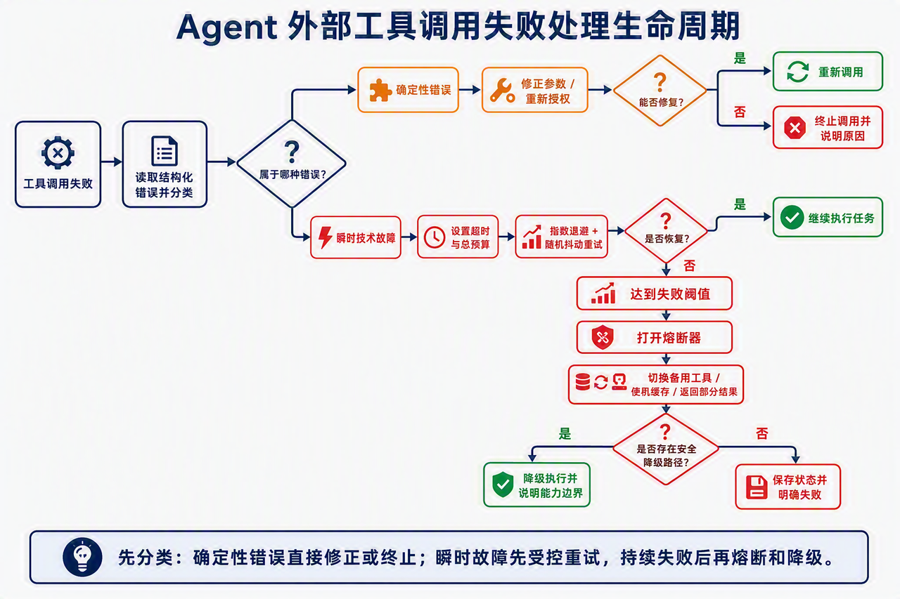
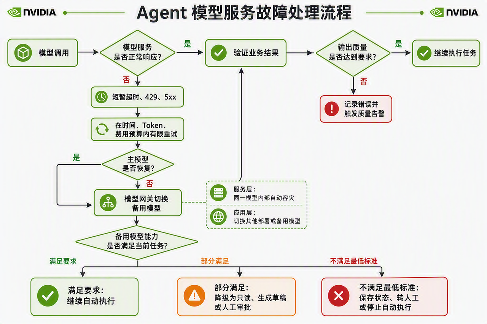

> **课时** 70/132　·　**Agent 八股**　·　约 1 小时
> [上一课：16.3 传统方法就能做，你用Agent做有必要吗？ · 16.4 面试问题](../04-Agent/34-16.3 传统方法就能做，你用Agent做有必要吗？ · 16.4 面试问题.md)　·　[下一课：19 开源框架解读- DeepSeek Harness · 19.2 整体架构](../04-Agent/36-19 开源框架解读- DeepSeek Harness · 19.2 整体架构.md)
>
> 学完标准：合上笔记，能讲清本节在问什么、你怎么答、以及如何套到自己的项目上。

---

## 17 Agent健壮性设计

### 17.1 前言

如何设计一个 **高可用、发生故障后能够优雅回退的 Agent 系统**，是当前 Agent 岗位面试中比较受关注的知识点。它也是区分普通演示型项目与企业级、生产级项目的重要设计能力：一个项目不仅要能在理想条件下完成任务，还要考虑模型、工具和运行流程发生异常时，系统如何恢复、隔离、降级或安全停止。

我们在“[**2026 年面试官最喜欢的 6 个 AI 项目**](https://my.feishu.cn/docx/GikId1snboM6LyxxGPXc0kDdnub#doxcnkegsa2khRmUzBMu0rg7ovc)”中曾经讨论过这一点。最近整理的真实面试问题也进一步说明了它的重要性：

> **英伟达 Agent 一面：** Agent 遇到异常故障时，用什么方式保持持续健壮的运行？（我们后面会收录这期面经，做精讲）
>
> **宇树科技 Agent 一面：** 外部工具调用失败后，系统如何容错或降级？
>

这两道问题虽然切入角度不同，但都在考察同一个核心能力： **当 Agent 无法按照原计划继续执行时，系统能否识别故障、采取正确的恢复策略，并在无法恢复时进行优雅降级。** 由此可以看出，Agent 健壮性设计既是一个高频面试知识点，也是生产级 Agent 项目不可缺少的工程能力。

因此，本文将其整理为一个独立专题—— **Agent 系统健壮性设计**，系统讲清楚 Agent 开发中可能遇到的故障，以及面对这些故障时应当如何安全、可控地处理。无论是准备面试，还是设计和完善自己的 Agent 项目，这部分理论与实践方法都非常实用。

**本文的内容安排：** 全文将围绕 Agent 开发与运行过程中的 **外部工具与依赖故障、模型服务故障，以及 Agent 推理与控制流故障** 展开，并按照“ **故障表现 → 解决策略 → 完整处理流程** ”进行讲解，说明什么时候应该重试、什么时候需要修正或重新规划、什么时候应当熔断和降级，以及什么时候必须转人工或停止执行。文中还会穿插相应的 **面试问题、答题思路与参考答案**，帮助大家快速检验理解程度，并掌握如何在面试中有条理地表达一套完整、可落地的生产级方案。

---

### 17.2 调用工具失败

Agent 的主要价值来自调用搜索、数据库、代码执行、支付、工单、邮件和企业内部 API 等工具，因此工具层也是最常见的故障来源。这个几乎是在设计高可用Agent系统时，最常问的问题了。

#### 17.2.1 瞬时技术故障：设置明确的超时、总预算和有界重试

**故障表现：** 瞬时技术故障一般包括 **网络连接中断、请求超时、HTTP 429 限流、部分 HTTP 5xx、MCP Server 或插件短暂不可用**，以及下游服务临时过载。这类故障的特点是过一段时间后可能自行恢复，因此允许重试，但不能让单个依赖无限阻塞整个 Agent。

**解决策略：** 为每次调用设置 **连接超时和响应超时**，同时限制工具调用阶段及整个 Agent 任务的 **总时间、总成本和最大重试次数**。对于明确可重试的错误，采用指数退避和随机抖动，遵守服务端的 `Retry-After`，并在达到次数或时间预算后立即停止，避免无限重试演变为重试风暴和级联故障。

> ❓️ **你可能会问：什么是指数退避和随机抖动？**
>
> 💡 这是软件开发，尤其是分布式系统中非常经典的重试策略。 **指数退避** 是指每次重试失败后逐渐延长等待时间，例如依次等待 1 秒、2 秒、4 秒和 8 秒，避免在服务尚未恢复时频繁请求； **随机抖动** 则是在等待时间上加入一定的随机变化，把不同客户端的重试时刻错开，避免大量请求在同一时间再次涌入下游服务。
>

#### 17.2.2 确定性调用错误：返回结构化错误并修正调用

**故障表现：** 确定性调用错误一般包括 **参数缺失、参数类型错误、工具名称或版本不匹配、Schema 校验失败、身份认证过期、权限不足**，以及请求违反业务规则。这类问题由请求本身或执行条件决定，通常不会随着时间自动消失，因此 **原样重试没有意义**。

**解决策略：** 由工具执行器返回 **错误类型、是否可重试、失败字段和具体原因** 等结构化信息，让 Agent 据此修正参数、补充前置条件、重新授权、替换工具或调整计划，而不是机械地重复同一个请求。例如可以返回：

```json
{"error_type": "INVALID_ARGUMENT",
"retryable": false,
"message": "end_time must be later than start_time",
"failed_fields": ["start_time", "end_time"]}
```

#### 17.2.3 瞬时故障多次重试仍失败：使用熔断器隔离故障

**故障表现：** 这一阶段主要承接第一类瞬时故障：工具经过有限次数的退避重试后，仍然 **连续超时、返回 5xx 或处于不可用状态**，说明问题可能不再是短暂抖动，而是依赖正在持续故障。第二类参数错误、权限不足等确定性错误通常不会进入这里，因为它们应直接修正、重新授权或终止调用，而不是反复重试到熔断。

**解决策略：** 使用 **熔断器** 隔离故障：正常情况下处于 Closed 状态；连续失败达到阈值后进入 Open 状态，暂时拒绝新调用；等待冷却时间后进入 Half-Open 状态，只放行少量探测请求，确认依赖恢复后再关闭熔断。 **熔断的目的不是修复工具，而是保护 Agent 和下游系统。**

#### 17.2.4 工具长时间不可用：按照能力等级逐级降级

**故障表现：** 工具长时间不可用意味着自动恢复已经超过重试或熔断预算，但用户的任务可能仍有一部分可以完成。此时如果继续等待会浪费资源，如果直接宣告整个任务失败又可能损失仍可提供的核心能力，因此需要根据操作风险和业务目标判断可接受的能力边界。

**解决策略：** 依次尝试 **同能力的备用工具、缓存或已有中间结果**，并在无法完整完成时返回部分结果且明确缺失项。对于高风险操作，可以从写入降级为只读查询，从自动执行降级为提供建议；仍无法安全完成时保存当前状态并转人工，没有安全降级路径时则明确失败， **绝不能伪造成功结果**。

#### 17.2.5 完整处理流程



上面的四条可以统一成一套完整的工具调用失败处理流程。按照这个思路回答，既能体现清晰的故障分类能力，也能体现对重试、熔断和优雅降级等高可用设计的理解。这套方案也可以直接用于实际项目中的 Agent 工具调用层设计。

整体处理思路可以分为四步：

1. **错误分类：** 先读取结构化错误，区分确定性错误和瞬时技术故障，不能对所有失败统一重试。
1. **局部恢复：** 确定性错误通过修正参数、重新授权或终止调用处理；瞬时故障则在超时和总预算内进行有界重试。
1. **故障隔离：** 瞬时故障多次重试仍未恢复时，打开熔断器，避免持续冲击故障依赖。
1. **优雅降级：** 工具确实不可用时，切换备用工具、使用缓存或已有结果、返回部分结果，必要时降级为只读建议或转人工；没有安全降级路径时明确失败。
假设 Agent 调用搜索工具失败，系统首先读取结构化错误并进行分类：

1. 如果是参数格式错误、权限不足等 **确定性错误**，就进入第二条，修正参数、重新授权或直接终止，不能原样重试；
1. 如果是连接超时、HTTP 429 或 HTTP 503 等 **瞬时故障**，就进入第一条，在总预算内进行有限次数的指数退避和随机抖动重试；
1. 如果瞬时故障经过多次重试仍未恢复，就进入第三条，打开熔断器，停止继续冲击故障依赖；
1. 如果工具在熔断后仍长时间不可用，就进入第四条，切换备用工具、使用缓存或返回部分结果；
1. 如果不存在安全的降级路径，则明确报告工具不可用，保存必要状态并结束调用。
因此，完整逻辑可以概括为： **先分类；确定性错误直接修正或终止；瞬时故障先受控重试，持续失败后再熔断和降级。** 这比简单回答“失败后重试三次”更能体现生产系统设计能力。

> 🎯 **面试卡片**
>
> **面试问题：外部工具调用失败后，Agent 应该如何进行容错和降级？**
>
> 🧭 **答题思路与技巧：** 回答时不要把所有工具故障一概而论，也不要只说“失败后重试”。应当用清晰的分类和递进关系，体现回答的全面性与工程思维。
>
> 💬 **参考答案：**
>
> 外部工具调用失败后，我不会直接统一重试，而是先根据结构化错误进行分类。
>
> 1. 对于 **参数错误、权限不足等确定性错误**，原样重试没有意义，我会修正参数、重新授权，无法修复时直接终止调用并说明原因。
> 1. 对于 **网络超时、HTTP 429 和部分 5xx 等瞬时故障**，我会设置单次超时和任务总预算，并采用指数退避与随机抖动进行有限重试。
> 1. 如果瞬时故障 **多次重试仍未恢复**，我会打开熔断器，停止继续冲击下游，并通过半开状态探测服务是否恢复。
> 1. 如果工具 **长时间不可用**，我会根据业务风险切换备用工具、使用缓存或已有结果、返回部分结果，或者从自动执行降级为只读建议。仍然无法安全完成时，就保存必要状态、明确说明失败并转人工处理。
> 一句话概括就是： **先分类，能恢复就受控恢复；不能恢复就熔断；确实不可用就优雅降级。**
>

---

### 18.3 模型调用失败

模型服务故障和前面的外部工具调用故障有一定相似性：两者的总体目标都是 **在安全和预算允许的范围内尽可能恢复任务**，能够重试时受控重试，持续不可用时切换备用能力，无法完整恢复时再进行降级。但这一节把故障对象进一步聚焦到了 Agent 最核心的一项外部依赖—— **大模型 API**，因此除了通用的超时、限流和服务不可用，还需要讨论一些与 LLM 特性直接相关的问题。

其中最关键的区别是： **模型 API 调用成功，不代表模型在业务上正常。** 接口可能返回 HTTP 200，但模型由于概率性、版本变化或能力差异，仍然可能生成错误的工具参数、违反业务规则或遗漏用户要求。因此，模型服务故障不能只从 API 层判断，还要引入 **业务逻辑评估**，持续验证模型能否正确完成真实任务；主模型无法恢复时，还需要准备并切换 **经过业务验证的备用模型**，再根据备用模型的实际能力决定是否维持原权限或进一步降级。

---

#### 18.3.1 模型服务短暂抖动：在任务预算内进行有限重试

**故障表现：** 模型服务短暂抖动通常表现为 **请求超时、HTTP 429 限流、部分 HTTP 5xx、流式响应中断或单个推理端点暂时不可达**。这类故障可能随着负载下降或服务恢复而消失，但一次模型调用往往同时消耗时间、Token 和费用，失败后的重复生成还可能产生不同结果，因此不能无限重试。

**解决策略：** 先为单次请求设置超时，只对明确可恢复的错误进行**指数退避和随机抖动重试**，并同时限制 **最大调用次数、总耗时、总 Token 和总费用**。如果任务中已经完成了写操作，重试模型时必须从持久化状态继续，不能重新执行已经成功的副作用操作；达到任一预算后则停止局部重试，进入故障切换流程。

---

#### 18.3.2 接口可用但模型能力退化：持续监控真实任务质量

**故障表现：** 这是一类更隐蔽的模型服务故障：接口仍然能够返回结果，但由于 **模型版本更新、服务端策略变化、模型漂移或推理配置变化**，Agent 开始频繁生成错误参数、遗漏用户要求、违反领域规则，或者对同一个任务表现出明显的不一致。`τ-bench` 的实验也说明，只看单次平均成功率并不足以证明 Agent 可靠；即使较强模型的单次表现较好，同一任务连续多次都成功的概率仍会快速下降。

**解决策略：** 不能只监控可用率和响应时间，还要持续监控 **结构化输出通过率、工具参数正确率、领域规则违反率、任务完成率和重复运行一致性**。对于可以确定验证的任务，应将模型结果与真实业务状态、规则校验器或已知正确结果进行比较；对于高风险结果，则引入独立验证器或人工复核。当这些质量指标连续低于基线或风险阈值时，应将其视为服务事故，停止让该模型执行高风险写操作，而不是因为接口返回成功就继续放行。

> ❓️ **你可能会问：为什么不能只看模型接口的成功率？**
>
> 💡 因为模型服务具有概率性。传统 API 返回成功，通常意味着完成了一个定义明确的操作；模型接口返回成功，只能说明生成过程完成了，并不能证明生成结果正确。生产环境因此需要同时监控 **技术可用性** 和 **业务有效性**：前者关注请求是否成功，后者关注输出能否稳定完成真实任务。
>

---

#### 18.3.3 主模型持续不可用：切换预先验证的备用模型

**故障表现：** 当主模型经过有限重试后仍然持续超时、长时间限流或整体不可用时，说明故障已经超过局部重试能够解决的范围。如果 Agent 只能调用这一个模型，整个任务就会随着主模型故障而中断。

**解决策略：** 提前准备一个或多个 **备用模型**，并在上线前使用同一套真实业务任务验证其工具调用、输出格式、领域规则和运行稳定性。当主模型持续不可用时，由模型网关将请求切换到已经达到任务最低标准的备用模型，使任务能够继续运行。第三点的核心就是： **主模型故障后不能没有替代能力，但替代模型必须事先准备和验证。**

---

#### 18.3.4 备用模型能力低于主模型：按照任务风险降低权限

**故障表现：** 切换成功只说明备用模型可以提供服务，并不代表它在 **函数调用、上下文长度、复杂推理、规则遵循和安全控制** 等方面与主模型完全相同。如果让能力较弱的备用模型继续执行付款、退款、删除数据等高风险动作，就可能把一次可见的服务中断转化为更难发现的业务事故。

**解决策略：** 根据备用模型的实际能力和任务风险同步调整 Agent 权限：能够满足要求的低风险任务可以继续自动执行；无**法稳定完成的中风险任务降级为只读查询、草稿生成或执行前人工审批**；付款、退款等高风险任务则转入人工处理。如果备用模型连最低质量和安全标准都无法满足，就保存任务状态、向用户说明原因并停止自动执行。第四点的核心就是： **启用备用模型不等于保持原有权限，备用能力下降时，Agent 的自动化权限也必须随之下降。**

---

#### 18.3.5 完整流程



上面的四条可以统一成一套完整的模型服务故障处理流程。与工具故障类似，它同样需要完成故障识别、局部恢复、故障切换和优雅降级；但模型服务多了一项关键判断： **接口恢复之后，还必须验证模型能力是否恢复。**

整体处理思路可以分为四步：

1. **故障识别：** 同时监控错误率、延迟和限流等技术指标，以及任务成功率、规则违反率和重复运行一致性等质量指标，识别“接口不可用”和“接口可用但模型已经退化”两类事故。
1. **局部恢复：** 对短暂抖动在时间、Token 和费用预算内进行有限重试；恢复后通过代表性探测任务确认模型不仅能够响应，而且输出质量重新达到基线。
1. **备用模型切换：** 主模型持续不可用时，将请求切换到事先通过真实业务任务验证的备用模型，使任务能够继续运行。
1. **风险降级：** 如果备用模型只能覆盖部分能力，就同步降低 Agent 的操作权限，必要时转人工或停止自动执行。
假设一个售后 Agent 需要根据公司规则判断是否允许退款，并调用工具执行退款。系统可以按照下面的顺序处理：

1. 如果主模型偶尔出现超时或 HTTP 429，就在总预算内执行有限次数的退避重试；
1. 如果接口请求都成功，但近期模型频繁违反退款规则、生成不存在的订单号，系统就不能把它视为正常服务，而应根据业务质量指标触发告警并停止自动退款；
1. 如果主模型持续不可用或质量无法恢复，就切换到已经使用退款任务集验证过的备用模型；
1. 如果备用模型能够正确查询订单，却无法稳定完成退款判断，就只允许它查询信息和生成处理草稿，最终退款必须由人工确认；
1. 如果没有模型能够满足最低安全标准，则保存订单和任务进度，明确告知用户当前只能转人工处理，不能为了维持表面可用而继续自动退款。
因此，完整逻辑可以概括为： **先同时判断技术可用性和业务有效性；短暂故障先受控恢复，持续故障再切换经过验证的备用模型；备用能力不足时降低权限，无法满足安全标准时转人工或停用。** 这也对应了参考资料提出的持续监控、预先验证回退方案、设置停用条件、保留人工处理路径和事故复盘机制。

> 🎯 **面试卡片**
>
> **面试问题：模型服务发生故障时，Agent 应该如何保证任务持续、健壮地运行？**
>
> 🧭 **答题思路与技巧：** 可以先沿用工具故障的基本思路，说明对超时、限流等瞬时问题进行受控重试，再重点讲出下面两个更有区分度的观点：
>
> 第一， **不能只从 API 层判断模型调用是否失败。** 即使接口返回成功，也要通过任务成功率、参数正确率、规则违反率和最终业务状态等指标，判断模型是否真正完成了任务。
>
> 第二， **切换备用模型不代表万事大吉。** 备用模型同样存在不确定性，而且能力可能弱于主模型，因此切换后仍要继续进行业务逻辑验证，并根据验证结果决定正常执行、降低权限还是转人工。
>
> 面试时如果还能结合自己的业务场景举例，例如退款 Agent 中“接口返回成功但违反退款规则”，或者“备用模型只能查询订单、不能自动退款”，会让方案更具体，也更能体现生产级 Agent 的工程经验。
>
> 💬 **参考答案：**
>
> 模型服务发生故障后，我会同时从技术可用性和业务有效性两个层面判断，因为模型接口返回成功，并不代表模型仍能正确完成任务。
>
> 1. 对于 **超时、HTTP 429 和部分 5xx 等短暂故障**，我会设置单次超时和任务总预算，通过退避策略进行有限重试，避免时间、Token 和费用失控。
> 1. 除了错误率和延迟，我还会持续监控 **任务成功率、参数正确率、规则违反率和多次运行一致性**，及时发现接口正常但模型能力已经退化的情况。高风险结果必须经过规则校验、独立验证或人工复核。
> 1. 如果主模型持续不可用或质量低于阈值，我会切换到预先准备并用真实业务任务验证过的备用模型。不能因为备用模型能够返回文本，就默认它具有相同的工具调用和规则遵循能力。
> 1. 如果备用模型只能满足部分要求，我会同步降低 Agent 权限，例如从自动写入降级为只读查询、生成草稿或人工审批；如果没有方案满足最低安全标准，就保存任务状态、说明原因并转人工或停用系统。
> 一句话概括就是： **既监控模型能不能响应，也验证模型能不能正确完成任务；故障时先受控恢复，再切换经过验证的备用能力，能力不足就降权或转人工。**
>

### 18.4 讲解视频

https://www.bilibili.com/video/BV1MquZ6iE85/?vd_source=144bec9c3f54e465073138bed788be1b#reply313212531872

---

## 18 Agent项目上线问题

如果你的项目上线了，或者你想要把你的项目包装成已经上线了，那么这个小节是你需要参考的。我的个人建议是：**校招以及工作年限比较浅的同学，不必要一定把你的项目包装成上线了！ **甚至我工作五年面试的时候，不敢太说自己项目上线了。 原因很简单，就是当你项目上线以后，要考虑很多问题，面试官都会追问，如果你自己没上线，你又包装不明白，**说的露馅了，那你不如不说。 **上线当然是加分项，但是面试官可能对这件事，特别是经验不丰富的同学，工作5年以内，要求没那么高，所以你把我不住，那么你就说上线了。

如果你要包装成上线，我这一小节就是专门总结一些上线可能会问的面试问题，请你根据这些问题和思路想清楚，如何用在你的项目上，要包装就包装好，不要露馅。我会根据面试内容不断总结到这里的。

以下三个问题几乎必问，上线T0问题，前两个问题我在英伟达面经中解析了，大家可以直接跳转观看问题答案。

[1.你的项目Agent上线了以后，你是如何监控的？](https://my.feishu.cn/docx/GikId1snboM6LyxxGPXc0kDdnub#doxcnkYqcMzW3ecNV4QHPITm5cc)

[2. 你的Agent项目上线后通过哪些业务指标来衡量？](https://my.feishu.cn/docx/GikId1snboM6LyxxGPXc0kDdnub#doxcnnI95lFrmrBGlbUsRWtaRWf)

3. 线上遇到问题时，如何收集反馈，归因，修复的？

---
