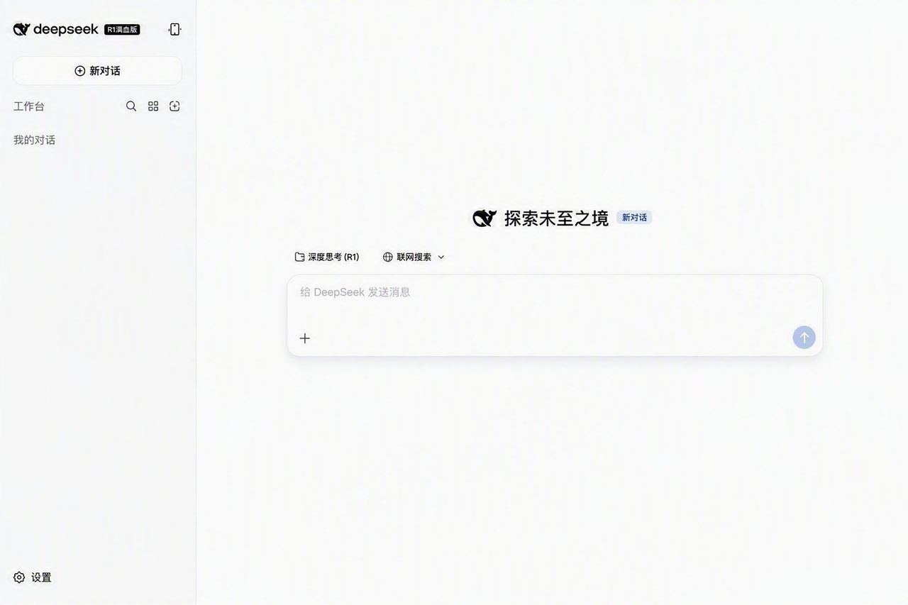
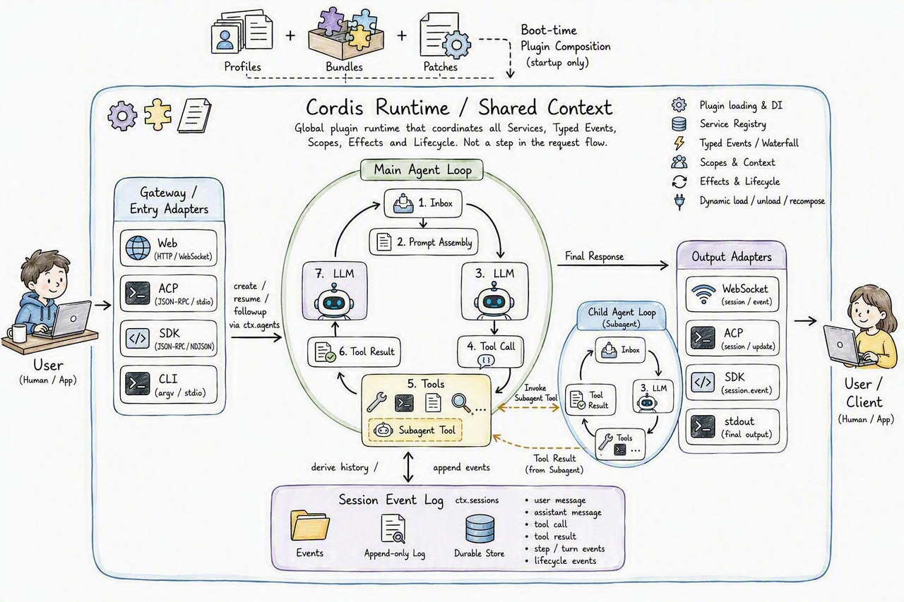

> **课时** 71/132　·　**Agent 八股**　·　约 40–45 分钟
> [上一课：17 Agent健壮性设计 · 18 Agent项目上线问题](../04-Agent/35-17 Agent健壮性设计 · 18 Agent项目上线问题.md)　·　[下一课：19.3 核心特性](../04-Agent/37-19.3 核心特性.md)
>
> 学完标准：合上笔记，能讲清本节在问什么、你怎么答、以及如何套到自己的项目上。

---

## 19 开源框架解读- DeepSeek Harness

DeepSeek Harness 2026年8月份开源的Harness 框架， 已经开源几天内，stars 数已经突破了158k了。在2026年来说，一定是属于超级8热门的项目之一，是大家必须要关注的。在2026年8月份，或者未来的几个月，我相信你去面试大模型Agent岗，大部分面试官都会问你DeepSeek Harness相关的内容，所以请注意：

- **从近期面试来说（2026年8~9月）**，是你几乎一定要准备的，我这个是保守来说的，因为他现在很爆，所以近两个月一定要学，如果说未来DSH 被证明效果很好，越来越火，会在更长的时间内被列为面试必学内容。
- **从长期的角度来说**，做大模型开发，学开源项目肯定是非常有必要的，特别是最新的，最热的架构，学习他们背后的思想，对于面试也是非常有帮助的，学习这些框架的思想，对于很多其他考点，你也能找到答题的出发点，所以同样值得学习。
我知道大家可能有点迷茫，觉得学习不过来，过去像这些类似的事情出现过太多次了，我非常有经验。我的个人建议是：

- **从短期的角度**，你需要掌握DSH 是什么？核心思想？架构图？你怎么看待行业的发展？你有没有用过它，你的实际体验是什么？ 学好了这些问题，大部分面试官问DSH，问的也不深。
- **从长期的角度来说**，如果DSH 持续火爆，面试的考察也会越来越深，你再深入学习就好。
- **从个人学习的角度**，学好一个开源框架，当然对你很有帮助，你可以把他吃透了，自己深度地解析，不管是像claudeCode还是DSH，自己把他学透了，对于你开发，包装简历，都是有非常大的帮助。请注意，真的学透一个开源框架，是一个很耗时，没有那么容易的事情，像CC，都有专门的书籍去解析它，不要把它想的很容易。
不过大家放心，我们的笔记因为是持续更新的，会帮助大家把握重点，比如说，现在（26/8/18）, DSH 刚爆火，我们笔记先解析架构，最核心的特性（一切即插件），总结相关面试问题。你跟着我们学一期，先去面试。

后面如果DSH持续火爆，我们会持续深入总结面试问题，某种程度，我们笔记就是面试风向标，如果面试常考的内容，我们笔记不会没有。

### 19.1 DeepSeekHarness是什么？

虽然它叫 DeepSeek Harness（简称 `dsh`），但大家不要被“Harness”这个词误导。站在使用者的角度，它和我们熟悉的 Claude Code、Codex、OpenClaw 一样，本身就是一个可以直接使用的 Agent，而不是一个只能被其他 Agent 调用的底层 Harness 库。

一个完整的 Agent，可以简单理解为：

```
Agent = LLM + Harness
```

这里的 LLM 是负责理解、推理和决策的“大脑”；Harness 则是模型外面的执行系统，负责给模型准备上下文、提供工具、管理会话，并把模型的决策真正执行出来。Claude Code、Codex、OpenClaw 都可以用这个公式理解，DeepSeek Harness 也是一样的。它内部包含模型调用，并围绕模型实现了一套完整的 Agent Loop，而不是只有 Harness、没有模型的“半成品”。

在功能上，DeepSeek Harness 重点处理的事情也和其他 Agent 类似：它会组装系统提示词和会话上下文，调用大模型进行推理，让模型读取和修改文件、搜索内容、运行 Shell 命令、调用各种工具，并根据工具返回的结果继续执行任务。同时，它还负责会话记录、上下文压缩、权限控制、沙箱、子 Agent 和任务状态等能力。也就是说，用户给它一个任务后，它可以像 Claude Code 或 Codex 一样，在工作区中自主完成多步操作。

DeepSeek Harness 真正特殊的地方，不在于“它是不是 Agent”，而在于“它是怎样构建 Agent 的”。与 Claude Code、Codex 等产品相比，它主要有下面两个特点：

1. **一切皆插件（Everything is a plugin）**
1. Claude Code、Codex 等产品提供的是相对完整、固定的成品体验，很多底层模块由官方预先决定；DeepSeek Harness 则更强调开源、模块化和可重新组合。
1. 这里的“插件”不只是给 Agent 增加的几个外部工具。模型适配器、工具系统、文件操作、Shell、沙箱、权限策略、会话持久化、子 Agent、Agent Loop，甚至 Web UI，都可以由插件提供或替换。因此，DeepSeek Harness 不只是允许开发者“给 Agent 加几个工具”，而是允许开发者重新组合 Agent 本身。这也是它最核心的架构特点。
1. **以 Web UI 为主要交互形式**
1. 与 Claude Code、Codex 常见的终端交互不同，DeepSeek Harness 当前把 Web UI 作为主要入口。用户可以直接在浏览器里与 Agent 对话、查看完整的执行轨迹并管理工作区，整体使用门槛更低，任务执行过程也更加直观。


所以，对 DeepSeek Harness 最准确的理解是：**它首先是一个能够直接工作的开源 Agent，同时也是一套高度插件化、可以重新组合的 Agent 运行平台。** 前者说明它和 Claude Code、Codex、OpenClaw 属于同一类产品；后者则是它区别于这些产品的核心特点。

目前 DeepSeek Harness 仍处于 Developer Preview（开发者预览）阶段，项目会快速迭代，也可能出现破坏兼容性的改动。现阶段我们学习它，重点不是背每一个功能的用法，而是理解它如何通过“一切皆插件”的方式重新组织模型、工具、会话、执行环境和交互界面。

我说了你可能感受不出来，你想知道他是是啥，可以看看网上的各种使用视频或者自己用就知道了。更直观的弄清楚DSH是什么，可以看看这个视频： 

[嵌入内容](https://www.bilibili.com/video/BV1ACbi6DEvC/?spm_id_from=333.337.search-card.all.click&vd_source=144bec9c3f54e465073138bed788be1b)

---

### 19.2 整体架构

我们解析 PI Agent、Claude Code、OpenClaw、Hermes 等开源 Agent 时，通常会先用一张架构图了解系统的整体运行方式。DSH 的宏观结构与它们有相似之处：外部请求进入 Agent 系统，Agent Loop 按照 ReAct 范式反复调用模型和工具，会话系统则保存消息与执行事实。不过，DSH 最鲜明的区别是：这些组件都运行在 Cordis 插件体系中，连 Agent Loop、模型适配器和界面本身也可以由插件提供或替换。



这张图可以分成四部分理解。

1. **Cordis Runtime 是全局运行底座**：最外层的 Cordis Runtime 包围整个系统，负责组织插件、注册服务、分发事件并管理生命周期。上方的 Profiles、Bundles 和 Patches 表示 DSH 在启动时如何选择和组合插件，它们不是用户请求依次经过的业务流程。
1. **不同入口汇入同一套 Agent 能力**：用户可以通过 Web、ACP、SDK 或 CLI 进入系统。Web 模式会经过 Connection、API Gateway 等组件；ACP、SDK 和 Headless 则各有自己的入口适配器。它们不一定经过同一个网络网关，但最终都会通过 `ctx.agents` 创建、恢复或驱动 Agent。
1. **LLM 和工具都在 Agent Loop 中协作**：主 Agent Loop 从 Inbox 获取消息，组装 Prompt 并调用 LLM。模型如果发出 Tool Call，Tool Runtime 就执行对应工具，再把 Tool Result 交回模型，直到任务完成。Subagent Tool 也是一种工具入口，但它启动的不是一次普通函数调用，而是一个拥有自身 LLM 与工具循环的 Child Agent Loop；子 Agent 的结果最终作为 Tool Result 返回主循环。
1. **结果输出与会话记录是两条关系**：Agent Loop 的最终回答经过 Output Adapters，以 WebSocket、ACP、SDK 或 stdout 等形式返回用户；与此同时，Agent Loop 会把用户消息、模型回答、工具调用、工具结果和生命周期事件写入 Session Event Log，并从中重建后续请求需要的会话历史。Session Event Log 是内部事实与历史来源，不等于把原始日志直接返回给用户。
因此，DSH 的运行主线可以概括为：**外部入口接收请求，****`ctx.agents`**** 将请求交给 Agent，Agent Loop 在 LLM 与工具之间循环执行，最终结果经对应适配器返回；Cordis 则在全局范围内组织和协调参与这一过程的所有插件。**

这张图只展示了最核心的宏观关系，真实实现还包括上下文压缩、权限审批、沙箱、后台任务、不同工具模式以及多种 Subagent Provider 等机制。接下来我们先从 DSH 最关键的设计理念——“一切即插件”开始展开。
