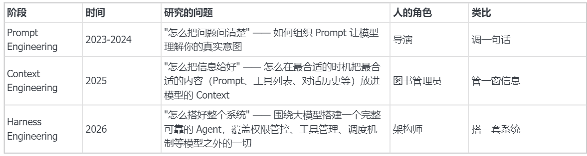
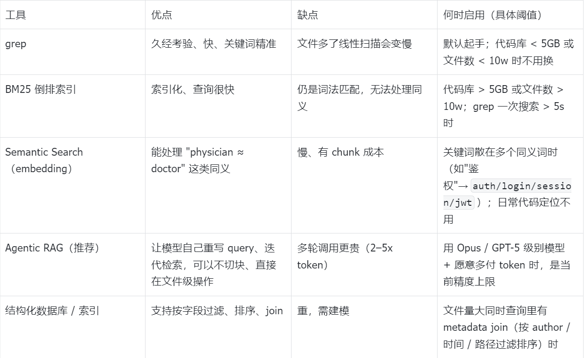
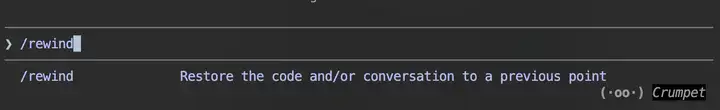

> **课时** 78/132　·　**AI 通用素养**　·　约 1 小时
> [上一课：AI 通用素养 · 1. 提示词工程](../07-AI素养/01-AI 通用素养 · 1. 提示词工程.md)　·　[下一课：2.4.3 Loops, Tool Use, and Feedback（循环、工具与反馈） · 2.4.6 参考](../07-AI素养/03-2.4.3 Loops, Tool Use, and Feedback(循环、工具与反馈.md)
>
> 学完标准：合上笔记，能讲清本节在问什么、你怎么答、以及如何套到自己的项目上。

---

## 2. Harness Engineering

Harness工程，在2026年5月来看，都是今年整个行业的热门考点。行业有一种定义： Agent - Model = Harness。所以Harness 的概念很大，从工具使用，模型记忆如何配置，如何测试，Agent架构选择，都可以叫做Harness.

**学习建议：**

1. **理解Harness:** 2.1 2.2. 2.3 总结Harness的定义。其实Harness的视频很多，大多都是讲解它是什么，发展历程，思想是啥，所以找一个看就够了。我给大家推荐了一个中文参考视频，建议看一下视频，因为我这里写的不详细。不过这类视频只用挑一个看，理解概念和思想。
1. **Harness的具体实战：**2.4 小节，我写的很详细。是我看了一个特别好的Harness视频来总结的。他和别的视频不同，是因为他足够具体，给出了具体的Harness的使用思路，而且该博主做了大量实验，引用了大量论文，有理有据。这个视频特别好，对面试，做Agent项目，使用AI都有帮助。我详细解析了这个视频，总结到了文档里，并结合了大量面试题讲解，所以看了这个小节你绝对非常收获。
1. **Harness具体项目：**2.5，2.6. 大致解析了一些Harness项目。这个里面内容就很多了，大家愿意深入学习的可以去看这些项目。我记得最近有一本书，《*Claude Code* 实战:*Harness*工程*之道*》。 你可以看出来Harness概念很大，它是一种思想，整个Claudecode的设计，都可以叫做Harness。所以Harness更多的学习，还是体现在我们使用AI，构建项目中，不断去体会。这个深入体会就靠大家自己了。
总而言之，其实按照路线a,b学完Harness。 应对Harness的面试问题，应该就没什么问题了。

### 2.1 概念定义

**一句话定义**

Harness Engineering 是围绕 AI 模型构建"运行环境与管控基础设施"的工程实践，目的是让 AI Agent 在长时、复杂、多步骤的真实任务中稳定、可靠、高效地运行。

**核心思想：从"马具"理解 Harness**

Harness 这个词的本意其实是马具——套在马身上用来控制马的那些装备，比如缰绳、头套等。马本身非常强大，但人类必须借助马具的力量才能驾驭它、让它为我所用。

把这个类比迁移到 AI 领域：

- 大模型 = 一匹脱缰的马：能力极强，但如果任由它自己跑，就会发散思维、产生幻觉，无法稳定给出我们想要的结果。
- Harness = 那套马具：用来控制和驾驭大模型的系统。
由此我们可以推导出 Harness 的一个常见公式：

Harness=Agent−Model 

换句话说，一个完整的 Agent 减去里面的大模型，剩下的所有东西都是 Harness。需要注意，Harness Engineering 是非常新的概念，业界尚未形成严格定义，这个公式是目前比较被认可的一种说法，并非学术定义。

举个具体例子：在 Claude Code 里面，所有不属于 Claude 模型的部分都是 Harness——比如写在 `CLAUDE.md` 里那些大模型要遵循的规则、Claude Code 可以使用的工具列表、它的定时调度机制等等。

### **2.2 演进脉络**



三者是叠加关系：Harness 内部的每个 session 仍然需要 Context Engineering，每次发给模型的 prompt 仍然需要 Prompt Engineering。

### **2.3 Harness 工程实践要点**

- 外部持久记忆——用文件系统（JSON、Markdown、git log）代替模型内部记忆，解决"失忆"问题。
- 确定性验证轨道——Linter、类型检查、单元测试等刚性门禁，AI 的输出必须通过测试才能被接受（对应解决"幻觉完成"——不让模型自己说"我做完了"）。
- 原子任务 + 上下文刷新——每个 Agent 只做一个小任务就销毁，新 Agent 从干净状态启动，彻底杜绝 Context Rot。
- 子 Agent 集群（Swarm）——用大量便宜快速的小模型并行工作，而非一个大模型顺序处理。
- 技能文件（Skills）——按需加载的专用指南，Agent 只看到与当前任务相关的工具和说明（建议不超过 30 个工具）。
- Guard Rails + Checkpoints——在关键节点自动运行检查，防止 Agent 偏离轨道。
- Handoffs——session 之间通过进度文件、git commit 等传递状态，实现跨 session 连续性。
- Human-in-the-loop——在关键阶段设置人工审核断点，弥补 AI 自验证的不足。
- 架构约束——通过 ArchUnit 等框架强制要求 Agent 生成的代码遵循特定模式。
- 垃圾回收 Agent——定期扫描修复代码库和文档中的不一致性，对抗系统熵增。
**    关键工程原则**

- **轻量化，为删除而建**：不要过度编码人类知识，模块要能快速移除替换（Manus 6个月5次重构、Vercel 删80%手工工具反而更好）
- **模型无关性**：Harness 不绑定特定模型，新模型出来能快速替换
- **将 Harness 视为数据集**：每次 Agent 失败、漂移、异常都是珍贵的训练素材，用于迭代优化
#### **2.3.1 参考资料**

关于Harness概念, 2.1 2.2 2.3. 我主要是记录了具体知识要点，其实想要理解上面内容，网上视频很多，大多都是按照2.1 2.2 2.3 这个思路讲的，大家只要看其中之一就能理解，我给大家推荐一个。

[嵌入内容](https://www.douyin.com/video/7636365606182325544)

### **2.4 Harness 思想的运用**

本期视频来源：Raj 的 "Engineering Coding Harnesses Deep Dive" 视频精读。我觉得这个视频是一个很好的视频，因为他足够细节，讲解了Harness在日常工作的应用，并且这些结论他做了实验，看了论文来支撑它。这个视频让我们更好的理解如何在日常使用Harness工程的思想，对应的一些最佳实践。我看完觉得这是非常好的视频，**对面试，实战，做项目都有极大帮助！**

所以我也是反复看了几遍，总结出来了要点，也录制了一个讲解视频。因为原视频是英文，所以如果觉得看这不方便，结合笔记和我录制的讲解视频看就行，不用去看原视频了。

这一节从四个方面： **Retrieval / Context & Memory / Loops & Tools / Orchestration** 来讲解了Harness工程在我们使用AI，或者说构造AIAgent应用过程中的具体做法。这里面每一个部分，给出的建议都特别具体。这一小节，结合了大量面试问题讲解，消化好这一部分对于面试非常有帮助。

---

#### **2.4.1 Retrival（检索）**

##### **2.4.1.1 背景 / 基础知识**

我们需要根据自己的任务场景，来提供给 AI 检索的工具。虽然 Claude Code 里其实内置了 Grep 工具，但 Claude Code 是通用的，而我们的任务是定制的。这是一个实用的建议——不管你是使用 AI 还是构建 AI，都可以想一下：什么样的检索工具对我的场景是合适的？

举个例子：如果你的项目是一个超大型项目（比如 100GB 代码库），直接让 Claude Code 用 grep 线性扫盘会很慢；这时候你可能要给它建立一个 BM25 倒排索引，再以 Skill 的形式装上去让 CC 调用这个搜索工具。

检索工具从"词法"到"语义"是一条谱系，不是非此即彼：



视频里 Raj 跑的实验是"**Agentic + 纯 BM25**"反超了"**One-shot + embedding 切块**"，但这是"embedding 从必选变可选"，不是"BM25 取代 embedding"。

> 注：表中 ">5GB / >10w" 等具体阈值是工程经验值，源视频只笼统说 "as you get more and more files"。下方"最佳实践建议"沿用同一组阈值。
>

##### **2.4.1.2  最佳实践建议**

- **默认 grep 起手**：90% 的代码搜索靠 grep 就够，不要一上来就上向量库。

- **代码库 > 5GB 或文件数 > 10w，加 BM25**：典型做法是包一个 SKILL（封装 `ripgrep --index` 或开源 BM25 库），让模型像调工具一样用。

- **跨语言/跨同义词的查找才用 embedding**：比如查"用户鉴权相关代码"，关键词散在 `auth/login/session/jwt`——这种 case 上 semantic search。日常代码定位别用。

- **配好模型（Opus/GPT-5 级别）就上 Agentic RAG**：让模型自己重写 query、按文件级别迭代，比预先 chunk 切片更准；前提是你愿意多花 2–5x token。底层用 BM25 / embedding / 混合都可以。

- **文件级 > chunk 级**：能不切块就不切块，整文件交给模型，避免上下文撕裂。

- **什么时候迁数据库**：当你需要"按 author 过滤 + 按 commit 时间排序 + 按路径匹配"这种 **metadata join** 时，才考虑结构化索引/数据库；纯文本搜索别上 DB。

##### **2.4.1.3 面试问题**

**Q1：Harness 工程对你的工程实践、使用模型有什么启发？**

最大的启发是：**不要把通用 AI 工具当万能工具，而要根据业务场景给它配检索工具**。Claude Code 内置的 grep 在通用场景下够用，但任何严肃业务都是定制的——代码库可能有 100GB，文档可能跨多个仓库，查询可能带 metadata 过滤。这时通用工具会很慢甚至搜不到。

落到具体做法是三步：1) 先看任务量级和查询形态——文件多大、查询是纯文本还是带字段过滤；2) 按谱系选工具——grep / BM25 / embedding / 结构化 DB，能用轻的就不上重的；3) 用 Skill 把这个定制工具封装好让 agent 调用。这其实是 harness 工程的核心——agent 的能力上限不只取决于模型，更取决于你给它配的工具链。

**Q2：如何看待 RAG 的发展趋势？会不会被取代？**

我的判断是**至少目前没有被取代，但它在 stack 里的位置变了**。

首先，现在的趋势确实不再是"什么场景都先上 RAG"：1) 一般中小项目，**grep / BM25 + 模型自身能力**就能解决大部分检索问题，Claude Code 默认就是这套；2) 即使在高级场景，有实验表明 **Agentic RAG（哪怕底层只用 BM25）也能反超传统切块 + embedding RAG**——这说明随着模型变强，"语义近似"这层不一定非要靠 embedding 来做，模型自己重写 query 就行。

但这不等于 RAG 被取代：1) **范式上**，Agentic RAG 本身就是 RAG，只是把"一次检索"换成"迭代检索"；2) **工具上**，embedding 在跨语言、跨同义词、海量文档场景仍是性价比最高的选择；3) **架构上**，企业级场景往往需要 metadata join，这又得叠结构化数据库 + RAG 的混合方案。

所以更准确的说法是：RAG 没被取代，而是**从"默认必选"降级成"按需启用的一档"**。判断要不要用，看三个条件：模型强度、文档规模、查询是否需要跨同义词或跨字段。

---

#### **2.4.2 Context & Memory（上下文与记忆）**

##### **2.4.2.1 背景**

虽然主流模型号称 1M token 上下文，但实测**填越多越退化**——通常超过一半就开始丢信息。所以"有 1M 窗口"≠"能用 1M 窗口"，真正能可靠使用的往往只有前 30–50%。这就引出一个问题：信息越来越多（长对话、错误日志、跨会话的项目知识），但能放进窗口的就这么多，**该把什么放进来、什么放出去、什么留到下次**？

视频博主把这件事拆成三层记忆来处理：**Active Context Window、Working State、Durable Memory**。下面就只讲清楚这三层各自负责什么。

> 关于记忆的分类有很多说法（短期/长期、工作记忆/情景记忆等），笔记里讲开源架构（CC、OpenHands、Claude Code）时也各有各的叫法。本质都是一回事，只是切分粒度不同。本节更重要的还是使用这些记忆背后的最佳实践和蕴含的思想。
>

##### **2.4.2.2 基础知识：三层记忆分别干什么**

**Layer 1：Active Context Window（当前上下文）**

就是这一轮 API 调用真正发给模型的那段 token。它的职责是**管好"现在"**——决定这次推理时模型眼前能看到什么。因为窗口会退化，所以这一层的核心工作是"瘦身"：用 sliding window 只保留最近几轮、用 compaction 把老对话压成摘要、用 rewind 把走错的分支直接砍掉，避免错误内容继续占着窗口。

**Layer 2：Working State（临时工作文件）**

> 和跨会话记忆相同的地方都是用外部文件存储。不同的地方在于这个是给当前对话用的，当前对话用完就丢。而长期记忆的文件是跨会话的。这里其实对我们做Agent有一个启示，就是不要什么东西都往上下文塞，我们可以把一些结果保存在磁盘，运行的时候动态查找。因为上下文很宝贵。
>

任务进行中、但塞不进窗口的中间状态，落到**文件系统**里。它的职责是**管好"这次任务"**——给 agent 一个比 context window 大得多的"草稿纸"。最典型的就是 `plan.md` / `todo.md`：让 agent 边做边勾选，目标不会在长循环中走丢。再激进一点是 Recursive Language Models 范式：把所有历史都落盘，用 Python REPL 按需检索，相当于"无限上下文"。任务结束这层就可以扔掉。

**Layer 3：Durable Memory（跨会话长期记忆）**

**跨会话**留下来的知识，下次开新会话还能用。它的职责是**管好"这个项目/这个 agent"**——把经验沉淀下来不要每次重学。两种主流形态：

- **AGENTS.md**：项目级事实（构建命令、目录约定、坑），主流 harness 都会自动注入 system prompt。

- **Skills**：博主把SKILL定义成了新的一种Agent的持久记忆的表现形式。

三层是**自下而上递进**的：窗口装不下 → 落到 working files；任务结束还想留 → 升级成 durable memory。

##### **2.4.2.3 最佳实践建议**

按三层记忆分别给出操作建议，**自下而上**对应"管现在 / 管这次任务 / 管这个项目"：

**Layer 1：Active Context Window —— 管好"现在"**

- **主动管理上下文**：

1. 主动压缩上下文，不要等满了再压缩，因为模型能力会随着窗口增大而退化。
2. 不要过于依赖模型的compaction, 因为很多compaction是黑盒，你不知道它发生了什么。另外主动压缩，指定它保留哪些信息，是好的工程实践（主动使用claude code的/compaction，后面加上参数，指定compaction的时候保留哪些信息。(关于这两个指令，不明白的也可以参考这两个文章：[Claudecode compaction指令](https://x-sir.blog.csdn.net/article/details/159156069)，[rewind指令](https://www.zhihu.com/question/2001668790279245831) )


```
/compact 保留所有架构决策和待办事项。
```

3. 只保留关键的信息在上下文，避免挤爆上下文。比如长 stack trace、20000 行日志先在 Agent 层截断/抽取关键帧再喂回去。使用Claudecode的rewind功能，直接把走错的分支砍掉，不要让错误信息继续占着窗口。
> 这些原则其实对我们实践也好，做Agent应用也好都有帮助。包括面试官问你使用CC有什么心得？你觉得ClaudeCode比其他coding工具好用在哪里，都是我们面试的素材，我们后面会展示。
>

**Layer 2：Working State —— 管好"这次任务"**

- **长任务先写一个 todo markdown**：把计划落盘成 `plan.md` / `todo.md`，让 agent 每完成一步勾选；避免任务在长循环中丢目标。（Langchain的Deep Agent就是这么做的）

- **能落盘就别塞上下文**：中间产物（搜索结果、抓取的网页、生成的代码片段）写文件，让 agent 按需读，不要全堆进窗口。上下文很贵，磁盘很便宜。（博主举了一个例子，让Agent 所有历史落盘，用 Python REPL 按需检索，相当于给 agent 一张"无限大草稿纸"  相比不使用这个技巧，效果更好）

- **任务结束就清理**：working files 是一次性的，任务完成后归档或删除，别让它污染下一次任务。

**Layer 3：Durable Memory —— 管好"这个项目 / 这个 agent"**

- **AGENTS.md 铁律**：

1. 手写不自动生成；
2. 只写"项目特有的事实"（构建命令、目录约定、坑），不写通用编程知识；
3. Boris(CC的开发者）建议每次大模型升级或每季度复盘一次，删掉过时条目。（也许这个写得有点夸张，不过定期检查Agent.md是一个很好的习惯）
4. Agents.md写废话，反而会误导模型。 具体这里可以参考笔记论文部分。
- **写 Skill 的判定标准**：

1. 同一类操作做过 3 次以上 + 步骤超过 5 步 + 通用模型容易做错 —— 才值得沉淀成 Skill。
2. **Skill 建议配上 eval**：如果你的SKILL写了很多模型已经知道的废话，反而会降低模型性能。所以可以给每个 Skill 准备一个小评测集，定期跑 **with skill vs without skill** 两组对照；模型升级后重跑，发现负贡献立刻下线（旧 Skill 可能被新模型的原生能力 superseded）。

##### **2.4.2.4 面试问题**

**Q1：请你分享一下使用 Claude Code 的小技巧。**

我用下来最大的心得是：**要主动管理上下文，别赌模型自己能管好**。这件事的底层原因是——虽然现在主流模型号称 1M token 窗口，但实测填得越满模型越退化，可靠的部分往往只有前 30%~50%。所以"窗口大"不等于"能用满"，主动瘦身是必须的。

落到 Claude Code 上，我常用两个原生功能：

1. ****主动 `/compact` 而不是等它自己压****：CC 自带的自动 compaction 是黑盒，你不知道它丢了什么。我的做法是在上下文用到 50% 左右就主动触发，而且 `/compact` 后面加参数，明确告诉它"保留所有架构决策和待办事项"——指定要保留什么比让它自己挑要靠谱得多。

2. **走错路用 Rewind（双击 ESC）直接砍掉**：如果模型沿着错误方向跑了几轮，最忌讳的就是"说服它改回来"——因为错误的推理过程已经污染上下文了，再多解释只是叠 buff。Rewind 是直接把那段分支从历史里删掉，相当于"假装没发生过"，比纠错干净得多。

更普适的原则是：长 stack trace、几千行日志这种噪声，不要原样塞回窗口；要么截断要么先落盘再按需读。**上下文是稀缺资源，要像管显存一样管它。**

---

**Q2：Harness 工程给你使用 AI 工具带来什么启示？**

> 根据本章学习的内容，总结两个可参考方向的回答。
>

**版本一（记忆管理视角）**：我想谈一下关于Agent记忆管理的一些心得，我把Agent的记忆分成三层：1.上下文窗口 2.临时工作文件 3.持久记忆。在使用它们的时候，谈一下我的心得：

1. 上下文窗口非常宝贵，我们需要很小心管理他，同时虽然现在模型的窗口越来越大，最大的上下文可以支持1M，但是当上下文增大，模型性能也会退化，所以我们不必等到上下文满了再压缩，可以在上下文50%的时候，主动压缩。
2. 临时工作文件这一层，我们让AI存一些当前任务的中间产物，比如搜索结果，长日志。我们不把他放在上下文中，而是放在磁盘里，因为磁盘很便宜。通过Agent搜索磁盘文件，可以让Agent处理很久之前的任务记录，同时也不污染上下文。
3. 持久记忆常见的有Agent.md和Skill.我们应该手动写Agent.md，不要依赖AI生成。同时对于SKILL，如果同一操作重复超过3次以上，我们应该建立SKILL，但也应该建立测试集评估SKILL，因为模型升级，或者SKILL过啰嗦，也会影响Agent的性能，所以定期检查SKILL是一个好习惯。
**版本二（AGENTS.md 管理视角）**：最大启示是**项目级知识要外化，但要克制**。以前我习惯把所有约定写在 README 里靠人脑记，现在我会用 `AGENTS.md` 把"项目特有的事实"喂给 agent——构建命令、目录约定、踩过的坑。

但管理 `AGENTS.md` 有几条铁律我是踩坑学到的，最近也有一篇论文 *Evaluating AGENTS.md — Are Repository-Level Context Files Helpful for Coding Agents?*（arxiv 2602.11988）做了实证支撑：作者在 AGENTBENCH 上对比"无 context file / LLM 自动生成 / 人类手写"三档设置，发现 **LLM 自动生成的 AGENTS.md 反而让任务成功率下降 ~3%、token 消耗上升 ~20%**，人工手写也只有 +4% 的提升。原因是 context file 里每一条额外要求都是一个约束，Agent 会认真履行但同时也分散了注意力。所以我的做法是：

1. **手写不自动生成**——自动生成的 `AGENTS.md` 充斥废话，论文实验里直接成了负贡献；

2. **只写项目特有的事实**——构建命令、测试命令、特定工具（如"用 uv 不用 pip"）这类 AI 猜不到的；目录结构、"保持代码整洁"这类废话不要写，AI 自己知道；

3. **定期复盘删过时条目**——模型升级后，老的"提醒"可能反而成为干扰；

4. **简洁第一，少即是多**——`AGENTS.md` 写得越长，注入 system prompt 的开销越大，而且容易稀释关键信息。

这件事让我意识到：harness 不是越多上下文越好，而是**信号-噪声比**的工程。

---

**Q3：使用 Skill 有什么心得吗**

我的核心心得是：**Skill 不是越多越好，滥用会反向降低性能**。

直觉上 Skill 是好东西——把一类可复用流程外化成 prompt + 代码 + 参考资料，让 agent 像调工具一样用。Cursor 就有过用 200 行 Skill 替掉 15000 行编排代码的例子。但实际用下来我发现两个坑：

1. **Skill 写多了反而干扰模型**：如果 Skill 里写了很多模型本来就知道的常识，等于在 system prompt 里加噪声，**结果是 with skill 比 without skill 还差**。

2. **Skill 会过时**：新模型原生支持多模态文件解析后，老的"教它怎么解析 PDF"的 Skill 就成了负担。

所以我建立了两条纪律：

- **判定标准**：同一类操作做过 3 次以上 + 步骤超过 5 步 + 通用模型容易做错——同时满足这三个条件才值得做成 Skill。一次性的别做。

- **每个 Skill 必须配 eval**：准备一个小评测集，定期跑 **with skill vs without skill** 对照。模型升级后重跑，发现负贡献立刻下线。

总结来说：**Skill 是杠杆，但它也有成本；要用 eval 来证明它真的在帮你，而不是凭感觉攒一堆**。

---
