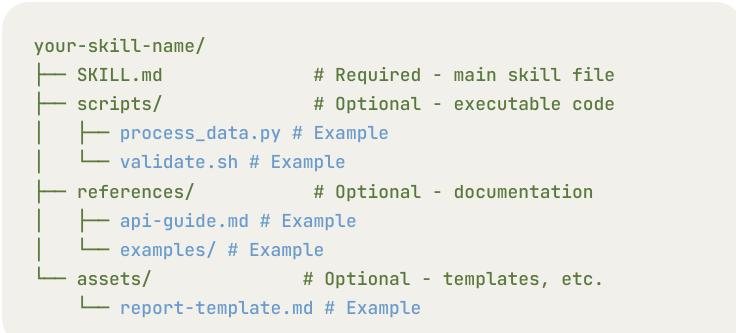
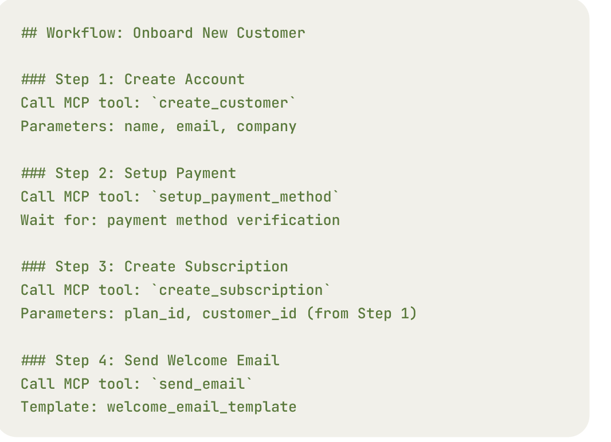
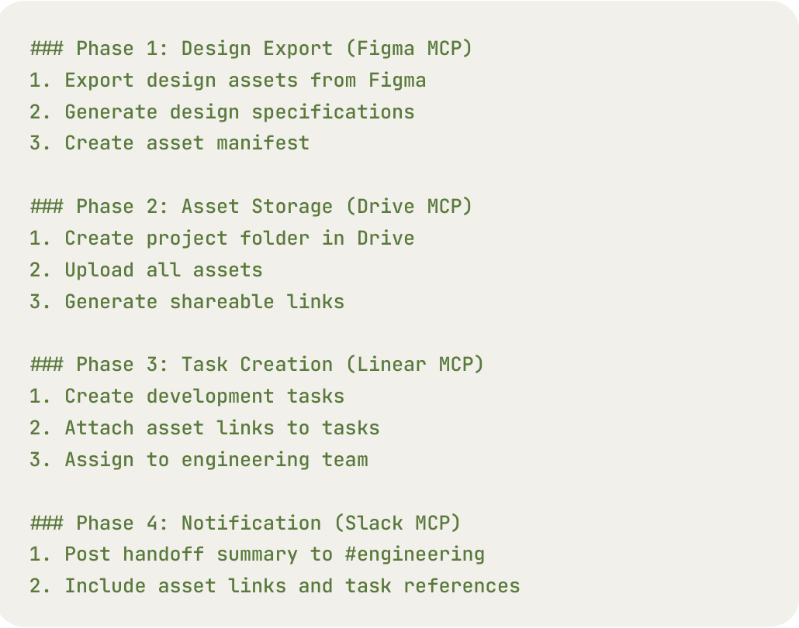
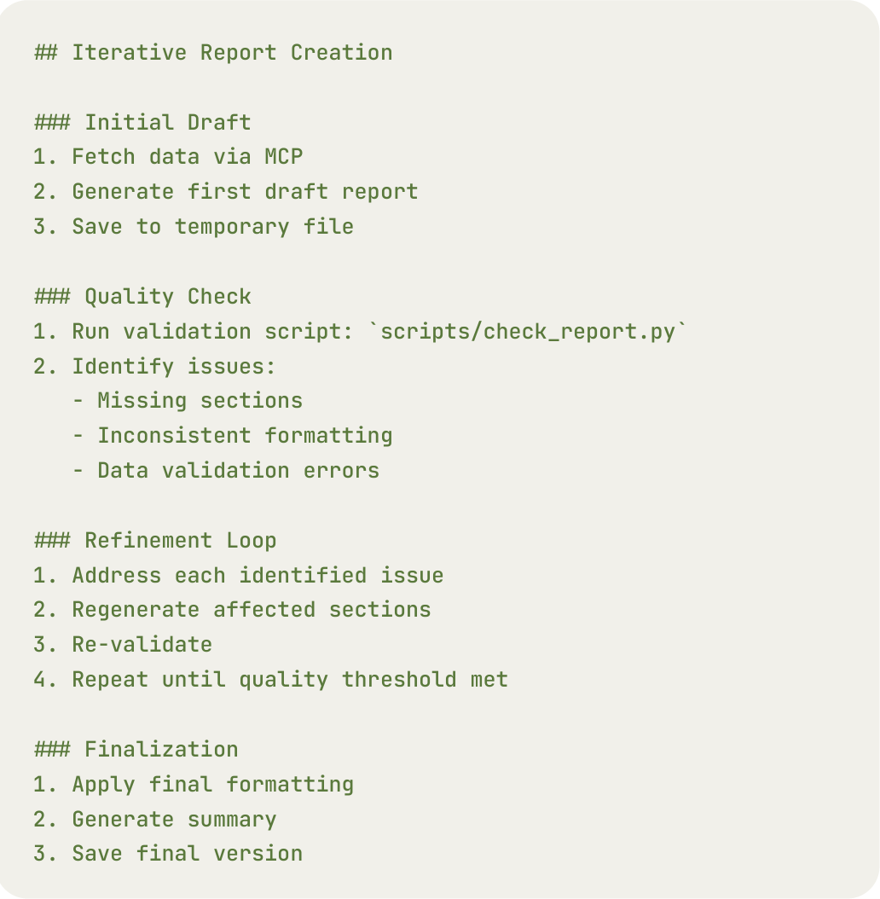
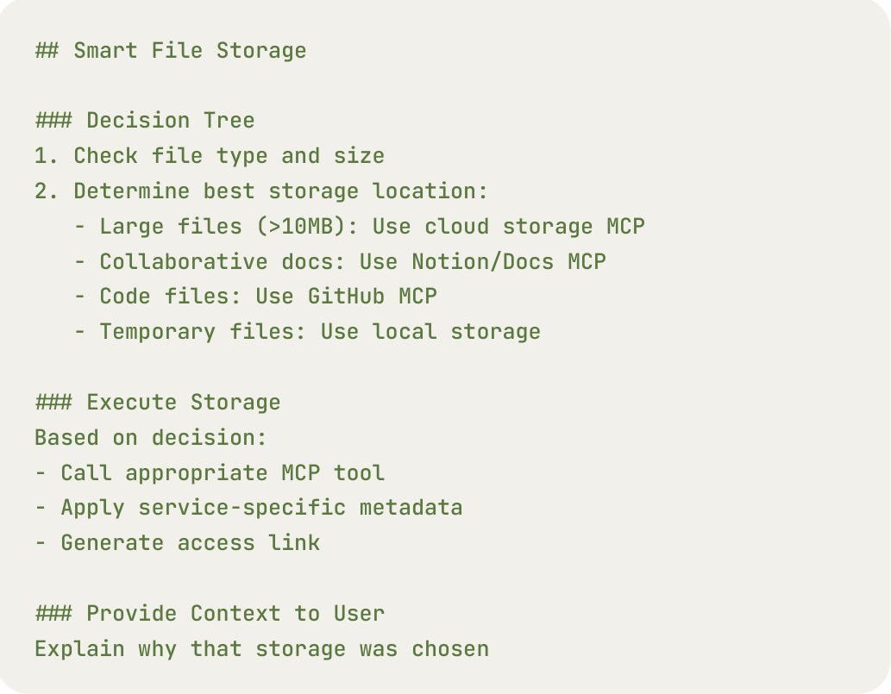
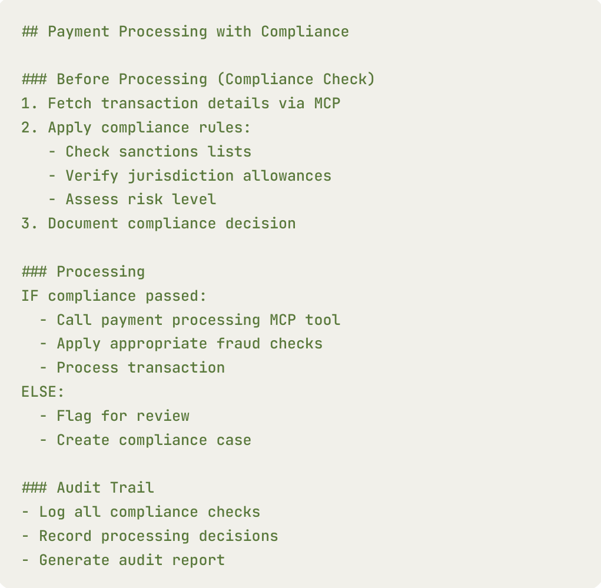
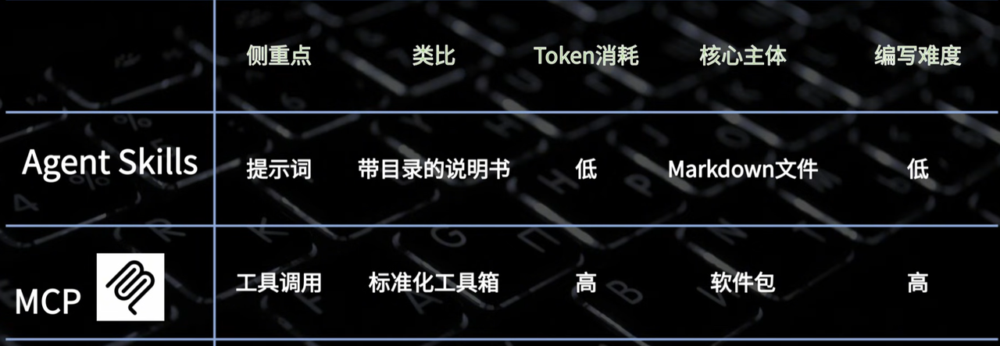
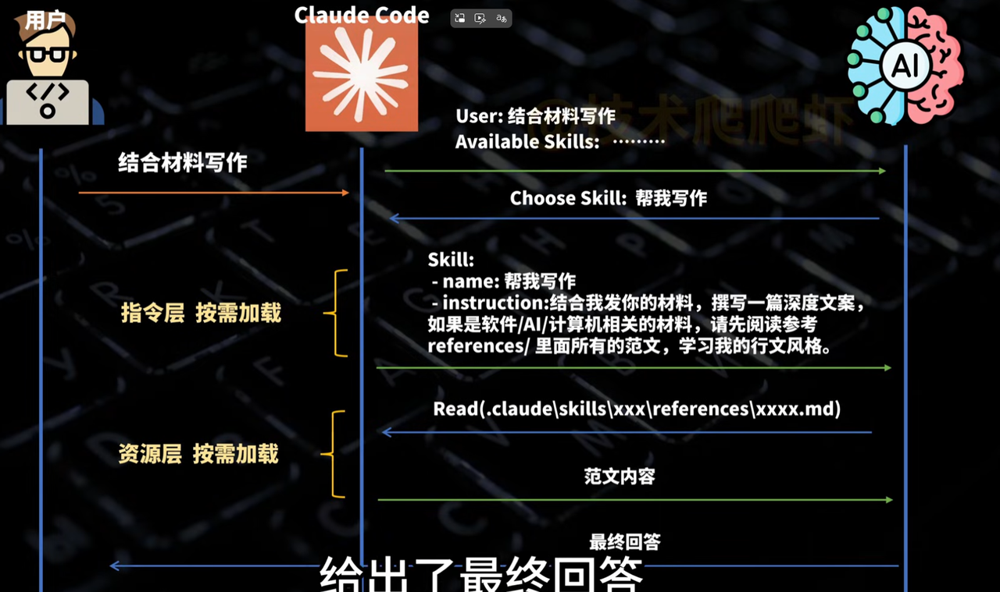

> **课时** 82/132　·　**AI 通用素养**　·　约 50 分钟
> [上一课：2.7 面试问题速览](../07-AI素养/05-2.7 面试问题速览.md)　·　[下一课：3.11 面试实战](../07-AI素养/07-3.11 面试实战.md)
>
> 学完标准：合上笔记，能讲清本节在问什么、你怎么答、以及如何套到自己的项目上。

---

## 3 SKILL

SKILL 比较新，是2025年10月16号提出，在12月份左右才慢慢被市场支持，在26年1月份已经变得很火了。所以虽然目前我的面经没有涉及。但是很多朋友在1月份面试已经被问到了，而且这个概念现在很火。学习大模型，特别热门的新技术一定是要学的。从目前（2026年1月）来看，Skills会成为未来一段时间面试高频考点，务必要掌握。推荐学习路线为：

1：**入门视频:** 了解Skill是什么，怎么用。(视频见3.10)

2.  **进阶视频：**掌握Skill的设计思路。(视频见3.10)

3.  **Skill编写规范**：本节的笔记部分以及我在下面推荐的Anthropic关于Skill的官方文档：了解Skill编写的最佳实践，范式，命名规则等。

4. **如何写SKILL：**下面推荐视频有个博主讲如何写出SKILL的，以及现场教学。最重要的思想：Feedback Cycle其实就是反复迭代，了解了1，2，3，可以看一下他展示真的如何写的这个思想和过程。

5.  **实战**：

     1. 此节笔记提供了一些非官方的SKILL github链接，特别是第4个链接，是由Anthropic提供的一组Skill示例，严格遵循了它提供的Skill的最佳实践文档，可以作为Skill的教科书级别的示例来阅读。 (链接见 [大模型应用/算法学习路线+八股+面试实战_3](https://my.feishu.cn/docx/GikId1snboM6LyxxGPXc0kDdnub))

     2. 我自己也录制了一个视频，结合我们笔记中的Rag项目对应的SKILL 来讲解我写SKILL 遇到的坑，怎么写出来的Skill， 怎么使用Skill-creator之类的问题 给大家参考。

6. 最后是你应该自己写一些SKILL? 自己用的提效的SKILL，甚至是公司用的更标准的SKILL，写一些你就会更有经验。

通过这个路线，你的SKILL技巧应该比较成熟了。面试基本SKILL会问：是什么？怎么用？你用它做了什么事？你写了什么SKILL？ 相信你通过这个路线学了，这几个问题都能答出来。

### 3.1 SKILL 概念

Skill是一组打包了指令的文件夹：文件夹会包含Skill.md 的核心指令文件，以及Scripts,Reference和assets的可选资源文件（后文SKILL目录结构小节有更详细解释）。它教会AI如何处理指定的任务和流程。当需要处理重复的工作流，比如根据规范生成前端设计，创建符合团队风格指南的文档，多步骤流程编排等任务时，Skill可以让你无需每次对话重新解释你的偏好，流程，领域知识，而是通过Skill一次教会AI，之后每次都能受用。相比传统的提示词，它采用渐进式披露，动态加载提示词，更节约Token.

### 3.2 SKILL目录结构

从图中我们可以清晰的理解概念所说，一个SKILL就是一个文件夹。其中包含以下内容：

1.SKILL.md：必须，包含了 Yaml头和Body。Yaml是md文件中的头，告诉AI是否加载这个SKILL，AI必定会加载。而body

是正文，是渐进式披露的，只有AI读取了YAML头，认为这个SKILL应该被加载，才会加载这个正文部分。

2.Scripts: 可选。包含着在AI执行过程中需要使用的脚本文件。

3.References: 可选。存放执行SKILL相关的文档，说明，内容以MD为主。

4.Assets：可选。存放执行SKILL时需要的模板，静态资源，比如图片等。

2,3,4其实就是在SKILL执行过程中，所需要的资源。Anthropic 官方明确建议一个SKILL不应该超过500行，所以SKILL需要引用其它资源的时候，应该将这些东西放在SKILL.MD之外，而在SKILL.MD中显式指向它。

### 3.3 SKILL的常见应用场景：

1.生成一致的，高质量的内容，比如文档，PPT，app, design, 代码等。实例：[frontend-design skill](https://github.com/anthropics/skills/tree/main/skills/frontend-design)

2.编排多步流程，让这些步骤遵循特定的顺序，示例：[Skill-creator](https://github.com/anthropics/skills/blob/main/skills/skill-creator/SKILL.md)

3.规范/增强MCP使用，将MCP转换成可靠的工作流。实例：[Sentry-code-review skill](https://github.com/getsentry/sentry-for-claude/tree/main/skills)

（这一点我想解释一下的是，根据Anthropic官方指南，规范MCP的使用指的是用了Skill, 可以让用户/AI更清楚知道某个MCP Server 如何使用，遇到问题如何解决，取得稳定的结果。通常的最佳实践是在MCP Server的文档中附上SKILL的链接。用户在使用多个MCP Server的时候，也可以通过SKILL来编排多个MCP的使用流。从这一点可以看出SKILL和MCP是相辅相成的，而不是替代关系。这一点是Anthropic官方指南，我觉得这一点比较新颖，也是一些视频没有提到的，面试时候说出一点SKILL和MCP的补充关系和最佳实践，可以加分）

### 3.4 SKILL测试与评估

通常可以从以下几个角度来测试Skill的质量：

1. 触发测试：保证SKILL会在正确的时机被加载。在不该触发的情况不会被误触发，在该触发的情况也不会不触发。
2. 功能测试：测试SKILL产生正确的结果：输出是符合预期的，API正确调用，错误被处理，边缘情况被覆盖。
3. 性能测试：对比使用SKILL和不使用SKILL时，用户的介入次数是否减少，API调用失败次数是否减少，Token消耗是否降低。
###    3.5 SKILL典型范式

1. 顺序工作流编排： 当有多个步骤，并且需要按照指定的顺序执行时使用。
核心要点：说明步骤顺序，步骤间的依赖，每一步如何验证，失败时如何回滚。

2. 多MCP 协作： 任务流包含多个MCP Server时使用。
核心要点：说明多MCP步骤间如何传递数据，错误异常处理，清晰的步骤界限；

3. 迭代优化： 需要通过多次迭代提升输出质量时：
核心要点：清晰的质量标准， 迭代提升，验证脚本，知道何时停止迭代。

4. 上下文感知工具选择： 当需要根据上下文场景，来动态选择使用不同的工具时使用
核心要点：清晰的选择策略，兜底选择，选择理由透明

1. 领域专业智能：Skill需要使用特定领域的知识来完成任务时使用。
关键要点：将专业知识嵌入逻辑，合规性保证，详尽的领域文档，

### 3.6 SKILL  vs MCP

（面试官特喜欢问的就是差别，你答的不多，还喜欢追问，还有吗？这里尽量给大家总结全面一点）

借用Anthropic 官网文档原话，Skills 和 MCP的核心差别是：MCP 提供给模型数据，而Skills教会模型如何使用这些数据（"MCP connects Claude to data, Skills teach Claude what to do with data)。二者的区别为：

1. MCP侧重于提供工具调用，而Skills则侧重于提示词。MCP更像是一个标准的工具箱，提供规范，可复用的工具。而Skills则是一个带目录的说明书。
1. MCP 的本质是一个独立运行的程序，而Skills 本质是一个文档。他们本质不同，决定了他们性质也不同，Skills更适合处理轻量级的，简单的逻辑，安全性和稳定性都不及MCP。
1. Skills 采用渐进式披露提示词的机制，Tokens消耗低。而MCP则是一次性塞入所有提示词，Token消耗高。
1. Skills的开发难度相比于MCP，开发难度低很多。
总结来说，SKILL和MCP二者不是相互替代，而是相互补充的。 在开发MCP SERVER的时候，可以在MCP Server的文档中添加一个链接，指向一个SKILL的链接，这个SKILL让用户/AI更清楚知道该MCP 如何使用，遇到问题如何解决，让模型调用MCP时取得更稳定的结果。在同时使用了多个MCP Server的时候，也可以用SKILL对多个编排多个MCP Server的工作流

### 3.7 SKILL vs Prompts

Skills 相比于Prompts的核心差别在于他们的**形态**和**生命周期**。

Prompts 是一次性对话内容，你需要自己保存，复制和粘贴。模型不会知道什么时候用哪一个Prompt，而且你需要把Prompts **全部塞到上下文里面**。这会大量占用你的上下文空间。

Skills 则是将提示词以一种**更加工程化的包装方式打包**，他是一个**文件夹的形式**，里面包含skills.md 和相关的资源文件。他会动**态加载/渐进式披露提示词，**更加节省提示词**。**容易复用和版本管理，易于协作和共享。

总结来说，Skills不是一个更复杂的提示词，而是把复杂的提示词，变成了一个**有结构，可复用，可以自动调用**的模块。

### 3.8 SKILL的运行模式

1. **用户发起任务**
 用户对 Claude Code 提需求，Claude Code 把这个请求连同当前可用的 Skills列表结合元数据一起交给 AI，让 AI 先基于需求判断该用哪类能力。
1. **AI 选择要用的 Skill**
 AI 在可用的Skills里做匹配，然后返回指定的Skills
1. **按需加载 Skill 的指令层**
    一旦选定 skill，Claude Code 才把该 skill 的具体定义交给 AI, 这一步体现了Skills**指令层 按需加载**：只有用到这个 skill 时，才把更详细的指令灌给模型。

1. **按需加载 Skill 的资源层→ 读范文/材料 → 生成最终回答**
    如果需要使用到资源层，接下来 Claude Code 会执行读资源的动作，把 **references/范文内容**喂给 AI；AI 基于 用户材料 + skill 指令 + references 完成写作并输出 最终回答。

### 3.9 SKILL的设计理念

（上面其实是一些SKILL的基础知识，相对来说是最基础，或者考到SKILL 必问的。 必须准备好。这一节可以理解为一个拔高项，我们不谈Skills 的具体概念，而结合行业的痛点，发展趋势，未来的展望来聊Skills。 如果你能和面试官讲出来，会体现出你其实是有思考，有想法，关注着行业发展和趋势的。把这些答了，是加分项）

    发展到现在（2026年初），现在的Agent工程的痛点不再是能不能做，而是能不能交付。目前的行业痛点是：

1.虽然模型能力很强，但是常识很弱，能解决通用问题，却在具体业务问题上频繁踩雷。经常做的是文本补全，而不是业务理解。这通常导致造出来的Agent需要质检，返工，人力成本高。

2.现在经常导致的一个问题是，公司重复造轮子。给财务做一个Agent，法务做一个Agent, 运营做一个Agent，每个Agent都有自己的权限，工具，prompt等。就会变成同一个业务规则，在5个Agent里各写一遍，这就导致重复造轮子很严重，难以维护。

3.现在的Agent通常是一个会有复杂的prompts，这导致token太大，模型不能精准执行，另外成本上升。当你用复制粘贴扩展能力，系统就会用维护地狱来还债。

所以行业发展到现在，需要从堆砌提示词，迭代，调试，优化做一个Agent的过程变成做一个 可治理，可迭代，可复用的产品。通过Skills， 行业开发Agent的模式变成去写一个可复用，可管理的技能资产（Reusable skills), 结合通用内核，来解决这些痛点。

### 3.10 参考视频和项目

**入门视频推荐这两个：**从skills 是什么，组成，核心特点，实践，对比MCP这几个角度都讲了，基本是最基础的内容。这两个视频其实都围绕这几点讲，内容有重复性，可以结合互补着看，适合入门。

[嵌入内容](https://www.douyin.com/video/7592521205031177499)

[嵌入内容](https://www.douyin.com/video/7590008747938876706)

**进阶视频：**

这个讲了一些Skills背后的设计理念，行业痛点，学好了和面试官回答可以体现你的行业洞察能力。

https://www.youtube.com/watch?v=xeoWgfkxADI

这个提到了和Prompts的本质区别，以及提了两种skill的使用方式，相比入门视频深入一些。

     https://www.youtube.com/watch?v=ZzPoWrlzE1w

**如何写SKILL**

聊了这么多都是理论，到底如何写SKILL，看一下这个视频，特别是第13分钟开始，博主讲了如何写SKILL，原则是什么，现场展示了这个过程。其中他说的Feedback Cycle说的是写SKILL最重要的是迭代，这点我很认同。他的例子使用他自己写的Skill-builder生成skill(我用了感觉不好用），你可以使用官方的SKILL-Creator， 其它的原理是一样的。

https://www.youtube.com/watch?v=zKBPwDpBfhs&t=324s

**     Skills实战：**

    本小节提供了一些Skills的实例。

1. 为 AI Agent（如 Claude Code）提供一组操作 Obsidian 笔记的技能，让 AI 能直接创建、修改 Markdown / Canvas / Bases，实现“AI 管理知识库”。
     https://github.com/kepano/obsidian-skills

1. 一个给 AI 编程 Agent 用的“工程化技能框架”，强制先澄清需求、写设计、做计划，再用子 Agent 按 TDD / DRY 的方式自动开发代码
     https://github.com/obra/superpowers

1. 让 AI Agent 把“计划、进度、知识”写进持久化 Markdown 文件中，用文件系统当长期记忆，解决复杂任务中上下文丢失的问题（Manus 风格）。
     https://github.com/OthmanAdi/planning-with-files

1. Anthropic 的官方示例，关于Skill的编写规范，可以以这个为模板。比如命名规范，编写风格，可以把这个当作教科书。 下面分享的这个官方文档是由Anthropic官方写的，文档里给的Skill的例子也引用的在这个github 项目里的例子。完全可以相信这个仓库中的Skill的质量。这个项目里的Skill-Creator 也是被广泛使用的Skill.
https://github.com/anthropics/skills/tree/main/skills

      https://github.com/anthropics/skills/tree/main/skills/skill-creator

   **官方文档**

    这个文档是Anthropic  提供的教科书，包含Skill组成，如何命名，使用场景，常见范式等。非常值得一读，笔记的Skill文档部分很多地方我也是参考的这个文档。时间充足可以自己阅读，不充足可以看我的笔记，我的笔记总结了这个文档的最精髓部分。

   https://resources.anthropic.com/hubfs/The-Complete-Guide-to-Building-Skill-for-Claude.pdf?hsLang=en

   https://platform.claude.com/docs/en/agents-and-tools/agent-skills/best-practices
