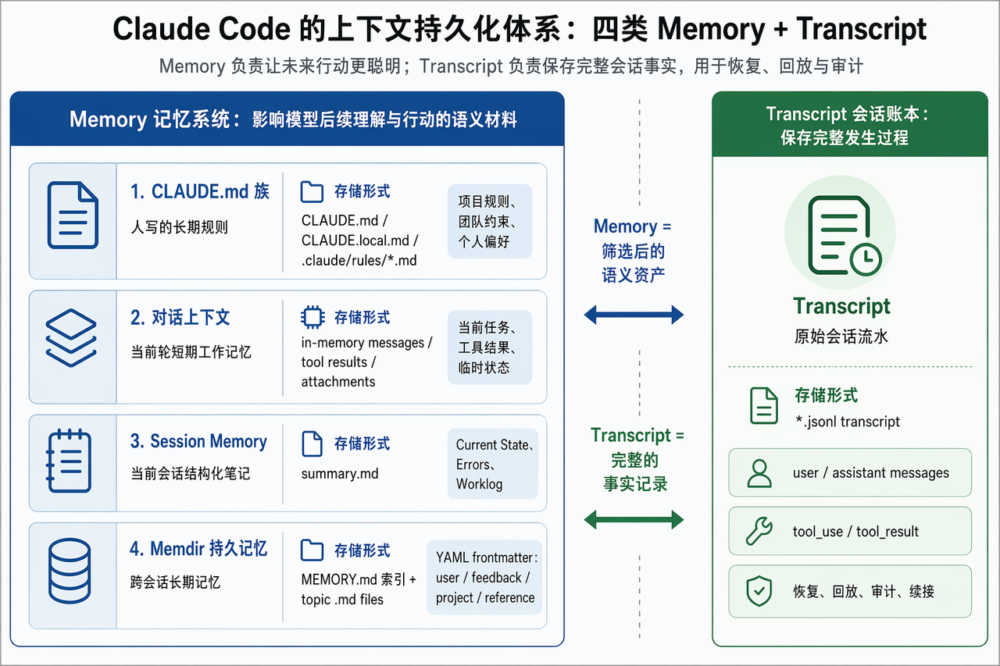
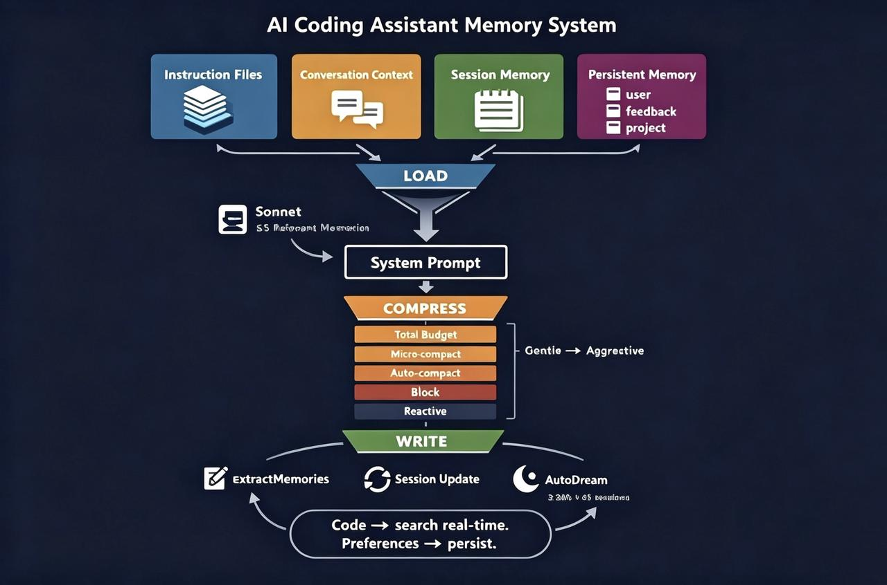
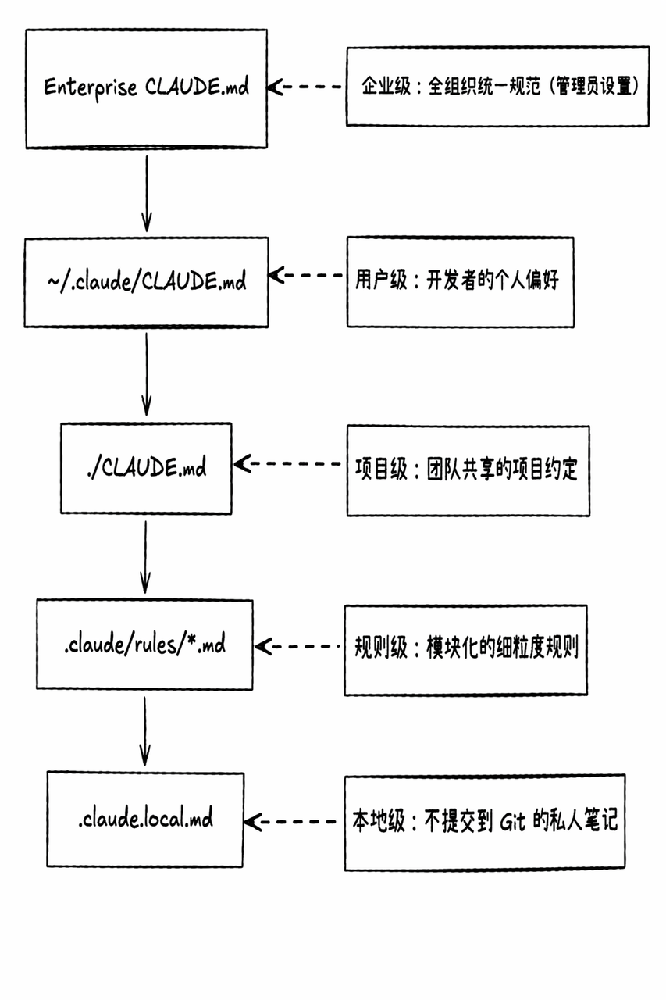

> **课时** 88/132　·　**AI 通用素养**　·　约 50 分钟
> [上一课：4.4 ClaudeCode源码解读/架构拆解 · 4.4.2 整体架构](../07-AI素养/11-4.4 ClaudeCode源码解读-架构拆解 · 4.4.2 整体架构.md)　·　[下一课：4.4.3.4 压缩 · 4.4.3.7 讲解视频](../07-AI素养/13-4.4.3.4 压缩 · 4.4.3.7 讲解视频.md)
>
> 学完标准：合上笔记，能讲清本节在问什么、你怎么答、以及如何套到自己的项目上。

---

#### 4.4.3  记忆功能

> 其实大家看各种Agent的开源项目，每个Agent项目，我们都需要关注最重要的几个点，也是Agent项目的核心：比如记忆，架构，Agent的交互对吧。所以不管看哪个Agent项目，都该特别解析关注这个记忆模块。我们在笔记的openclaw部分已经解析了小龙虾的记忆功能，今天我们来看看ClaudeCode的记忆功能，二者对比，体会成熟的Agent项目的记忆功能背后的设计哲学。
>

学习一个 Agent 的记忆模块，可以重点从以下几个问题入手：

- **它由哪些部分组成？**

- **它是如何运行的？**例如加载、写入、压缩、恢复等流程。

- **各部分分别负责什么功能？**

- **信息以什么格式存储？**例如 `.md`、`.jsonl`、内存对象等。

- **这些信息存在哪里？**是在内存中，还是落到磁盘文件里？

- **整体设计理念是什么？**它是为了让模型更聪明，还是为了让系统更可恢复、更可审计？

教大家一个小技巧，如果你没有设计Agent的一些思想，那么在你的Agent系统（简历上），加上这么一条：xxx。基本照抄ClaudeCode的设计理念，写在简历上，面试的介绍项目大概讲一下，面试官大概率会问设计的细节，然后你就可以照着本节的笔记去讲解。本节笔记也会引入真实的面试真题，感受面试官对于你的记忆系统是怎么提问的？可以用这些面试真题来体会自己有没有真正理解。当然如果你更有想法，在消化了本节内容后，可以结合自己项目和思想，去改进你的记忆系统（但前提是你消化了这个业内的标杆实现，如果你没有消化就自己设计，那你还不如照抄呢）

从宏观上，我们从这个图来了解CC的存储系统。其实我翻了大量的参考资料，很多资料的解析，其实只解析了CC的左半边部分，甚至只解析了左半边记忆系统里面的某一层。但是我这里加入了右边，Transcript，因为不讲这个，讲不清楚ClaudeCode是如何恢复对话，做上下文重建的（这也是面试问题，另外你要是用这一套记忆系统放在你的项目，你必须从各个角度理解透彻，因为面试官会从各个角度来提问）

从宏观上看，Claude Code 的上下文持久化体系可以分成两大部分：**Memory 记忆系统** 和 **Transcript 会话账本**。如下图：

- 左侧的 **Memory 记忆系统**，主要负责保存会影响模型后续理解和行动的语义材料。它包括 CLAUDE.md 族、对话上下文、Session Memory 和 Memdir 持久记忆。

- 右侧的 **Transcript**，更像完整的会话流水账，用来记录用户消息、助手回复、工具调用和工具结果。它主要服务于恢复、回放、审计和会话续接。



下面4.4.3.1 就是对该图左边的这一部分进行详细讲解。

同时附上一张完整的图片，包含了四层记忆和压缩功能，CC整体的运作图。



##### 4.4.3.1 四层记忆

1. **五层指令文件（CLAUDE.md 族）—— 人写的规则**
> 指令文件其实在CC的核心用法就讲过，这里Claude.md 系列文件的维护，需要人工维护的。
>



CLAUDE.md 族采用五层记忆体系：

- **企业级**：`/etc/claude-code/CLAUDE.md`
管理者是 IT 部门 / 管理员，作用范围是全公司开发者。特点是强制执行，个人无法覆盖。

- **用户级**：`~/.claude/CLAUDE.md`
管理者是开发者个人，作用范围是该用户所有项目。特点是跨项目的个人偏好。

- **项目级**：`./CLAUDE.md`
管理者是团队 / Tech Lead，作用范围是当前项目所有成员。特点是提交至 Git，团队共享。

- **规则级**：`.claude/rules/*.md`
管理者是团队 / 个人，作用范围由 Glob 模式限定。特点是模块化、条件化触发。

- **本地级**：`./CLAUDE.local.md`
管理者是开发者个人，作用范围仅当前工作区。特点是不提交 Git，通常自动加入 `.gitignore`。

从上至下，适用范围逐渐收窄，内容颗粒度日益精细，管理灵活性也随之递增。

你可能会问，当这五层内容，冲突了怎么办？

Claude Code 不会像配置系统那样用下层文件把上层文件整段替换掉，而是把企业级、用户级、项目级、规则级、本地级这些 `CLAUDE.md` **内容一起读出来**，**按一定顺序合并进同一个上下文里，让模型同时看到多层规则**。发生冲突时，普通规则主要靠**模型根据“更具体、更贴近当前任务、位置更靠后/更新”的信息来判断该听谁**，比如用户级说 4 空格、项目级说 2 空格，项目级更具体，通常会被采纳。但这仍是认知层的软优先级，不是代码级覆盖；真正的硬约束要靠权限、Hooks、Managed Settings 这类系统机制保证。

这里是一个面试问题考点，请看 [腾讯AI Agent暑期实习，面试问题2：如果用户和AI对话生成问题本身有冲突，系统应该怎么处理](https://my.feishu.cn/docx/GikId1snboM6LyxxGPXc0kDdnub#doxcnJf3Fuujw88dqsrHnj52zah)

> 更多参考资料：讲解CC的MD的原则，可以查看 《ClaudeCode Harness之道》（黄佳著）第2章 2.2小节（书籍资源要你自己找哈）。
>

---

1. **对话上下文—— 短期记忆**
> 就是大模型多轮对话的数组，每个Agent都有。
>

当前对话的消息数组，所有 LLM 应用都有。Claude Code 的特别之处在于配套了一套多层压缩策略来管理它（见 3.1存储时，由后台 agent 更新），主要服务本次 compact。

---

1. **持久记忆（Memdir）—— 跨会话的长期记忆**
最核心的长期记忆系统，位于 `~/.claude/memory/`。存 4 类信息：

- **`user`**：用户角色、偏好、技能水平。例："偏好函数式风格"、"是后端工程师"
- **`feedback`**：用户对 AI 的纠正和确认。例："上次用 forEach 被要求改成 map"
- **`project`**：项目目标、决策、截止日期。例："Q3 要迁移到 TypeScript"
- **`reference`**：外部系统指针。例："Bug tracker 在 Linear：xxx"
注意这里**故意不存代码事实**（如"函数 X 在第 30 行"），因为代码会变但记忆不会自动更新，过时的代码记忆会变成危险的误导。代码相关的事实永远用 grep/glob 实时搜索，只有人的偏好和判断才值得持久化。

**存储结构：**

```
~/.claude/memory/
├── MEMORY.md              ← 索引文件（每次会话自动加载）
├── user_role.md           ← 主题文件：用户角色
├── feedback_testing.md    ← 主题文件：测试相关反馈
├── project_migration.md   ← 主题文件：迁移计划
└── reference_tracker.md   ← 主题文件：外部系统指针
```

`MEMORY.md` 是**索引**，不存记忆内容本身——每行只有一个指向主题文件的链接和一句话摘要（≤150 字符），格式如 `- [用户角色](user_role.md) — 后端工程师，偏好函数式风格`。上限 200 行 / 25KB。

实际的记忆内容存在各个**主题文件**中，按语义主题命名（不是固定 4 个文件），每个文件带 YAML frontmatter 声明 name、description 和 type（对应上面的 user/feedback/project/reference 四种类型）。查询时系统通过扫描 frontmatter 来判断哪些文件与当前对话相关。

**团队记忆：** Memdir 下有 `team/` 子目录，支持跨用户共享的项目记忆。会话开始时自动同步。敏感信息（API 密钥等）禁止存入。Feature flag `TEAMMEM` 控制。

**写入时机**：用户明确说“记住”时立即写；或者一轮完整回答结束后，也就是模型给出最终回答、没有继续调用工具时，系统会触发后台 **extraction agent**。它会看最近一段对话里有没有值得跨会话保存的内容，也就是 durable memory。

**召回策略：**

Claude Code 的长期记忆召回是这样的：**每个用户回合后台发起一次检索**，由一个**更便宜的小模型**（Sonnet）拿用户这句话去和每条记忆的一行 description 做语义相关性匹配，最多挑出 5 条"确定有用"的注入上下文（常常是 0 条，挑不准就不选）。注入前还有多道闸门——**单字输入、超会话预算、已注入过或主模型已读过的**，都会被跳过，所以不是每回合雷打不动灌 5 条，而是按相关性 + 去重 + 预算动态决定。此外 MEMORY.md 索引始终常驻上下文，主模型也能按需主动去读对应记忆文件。

> 召回策略这里，[202605 安克暑期实习](https://my.feishu.cn/docx/GikId1snboM6LyxxGPXc0kDdnub#doxcnIR1aQmoY6FbwGCTFpSx7ic) 面经中有问到。 
>

> 想深入学习Memdir? 其实对于这个Memdir，它的设计的理念，层级，可以看[这里](https://lintsinghua.github.io/#ch06)
>

---

##### 4.4.3.2 Transcript会话账本

通常来说，很多书籍，文章解析ClaudeCode的时候，讲记忆功能，只会讲4.4.4.1的四层记忆，不会讲这个一小节。但是为什么要讲，是因为如果你要把这一套记忆系统，用在你的项目，和面试官聊的时候，你必须理解这一整套，你的Agent存了哪些东西，面试官可能会问你，会话是如何重建的，恢复的？你必须要理解这一层的存储，因为会话重建，回滚的方法，通常不是通过4.4.3.1的记忆实现的。而是通过专门的会话账本存储的。学习这一小节，有助于理解整个Agent体系的全局架构，面试官问你：**你的系统存了哪些东西？你如何恢复上下文的问题？本节会发挥很大的帮助。**

大家可以看看Keep公司暑期实习面经，通过这个面经，你可以感受到，你学习这个小节的重要性。**从面试官主动问的概率上，该小节被问到的概率不大**，这个小节的核心思想是给大家建立一个意识，日志如何恢复的。**当你在用这一套包装简历的时候，那你务必想清楚这一小节**，请你也想清楚你的系统里：

**Transcript存了什么？**

**当刷新恢复上下文时怎么做的？**

**当返回到某个Checkpoint的时候怎么做的？**

这些具体的细节还是依赖于大家自己，如果你要用这一套包装，最好能做一下，不能做也想清楚这些问题。我也给到大家对应的参考资料，大家可以借鉴LangGraph的恢复功能弄清这些问题，本节只介绍CC大概的思路（具体实现各个产品不一样，但宏观思路是一样的：记忆系统让Agent聪明+日志系统让Agent重建会话）

**功能介绍**

Transcript 会话账本是 Claude Code 的**完整会话记录层**，用来保存一次会话中**真实发生过的消息与执行过程**。它**记录用户输入、助手回复、工具调用、工具返回结果、compact boundary、错误与恢复痕迹等内容**。它的核心功能不是“提炼记忆”，而是保留原始事实：让系统之后可以**恢复上下文、续接会话、回放执行轨迹**，并在出问题时用于审计和排查。

**写入时机**

写入时机是在会话运行过程中持续发生的。在 query loop 里收到新的用户消息、助手消息、工具结果或 compact boundary 后，会调用把这些内容写入 Transcript。也就是说，Transcript 不是最后才生成的总结，而是随着会话一步步追加的执行账本

**存储格式**

 JSONL。每一行都是一条结构化记录，例如一条用户消息、一条模型回复、一条工具调用结果，或者一条系统状态记录。相比 Markdown，JSONL 更适合机器读取、追加写入和恢复会话。

**恢复功能**

恢复功能指的是 Claude Code 可以根据之前保存下来的会话记录，把一个旧会话重新接起来继续工作。它依赖的不是模型“凭空记得”，而是读取之前的 Transcript 会话账本，把用户消息、模型回复、工具结果、压缩边界和相关状态重新整理成可继续对话的上下文。这样用户下次打开同一个会话时，系统不需要从零开始，而是能知道之前聊到哪里、做过什么、哪些工具已经返回过结果、当前任务处在什么阶段。

**重放功能**

重放功能指的是系统可以根据 Transcript 中按时间保存的记录，回看或复现一次会话中发生过的过程。因为 Transcript 记录的是完整流水，而不是最终总结，所以它可以展示用户什么时候说了什么、模型什么时候做了什么决定、调用了哪些工具、工具返回了什么、在哪个位置发生了中断或压缩。重放的重点不是让模型重新推理一遍，而是让人或系统沿着已有记录理解“当时到底发生了什么”。

这一小节的内容，也可以参考 [虾皮2026暑期实习面试](https://my.feishu.cn/docx/GikId1snboM6LyxxGPXc0kDdnub#doxcnQNzwX0byNnr43tHH4KzT8c)，有较多关于重建的讨论。

同时，在PI agent的讲解章节，关于[会话存储](https://my.feishu.cn/docx/GikId1snboM6LyxxGPXc0kDdnub#F2aZdWlEyowAvYxCWQfcsFcGnld)，Session机制相关内容更详细，也可以参考这里。

---

##### 4.4.3.3 上下文组装

每轮对话开始时，系统从上述 4 种存储中**组装完整的上下文**注入 system prompt。

**指令文件的加载**

所有层级的 CLAUDE.md **都会被拼接在一起**注入，不会互相覆盖。但拼接顺序有讲究——源码注释写道：*"Files are loaded in reverse order of priority, i.e. the latest files are highest priority with the model paying more attention to them."* 这利用了 LLM 的一个已知特性：**模型对 prompt 末尾的内容天然给予更高注意力**（recency bias）。因此排在后面的文件在实践中"优先级更高"。

加载顺序（排在越后面，模型越关注）：管理员全局 → 用户全局 → 项目级 → 本地私有。举例：如果管理员规则说"用 npm"，但项目级 CLAUDE.md 说"用 pnpm"，模型会倾向于遵循后者。

**持久记忆的加载**

1. `MEMORY.md` 前 200 行**每次会话自动加载**到 system prompt
1. 用 **Sonnet**（小模型，不是主模型 Opus）扫描所有记忆文件的标题和 frontmatter 描述，选出**最多 5 条**最相关的，作为 `relevant_memories` 附件注入上下文
1. 排除本次会话已召回过的记忆（避免重复）
1. 超过 1 天的记忆自动加**过期警告**：*"这条记忆是 N 天前的... 关于代码行为的声明可能已过时，请先验证。"*
1. 会话总预算 60KB
值得一提的是，记忆召回没有使用 RAG（检索增强生成）。Boris 在播客中透露，早期版本曾尝试过本地向量数据库 + 云端 embedding 的 RAG 方案，但遇到了多个问题：代码修改后索引不同步（新写的函数搜不到）、索引的权限管控复杂（谁能访问、如何防止越权）。最终发现**agentic search（模型自主调用 glob + grep）全面优于 RAG**——Boris 的原话是 *"agentic search just outperformed everything, and when I say agentic search, this is a fancy word for glob and grep."*
