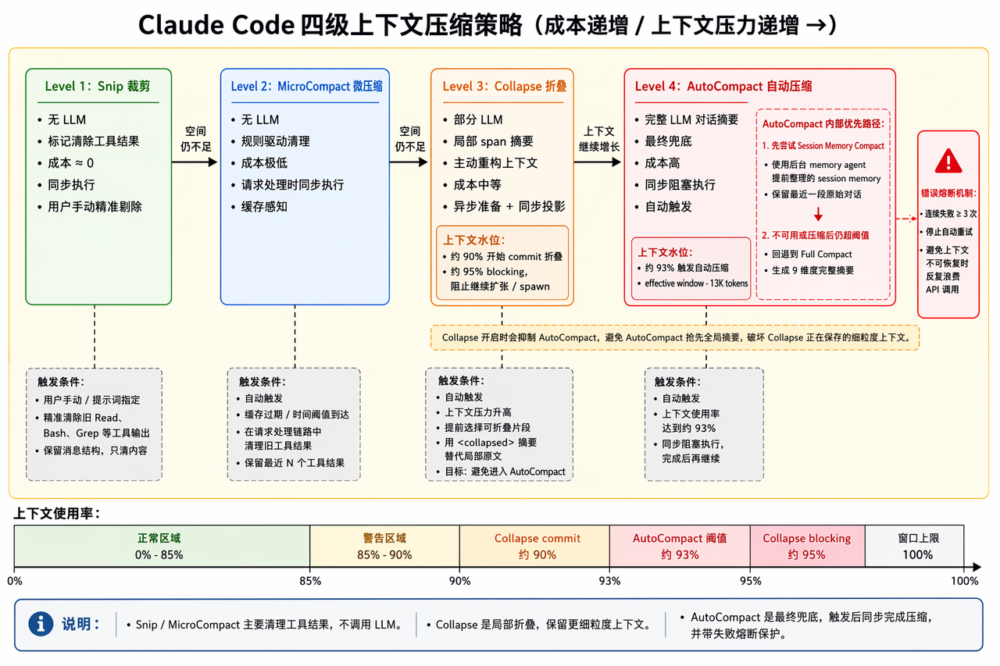
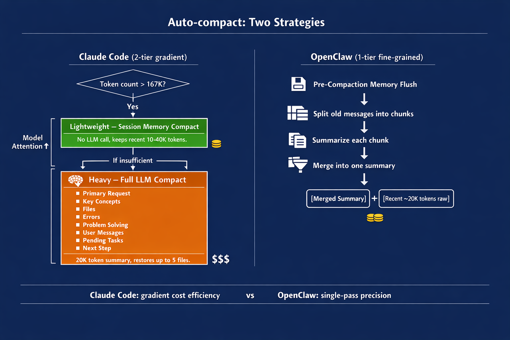
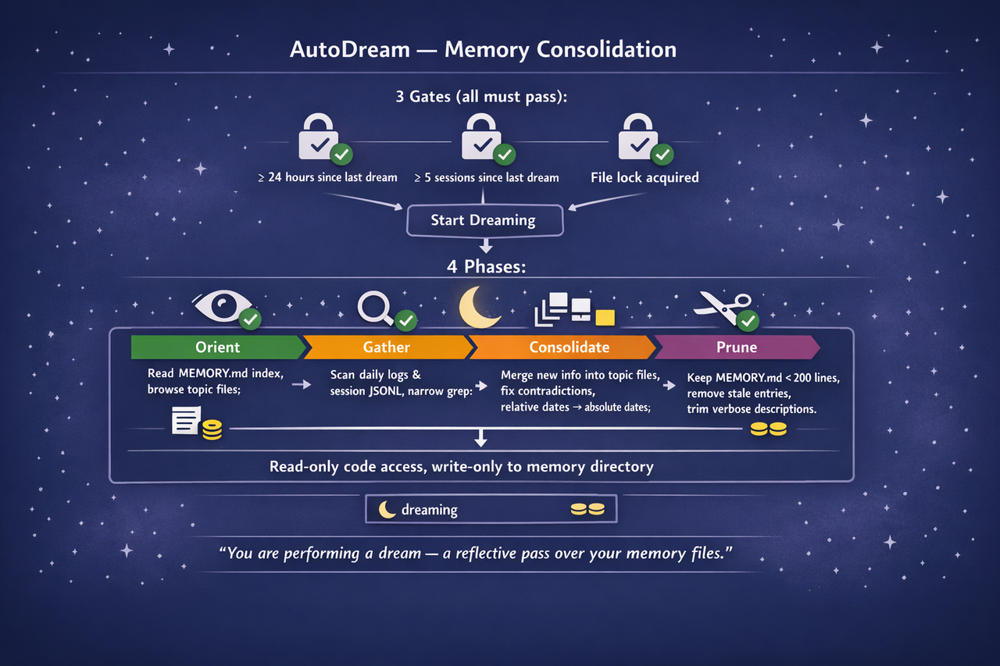
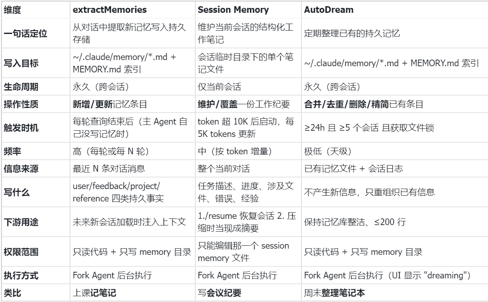

> **课时** 89/132　·　**AI 通用素养**　·　约 1 小时
> [上一课：4.4.3 记忆功能 · 4.4.3.3 上下文组装](../07-AI素养/12-4.4.3 记忆功能 · 4.4.3.3 上下文组装.md)　·　[下一课：4.4.3.8 相关面试真题](../07-AI素养/14-4.4.3.8 相关面试真题.md)
>
> 学完标准：合上笔记，能讲清本节在问什么、你怎么答、以及如何套到自己的项目上。

---

##### 4.4.3.4 压缩

> 压缩是Agent里面的一个核心技巧。我觉得这里面的内容相当复杂，作者在这里也重构过几次，如果你看到的内容和视频有不一样的地方，说明内容重构过了。我也参考了好几个资料（我会附在本节参考资料里），但是其实这些参考资料里讲的都不太一样。我重构的思路，加入了更多的图片讲解，同时我避免讲的过于复杂，因为里面太深奥了，如果写的太复杂反而会弄晕。我的总结是针对于面试问题的，我希望本章内容足够回答面试问题，我也会穿插很多面试真题在其中。如果你想更深入研究，可以去看我给出的参考资料（当然我给的参考资料不同参考资料对这一块讲解也有所不同，我认为不用深究，理解原理知道如何运用到自己项目就好）
>

对话越来越长，上下文窗口终会被填满。Claude Code 设计了一套**四层压缩流水线**，在每轮查询循环中按固定顺序依次执行，每层有独立的触发条件——不是每层每次都触发，而是逐层检查、按需执行，越往后越激进。

这一张图比较清晰地展示了本小节要讲的全部内容，后面会详细展开, 重点关注：

压缩分成4个层级，从弱到强。

每层压缩的触发条件，同步还是异步，何时触发，怎么触发的？

最后一层有一个熔断机制：避免死循环。



---

###### 4.4.3.4.1 层一：Snip裁剪

**是什么？**

Snip 是最轻量的清理方式，主要用于清除已经不再需要的旧工具结果，比如 Read、Bash、Grep 等输出。它不调用 LLM，只把大段工具结果替换成简短标记，从而释放 token。

**如何触发？**

自动触发。系统根据工具结果数量、缓存状态、时间间隔或 token 阈值，自动清理旧工具结果，不调用 LLM。用户无法通过提示词精准指定删除某条工具结果。

**实现原理**

Snip 不删除整条消息，而是保留消息结构，系统将其中的工具调用结果替换为简短的标记文本（如 `[Old tool result content cleared]`），从而释放令牌空间。这样既能减少 token，又不会破坏 tool_use 和 tool_result 的对应关系。

**同步/异步？**

同步执行，成本接近 0。

---

###### **4.4.3.4.2 层二：MicroCompact（微压缩）**

**是什么？**

MicroCompact 是基于时间触发的大规模工具结果清理。当检测到距离上一次助手消息的时间间隔超过配置阈值时，意味着服务端缓存已过期，此时无论内容多么重要，全量重写都无法避免 -- 既然如此，不如在请求之前主动清除旧的工具结果，减小重写负载。

**如何触发？**

自动触发，常见条件是缓存过期、时间间隔达到阈值，或请求处理时发现旧工具结果已经不适合继续保留。在你发送请求后，CC处理你的任务前，如果检测到条件允许，自己就做了微压缩。

**实现原理**

系统按工具类型白名单筛选可压缩内容，例如 Read、Bash、Grep、Glob、WebFetch 等。通常会保留最近 N 个工具结果，把更早的结果替换为清除标记。

**同步/异步？**

同步执行，发生在请求处理链路中，发起模型请求前完成。

---

###### **4.4.3.4.3 层三：Collapse（折叠）**

**是什么？**

Collapse 是上下文重构级压缩。当启用 Context Collapse 特性时，系统会在上下文使用率达到 90% 时开始提交（commit）压缩操作，在 95% 时阻止新的 spawn。这一级别的设计理念是将上下文管理从"被动压缩"转变为"主动重构"。Collapse 模式会抑制自动压缩的触发，因为两者在 93% 的临界点会产生竞争。Collapse 作为更精细的上下文管理系统，拥有更高的优先级。

**如何触发？**

自动触发，主要由上下文压力驱动。大致在上下文使用率约 90% 时开始 commit 折叠，在约 95% 时进入 blocking，阻止继续扩张或创建新的子任务。

**实现原理**

Collapse 会选择相对稳定、低风险的历史片段，让专门的 context-collapse 子 agent 生成局部摘要。之后请求模型时，系统不直接发送完整历史，而是投影成类似：

```
原始历史：A B C D E F
折叠视图：A B <collapsed summary of C-D> E F
```

原始消息仍然保留在 transcript 中，折叠摘要作为提交记录保存，可以跨轮恢复。

**同步/异步？**

> 也就是在真正执行的时候，他还是同步阻塞的，但是可以异步准备一下它的摘要。比如说当信息变更成A,B,C,D的时候，已经开始总结C,D的summary了，E,F同时继续，这是异步的。但是真正压缩的时候，将C,D替换成summary的时候，是同步的。
>

混合模式：局部摘要可以提前异步准备；真正发请求前，系统同步应用折叠视图。

---

###### **4.4.3.4.4 层四：AutoCompact（自动压缩）**

**是什么？**

AutoCompact 是最终兜底机制。当上下文接近上限时，系统自动触发压缩，避免请求因为上下文过长失败。它的成本最高，因为通常需要 LLM 参与摘要。

**如何触发？**

自动触发。典型阈值是 effective context window - 13K tokens，约等于上下文使用率 93%。另外，如果模型返回 context overflow / prompt too long，也可能触发恢复性压缩。

**实现原理**

触发后有两个子策略，**先尝试轻量的，不行再用重量的**：

1. **Session Memory Compact（轻量）**：用已经由后台代理提取好的 Session Memory 文件作为摘要，保留最近 **10K~40K tokens** 的原始对话（至少保留 5 条含文本的消息）。**不需要额外的 LLM 调用**，所以很便宜。
1. **Full LLM Compact（重量）**：把整段对话发给 LLM 做结构化摘要。摘要输出上限 **20K tokens**，包含 9 个固定段落：
    - 核心请求
    - 关键概念
    - 涉及文件列表
    - 代码错误与修复
    - 问题解决过程
    - 所有用户消息
    - 待办事项
    - 当前工作
    - 下一步计划
1. 压缩后自动恢复文件上下文：压缩会丢弃旧消息，但会话期间所有被读过、写过、编辑过的文件都记录在 `readFileState` 缓存中（包括 agent 调用 FileRead/FileEdit/FileWrite/Bash 工具操作的文件，以及 memdir 系统和 Sonnet 预取自动加载的记忆文件）。压缩完成后，系统会从这个缓存中排除 CLAUDE.md 和 Plan 文件（它们有各自的恢复机制），再按最近访问时间排序，取最多 5 个文件从磁盘重新读取（不用旧缓存，确保内容是最新的），以每文件 ≤5K tokens、总计 ≤50K tokens 的预算注入到压缩后的上下文中，让模型不需要在下一轮重新读取这些文件就能继续工作。如果会话中没有操作过任何文件，则不会恢复。
1. **防御机制**：连续失败 **3 次**后触发熔断，不再尝试。如果压缩调用本身也报 prompt-too-long，会从最旧的消息开始截断，最多重试 **3 次**。
**为什么建议主动 ****`/compact`**

社区分析源码后的一个关键建议是：**主动使用 ****`/compact`****，不要等系统自动压缩**（出自 "I Read 512,000 Lines of Leaked Claude Code" 视频）。原因很简单——自动压缩触发时，你无法控制保留什么，系统按自己的 9 段模板做摘要，可能会丢掉你认为重要的上下文。而手动 `/compact` 可以附带指令，比如 `/compact 重点保留决策和待办事项`，让 LLM 知道什么该保留。Boris 在播客中也提到自动压缩是实现"本质上无限上下文"（essentially infinite context）的核心手段，但这更多是系统兜底，用户主动管理上下文效果会更好。

---

###### **4.4.3.4.5 和Openclaw的对比**

> 这里我们不妨把两个架构的压缩策略对比。
>

OpenClaw只有一级压缩，但做得更精细：保留最近 ~20K tokens 原文不动，只压缩更早的旧消息，旧消息按 token 数分成多个块逐块总结，再合并成一个连贯摘要。压缩前还会静默运行一轮，提醒 Agent 把重要内容写入记忆文件（Pre-Compaction Memory Flush），防止关键信息随压缩丢失。压缩后结构：`[合并摘要] + [最近 ~20K tokens 原文]`。

Claude Code 则是**两级梯度设计**：轻量级的 Session Memory Compact 效果类似 OpenClaw（摘要 + 保留最近原文），但摘要不是现场生成的，而是后台子代理提前维护好的，所以不需要额外 LLM 调用、更省成本。只有轻量级扛不住时才上 Full LLM Compact——这一步更激进，把全部对话压缩成结构化摘要，旧消息全部丢弃。

核心差异：OpenClaw 一步到位但精细（分块 + 合并 + 预刷记忆），Claude Code 分两步走（先便宜后贵），用梯度换成本效率。

**下图是Claude Code 的压缩策略 vs Openclaw的压缩策略**



###### **4.4.3.4.6  我的Agent需要这么复杂吗？**

大概率不需要。ClaudeCode面向全球规模生产流量，很多设计，是为了处理极端情况。

比如第二层微压缩，主要为了处理的是提示词缓存，这个和Anthropic的推理端缓存有关，我们大概率不用做。一般建议做的：工具要清理 + 失败停止重试+你的压缩过程保留哪些信息。

另外我分析了两个同学的面经，他们和面试官讲压缩的时候是异步压缩的，结果被面试官追问细节答不上来。其实根据我们小节讲的，在真正压缩的时候，都是同步的。但是压缩的时候依赖于一些异步执行（比如实时总结中间过程）的结果。这里注意一下。所以你最好别把你的项目压缩过程设计成异步的，弄得比CC还复杂，不想清楚面试还爱翻车。

###### **4.4.3.4.7  面试真题**

###### **4.4.3.4.8  参考资料**

我给了三个资料，他们对于CC压缩的分层层级分类都不一样，如我引言所说。以一种为准，掌握思想和原理，想清楚细节，用来对付面试题和设计项目就够了。 

1. [《解码 Agent Harness · Claude Code 架构深度剖析》第7章](https://lintsinghua.github.io/#ch07)（本节按照这本书的分类总结的）
1. [Claude Code 上下文工程：四層壓縮機制的源碼級拆解](https://ai-coding.wiselychen.com/claude-code-context-engineering-four-layer-compression/)
1. [Claude Code 底层逻辑分析：三级压缩系统，让 AI 用有限的上下文窗口做无限长的任务](https://cloud.tencent.com/developer/article/2653153)
---

##### 4.4.3.5 记忆写入

上面讲了 4 种存储和加载/压缩策略，但记忆是怎么**写进去**的？有 3 个写入机制：

1. **extractMemories（持久记忆提取）**
在每次完整查询循环结束后（模型给出最终回复、没有更多工具要调用时），由一个 Fork Agent 后台执行：

- 继承父对话的完整上下文，共享 prompt cache（不额外消耗 token）
- **严格权限沙箱**：只能读文件 + 只能写记忆目录，不能执行 bash、不能调 MCP、不能启动子代理
- 高效的 2 轮模式：第 1 轮并行读所有需更新的文件 → 第 2 轮并行写所有变更
- 有频率限制，不是每轮都跑
1. **Session Memory 更新**
对话 token 超过 10K 后启动，之后每 5K tokens 由后台 Fork Agent 更新一次结构化笔记文件。

1. **AutoDream（记忆整合）—— "睡眠整理"**
定期运行的后台代理，对持久记忆做整理、合并、去重、清理。灵感来自人类睡眠时整理白天记忆的过程。下图是AutoDream图片展示。



**触发条件（三个门全部通过才执行）：**

1. 距上次整合 ≥ **24 小时**（最先检查，成本最低——一次 `stat` 调用）
1. 距上次整合 ≥ **5 个会话**
1. 获取 **consolidation lock**（PID 文件锁，防并发；超过 1 小时且 PID 已死则可回收）
**执行 4 阶段：**

- **Orient**：读取 MEMORY.md 索引，浏览现有主题文件，了解当前状态
- **Gather**：扫描每日日志和会话记录（JSONL），窄范围 grep，不穷举
- **Consolidate**：新信息合并到现有主题文件，修复矛盾，相对日期转绝对日期
- **Prune**：保持 MEMORY.md ≤ 200 行，删除过时条目，精简冗长描述
System prompt：*"You are performing a dream — a reflective pass over your memory files. Synthesize what you've learned recently into durable, well-organized memories so that future sessions can orient quickly."*

整合期间**只读访问**——可以看代码文件，但只能写记忆目录。由 Fork Agent 执行，UI 底栏显示 "dreaming" 标签。

**三者对比：**



#####  4.4.3.6 Claude Code vs OpenClaw：记忆设计思路对比

两者解决的是同一个问题——**有限上下文窗口下如何让 Agent 不失忆**，但设计思路有几处根本性的分歧。

**检索路线之争：Agentic Search vs RAG**

这是两者最大的分歧。Claude Code 明确**拒绝 RAG**，Boris 透露早期试过向量数据库 + embedding 方案，但发现代码修改后索引不同步、权限管控复杂，最终结论是让 Agent 自己调 glob + grep 实时搜索（agentic search）全面优于 RAG。OpenClaw 则走了完全相反的路——用 SQLite 建本地索引，向量语义匹配 + BM25 关键词匹配加权合并做混合检索。

本质上这是 **"每次多花点 token 换实时准确"** vs **"建索引省 token 但要维护一致性"** 的取舍。对 coding agent 来说，代码文件变化极频繁，索引的一致性成本很高，所以 Claude Code 选择了不建索引；而 OpenClaw 面向更通用的 Agent 场景（聊天、知识管理），记忆文件相对稳定，RAG 的收益更明显。

**压缩策略：梯度递进 vs 一步到位**

Claude Code 设计了 5 层压缩流水线，从温和到激进逐层升级——先清理工具输出碎片、再考虑缓存优化、然后才做 LLM 摘要、最后硬拒绝和兜底。大部分情况下前两层（不需要 LLM 调用）就能把 token 压下来，真正的 LLM 压缩是中低频事件。这是一种**用工程复杂度换成本效率**的思路。

OpenClaw 只有一级压缩，但流程更精细：划分保留区（最近 ~20K tokens 原封不动）、压缩区分块逐块总结、多块摘要再合并成一个连贯总结。每次触发都需要 LLM 调用，成本更高，但**实现简单、行为可预测**。

**记忆写入：自动化 vs 显式写入**

Claude Code 做了重度的写入自动化——三个后台 Agent 分工：extractMemories 每轮结束后自动提取持久记忆，Session Memory 持续维护会话笔记，AutoDream 定期整合去重。用户不需要主动"存档"，系统自动帮你把重要信息沉淀下来。

OpenClaw 更依赖显式写入。它的文档反复强调一个常见失误：*聊天中说的指令不会自动保存到文件——不写入文件就会被压缩丢掉*。作为补偿，OpenClaw 在压缩前有一个 **Pre-Compaction Memory Flush**——静默提醒 Agent 把重要内容写入记忆文件。但这本质上是"事到临头才保存"，而 Claude Code 是"一直在保存"。

**记忆加载：Push vs Pull**

Claude Code 是**系统层面硬编码**的 push 模式——每轮对话前，系统必定用 Sonnet（轻量小模型）扫一遍所有记忆文件的标题和描述，挑出最相关的几条，直接塞进上下文。主模型开始思考时，相关记忆已经摆在眼前了，不需要它主动去找。类比：**秘书在你开会前，把相关资料提前放在桌上**。代价是每轮都要占固定的上下文空间，不管用不用得上。

OpenClaw 是 pull 模式——系统不会提前塞记忆，而是把 `memory_search` 作为一个普通工具暴露给模型。模型在推理过程中自己判断"这轮要不要查记忆"，跟它决定要不要调 bash、要不要读文件是一样的逻辑。更灵活省空间，但风险在于**模型不知道自己不知道什么**——比如你上周说过"我讨厌用 forEach"，这条记忆存在文件里了，但今天聊到循环时模型可能根本没想到要去搜"用户的代码风格偏好"，就直接写了 forEach。Push 模式下这条记忆会被小模型提前捞出来，就不会犯这个错。

**设计哲学总结**

Claude Code 走的是**工程优化路线**：梯度压缩能省则省、后台 Agent 自动写入、小模型做筛选降低成本——处处体现"怎么用更少的 token 做更多的事"。OpenClaw 走的是**架构清晰路线**：四层对标计算机存储层次（硬盘→日志→内存→搜索引擎），每层职责明确，系统更易理解和调试。面试时两者结合讲，既能展示工程优化思维，又能体现架构设计能力。

#####  4.4.3.7 讲解视频

ClaudeCode记忆模块保姆级教学。这个视频讲了整个4.4.3小节，注意对于四层记忆这里，视频讲到memdir这一层是用来恢复上下文的，这里视频讲的不对，请大家谅解，文档已经更正过来了。

https://www.bilibili.com/video/BV1UHQhBFEJx/?vd_source=144bec9c3f54e465073138bed788be1b

这个视频是对于虾皮面试内容的讲解。里面有很大一部分是结合了CC的四层记忆讲解的真题，关于memdir的部分，该视频讲解的也是正确的。可以结合参考。

https://www.bilibili.com/video/BV1BkVk6DEx3/?spm_id_from=333.1387.homepage.video_card.click&vd_source=144bec9c3f54e465073138bed788be1b

**字节一面真题：上下文压缩机制**

真题来源：[2026年10月字节一面](https://my.feishu.cn/docx/GikId1snboM6LyxxGPXc0kDdnub#doxcngfFzn3Bi9iO4I11TAqdd7g) · [第5组原题](https://my.feishu.cn/docx/GikId1snboM6LyxxGPXc0kDdnub#doxcnnqM8uDnRt9CJUuF1v52uwk)

**1. 介绍一下你了解的 Claude Code 上下文压缩机制。**

**💡 答题思路**

CC的4层压缩与案例，笔记里有专题视频讲解，包括也给到了参考链接（一本可以在线看的书籍），讲了cc的四层压缩原理。注意笔记可能总结自5月，不过我查了CC本身也没开源，官方也没有描述，这个答案是4月份从他们泄露的源码中总结的，现在cc的真实实现可能会有所不同，不过答题思路，思想应该是类似，也值得我们学习。

**🎤 参考答案**

我理解 Claude Code 的上下文管理，不是窗口快满时统一做一次摘要，而是先清理低价值内容，再逐步使用更重的压缩手段。**可以分成 Snip、MicroCompact、Collapse 和 AutoCompact 四层按需机制。** 它们有各自的触发条件，不是每轮都把四层执行一遍；其中 Collapse 还取决于相关特性是否启用，不能把这些实现细节当成所有版本固定不变的行为。

**第一层是 Snip，轻量裁剪。** 它不调用 LLM，主要把已经不再需要的大段旧工具结果替换为简短标记，同时保留消息结构，以及工具调用和工具结果之间的对应关系。这样能先以很低的成本释放上下文空间。

**第二层是 MicroCompact，微压缩。** 它结合时间间隔、缓存状态等条件，在发起模型请求前，对符合条件的旧工具结果进一步清理，通常保留近期结果。这里不仅是在节省 token，也考虑了提示词缓存：当缓存已经过期、请求本来就需要重新处理时，清理旧结果可以减小后续负载。这一过程在请求链路中同步完成。

**第三层是 Collapse，局部折叠。** 在启用相关特性的情况下，它选择相对稳定、低风险的历史片段，交给专门的子 Agent 生成局部摘要。比如历史是 A、B、C、D、E、F，发送给模型时可以变成 A、B、C—D 的摘要、E、F。原始记录仍保留在 transcript 中，改变的是本轮模型看到的上下文视图。摘要可以提前异步准备，但真正发请求前，要同步应用折叠结果；上下文压力过高时，还会限制继续扩张任务。

**第四层是 AutoCompact，强力兜底。** 当上下文接近预算上限，或者请求出现上下文溢出时，系统尝试进一步压缩。CC有两种压缩策略：优先使用后台已经维护好的 Session Memory 作为摘要，并保留近期原文，避免在触发时再额外调用一次 LLM；如果这条路径不适用或失败，再通过 Full LLM Compact 调用模型，把历史整理为包含核心请求、涉及文件、错误与修复、待办、当前工作和下一步等信息的结构化摘要。

总结来说，这套机制的核心是：**先清工具噪声，再做局部折叠，必要时做结构化摘要；异步准备、同步应用，并处理压缩后的恢复和失败兜底。**

---
