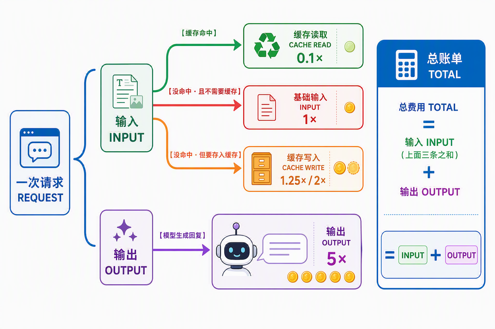
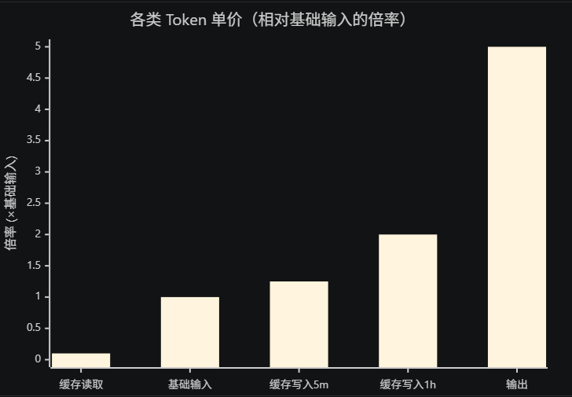
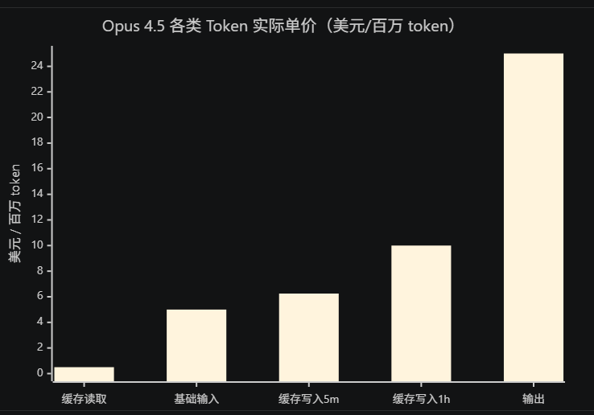
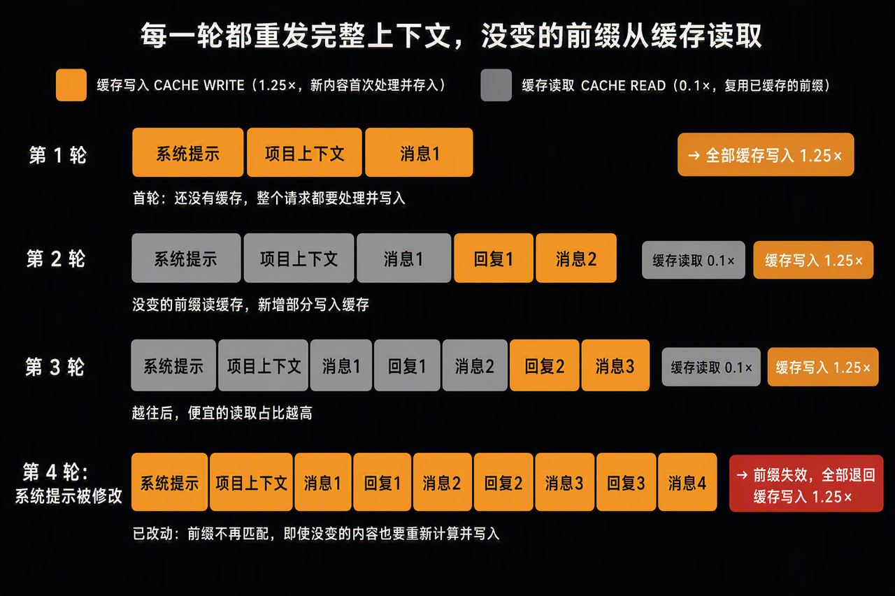
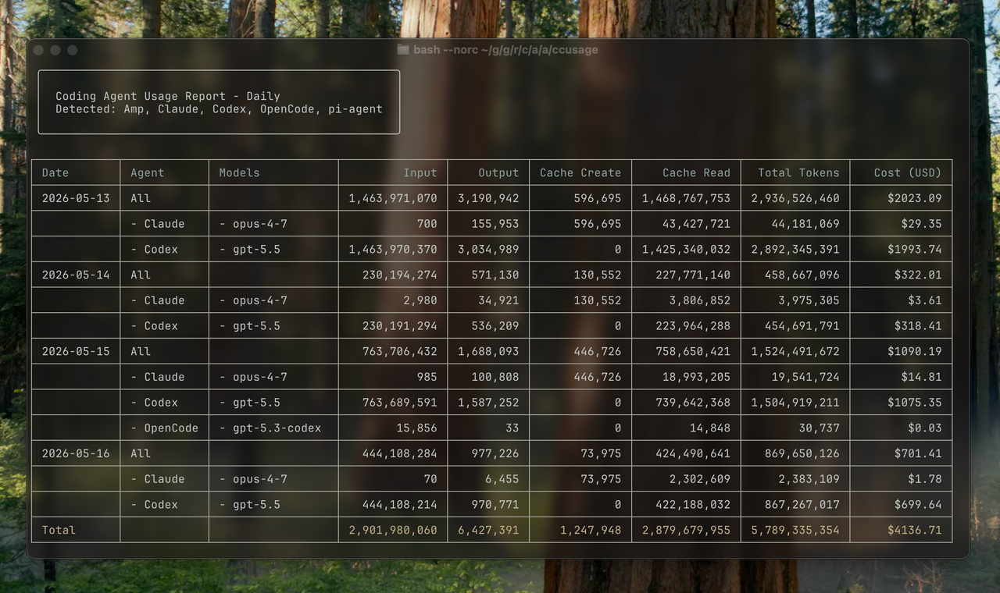

> **课时** 96/132　·　**AI 通用素养**　·　约 1 小时
> [上一课：4.6 Codex VS ClaudeCode · 4.7 Codex ClaudeCode安装小技巧](../07-AI素养/19-4.6 Codex VS ClaudeCode · 4.7 Codex ClaudeCo.md)　·　[下一课：4.9 参考资源](../07-AI素养/21-4.9 参考资源.md)
>
> 学完标准：合上笔记，能讲清本节在问什么、你怎么答、以及如何套到自己的项目上。

---

### 4.8 如何给ClaudeCode（包括其他coding工具）节省Token？

#### 4.8.1 前言

这篇笔记的目的，是教你一套**节约 AI 工具提示词（Token）的技巧**。学会之后，你在日常使用 AI 编程时，可以省掉大量 Token——无论你是按量付费的 API 用户（直接省钱），还是订阅版用户（额度更经用）。

本文虽然以 **Claude Code** 为例讲解，但其中的**方法和原理是通用的**，同样适用于 Codex、Gemini CLI 等其他 Vibecoding 工具——差别只在具体数字和命令，思路完全可以照搬。

而且，学会本章节不只是为了省钱。**从面试的角度**看，它同样很有价值：当面试官问你有没有使用 Vibecoding 工具的心得，能介绍一下吗？如何编写提示词的最佳策略？这类问题时——包括理解 Claude Code 的压缩与缓存策略这一块——本章的内容都能让你答得有条理、有深度。文末我也会照例，把对应的面试问题单独整理出来。（我印象很深的是夸克千问的Agent开发二面，面试官就是和我讨论怎么写提示词，他会一直问我还有什么策略吗？还有什么吗？如果当时我看了今天的素材，我的回答就会多一个角度。）

本篇的组织结构是：

1. **先理解大模型的计费标准和策略**——只有知道它怎么收费，才能知道该怎么省钱。
1. **再讲解 Claude Code 的提示词缓存策略**——这一块比较复杂，我会给出参考文档，感兴趣的可以深入学习；我们先大致理解它的原理，才能明白后面最佳实践为什么要那样做。但这里也几乎是全文最难的地方，理解了这里，其他地方就很容易了。
1. **然后是最佳实践**——告诉你具体应该怎么做，并给出需要用到的工具链接。
1. **最后是面试问题总结**——一如既往，把学完本节后能应对的面试问题整理出来。
#### 4.8.2 大模型的计费标准

##### **4.8.2.1 先看懂：你跟 AI 说一句话，背后发生了什么**

在谈钱之前，先弄清一次对话的完整过程——不然后面那些输入、缓存、输出你会对不上号。

你每发一条消息，模型并不是只读你那句话。它每一轮都要**把整个上下文从头到尾读一遍**，然后才生成回复。这个上下文包括（这里是粗略地讲，其实Agent的上下文内容，我们每个Agent架构都会专门讲解，但本节主要是聚焦于计费，不深究上下文细节，以下是最典型的模型上下文组成）：

1. **系统提示 + 工具定义**（Claude Code 内置的一大段说明，最靠前）
1. **项目信息**（你的 CLAUDE.md、memory 等）
1. **之前的完整对话历史**（前面每一轮的问和答）
1. **你这一轮新说的话**
把这 4 块加起来，模型读进去的全部，叫 **输入（input）**；模型写出来的回复，叫 **输出（output）**。

**关键问题来了**：第 ①②③ 块，其实**每一轮都长得一模一样**（系统提示不变、CLAUDE.md 不变、已发生的历史也不会变），只有第 ④ 块每轮才新增。如果每轮都把 ①②③ 当成全新内容重新读一遍并收全价，那太浪费了。于是就有了**缓存**：把这些重复不变的部分**存起来**，下一轮直接复用。

这就引出了收费的逻辑。下面这张图把一次请求怎么被拆分收费画清楚。核心逻辑是：

> **一次请求 = 输入 + 输出两部分收费。输出只有一种（最贵）。而输入会按有没有命中缓存分成三条路，每条价格不同。**
>
> ❓ **你可能会先问：为什么一次大模型请求的费用要分成输入和输出两部分？**
>
> 因为大模型推理本身就分成两个截然不同的阶段，成本差异很大。做过模型推理的同学应该清楚，这两个阶段叫 **prefill（预填充）** 和 **decode（解码）**——**输入正对应 prefill，输出正对应 decode**。
>
> - **prefill（对应输入）**：把你的整段 prompt 一次性读进去理解。这些 token 可以**并行处理**，GPU 一口气就能吞一大批，算得快、摊到每个 token 的成本低 → 所以**输入便宜**。
> - **decode（对应输出）**：生成回复时只能**一个字一个字往外蹦**（每个新词都依赖前一个，没法并行），每生成一个 token 都要把整个模型重跑一遍，慢且吃算力 → 所以**输出最贵**。
> 一句话：**因为读 prompt 和写回复是两种成本完全不同的计算，所以要分开计费**——这也是为什么后面输出的单价会远高于输入。
>

这一次请求会被拆成四种收费名目：

- **① 缓存写入 cache write（5m / 1h 两种时长）**：发生在某段内容**首次出现的那一轮**——内容第一次被读，并存进缓存。
- **② 缓存读取 cache read（便宜 10 倍）**：发生在**后续每一轮复用它时**——内容没变、还没过期，直接复用。
- **③ 基础输入 input（全价）**：发生在**缓存过期/失效后重读，或某段内容压根没被缓存**时——当成全新内容来读。
- **④ 输出 output（最贵）**：发生在**每一轮的回答**——模型生成回复。
一句话串起来：**同一段内容第一次见 → 走写入存起来；以后复用 → 走便宜的读取；如果缓存没了、当新的重读 → 走全价输入；模型的回答 → 走最贵的输出。** 省 token 的所有招数，本质都是在操控这几个阶段的走向（让更多内容走②便宜读取、少走③④）。

理解了这个过程，再看下面的价目就顺了。

##### 4.8.2.2 五类 Token 的单价

Claude API 把 token 分成 **5 种，单价各不相同**（以下为官方定价，单位：美元/百万 token）：

以基础输入的单价为基准（记作 1×），5 种 token 的相对倍率如下：

- **基础输入 input**：全新的、没缓存过的输入，**1×（基准）**。
- **缓存写入 cache write（5 分钟）**：内容第一次写进缓存，**1.25×**（比输入还贵一点）。
- **缓存写入 cache write（1 小时）**：写进缓存并保留 1 小时，**2×**。
- **缓存读取 cache read**：复用已缓存的内容，**0.1×**（便宜 10 倍！）。
- **输出 output**：模型生成的回复，通常是输入的 **5 倍**（最贵）。
把这套倍率画成图，一眼就能看出差距（数值＝相对基础输入的倍率）：

> 看这张图就懂了：**最左边的缓存读取几乎贴地（0.1×），最右边的输出高达 5×。** 省 token 的全部套路，本质就是——把尽量多的量从右边（贵）挪到左边（便宜）。
>

以几个主流模型为例（美元/百万 token，顺序为 输入 / 缓存写入5m / 缓存读取 / 输出）：

- **Opus 4.5**：$5 / $6.25 / **$0.50** / $25
- **Sonnet 4.5**：$3 / $3.75 / **$0.30** / $15
- **Haiku 4.5**：$1 / $1.25 / **$0.10** / $5
同一模型内，各类 token 的实际单价差距也很直观（以 Opus 4.5 为例，美元/百万 token，列与上一张图一一对应）：

> 中间三档（输入 $5、写入5m $6.25、写入1h $10）挤在一起，两头拉得最开：**最便宜的缓存读取 $0.50，最贵的输出 $25，差 50 倍。**
>

**从这张表能读出三个关键事实，它们正是后面所有省 token 手段的依据：**

1. **缓存读取便宜 10 倍**（0.1×）。所以让内容尽量走 cache read，是最大的一块节省——这就是原理层顺应缓存的意义。
1. **输出最贵**（约输入的 5 倍）。所以让模型少说废话省下的是最贵的那种 token——这就是让 Claude 简洁回答为什么划算。
1. **写入缓存略贵一点**（1.25×），是一次性成本，下一轮就靠便宜的读取回本。所以**频繁打破缓存 = 反复付这笔写入费**，特别亏。
#### 4.8.3 Claude Code 的提示词缓存策略

上一章讲清了怎么收费，这一章讲清缓存怎么运作——它是 Claude Code 的**内置行为**，不用装任何东西，但理解它是后面所有最佳实践的根基。

**缓存是什么：复印 + 存档**

把缓存想象成**复印存档**：

- **cache create（缓存创建）** ＝ 第一次把内容复印、归档。有成本，但**只花一次**。
- **cache read（缓存读取）** ＝ 之后直接从档案柜拿复印件，不用重新处理，**便宜约 10 倍**。
同一段内容，第一次见按 create 收费，以后每次复用按 read 收费。**省钱的关键就一句话：让尽量多的内容走便宜的 read。** 而且这一切**自动发生**，你不用配置。

**缓存分三层：范围越大越省**

Claude 的缓存按能被多大范围复用分三层，越靠前越稳定、越多会话共享：

- **系统层**：内容是基础指令、工具定义，复用范围是**全局（所有会话共享）**。
- **项目层**：内容是 CLAUDE.md、memory，复用范围是**按项目**。
- **对话层**：内容是你的消息、回复，复用范围是**仅当前会话**。
**TTL：缓存能活多久**

TTL 是缓存闲置多久后过期。**每次活跃使用都会重置计时**，只有长时间不碰才作废。

- 订阅版 / Claude Code：**1 小时 **
- API 付费 / 子代理：**5 分钟**
**缓存是怎么随对话一轮轮增长的**

知道了缓存的分类，还得看清缓存在多轮对话里**怎么一步步长大**——这决定了你什么时候便宜、什么时候突然变贵。

核心机制叫 **前缀匹配（prefix matching）**：缓存是从**最开头**起、一段段往后叠的。每一轮都会把**完整上下文**重新发一遍，其中**没变的前缀部分直接读缓存（便宜），只有新增的部分才需要写入缓存**。

用图里的四轮来看：

- **第 1 轮**：全新开始，还没有任何缓存。系统提示 + 项目上下文 + 消息1 **全部要处理并写入缓存**（这一轮最贵）。
- **第 2 轮**：前面那一整块（系统提示、项目上下文、消息1）**没变 → 直接读缓存**；只有新增的回复1 + 消息2需要写入缓存。
- **第 3 轮**：同理，前面全部读缓存，只有新增的回复2 + 消息3写入。**越往后，便宜的读取占比越高——这就是为什么长会话反而越用越省。**
- **第 4 轮（系统提示被改了）**：因为最靠前的系统提示变了，**整个前缀的指纹对不上了**，从它往后的所有内容——哪怕一个字没改——都得**重新处理、重新写入**。一夜回到第 1 轮，一次昂贵的重算。
**什么会打破缓存**

缓存是**前缀匹配**——从头往后一段段叠。**只要动了靠前的内容，从那点往后全部作废、要重新 create。** 触发情形：

- 闲置超过 TTL（缓存过期）
- **切换模型**
- 改系统提示
- 执行 `/compact`
（注意：改 CLAUDE.md 反而不会立刻失效，重启会话才生效。）

这就解释了核心结论：**只要动了靠前的东西（改系统提示、切模型、或让缓存过期），前缀就断了，后面全部作废重来。** 往后追加新对话是安全的，动前面是致命的。

> 📎 **提示词缓存的完整机制其实相当复杂**——它还涉及缓存断点（breakpoint）、20 个块的回看窗口、最小可缓存 token 数（多数模型 1024 起）、不同改动对 tools/system/messages 各层的影响等等。
>
> 日常使用**记住别动前缀这一条就够了**；想深入了解的，可以看 Anthropic 官方文档：[https://platform.claude.com/docs/en/docs/build-with-claude/prompt-caching](https://platform.claude.com/docs/en/docs/build-with-claude/prompt-caching)
>

#### 4.8.4 最佳实践

理解了计费和缓存，就能推出该怎么做了。分两类：**免费无副作用的习惯**（顺应缓存）和**主动削减投喂的工具**（各有取舍）。下面每一类都给出**市面主流、开源免费**的成熟替代品（均为公开 GitHub 项目，不依赖任何付费社区）。

##### 4.8.4.1  先养成三个免费习惯（顺应缓存）

1. **别停太久**——超 1 小时缓存就凉，别把庞大旧历史拖回来重造，因为反正你过去的缓存都已经无效了，干脆我彻底整理一波，让上下文处于最有效的状态。这里有两种做法： 一种是可以使用compact压缩历史，带着更简单的上下文继续。 一种是使用一些skill，比如像Nate（我经常跟着学习的专门做ClaudeCode自动化的博主）提供的**handoff skill**，使用这个skill重新开一个新会话，并把前一段会话上下文整理打包过来，本质是使用Harness技巧总结好一次会话的精髓，使用新的上下文来延续上一次会话。
1. **切任务就 ****`/clear`**——旧任务的长历史对新任务无用，却每轮重复计费。
1. **切模型别中途切**——切模型这件事会破坏缓存，要用的模型就一开始定好，避免打破缓存。
> 这套原理对省 token 的意义：你花的每一分钱，要么是复用已缓存的（便宜 read），要么是被迫重造（昂贵 create）。上面三个习惯，本质都是**别让缓存无谓地失效**。
>

##### 4.8.4.2 先诊断：不知道浪费在哪就没法省

**原理**：每次开会话，CLAUDE.md、skills、MCP、slash 命令、hooks 都会被加载进上下文，凭空吃掉 token（大头常是 skills 和 MCP）。得先量出来花在哪，才能对症下药。

- [**ccusage**](https://github.com/ryoppippi/ccusage) 读本地会话日志，生成每日/每周/每会话的 token 与花费报告。`npx ccusage` 即用，**还同时支持 Codex、Gemini CLI**。

- [**Claude-Code-Usage-Monitor**](https://github.com/Maciek-roboblog/Claude-Code-Usage-Monitor) 实时终端面板，带用量预测和告警，适合盯着别超额度。
- **`/context`****（内置免费）**：不装任何东西，直接看当前上下文构成，最轻量的自查方式，因为通常工具自带的查花费的手段，不是那么清晰，所以才会有专门的这些工具更细致地统计。
##### 4.8.4.3 削减输入 token

**原理**：默认情况下 Claude 靠 grep + 逐块读文件来定位相关代码，这个摸索过程很费 token。给它更好的检索方式或现成的项目地图，就能少读很多无关文件。这个你看了我们笔记中Harness讲解检索的章节就很容易理解，本质上就是修改工具的检索方法。不同的检索方法特点不同，CC使用的是更通用的方法，如果想要更省钱，可以建立索引。

- [**Serena**](https://github.com/oraios/serena) 开源 MCP 工具包，提供符号级的**语义代码检索/编辑/重构**能力，支持 40+ 语言。相当于代码索引图谱的主流替代：让 Claude 按符号精准定位，而不是大段读文件。
- [**mcp-language-server**](https://github.com/isaacphi/mcp-language-server) 把语言服务器（LSP）能力接给 AI，支持查定义、找引用、看诊断。更轻量的语义导航方案。
- **写好项目文档（免费、最易做）**：在 CLAUDE.md 或分目录的说明文件里，把每块代码干嘛、有哪些约定和坑写清楚。**为什么省**：Claude 不用每次重新摸索项目结构——这就是 Intent Layer 的核心思想，其实手写一份就能实现，不必装工具。
##### 4.8.4.4 削减输出 token

**原理**：模型爱写铺垫、叙述、总结，这些最费输出 token，而多轮对话里会不断累积。让它说话简洁即可。

- **不必装工具**：网上有个流行的 [**Caveman skill**](https://github.com/JuliusBrussee/caveman)（「原始人 skill」，slogan 是「why use many token when few token do trick」），思路就是逼 Claude 像原始人一样用最少的字说话、砍掉一切废话，官方称能省下约 65% 的输出 token。但它本质上不神秘——**你自己在 CLAUDE.md 里写一句约束就能实现同样效果**，例如「回答简洁直接，省略铺垫和客套，保留必要的技术细节」。代价也一样：说太少时复杂任务可能降质，需要详解时临时放开即可。
##### 4.8.4.5  会话与文档管理

- **交接会话**：可以使用 [Handoff Skill（夸克网盘）](https://pan.quark.cn/s/636c80069efc)，让 Claude 总结当前会话中做了什么、下一步做什么，再开启新会话继续。也可以让 Claude 手动总结后执行 `/clear`，或者使用内置的 `/compact`。**为什么省**：不必拖着长上下文每轮重复计费。
- **写好 CLAUDE.md（免费）**：保持 <300 行，**只写模型猜不到的**（项目意图、非显而易见的版本/工具约束、偏离常规的架构、踩过的坑）。**为什么省**：短而精的文档既减少每次加载的 token，又避免模型自作主张走弯路。旧式命名规范那类是浪费。
- **切模型**：简单/重复任务用更便宜的小模型。**为什么省**：小模型单价低。但记得——要用就一开始选定，别中途切（否则打破缓存）。
>  ❗ 这些方法对其他工具（如 Codex）适用吗？
>
> - **原理层**：思维通用（前缀缓存、动了靠前的就全废、稳定内容放前面），但**数字不通用**——Codex（OpenAI）的 TTL 更短且不可控，缓存折扣更小（约省 50% 而非 90%），命令也全不同。
> - **工具层**：**大多跨工具通用**。语义检索（Serena 等）、用量统计（ccusage 直接支持 Codex）、写好项目文档，本质是处理文件/上下文/用量，和用哪个模型无关。
> **一句话**：原理层照搬思维、本地化数字；工具层大多能直接迁移。
>

##### 4.8.4.6 工具速查

- **查 token 用量/花费（支持 Codex、Gemini）** → [ccusage](https://github.com/ryoppippi/ccusage)
- **实时用量监控 + 告警** → [Claude-Code-Usage-Monitor](https://github.com/Maciek-roboblog/Claude-Code-Usage-Monitor)
- **语义检索代码（代替代码图谱）** → [Serena](https://github.com/oraios/serena)
- **轻量语义导航（查定义/引用）** → [mcp-language-server](https://github.com/isaacphi/mcp-language-server)
- **整理上下文并交接新会话** → [Handoff Skill（夸克网盘）](https://pan.quark.cn/s/636c80069efc)（这个SKILL是Youtube博主Nate提供的免费SKILL,我怕大家翻墙不方便，所以变成了网盘形式分享给大家）
- **看当前上下文构成** → `/context`（内置，无需安装）
> 说明：Caveman（少说话）、Handoff（交接会话）、Intent Layer（补文档）等技巧，其实**用一句 CLAUDE.md 提示词或内置命令就能实现同样效果**，不必额外装工具。压缩终端输出（RTK）较小众，可按需自行搜索，或用让 Claude 别读大段日志的提示约束替代。
>

**最佳实践核心两句话**：① 别为用不上的旧上下文反复付费（顺应缓存）；② 别喂给模型它不需要的东西（工具削减）。

---

#### 4.8.5 相关面试问题

1. **你有没有使用 Vibecoding 工具（如 Claude Code）的心得，能介绍一下吗？（通用问题，面试官喜欢问AI使用技巧）？**
    **答题思路：** 这个问题可以从很多角度回答。这里主要从节省 Token 的角度，按照计费模型、缓存原理、最佳实践三个层次展开，体现自己不只是会使用工具，也理解它背后的成本结构。

    **参考答案：**

    我在使用 Claude Code 这类 Vibecoding 工具时，一个比较重要的心得是，要主动管理上下文，而不是把所有内容都交给 AI 自己处理。因为模型每一轮都需要读取上下文，而且输入、输出、缓存写入和缓存读取的价格并不相同。如果完全不管理上下文，不仅会浪费 Token，也容易让模型被无关信息干扰。

    具体来说，我会把项目中长期有效、但模型无法自己推断的信息写进 CLAUDE.md，比如项目架构、特殊约定和踩过的坑，同时尽量保持这个文件精简。处理同一个任务时，我会保持模型和前面的固定内容稳定，提高提示词缓存的命中率；如果切换到完全不同的任务，我会使用 `/clear` 清理无关历史，而不是一直带着旧上下文。

    另外，我会使用语义代码检索工具，减少 AI 读取无关文件的过程，也会明确要求它回答简洁，减少没有价值的铺垫和总结。我认为，使用这类工具的关键不只是提示词写得长，而是给模型准确、必要的上下文，并且持续控制上下文的质量。这样既能节省 Token，也能提高回答的准确性和开发效率。

1. **编写提示词的最佳策略是什么？（源自夸克千问二面）**
    **答题思路：** 先说明提示词要包含清晰的目标、必要背景和输出要求，再从缓存角度说明要把稳定内容放在前面，把变化内容放在后面。还可以补充 CLAUDE.md 要保持精简，只写模型无法推断的信息。

    **参考答案：**

    我认为编写提示词的第一个原则是明确。一个完整的提示词应该说明任务目标、必要的背景信息、限制条件和期望的输出形式。比如，不只是说帮我修改代码，而是要说明需要解决什么问题、哪些行为不能改变、应该修改哪些范围，以及最后是否需要运行测试。这样可以减少模型反复确认或者理解错误的情况。

    第二个原则是只提供必要的上下文。上下文不是越多越好，如果把大量无关代码、日志和历史对话都放进去，既会浪费 Token，也可能降低模型判断的准确性。对于项目中长期不变的约定，我会放进 CLAUDE.md，但会尽量控制在 300 行以内，只记录项目意图、特殊架构、工具限制和常见问题，不重复那些模型通过代码就能看出来的内容。

    第三个原则是考虑提示词缓存。因为缓存采用前缀匹配，所以我会把系统提示、项目规范等稳定内容放在前面，把每一轮都会变化的具体需求放在后面，尽量不修改已经稳定的前缀。另外，我也会明确要求模型回答简洁，保留必要的技术细节，减少客套、重复总结和无意义的输出。

1. **你在使用AI工具的时候会用哪些插件吗？可以介绍下吗？（深信服社招一面）**
    **答题思路：** 挑选本节介绍的几个代表性工具，分别从用量统计、代码检索和会话管理三个方面回答。重点不是罗列工具名称，而是说明使用场景、解决的问题和带来的收益。

    **参考答案：**

    我会根据不同的使用场景选择工具，而不是安装很多功能重复的插件。第一类是用量统计工具，比如 **ccusage**。它可以读取本地会话日志，按天、按周或者按会话统计 Token 用量和费用。我会用它判断消耗主要来自输入、缓存还是输出，再决定应该优化哪个部分。

    第二类是代码检索工具，比如 Serena。它可以提供符号级的语义检索能力，让 AI 按照类、方法和引用关系定位代码，而不是通过 grep 不断搜索，再大段读取文件。对于比较大的项目，这种方式可以减少很多无关上下文，也能提高定位问题的效率。如果只需要查定义和引用，也可以使用 mcp-language-server 这类更轻量的工具。

    第三类是会话管理工具，比如 Handoff Skill。当一个会话已经很长，或者缓存已经失效时，我会让它总结已经完成的工作、关键决策、修改过的文件和下一步计划，再把这些必要信息交接到新会话。我的原则不是工具越多越好，而是每个工具都应该解决一个明确的问题，减少无效上下文和重复工作。

1. **可以介绍一下ClaudeCode 的提示词缓存的功能吗？**
    **答题思路：** 先说明缓存解决的问题，再解释缓存写入、缓存读取和前缀匹配机制，最后介绍常见的缓存失效原因以及实际使用中的注意事项。

    **参考答案：**

    **Claude Code 的提示词缓存**，主要用于复用多轮对话中重复出现的上下文。模型每一轮并不是只读取用户新发送的那句话，而是需要读取系统提示、工具定义、项目文档和之前的对话历史。如果这些内容每次都按照新的输入重新处理，成本会比较高，所以 Claude 会把其中稳定的内容缓存起来。

    一段内容第一次出现时，会进行缓存写入。后续请求中，如果前面的内容没有发生变化，就可以直接进行缓存读取，只处理本轮新增加的消息。缓存读取的单价大约只有基础输入的十分之一，因此在长会话中，只要缓存能够持续命中，就可以明显降低 Token 成本。

    它的核心机制是前缀匹配，也就是从上下文的最前面开始判断内容是否一致。系统提示和项目上下文通常在前面，历史对话和新消息依次追加在后面。如果修改了靠前的系统提示、中途切换模型、执行了会重写上下文的操作，或者缓存超过有效时间，就可能导致前缀无法匹配，后面的内容也需要重新处理。

    所以在实际使用中，我会尽量保持系统提示、工具配置和项目说明稳定，把每轮变化的需求追加在后面，也会避免在同一个任务进行到一半时切换模型。这样可以让更多内容命中缓存，减少重复计算和费用。

---
