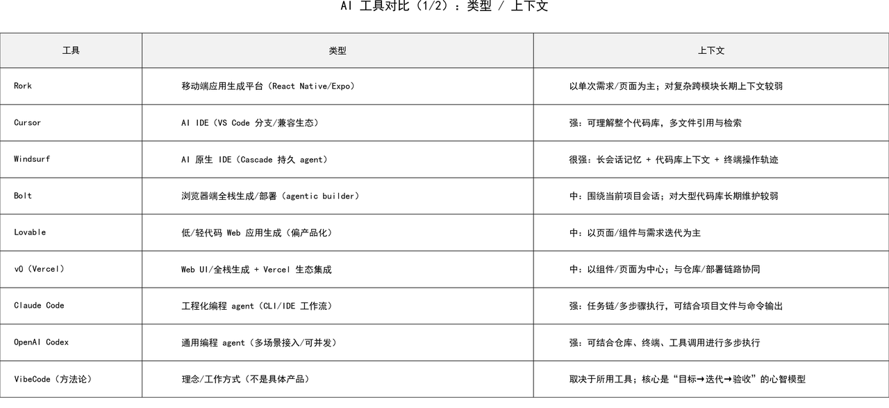
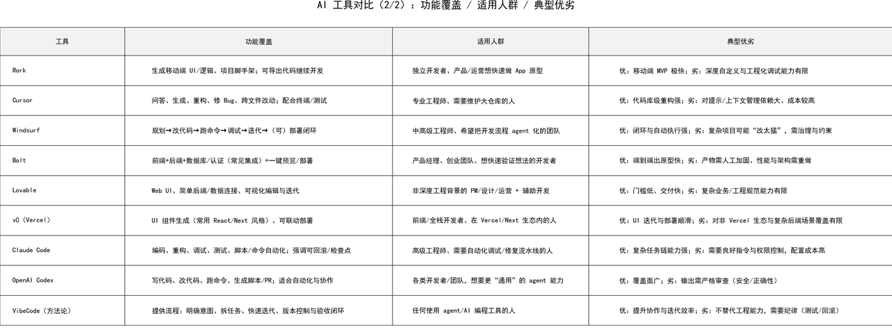
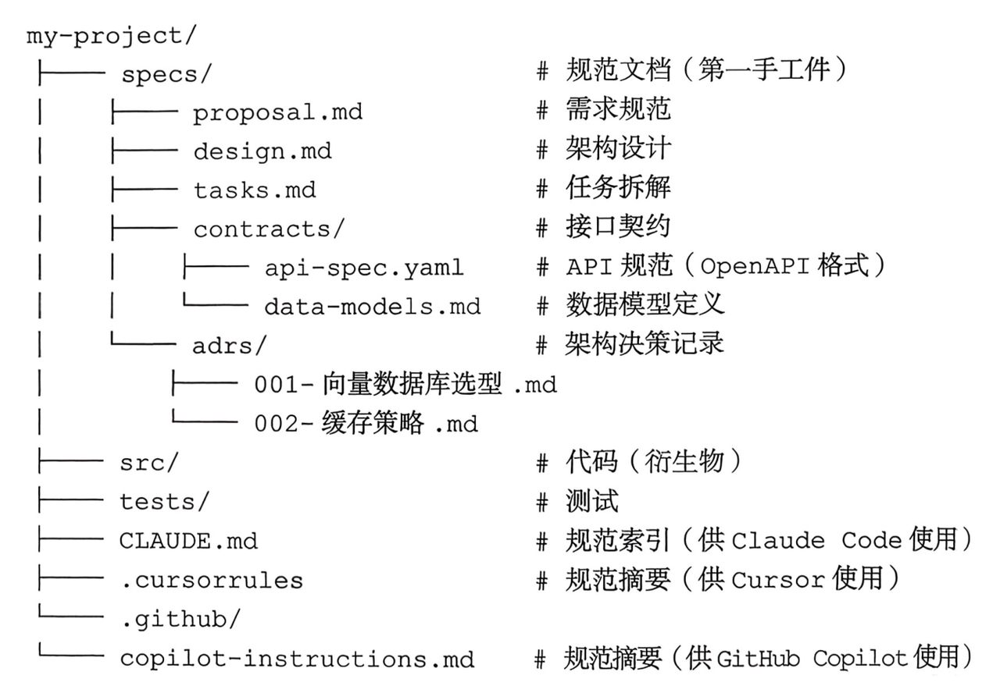

> **课时** 98/132　·　**AI 通用素养**　·　约 40–45 分钟
> [上一课：4.9 参考资源](../07-AI素养/21-4.9 参考资源.md)　·　[下一课：论文 · Agents](../08-论文算法/01-论文 · Agents.md)
>
> 学完标准：合上笔记，能讲清本节在问什么、你怎么答、以及如何套到自己的项目上。

---

## 5. Vibe Coding

Vibe Coding 已经是现在绕不开的趋势了。虽然本节归在了其它问题，但是我强调的本节其实也非常重要。

**面试的角度它很重要**：可以看到网龙面试环节问Vibe Coding的经验，我也遇到很多面试官会问你最喜欢使用哪个Vibecoding的 工具等，其实这些都是企业对于你的考察，因为在新的时代的来临，程序员的编程方式一定会发生变化，如何高效vibe code, 聪明使用AI工具一定是企业看中的，因此虽然他不是一个硬核知识考点，但绝对也是面试中热门的话题，这个问题答的好，一定是一个加分点。

**个人成长的角度上：**它也太重要了。现在谁不vibe coding呢？谁不会聊两句你是如何使用AI工具编程的呢？学会高效使用VibeCoding对个人成长必不可少。

所以本节内容其实很重要，而且这个内容甚至适合于任何人，你甚至可以是产品经理或者没有任何开发背景的人，因为VibeCoding极大降低了编程门槛。

本节会推荐5个Vibe Coding的视频，同时根据视频也整理成了文字精髓放在这个小节。看完本节，你会学习到Vibe Coding的推荐方法，行业发展/Vibe Coding的趋势。 相信本节内容也会给你带来灵感。

### 5.1 核心技巧

Vibe Coding的有5大核心基础：**思考，架构，节点，调试，上下文。**

#### 5.1.1 思考细致

在使用AI工具前，你需要仔细思考你到底想要什么。如果你自己都没想明白，你怎么能期望AI能够写明白？在我们vibe coding的时候都使用的自然语言，很容易没有想清楚我们到底想要一个什么样的产品，其实这个阶段是我们很好的仔细思考，提升自我的机会。必须仔细想清楚，想实现的目标是什么，它应该怎么实现，需要哪些条件和能力，他要遵循什么样的规则，它的流程是什么。 将问题想清楚，再以自然语言的形式描述给AI。

#### 5.1.2 明确架构

      我们使用VibeCoding的时候，几乎一定有现成的架构或者类似的任务的。我们需要让AI遵循指定的架构，或者使用指定库，这样效果一定会比让他从头完成更好。我们需要给AI指明一个方向。比如，对于一个浏览器应用，你可以明确它使用React前端，CSS和HTML JavaScript前端。

（如果你不知道采用哪种架构，没关系，可以先让AI给你提供一些可能的方向，然后以学习的心态去学习，确定好对应的架构，可以在vibecoding的时候同时进行学习）

####    5.1.3 做好版本控制

系统可能崩溃，所以始终做好版本控制和节点管理。

####    5.1.4 调试

通常在Vibe Coding中，最快修复问题的方式是指出问题，让AI自己修复。但有时可能会遇到一些问题，AI并不能很轻易地解决，这时就需要我们对系统有一个问题更深入的理解，缩小范围，推测可能的原因帮助AI解决问题。

####     5.1.5 提供上下文

你提供更多的细节，信息，上下文，你的AI的输出就会越好。这些信息包括，具体的产品文档，你的环境，你的倾向，示例，或者是更加精心打磨的上下文，这些都能够帮助AI取得更好的效果。

### 5.2 建议

1. 总是先完成一个最小可以运行的产品，然后再迭代，增加更多的feature.
1. 在你使用AI coding的时候，一般只有两种模式，你要么是在添加新feature，要么是在调试错误。添加新feature时，记住提供更多的信息，明确架构，给出有明确细节的参考文档，增量修改，做好版本管理和控制。当你在调试的时候，记住弄清楚系统是怎么运行的（如果不清楚，就问AI），给出尽可能多的信息，想想如何能让AI解决这个BUG。
1. 给出全局的约束。这个有点像将要求放在系统提示词中，让AI Coding的时候总是遵循某个规则，比如尽量少的改动代码，以xx的规范来完成。
### 5.3 不同Vibe Coding工具对比

### 5.4 参数视频

不好意思，这一小节推荐的视频都是英文的，确实找到的一些很好的教程都是英文的。如果英语差，视频下方可以点CC把字幕打开，另外很多AI工具比如Github copilot中，可以把视频链接丢进去给它总结，另外我自己本节的内容，也是对这些视频的内容做了一个总结。

**Tina Huang老师**

是一个很知名的老师了，之前也推荐了很多她的视频。她的这个视频总结了vibe coding的5大核心技巧：思考，架构，节点，调试，上下文，并给出了一些建议，视频中展示了她如何vibe coding的一个实战。对应笔记5.1和5.2

https://www.youtube.com/watch?v=iLCDSY2XX7E

对比了2026年不同的vibe coding工具，主要是用的一些国外的工具：Windsurf, Bolt, Cursor,Rork,Claude Code, Cursor 等，了解这个是因为其实我们需要对不同的工具特点有一些了解和对比，思考。这也能反映我们在聪明的使用AI工具。这个问题其实在面试中也涉及过几次了。这个视频像一个茶话会，就是以夯到拉的形式给AI Coding工具打分，**大致有个印象就行了**。可以**大概看一下**5.3 或者视频，避免面试过程中面试官问你用过哪些Vibe coding但是你啥也没用过，只能说出一个的情况就好了。

https://www.youtube.com/watch?v=ud0bv2J3xWY

**Claude Code 的使用：**

这个视频是中文的，Claude Code作为最火的AI工具之一，是值得学习和使用的。不过确实CC相比于很多AI工具，是有一定上手门槛的，使用命令操作，并不是很直观。如果想要学习Claude Code, 可以看这个视频，里面讲了如何配置，常见的用法和命令：包括CC使用MCP, Subagent, SKILL, Checkpoint，不同的模式等。

[嵌入内容](https://www.douyin.com/jingxuan?modal_id=7599230984264879375)

**Vibe Coding趋势：**

Y Combinator的演讲，建立Vibe Coding 宏观视角，理解时代趋势和核心竞争力。

https://www.youtube.com/watch?v=IACHfKmZMr8

**10分钟去学会Vibe Coding：**

快速上手实战项目，通过一个10分钟实战项目通过Vibe coding 写出一个例子，并且还讲了如何通过这个变现，适合新手小白。

https://www.youtube.com/watch?v=-LFB8D9WV-g

### 2.5 SDD开发工作流

真题来源：[2026年10月字节一面](https://my.feishu.cn/docx/GikId1snboM6LyxxGPXc0kDdnub#doxcngfFzn3Bi9iO4I11TAqdd7g) · [第7组原题](https://my.feishu.cn/docx/GikId1snboM6LyxxGPXc0kDdnub#doxcnlGEfnzRyxO1gepT9SWsUJe)

**1 你平时使用 AI Coding 工具的完整开发工作流是什么？有没有更native的工作方法**

**💡 答题思路**

这一组问题也是没有标准答案的开放性问题。不过，可以从我们介绍的 [Claude Code 使用技巧](https://my.feishu.cn/docx/GikId1snboM6LyxxGPXc0kDdnub#doxcnqvHgjaQ4xtYg3D7xewcllf)的角度来回答：主动压缩上下文、走错方向时使用 rewind、用工作文件保存计划和进度、通过项目规则与 Skill 沉淀经验等，这些都可以作为切入点，结合自己的实际使用经历展开。

然后面试官问的第 2、3 题 完整的工作流和更AI Native的方法，我借这个机会给大家分享一个角度，可以给面试官讲SDD的开发流程。

SDD：Spec-Driven Development，规范驱动开发。在AI vibecoding时代，代码就是文档，文档就是代码。维护一个很好的文档，可以让每一次AI能够快速理解当前做到了哪里，如何继续，让人能够更快的理解代码（只用看文档就行了），同时在团队内部的交接也更容易。比如你写代码写了一半，如果没有详细的文档，别人拿着你的项目不知道如何上手，并且他用他的AI继续开发，很可能不是朝着你设计的思路继续的。如果我们能把Spec写的很规范，人和AI都利于阅读，交接。现在有专门的书籍，比如《SDD实战规范驱动开发之道》 - 黄佳 讲这个，如果做的很正规，甚至Spec要写到CI/CD流水线中。想了解更多细节，可以看看书籍。

回到这个问题2和问题3，我觉得可以从SDD的角度来说，告诉他你如何组织Spec的结构，使用哪些小技巧（比如定义维护检查Spec), 如何做版本管理，如何更新文档。

**🎤 参考答案**

（**我想通过这个长一点的回答，把整个链路核心要点讲一下。现场回答需要精简一点。**）

我想分享一种我比较认可的 AI Coding 工作流，就是 **SDD，Spec-Driven Development，文档驱动开发**。核心不是让 AI 多写文档，而是把需求、设计和验收标准沉淀成明确的规范，让人和 AI 围绕同一套依据开发。

这样做的好处是，开发不再依赖某一次聊天记录。换一个会话、换一个 AI 工具，或者交给另一位同事，都能知道项目要做什么、为什么这样设计、目前完成到哪里，不需要重新解释，也能减少后续开发偏离原来思路的问题。

具体来说，**我通常会先整理项目的规范目录**。在根目录用 `CLAUDE.md` 做入口，放规范索引和必要的开发规则；在 `specs/` 下，用 `proposal.md` 描述需求、范围和成功标准，用 `design.md` 描述架构和模块职责，用 `tasks.md` 拆解任务、依赖和验收条件。接口契约、数据模型和重要技术决策，也会根据项目复杂度单独组织，通过引用关联起来，避免同一份内容到处重复维护。

*来源：《SDD实战：规范驱动开发之道》，3.4.1「目录结构约定」，书内第 62 页*

**文档写出来以后，还要持续检查它们是否一致。** 我会配置 Hook，让一轮文档修改结束后自动触发检查：先用脚本检查格式、引用等确定性问题，再接入 AI 审查，检查需求有没有对应的设计、设计有没有落实到任务、任务有没有明确的验收标准。发现冲突，要指出具体位置和原因，再修正；涉及需求和架构取舍的地方，由我确认。Hook 负责触发检查，并不意味着它天然就能判断文档之间的语义是否一致。

进入开发后，我会让 AI 先读取当前任务关联的规范，再分步实现。每完成一个任务，就对照验收标准运行测试、更新进度。如果发现规范有缺陷，先反馈并修正规范，而不是让它在代码里临时绕过去。

后续迭代时，**我会先判断变更影响到哪一层，从受影响的最上游开始修改。** 比如新增功能改变了需求范围，就先更新需求，再同步设计、接口和任务，最后实现代码、补充测试并做回归；如果只是调整技术方案，就从设计层开始。普通的实现 Bug，如果需求和设计都没问题，直接修代码、补测试即可，不需要每次都重写整套文档。

版本管理上，我会把规范和代码放在同一个 Git 仓库中。**每次完成一个 feature，我提交的不只是代码，也包括同步更新的需求、设计、任务进度，以及测试内容和结果。** 这样交接时，别人不仅能看到我改了什么，也能知道为什么这样改、有哪些架构约束、验证过哪些场景、还有什么没完成，以及下一步如何继续。他也可以让自己的 AI 读取这些文档，在同一套依据上接着开发，而不是重新猜测我的设计意图。同时，代码、规范和测试记录对应到同一个版本，也方便后续回到当时的状态，重放开发过程、复现问题和追溯决策。当前文档保留当前有效的内容，历史交给 Git；重要技术决策则通过 ADR 保留背景和理由。

我觉得这套方法更 AI Native 的地方在于：**不是靠人反复给 AI 补上下文、催它继续，而是把上下文、执行依据和验证机制组织成可持续运行的工作流。** 人主要负责目标、边界和关键决策，AI 围绕规范执行，再通过检查和测试反馈修正。这样既方便长期迭代，也更容易交接和追溯。

---

### 2.6 面试真题

真题来源：[2026年10月字节一面](https://my.feishu.cn/docx/GikId1snboM6LyxxGPXc0kDdnub#doxcngfFzn3Bi9iO4I11TAqdd7g) · [第7组原题](https://my.feishu.cn/docx/GikId1snboM6LyxxGPXc0kDdnub#doxcnlGEfnzRyxO1gepT9SWsUJe)

**1. 平时使用 AI Coding 工具开发时，遇到过哪些问题？**

**2. 你平时使用 AI Coding 工具的完整开发工作流是什么？**

**3. 有没有更 AI Native 的做法？**

解析见上文「2.5 SDD开发工作流」。
