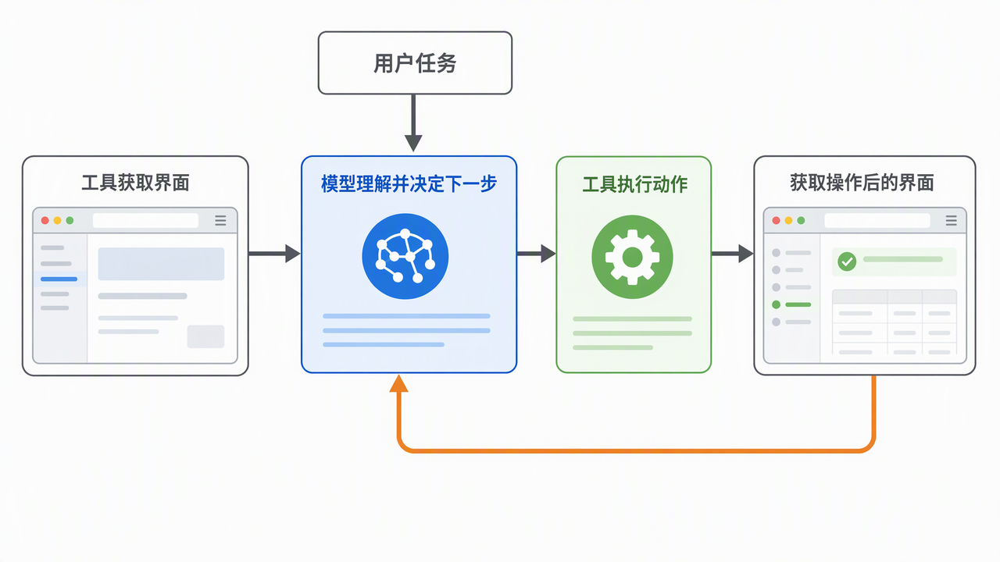
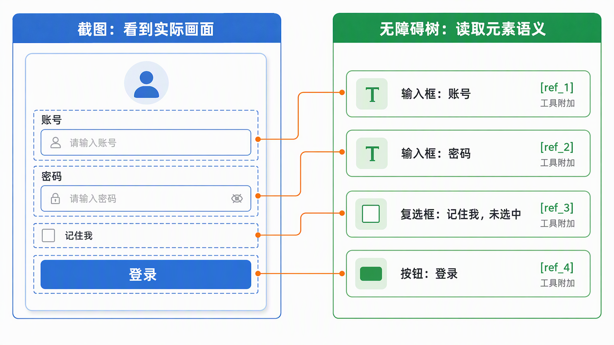
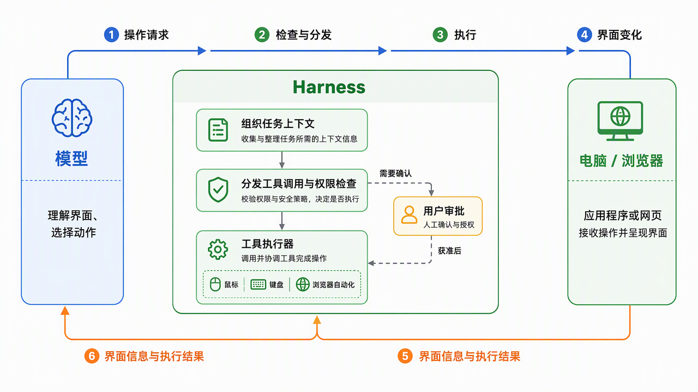
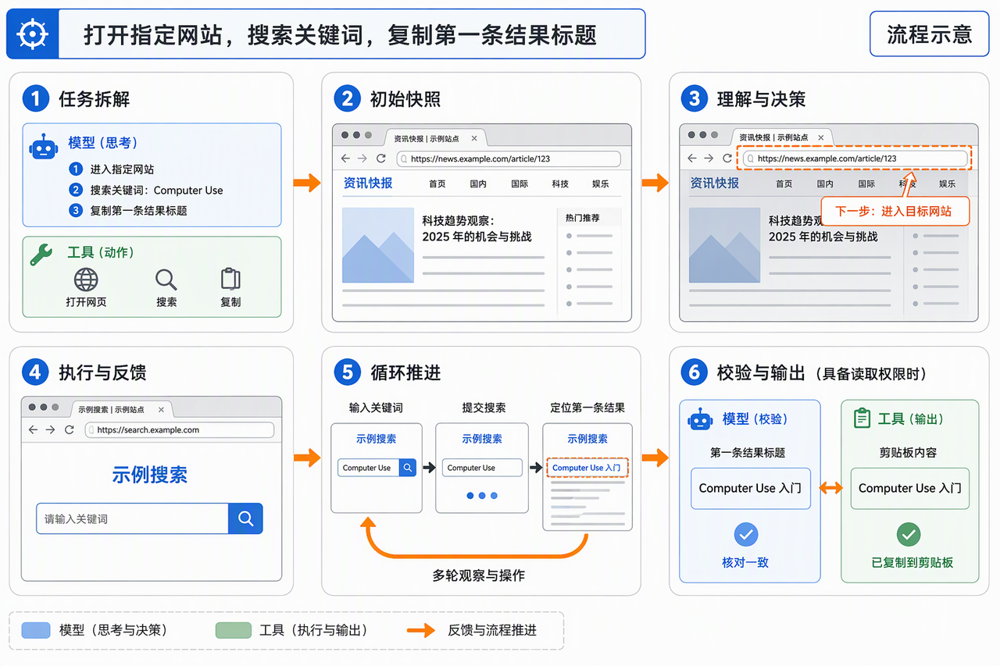
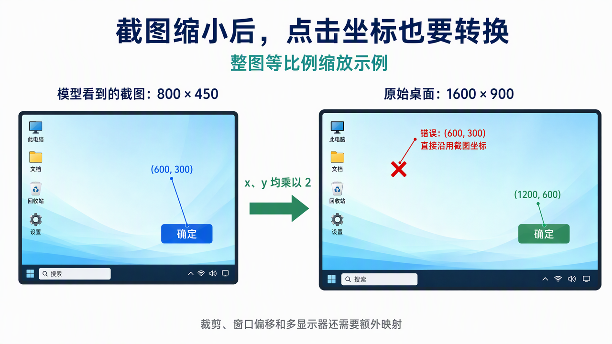

> **增补课时**　·　**AI 通用素养**　·　约 1 小时
> 同步自飞书原文 2026-10 更新：Computer Use
>
> 学完标准：合上笔记，能讲清本节在问什么、你怎么答、以及如何套到自己的项目上。

---

## 6 Computer Use[按需学习]

### 6.1 前言

更新这一期问题的灵感来源自[2026年10月字节秋招大模型开发一面的面试问题](https://my.feishu.cn/docx/GikId1snboM6LyxxGPXc0kDdnub#doxcngfFzn3Bi9iO4I11TAqdd7g)，面试官问： **Computer Use 操作本地电脑的大致实现机制是什么？是否了解操作本地电脑和操作云端电脑两种方案？**

对于Computer Use这个概念，不算高频考点，除非面试官就是对此比较感兴趣，一般不会问。

**学习本章的意义:**

1. 这确实是一个很实用的操作，如果掌握了它的原理，你在使用AI工具让他进行computer use的时候，会更加顺利。

2. 学习Computer Use的实现过程，有助于我们**从模型和Harness两个角度**，理解大模型相关知识点。有助于你更理解Agent是怎么运行的。

3. 即使面试官不常问，但这也偶尔被问到吗？另外它不问，学会了在某些场合你也可以自己主动印出来这个点，和面试官讲解，也可能会在一些面试问题上给到你答题灵感。

总之：**此内容不是必学高频考点，但学了肯定对你有帮助。**

---

### 6.2 什么是 Computer Use？

借用 Anthropic 官方对 Computer Use 的介绍：

> developers can direct Claude to use computers the way people do—by looking at a screen, moving a cursor, clicking buttons, and typing text.

也就是说，**AI 可以像人一样使用电脑：观察屏幕、移动光标、点击按钮，以及输入文字。**

更具体一点，在启用 Computer Use 后，你可以对 Claude Code 说：“请帮我打开浏览器，找到 Anthropic 官方对 Computer Use 的介绍，并把定义部分截图保存下来。”你会看到它打开浏览器、输入搜索词、进入官网、找到相关段落，再完成截图和保存，就很真人的操作电脑一样。

---

### 6.3 实现机制

其实，OpenAI 和 Anthropic 官方都介绍过 Computer Use 是如何实现的，可以参考 Anthropic 的 [《Developing a computer use model》](https%3A%2F%2Fwww.anthropic.com%2Fnews%2Fdeveloping-computer-use)、[《Computer use tool》](https%3A%2F%2Fplatform.claude.com%2Fdocs%2Fen%2Fagents-and-tools%2Ftool-use%2Fcomputer-use-tool)，以及 OpenAI 的 [《Computer-Using Agent》](https%3A%2F%2Fopenai.com%2Findex%2Fcomputer-using-agent%2F)。它们介绍的核心机制可以概括为：

**观察当前界面 → 模型理解并决定下一步 → 工具执行动作 → 观察操作结果 → 继续循环。**



这个道理很容易理解，其实就和人去操作电脑一样对吗?

人通过眼睛获取屏幕，思考后决定是点击还是敲键盘，看到效果后继续思考下一步，如此循环。

接下来，我们就顺着这个顺序，把这每一步理解了。

**2.1 观察当前界面：如何获取界面的信息？**

人是用眼睛看屏幕，那模型怎么“看”到当前界面呢？其实不只有截图这一种方式。这里按照截图、读取无障碍树，以及两者结合这三种方案来理解。

**方案一：截图，让模型看画面**

最直接的方法，就是**由工具截取当前屏幕，再把图片交给模型**。模型收到的是真实界面的画面，后续再根据图片理解页面内容、识别按钮位置，并决定下一步操作。

比如要登录一个网站，程序先截取登录页面，模型看到图片中的账号框、密码框和登录按钮，再决定接下来要操作哪个位置。

**方案二：读取无障碍树，让模型读界面信息**

对于网页，除了截图，还可以**通过浏览器工具读取页面的无障碍树，把其中的结构化信息交给模型**。

**无障碍树可以理解为界面的“语义说明书”**，原本用于支持屏幕阅读器等辅助技术。它用树状结构描述页面里有哪些元素、分别叫什么、处于什么状态，比如“这是一个按钮，名称是登录”“这是一个复选框，目前未选中”。

比如，你让 AI 帮忙登录一个网站，工具读取登录页面的无障碍树后，将下面这样的文本交给模型。**这里是简化示意，不是固定的工具返回格式**；方括号里的编号是工具附加的元素引用，用于后续操作：

```
登录页面
├── 输入框：账号 [ref_1]
├── 输入框：密码 [ref_2]
├── 复选框：记住我，未选中 [ref_3]
└── 按钮：登录 [ref_4]
```



通过这份文本，模型就能知道页面上有账号框、密码框和登录按钮。结合用户的登录目标，它可以决定先向账号框 `ref_1` 输入账号，再向密码框 `ref_2` 输入密码，最后点击登录按钮 `ref_4`，并把这些操作请求交给工具执行。

所以，这种方式不需要模型先从图片里辨认控件、判断坐标，而是**通过读取无障碍树，了解当前界面，再决定下一步操作**。这份信息可以直接作为工具结果返回，不一定需要保存成一个文件。

> **思考｜为什么不直接使用 HTML 或 DOM？**

> 你可能会问：网页本身就有 HTML，也有浏览器解析、运行后形成的 DOM，为什么这里选择读取无障碍树，而不是直接把它们交给模型？

> 这本质上是一种方案的取舍。Anthropic 在[浏览器工具的安全建议](https%3A%2F%2Fplatform.claude.com%2Fdocs%2Fen%2Fagents-and-tools%2Ftool-use%2Fbrowser-use-tool%23security-considerations)中明确说：“build page reads from what the page renders (the accessibility tree or visible text), not raw DOM source”。意思是，应该基于页面渲染出的无障碍树或可见文字构建读取结果，而不是直接返回原始 DOM 源码，避免将隐藏文字交给模型。

> 对于找按钮、填表、点击这类任务，无障碍树提供的角色、名称、状态和工具附加的元素引用，也更贴近模型当下需要的信息。因此，这类场景优先使用无障碍树更合适；**不是模型看不懂 HTML，也不是 DOM 不能用**。如果任务变成分析页面代码或排查元素结构问题，HTML 或 DOM 就可能更合适。**无障碍树也不能消除页面内容中的提示注入风险。**

**方案三：两者结合，既读无障碍树，也看画面**

这两种方式并不冲突，可以在同一个任务里配合使用。

比如，工具先读取无障碍树，让模型找到账号框和登录按钮；执行登录后，可以先读取新的无障碍树，检查是否出现成功或错误提示。如果还需要确认页面布局、按钮是否被遮挡等实际显示效果，再获取截图进行判断。

这里的“两者结合”并不是每一步都要同时读树和截图，而是**根据当前任务，按需选择获取哪一种信息**。

> **思考｜什么时候读无障碍树，什么时候看截图？**

> 你可能会问：读取无障碍树能完成的操作，模型看截图不是也能完成吗？为什么还要优先读树？

> 这有点像我们一直讲的：一个功能既能用 AI 做，也能用代码做，应该怎么选？相似的取舍思路是，**选择更直接、够用的方法**。不过，这里两种方案都需要模型理解，区别在于给模型什么信息，而不是要不要使用 AI。

> 对于找按钮、填表这类操作，无障碍树已经能提供**元素的名称、状态和工具附加的引用**，就不必先让模型从图片里辨认位置。对于典型网页，这通常能减少输入 token 消耗,同时效果也很好，处理速度更快。

> 如果任务是**判断图片有没有被裁切、按钮有没有被弹窗遮挡**，这是就可以用截图。

> 总结来说，可以记成：**能通过元素语义完成的常规操作，先读树；需要判断画面，或者树里没有有效目标，就看截图。两者结合是按需切换和使用。**

**三种方案的对比**

方案


优点


局限


适用场景


**截图**


能看到实际显示效果，不依赖页面提供可用的无障碍树


需要模型识别画面、定位目标；按坐标操作时容易受到布局变化影响


检查图片、布局、遮挡，或操作无障碍树未描述的画布、远程桌面等内容


**读取无障碍树**


直接提供元素的角色、名称和状态，可结合元素引用操作；典型网页通常比截图消耗更少的输入 token


依赖工具和页面提供有效的树；无法完整表达视觉效果，页面结构明显变化后引用可能失效


网页填表、查找控件、点击按钮、读取文字等常规操作


**两者结合**


读树定位控件，用截图检查画面，兼顾结构信息和视觉信息


需要判断何时切换；如果每一步都重复读树和截图，可能增加不必要的开销


既要完成控件操作，又要验证实际显示效果的任务


**2.2 理解界面并决定下一步：模型如何生成动作？**

当模型获取了信息后，下一步就是根据当前信息，推理决定下一步的动作。

模型首先要理解界面。如果输入的是截图，模型通过视觉能力识别界面内容、控件及其位置；如果输入的是无障碍树，模型则读取元素的角色、名称、状态和引用。两者提供信息的方式不同，但目的相同：**让模型知道当前界面是什么状态，有哪些可以操作的对象**。

接下来，模型需要结合**用户目标、相关的历史操作和执行结果**，判断任务进度，选择当前合适的动作。因此，模型接收的不只是界面信息，还包括任务上下文和可用工具的说明。它并不是每次看到界面就重新开始，也不是一次规划好所有动作后机械执行，而是**随着新的观察调整下一步**。

确定动作后，模型还需要定位操作目标：截图路线需要把目标对应到画面中的位置，无障碍树路线则可以利用元素引用。随后，**模型按照工具定义生成操作请求**，明确要执行什么动作、作用于哪个目标。

**2.3 执行动作：谁把模型的决定变成真实操作？**

**工具执行器负责将模型的操作请求落实为实际操作**，**harness 负责组织工具调用、分发请求和回传结果**。

执行时，程序先接收模型返回的工具调用，解析动作类型和操作目标，再分发给对应的实现。

具体怎么执行，取决于目标环境。对于桌面，可以将请求转换成操作系统的鼠标、键盘输入事件；对于浏览器，可以通过 Playwright 等自动化工具执行鼠标、键盘操作，或者将元素引用映射到实际控件后再操作。因此，执行器可以由脚本或其他程序实现，但这不等于整个任务都是提前写死的脚本：**每一轮要执行什么，仍然可以由模型根据当前状态决定**。

执行器还需要把目标对应准确。按坐标操作时，要保证**坐标与模型观察到的截图一致**；按元素引用操作时，要维护**引用与实际元素的对应关系**。请求落到错误的窗口、页面或已经失效的元素上，即使调用格式正确，也不能算执行正确。

另外，**模型提出请求，不代表它自动获得了执行权限。**执行侧需要校验参数和访问范围，**对需要确认的敏感动作保留用户审批**；遇到无效目标、权限不足或工具不支持的动作，应返回错误，而不是当成成功继续运行。



---

### 6.4 操作拆解

**3.1 完整流程：从任务输入到操作落地的六个步骤**

为了让前面的理论更落地，这里拆解一次典型的 Computer Use 操作流程。假设我们要让智能体完成这样一个任务：“**在当前浏览器中打开某个网址，搜索关键词，并把第一条结果的标题复制下来。**”

下面以截图驱动的操作方式，顺着这个任务走一遍。

**第一步：任务解析与目标拆解**

模型收到任务后，先梳理要完成的事情：进入指定网站、找到搜索框、输入关键词、触发搜索、读取第一条结果的标题，再复制到剪贴板。有了这份大致的步骤清单，后续每次观察界面时，模型就能结合任务进度，判断接下来该做什么。执行过程中，**这份计划也会随着页面状态调整。**

**第二步：初始环境快照**

智能体调用截图工具，**捕获当前屏幕**。这张图片让模型知道“我从哪里开始”：浏览器打开了什么页面，地址栏在哪里，窗口前面有没有弹窗。模型随后根据画面定位操作目标，生成与截图位置对应的动作。如果浏览器工具支持读取无障碍树，也可以按需获取页面元素的名称、状态和引用，辅助判断。

**第三步：状态理解与动作生成**

假设截图中，浏览器正停留在另一个网站。模型结合任务目标，判断应该先进入指定网站，于是找到地址栏的位置，**生成点击地址栏的操作请求**。随后再根据执行结果，继续安排网址输入和回车操作。

这些请求会按照工具规定的格式输出，包含**动作类型、目标位置和所需参数**，供执行器读取。这里，模型完成了从“看到当前页面”到“决定具体操作”的转换。

**第四步：执行动作并记录结果**

**Harness 将操作请求交给执行器**，执行器在电脑上完成对应的点击、输入和按键操作，并返回执行结果。系统再获取新的截图，让模型检查操作后的页面。

例如，输入网址并按下回车后，模型会查看网站是否已经加载完成。搜索框出现了，就可以继续输入关键词；页面还在加载，就等待后再观察；出现错误提示，则根据提示调整操作。**每次执行后的反馈，都会成为下一次决策的依据。**

**第五步：循环迭代直到任务完成**

接下来，智能体沿着同样的流程推进：找到搜索框、输入关键词、提交搜索，等结果出现后，再定位第一条结果的标题，完成选择和复制。整个过程会经历多轮“**截图—理解—决策—执行—再截图**”。

Harness 同时**保留必要的操作记录和阶段性结果**，帮助模型记住任务进度。例如，搜索已经提交，当前就该检查结果列表。任务较长时，较早的记录可以整理成摘要，供后续决策参考。

**第六步：结果校验与输出**

最后，智能体**按照用户最初的要求检查结果**：搜索词是否正确，选中的是否为第一条结果，标题是否完整。如果工具支持并获准读取剪贴板，还可以将剪贴板内容与页面标题核对。

检查完成后，智能体向用户反馈提取到的标题和复制情况；**遇到无法完成或无法验证的部分，也一并说明**。至此，这个任务从自然语言输入，经过多轮界面交互，形成了可以交付给用户的结果。



---

### 6.5 难点与困境

你可能看了上面的内容，觉得：哇，这个computer use的功能和原理其实也不难呀，我自己就能实现。截图-理解图片-推理下一步-调用调用工具，然后再循环就行了嘛，为什么现在的工具computer use的功能还不能说完全成熟了呢？

其实从模型层和Harness层，computer use仍然面临着很多技术挑战和难点，我来分别从Harness和模型两个角度，来讲解这件事的难点：

**4.1 模型训练层**

模型在常见界面上操作顺利，并不代表换一个软件、换一种布局后，仍然能做对。比如，同样是打开一个文件，在普通桌面上可能只需要双击图标；换成一个不熟悉的文件管理界面，入口、图标和交互方式都可能不同。模型需要根据当前界面重新判断，而不能只复用熟悉的操作顺序。

**这背后的难点是泛化。**训练中出现过的界面和操作路径是有限的，实际使用时却会遇到不同的软件版本、布局变化和异常状态。训练不仅要让模型学会常见操作，还要让它在界面变化后仍能识别目标、选择动作，在原来的路径走不通时调整策略。

同时，Anthropic的官方资料也表明了**屏幕理解、像素定位、操作推理，以及遇到障碍后的纠错重试** 这些都是在computer use方面，模型训练测需要处理的难点。

**4.2 Harness 层**

假设为了控制图像开销，程序先把桌面截图缩小，再交给模型。模型准确指出了缩小后图片里的按钮位置，但执行器直接把这个坐标用于原始桌面，鼠标就可能点到按钮外面。这时，问题不是模型没看懂，而是**观察和执行使用了不同的坐标系**。

Harness 需要组织**截图采集与执行器之间的坐标映射**，保证模型看到的位置能对应到实际操作的位置。单纯缩放整张截图时，按尺寸比例转换即可；如果还涉及窗口裁剪、系统显示缩放、窗口移动或多显示器，就需要同时处理**缩放关系和位置偏移**，不能只套一个固定比例。



包括还有很多难点：比如如果你发出的命令，让鼠标瞬移，那么很多软件会判定为异常操作，所以很多computer use做鼠标移动操作时，会刻意放慢速度，让这个操作过程看起来像人。同时在这种连续的截图，判断，调用工具的循环过程中，非常容易占满上下文，**如何优化管理上下文**，也是一个调整。

通过这些例子，你应该能感受到：很多技术**做出一个能跑通的 Demo 并不难，但要把它做成成熟、稳定、能够应对各种边界情况的产品，中间还有很大的差距。**

最后我们以Anthropic为例，从他们的公开进程宣布表明：**Computer Use这个技术一直在进步，但并未完全跑通**：

时间


公开节点


主要进展


2024 年 10 月 22 日


[新版 Claude 3.5 Sonnet 引入 Computer Use 公开测试](https%3A%2F%2Fwww.anthropic.com%2Fnews%2F3-5-models-and-computer-use)


模型可以根据截图生成移动鼠标、点击、输入等操作请求，再由开发者提供的程序执行。这时已经能跑通操作闭环，但官方明确表示，它仍然笨拙、容易出错。


2025 年 2 月 24 日


[Claude 3.7 Sonnet：更强的连续行动能力](https%3A%2F%2Fwww.anthropic.com%2Fnews%2Fvisible-extended-thinking)


官方将其中一种改进称为“action scaling”：模型能持续调用工具、响应环境变化，并利用更多交互步骤提高任务完成率。重点不只是第一步选得对，还包括走得更远、遇到变化后继续推进。


2025 年 5 月 22 日


[Claude 4 发布](https%3A%2F%2Fwww.anthropic.com%2Fnews%2Fclaude-4)


支持在扩展思考中调用工具，再根据结果继续推理，并改进指令遵循和借助外部文件保持任务记忆的能力。这些是通用 Agent 能力的增强，也为持续操作电脑提供基础，不是重新发明了一套点击机制。


2025 年 9 月 29 日


[Claude Sonnet 4.5：Computer Use 能力进一步提升](https%3A%2F%2Fwww.anthropic.com%2Fnews%2Fclaude-sonnet-4-5)


官方报告其电脑操作评测表现明显提升，并通过 Claude for Chrome 展示浏览网页、填写表格等任务。同批发布的上下文编辑和记忆工具，则从工程侧支持 Agent 运行更长时间。


2026 年 2 月 17 日


[Claude Sonnet 4.6：复杂办公任务与安全性改进](https%3A%2F%2Fwww.anthropic.com%2Fnews%2Fclaude-sonnet-4-6)


官方提到复杂电子表格、多步骤网页表单、跨浏览器标签页协作等场景的进步，同时提升对提示注入的抵抗能力。但也明确承认，模型操作电脑的能力仍落后于最熟练的人类。


2026 年 6 月 30 日


[Claude Sonnet 5：提高完成任务的能力与成本效率](https%3A%2F%2Fwww.anthropic.com%2Fnews%2Fclaude-sonnet-5)


官方展示了相较 Sonnet 4.6 更好的电脑操作成本—性能曲线：不只是追求更高的完成率，也关注完成同类任务需要多少计算和费用。


2026 年 9 月 28 日


[Claude Sonnet 5.5：继续改进长任务与图像理解](https%3A%2F%2Fwww.anthropic.com%2Fclaude-sonnet-5-5)


官方报告其长任务和图像理解能力进一步提升，并展示仅根据截图通关《宝可梦 红》的结果。这说明模型能在特定环境中持续观察和行动。


我们能看出，现在的Anthropic公司的Computer Use能力，仍然有待提升，其中主要瓶颈为：

**第一，能看懂界面，不代表每次都能选对动作、点对位置。** 模型仍可能生成错误坐标、选错工具或采取意料之外的动作；在小众软件、多个应用协同操作时，可靠性也可能下降。前面讲的陌生界面泛化问题，并没有因为某次模型发布就彻底消失。

**第二，能完成任务，不代表完成得足够快。** 官方仍将延迟列为限制，建议优先选择对速度不敏感的场景。结合前面的闭环就不难理解：如果一个任务需要反复截图、推理和执行，即使每一步都能做对，整个过程也可能比人操作更慢。

**第三，模型还不能可靠地区分“需要读取的内容”和“应该服从的指令”。** Computer Use 必须让模型接触网页、文档和图片，但这些内容也可能夹带恶意指令，诱导模型偏离用户目标。难点在于：既要让模型充分利用这些信息完成任务，又要避免它被其中的指令操控。模型训练可以提高抵抗能力，但目前仍不能彻底消除这类风险，因此还需要隔离环境、权限限制和人工确认来兜底。

---

### 6.6 面试问题

节选自[2026年10月字节秋招一面](https://my.feishu.cn/docx/GikId1snboM6LyxxGPXc0kDdnub#doxcngfFzn3Bi9iO4I11TAqdd7g)。

1. **Computer Use 操作本地电脑的大致实现机制是什么？是否了解操作本地电脑和操作云端电脑两种方案？**

**💡 答题思路**

**本地和云端 Computer Use的基本原理相同**，都通过“获取界面信息—模型理解并决策—工具执行—观察结果”的循环完成任务。**区别主要在执行环境**：本地方案操作用户电脑，云端方案操作云端的虚拟桌面。截图和鼠标、键盘操作由目标环境中的工具完成，再将结果交回模型。实际部署时，Agent 可以与云桌面一起运行，也可以通过网络连接远端执行器。

**🎤 参考答案**

我理解，Computer Use 本质上是让 AI 像人一样，通过观察界面、操作鼠标和键盘来完成任务。它的核心是一个“**观察、决策、执行、再观察**”的闭环。

首先，工具获取当前屏幕的截图，或者读取无障碍树，提供按钮、输入框等界面信息；然后，模型结合用户目标和当前状态，决定下一步操作，输出结构化的工具调用，比如点击某个坐标、向输入框填写文字。**这里不是模型直接控制电脑**，而是由外部运行框架，也就是 Harness，调度执行器，把请求转换成实际的鼠标、键盘事件，或者浏览器自动化操作。

执行后，再获取新的界面信息，让模型检查操作是否成功，并决定继续、等待还是纠错，直到完成任务。所以，它和写死步骤的自动化脚本不同，**后续动作可以根据界面的实际变化动态调整。**

具体部署上，可以分成本地和云端两种方案。**本地方案是在用户电脑上运行执行器**，获得授权后截取屏幕、操作本机应用，优势是能直接使用已有的软件、文件和登录状态，但也容易干扰用户操作，需要严格控制权限。

**云端方案则是在云端准备虚拟机、虚拟桌面或者隔离的浏览器环境**，由那里的执行器完成截图和操作。Agent 可以和环境部署在一起，也可以通过网络调用远端执行器。这种方式更方便隔离、重置和并发运行，但使用本地文件或软件时，需要额外打通访问。

两者的核心原理相同，主要区别是**被操作的环境在哪里，而不是模型在哪里运行**；无论哪种方案，**敏感操作都应该保留人工确认。**

---
