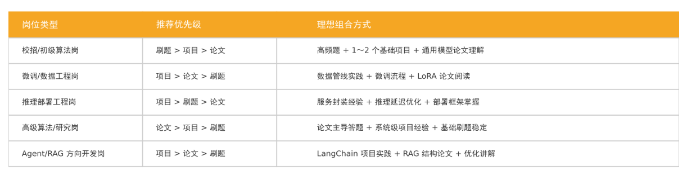

> **课时** 101/132　·　**面试技巧**　·　约 50 分钟
> [上一课：大模型算法0基础学习全记录 · 6 SKILL资源](../08-论文算法/02-大模型算法0基础学习全记录 · 6 SKILL资源.md)　·　[下一课：2. 你在项目中遇到的最难的问题，如何解决的？](../09-面试准备/02-2. 你在项目中遇到的最难的问题，如何解决的？.md)
>
> 学完标准：合上笔记，能讲清本节在问什么、你怎么答、以及如何套到自己的项目上。

---

# 面试技巧

##   1. 自我介绍

自我介绍是面试的第一流程，也是你给面试官的第一印象。 **请不要**讲流水账，把简历的内容照着说一遍。他并不是要关注你是谁，而是关注你和岗位的一个匹配度。 时间请控制在1分钟~2分钟， 时间非常短,  切忌讲废话，直接灌输他想要的答案。别说什么籍贯，爱好，别说什么 我很努力很认真空话虚话。**在有限的时间内灌输重点**。

参考模板：

1. **亮身份（学校/公司） + 核心标签**：eg. 我叫xx,我做过5年AI开发，我擅长Agent，RAG系统，熟悉常见的AI应用和框架，对模型前后训练，推理也有一定的实践。

 2. **用结果证明能力**：我用xx方法得到了xx提升。 使用我做的RAG系统，相比copilot 通用工具，回答的时间降低xx, 准确度提升xx。

 3.**体现诚意： **我了解过贵公司整个项目，我认为我的技术和它非常匹配，我也特别认可贵公司技术发展方向，特别期待加入这个岗位。

##   2.  反问

**核心逻辑**：

这个环节是为了

**弄清你是真的想来，还是只是随便看看**

**你的关注点，关注点的高度如何**

**思考能力：是否对岗位有深度思考**

**参考答案：**

针对不同的面试人员问不同的问题：

1. **业务主管**（通常是一面，通常面试官会是你的入职后的同事）：业务问题，岗位工作内容。比如：
  **团队的人员结构，人员组成，看看团队的实力如何，是大团队还是小团队**

        **上下游人员结构：**看看供需是否合理，哪个团队更有话语权，公司更重视什么。比如你面试测试，公司主要做黑盒测试，结果测试只有10人，却需要面对60~70个开发，那你可以看出测试工程师可能非常忙，而且公司不重视测试，可能测试也没啥话语权。

**   对候选人的期待，来了要完成什么任务**。

2. **大老板**（通常面试官会是你的+1， +2，通常是技术面终面，有的也叫主管面）： 公司战略，产品线发展。比如：
       面试业务，产品线，未来的规划，业务属性，是老业务还是新业务，通过这些问题判断下公司是否持续投入，别没几天这活就不做了。

1. **HR**： 薪酬，培训，福利，制度，晋升相关问题，比如
晋升窗口，培训机制（体现你想在这个公司长期发展而不是只考虑眼前）

薪资，社保，公积金其实不用着急，这些面试通过了在拉扯薪资的时候会详细聊

##   3.  简历编写技巧

书摘版放在下面，用来对齐「背景-目标-过程-结果」。2026 年 9 月新写的六步流程在[简历编写技巧](./03-简历编写技巧.md)，写简历时以那一课的步骤为主。

（第3小节和第4小节，摘选自清华大学出版社 《大模型工程师面试》 - 算法原理，开发实践与系统部署，基本是原文，有的地方我加了一些自己的见解）

###      3.1 简历设计原则

      一份大模型工程师简历的项目描述应具备结构清晰，要点明确，可读性强的特点，建议遵循"背景-目标-过程-结果"的四段式逻辑进行表述：

背景：简要介绍项目所属的业务场景，模型目标或者使用需求。例如，本项目旨在构建一个面向医疗文档自动问答的大语言模型系统，服务于某医疗机构的智能客服平台。

目标：明确技术目标或改进方法，如提升相应准确率，缩短推理时间，优化参数量等。例如，通过微调预训练模型，提升医学术语的准确率，实现私有部署。

过程：突出关键技术方案和工程实现细节，明确候选人责任的部分，使用的工具和面临的挑战。例如，负责样本构造与指令模板设计，使用LoRA进行参数高效微调，并基于FastAPI封装推理服务。

结果：量化结果非常关键，建议使用数据展示最终效果。例如，微调后模型在内部医学问答集上准确率提升15%, 平均响应时延降低至600毫秒。

这一结构有助于面试官迅速定位候选人的职责范围，技术能力与项目价值，避免信息冗余或模糊表述。

### 3.2 技术标签的提炼与对齐

技术标签的提炼与对齐是简历项目中非常重要的一环。简历项目需要显式体现与岗位匹配度较高的技术要素。对于大模型方向岗位，建议重点覆盖如下标签维度：

（1）**模型层面**：
 如 Transformer、BERT、GPT、GLM、Qwen、Baichuan、ChatGLM 等。

（2）**训练与调优**：
 如 LoRA、QLoRA、RLHF、SFT、Prefix Tuning、Loss 函数设计等。

（3）**推理部署**：
 如 LLM、Triton、ONNX、INT8 量化、TensorRT、FastAPI、Docker、K8s 等。

（4）**系统组件**：
 如 LangChain、RAG、向量检索、插件调用、多 Agent 协同等。

（5）**数据处理**：
 如分词、Token 控制、数据增强、Prompt 构造、语料清洗、HNSW 索引等。

（6）**工程工具**：
 如 PyTorch、Transformers 库、Weights & Biases、MLflow、Redis、MongoDB 等。

这些关键词既可以作为项目描述中的术语使用，也可以直接在简历中“技术栈”部分单独列出，便于简历筛选系统（ATS）或招聘者快速识别。

### 3.3 亮点挖掘与差异化展示技巧

面试官更关注的并非项目的“完整性”，而是候选人在其中主导了什么，有哪些独到之处，以及是否体现出技术判断力。

因此，需要在细节中挖掘亮点，打造技术区分度。具体策略如下：

（1）**介绍决策过程**：
 清晰说明选择某种技术方案的原因、对比过哪些方案，以及最终决策背后的技术判断。例如，为什么选择 LoRA 而不是全参数微调，为什么不采用多模态方案等。

（2）**展示问题解决能力**：
 详细描述遇到的技术难点与解决方法。例如，模型在推理阶段稳定性不足，如何设计优化策略来提升系统鲁棒性。

（3）**强调可复用性或通用性**：
 若项目成果具有通用价值或被团队复用，可作为重要亮点进行强调。

（4）**突出结果与影响力**：
 尽量用量化指标来体现项目价值。例如，模型部署后每日处理请求约 10 万条，平均准确率达到 92.3%。

### 3.4 常见误区与改进建议

常见误区与改进建议如下：

（1）**避免大而空**：
 不要使用“负责大模型微调”“参与多模态部署”等泛化描述。

（2）**避免工具堆砌**：
 仅列出工具名称而不解释其实际作用与价值是常见问题，需结合上下文说明使用方式与效果。

（3）**避免缺乏结果**：
 没有明确结果或指标的项目难以评估其价值，应尽量提供量化数据。

（4）**避免逻辑混乱**：
 过程描述过长但缺乏主线，容易让人抓不住重点。

改进建议包括：

- 多使用“设计”“主导”“实现”“优化”等主动表达，少用“参与”“协助”。
- 按“背景 → 问题 → 技术方案 → 结果”的结构进行描述。
- 明确区分个人贡献与团队成果。
## 4.  面试准备建议

### 4.1 刷题？论文？还是项目经验

面对大模型相关岗位的激烈竞争，许多求职者常常陷入一个关键抉择：应重点投入算法刷题，深耕学术论文，还是积累项目实践经验？

实际上，这三者在面试中的作用各有不同，适配的岗位类型、能力维度与评估标准也大相径庭。本节将从岗位匹配、能力增长路径与面试实效三个层面，系统剖析如何平衡选择刷题、论文与项目实践，制定最优面试准备策略。

#### **4.1.1 刷题**

算法刷题，尤其是针对 LeetCode、LintCode、牛客等平台的高频题，是求职准备中的经典环节。它主要面向以下几类考察目标：

（1）**基础数据结构与算法**：
 如数组、链表、哈希表、堆、栈、队列、树、图等。

（2）**算法思维训练**：
 如动态规划、二分查找、回溯剪枝、贪心策略等。

（3）**代码实现能力**：
 如语言熟练度、边界控制、时间与空间复杂度评估等。

在大模型方向，虽然刷题不像传统后端或客户端岗位那样高频必考，但对于以下情境仍具有重要作用：

（1）**校招 / 应届类算法工程师岗位**：
 仍以基础算法能力作为初筛门槛。

（2）**多轮面试结构化评估**：
 刷题能体现候选人的逻辑思维、编码能力与调试效率。

（3）**特定模块工程实现能力**：
 如稀疏矩阵计算、图结构建模、窗口滑动优化等。

因此，刷题并非大模型面试的核心，但作为基础训练，具备过滤风险、拉高下限、稳定输出的重要价值。建议每日保持 30–60 分钟算法练习，以巩固逻辑思维与编码熟练度。

#### **4.1.2 论文**

阅读、理解并复述经典大模型论文，是构建专业理论框架、展示对大模型认知深度的重要途径，尤其在以下面试情境中具有显著优势：

（1）**算法岗、研究岗、高级工程岗面试**：
 面试官往往会基于论文提问，如 Transformer、LoRA、RLHF、Constitutional AI 等经典论文所提出的算法与架构。

（2）**原理答题或开放式问答**：
 通过引用论文结构、图示与结论，可以显著提升答题的专业性。

（3）**简历项目延展问题**：
 当被问及某模型为何有效、为何选择某种优化策略时，引入论文机制能体现深度思考与行业同步性。

在实际面试准备中，建议分层次构建论文知识体系：

（1）**第一层**：
 Transformer、GPT、BERT、T5 等主流架构类论文。

（2）**第二层**：
 微调类（如 LoRA、Adapter）、训练策略类（如 Scaling Law）、对齐类（如 RLHF）。

（3）**第三层**：
 实际工作相关论文，如 RAG、Agent、Prompt 优化、多模态处理等。

论文阅读不是为了记忆细节，而是为了建立对模型行为、结构、设计的解释力与抽象能力。建议每周精读 1–2 篇，并形成结构化摘要笔记，便于面试引用。

#### **4.1.3 项目**

在大模型岗位的最终评估中，项目经验仍是最具权重的考察指标。相比刷题与论文，项目更能体现候选人是否具备“解决实际问题”的能力。其优势在于：

（1）**真实场景还原**：
 涵盖模型构建、训练调试、接口封装、系统部署、性能评估等全流程。

（2）**协作能力呈现**：
 展示候选人如何与团队对接，如何解决跨模块问题，体现团队适应能力。

（3）**创新与优化价值**：
 工程中解决过的非标准问题、引入的新技术组件、本地化部署技巧等，均为面试中可展开讲述的亮点素材。

企业在招聘大模型岗位时，往往希望候选人能立即参与业务落地，构建真实产品功能或支撑平台系统迭代。这使得有完整项目经历，尤其是端到端执行经历的候选人更具竞争力。

项目经验的准备策略应包括：

（1）选典型项目深挖讲透，不求多，但要逻辑完整。

 （2）形成一张项目结构图，让面试官快速理解任务边界。

 （3）围绕结果构建技术故事线，突出问题挑战、解决路径与最终影响。

 （4）结合代码仓库或在线演示，增加可信度与可展示性。

三者组合策略如下 1-6 所示。

最终目标是构建一个**基础能力稳定（刷题）**、**理论支撑扎实（论文）**、**工程实践落地（项目）**的三维能力体系。

概括地说，刷题、论文与项目经验并非对立，而是服务于候选人综合能力呈现的三大支柱。刷题提升思维与代码基础，论文构建技术深度与解释力，项目体现工程实践与业务关联。在准备大模型岗位面试时，应根据岗位类型与个人阶段匹配选择主线方向，并在三者之间形成协同优势，从而在技术深度与落地能力之间构建真正的竞争力体系。

# 其它问题

（这里来放一下我在面试中出现过的，但不是那么好归类的问题）

## 1. **Python 的异步方法是如何实现的？**

（其实Python语法在llm 的岗位问的不多，我也没有专门准备，但是这个问题确实是出现在了好几次面试中，所以我把它整理在这里，还是建议掌握这个问题。这个其实涉及到了**协程**以及具体的语法，第一次接触的朋友理解起来应该是会有点费劲的，不要着急寻求一次就能弄懂）

 Python 中最常见的方法是使用asyncio库，使用async 定义异步函数，然后在异步函数中使用await 来等待另一个异步操作完成。

### ** 1.1 异步方法如何通知事件完成？**

（作为上一个问题的延伸问题，这个也是京东二面被问到，我们在这里一起复习了）

**1.**** ****使用await 返回结果**

**2.** **使用Future/Task的set_result 或 回调**
