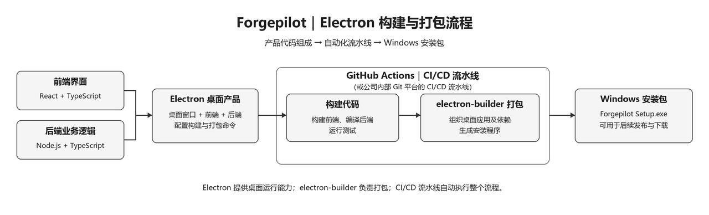
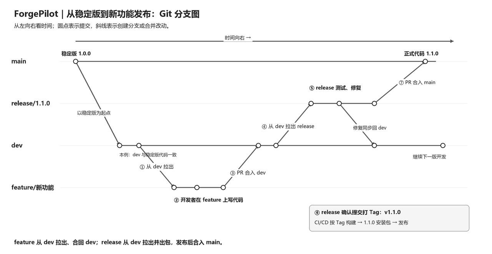
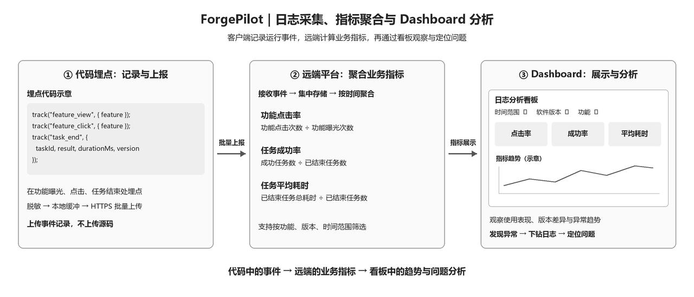

> **课时** 106/132　·　**面试技巧**　·　约 1 小时
> [上一课：ForgePilot 面试预测（上）](05-ForgePilot 面试预测（上）.md)　·　[下一课：面试实战 · 2025.10 安克创新](../10-面试实战/01-面试实战 · 2025.10 安克创新.md)
>
> 学完标准：合上笔记，能讲清本节在问什么、你怎么答、以及如何套到自己的项目上。

---

7.3.3.1.2.4 你在简历里提到“基于历史 Bug 与修复 PR 构建分层评估链路”，这是什么意思，具体怎么做的？

**对应简历以下描述，预测的问题：**

> 针对评审质量难以量化、误报漏报难以定位的问题，基于历史 Bug 与修复 PR 构建分层评估链路，以文件及代码区间匹配定位问题，再用独立 LLM Judge 补充语义判断；输出误报、漏报与根因命中分析，为评审策略迭代提供可回放依据。
>

**💡 答题思路：**

这道题出自对简历中“基于历史 Bug 与修复 PR 构建分层评估链路”这条表述的提问。**简历里的每一条表述，都是面试官提问的热门内容。** 我们要针对每一个描述，自己先想清楚：**这是什么意思？具体是如何做到的？先要说服自己，才能向面试官讲清楚。** 这里的“分层评估”“文件及代码区间匹配”“独立 LLM Judge”“误报、漏报与根因命中”“可回放”，都要能用具体做法解释，不能只记住这些技术名词。

**🗣️ 参考回答：**

这条讲的是**对 Agent 修复 Bug 中间过程的评估**，重点检查它有没有找到正确的问题位置和 root cause，而不是只看最后有没有修好。

因为最终测试不通过，可能是根因分析错了，也可能是分析正确但修改有问题。我们希望通过这套评估，把失败原因分清楚，再针对性调整。具体分四步。

**第一，用历史 Bug 和修复 PR 准备评估样本。**

把 Bug 描述、相关日志和修复前的代码交给 Agent，让它定位问题。我们根据历史修复 PR，结合代码和验证结果，整理问题位置与根因，作为参考答案。**参考答案只供评估使用，不提前给 Agent 看。**

**第二，先检查位置，再判断原因，形成分层评估。**

先用程序比对 Agent 报告的文件和代码区间，看它是否找到了相关位置。但位置对上不代表分析正确，所以再用独立的 LLM Judge，对照代码和参考答案，判断它说的是不是同一个问题、有没有解释清楚根因。有争议的结果再人工复核。

**第三，分析误报、漏报和根因命中情况。**

误报是提出的问题经核实并不成立；漏报是参考答案中已经确认的问题没有被发现；根因命中则是正确解释了 Bug 为什么发生。没有匹配上参考答案的发现，也会进一步核查，不能直接当作误报。

这样就能区分：**没找到问题、找到了但解释错了，还是根因正确却没修好。** 不同情况对应不同的改进方向。

**第四，保存样本和结果，支持回放复测。**

我们保存 Bug 输入、代码 commit、模型和提示词配置、工具调用记录，以及 Agent 输出和评估结论。调整检索或提示词后，再用同一批 Bug、同一个代码起点重新运行，对比结果。这里只改变要验证的策略，其他条件尽量保持一致。

所以，这套机制的作用是：**不仅知道 Agent 修复失败了，还能分析失败发生在哪个环节，并通过同一批案例复测改进是否有效。**

---

7.3.3.1.2.5 你在简历里写的“长任务执行可靠性”是什么意思？具体是怎么做的？

**对应简历以下描述，预测的问题：**

> 针对修复任务重复派发、构建失败后流程中断的问题，实现状态驱动的修复—构建—验证流程，以动作去重、并发控制和重试预算约束任务推进；失败时追加验证证据并按条件续跑原会话与原 PR，结合状态对账及中断恢复，减少重复执行和人工接管。
>

**💡 答题思路：**

这道题来自简历中的“长任务执行可靠性”。简历里的每一个描述都可能被追问，要先想清楚它是什么意思、具体如何做到，再向面试官解释。这里不是保证模型一定修好 Bug，而是说明程序如何管理整个修复流程：**任务按什么顺序执行，怎么避免重复，失败后怎么返修，意外中断后怎么接着执行。**

回答分四部分，与简历逐项对应：

1. **状态驱动的修复—构建—验证**：记录当前步骤，由程序根据执行结果安排下一步，而不是 Agent 说完成就算完成。
1. **动作去重、并发控制和重试预算**：同一请求或通知不重复触发动作，同一任务的分支不被多个 Agent 同时修改，自动返修不能无限循环。
1. **追加验证证据，按条件续跑原会话与原 PR**：把对应版本的报错和日志补充给 Agent，在已有修改上返修；区分代码问题与环境问题，并检查原 PR 是否仍可更新。
1. **状态对账及中断恢复**：服务意外中断后，核对构建等外部任务的实际结果，结合保存的任务、会话和 PR 信息继续执行，避免重复启动和人工重新派发。本题不展开主动取消处理，简历原句中的“取消恢复”建议同步改为“中断恢复”。
**🗣️ 参考回答：**

这里的长任务执行可靠性，主要是指 Bug 修复要经过修改代码、构建、测试，可能还要多轮返修。我们通过程序管理这个过程，避免重复派发任务，或者构建一失败就丢下任务，需要人从头接手。具体分四部分。

**第一，用任务状态控制修复、构建和验证的顺序。**

系统记录任务正在修改代码、等待构建，还是执行测试，并根据结果安排下一步。代码修改完成才能构建，构建通过才能进入后续验证，测试没有完成就不能报告修复成功。这就是“状态驱动”。

**第二，防止重复执行，并限制返修次数。**

同一个请求重复送达，或者同一次构建失败通知来了两遍，只处理一次，这就是动作去重。同一个任务也不能同时启动两个 Agent 修改同一分支，这就是并发控制。自动返修还会设置次数限制，例如最多两轮，仍然失败就停止并转人工，而不是无限重试。

**第三，失败后把报错补回原会话，在已有修改上继续返修。**

构建或测试失败后，我们把对应的代码版本、执行命令、报错和日志补充给 Agent，让它根据这些证据继续修改，而不是重新分析整个任务。如果原 PR 仍然打开、分支和权限也允许继续，就把后续修改提交到原分支，更新原 PR。若只是构建环境故障，则先处理环境问题，不让 Agent 盲目改代码。

**第四，意外中断后核对实际进度，从断点继续执行。**

例如服务重启后，系统里还记录着“构建中”，我们会根据保存的构建 ID 查询实际结果：已经成功就继续验证，还在运行就等待，失败了就进入失败处理，而不是重新启动一次构建。这就是状态对账。结合之前保存的任务进度、会话和 PR 信息，系统可以从合适的步骤继续，不需要人工重新整理上下文、派发任务。

---

7.3.3.1.2.6 你在简历里提到“基础工具与代码智能增强方案的对照评估”，具体是什么意思？你是怎么评估 Agent 修复效果的？

**对应简历以下描述，预测的问题：**

> 针对代码智能工具对自动修复的实际增益难以判断的问题，基于 SWE-bench 完成基础工具与代码智能增强方案的对照评估，比较代码检索、调用图及结构上下文对修复任务的作用；以测试验证补丁有效性，结合单任务成本、工具调用次数与执行轨迹形成质量—成本对照分析，为工具增强与修复策略选型提供依据。
>

**💡 答题思路：**

这道题来自简历中的工具对照评估。先说明：**我们建立了一套 Bug 修复评估集，通过增加或移除工具做对照实验，判断这些工具能否改善修复效果，以及增加的成本是否值得。** 再按照“准备评估集 → 对照与消融 → 测试验收 → 分析并选型”展开，既解释简历，也讲清 Agent 的评估方法。

这里按之前确定的口径，使用的是**借鉴 SWE-bench 方法构建的内部评估集**，不是直接声称使用了官方数据集。简历原句中的“基于 SWE-bench”应在定稿时同步明确这一含义。本题细化第 2 题的修复评估方法，重点回答工具是否有收益；第 7 题则通过定位与根因分析，帮助解释修复失败的原因。

**🗣️ 参考回答：**

这条主要是说，我们不确定给 Agent 增加代码检索、函数调用关系查询等工具后，是否真的能帮助它修复 Bug，所以建立了一套评估集，通过对照和消融实验，比较修复效果与成本，再决定集成哪些工具。具体分四步。

**第一，借鉴 SWE-bench 的方式准备评估集。**

从历史 Bug 中整理问题描述、相关日志、修复前的代码版本、运行环境和验收测试。Agent 根据问题描述修改代码，历史修复答案不提供给它。数据分为调试集和独立测试集，前者用于调整工具方案，后者用于最终验证。

**第二，固定其他条件，只改变工具组合。**

让同一个 Agent 使用相同模型，在同一批任务、代码起点和预算下运行。基础方案只提供文件读取、文本搜索、编辑和执行命令等工具；然后分别加入代码检索、调用关系查询、代码结构查询等能力进行比较。也可以从完整方案中移除某个工具，观察效果变化，判断收益来自哪个工具，而不是只比较两套完全不同的系统。

**第三，用测试判断补丁是否有效。**

Agent 生成补丁后，在对应环境中执行构建、缺陷验证和相关回归测试。既检查原来的 Bug 是否修好，也检查是否破坏了已有功能。按统一标准统计任务解决率，而不是让模型自己判断“修复成功”。

**第四，结合成本和执行过程决定工具选型。**

除了看修好了多少任务，还记录单任务费用、耗时和工具调用次数，并查看执行轨迹。例如，调用关系查询是否帮助 Agent 更快找到相关代码，还是增加了大量查询却没有改善结果。

最后根据这些对比，决定哪些工具值得保留、哪些需要改进，或者只在特定任务中启用。**调整的是 Agent 的工具组合，对比时使用的评估集保持一致。**

---

7.3.3.1.2.7 本地模型处理问题

**💡 答题思路：**

因为我们简历里明确写了，我们这个Agent项目接入了本地模型。融入了我们后训练项目。简历里写的很多评估，训练方法，可以完全套用后训练项目的内容，就不展开了。唯一要想清楚的是和后训练想不不一样的地方：就是该项目中使用本地模型干什么？**它的业务场景是啥，输入输出是啥？** 如果一开始的设计，我把本地模型的任务设置成了在解决bug之前，调用工具，搜集信息，产出结构化json字段。这个需求就完美和我们后训练项目适配了。

**🗣️ 参考回答：**

我们给本地模型的定位，是主 Agent 前面的一个**任务理解与信息补全层**。它不直接修 Bug，而是把 Ticket 和用户要求整理成结构化任务，判断还有哪些关键资料需要补齐，再由 Harness 组装上下文交给主 Agent。

它主要整理四类信息：**第一是任务对象**，也就是哪个工单、项目和仓库；**第二是问题描述**，包括实际现象、预期行为和已有复现线索；**第三是执行条件**，包括目标分支或版本，以及构建测试入口；**第四是用户约束**，比如只分析还是允许修改、不能改公共接口、不要新增依赖、暂时不要创建 PR。用户后续改口时，只更新被明确修改的字段，保留其他已有约束。

**第二层是工具调用和任务分流。** 我们为这一层设计了工单读取、评论和日志查询、项目与版本查询、代码检索及记忆召回等工具，模型通过多轮分析和工具调用补齐材料。当信息足以让主 Agent 开始工作，或者判断需要人工介入时，输出统一的结构化 JSON，包含 **Bug 单信息、仓库与版本、问题现象、复现线索、用户约束、信息缺口，以及是否需要人工介入和介入原因**。Harness 负责工具执行的权限与预算控制，并校验最终结果：满足条件就转到下层 AgentLoop，需要澄清就转人工；工具失败或达到循环上限则按规则回退，不无限等待信息完整。

**第三层是训练和本地推理优化。** 模型选用 **Qwen3-0.6B**。在已有结构化抽取实践中，**SFT 主要解决“能否按要求正确输出”**，包括固定 JSON 格式、字段归类、多轮状态继承和合法工具参数；**DPO 则作为偏好优化的对照尝试**，用于探索正确与错误候选之间的选择，例如信息不足时追问而不是猜测、保留已有约束而不是错误覆盖。实验中 DPO 没有体现出稳定增益，因此最终采用评测表现更合适的 SFT 方案，而不是默认叠加 DPO 就会更好。

推理侧使用 **llama.cpp** 本地部署，结合 **GGUF 量化压缩和前缀缓存**，分别减少模型资源占用和重复前缀计算，并通过回归评测检查质量变化。整体上，已有实验在解析质量和推理速度上都取得了改善，为 **0.6B 小模型承担受控的任务解析工作提供了基础**。迁移到 Ticket 场景后，再以字段正确性、约束保留、工具调用和人工分流的验收结果作为生产接入依据；不把原抽取实验直接等同于 Ticket 已经稳定上线。

**📚附录**

帮助你更具体理解，列出模型大概要搜集什么信息，申请哪些工具供参考。

**展开一：模型整理的四类信息**

**第一类是任务对象。** 包括 Ticket 编号、项目、所属组件和目标仓库。优先通过工单与项目配置解析；如果存在多个候选且无法确定，就向用户澄清。

**第二类是问题描述。** 包括实际现象、预期结果、触发条件、复现线索和日志引用。只提取已有事实并保留来源，不编造根因；缺少复现步骤不一定意味着任务必须停止。

**第三类是执行条件。** 包括分支或 commit、环境信息，以及构建和测试入口。需要查询配置并验证版本；如果没有现成测试，要明确标记，是否继续由任务规则决定。

**第四类是用户约束。** 包括只分析还是执行修复、允许修改的范围、是否禁止新增依赖，以及 PR 创建要求。需要正确处理否定、改口和局部更新，但用户意图不能代替系统授权或正式审批。

**展开二：可以申请的工具**

**第一类是工单资料查询。** 示例工具包括 `ticket.get`、`ticket.list_comments` 和 `ticket.get_related`，用于查询工单描述、补充评论和明确关联的工单。发现信息矛盾时记录冲突，不默认最新评论一定正确。

**第二类是附件与日志读取。** 示例工具包括 `ticket.list_attachments` 和 `ticket.read_attachment_excerpt`。先查看附件清单，再读取相关文本片段，并限制读取长度，不把全部附件塞入小模型。

**第三类是项目与版本查询。** 示例工具包括 `project.get_config`、`project.lookup_component` 和 `repo.resolve_revision`，用于查询组件到仓库的映射及工程配置，验证分支并解析代码版本。

**第四类是有限代码检索。** 示例工具包括 `code.search` 和 `repo.read_excerpt`，用于根据明确的错误码、符号或路径获取起步线索，以及读取工程说明。深度调用链分析仍留给主 Agent。

**第五类是项目经验召回。** 示例工具是 `memory.search`，用于召回有来源、经过验证且适用当前项目和版本的经验，并按权限过滤。

---

7.3.3.1.2.8 你如何对300+GB的代码仓库建立索引的？

**💡 答题思路：**面试官问这个问题是因为我们提到了，我们代码仓库很大，比如300+GB.使用的是GVFS仓库（也就是不会全量下载到本地的）。所以这个时候使用ClaudeCode本地处理肯定会失效。这是我们埋下的真实的痛点，面试官问这个问题很合理。

**🗣️ 参考回答：**

传统的 **Agentic + grep 全仓搜索方案，在我们的 GVFS 大仓库场景下不适用**。本地主要只有元数据，文件内容按需下载；grep 为了搜索而读取大量文件，会触发大量下载，延迟和资源开销不可控。如果只搜已下载的文件，又会漏掉大量代码。

所以我们设计了 **“远端共享索引 + 本地增量覆盖 + 按需读取”** 的方案，保留 Agent 多轮探索的能力，但不再依赖本地全仓扫描。

**远端主要建立两类索引。第一类是代码全文索引**，把文件路径、函数名、标识符和代码文本建立可检索的倒排索引，用来精确查找函数、错误码、配置项等，这是检索的基础。**第二类是语义向量索引**，按函数、类等结构切分代码，再生成向量，让用户用“登录失败后的重试逻辑在哪里”这样的自然语言，也能找到相关实现。

查询时，**精确关键词走全文检索，功能描述结合向量检索，再合并、排序，返回代码片段和对应版本**。我们优先复用已有企业搜索能力，通过检索插件接入，按需补充缺少的索引能力，不让每个开发者重复建一份全量索引

远端建索引当然也需要读取源码。**我们不是消除了获取代码的成本，而是把全量获取和建索引集中到服务端，供有权限的开发者共享**。后续按提交变化增量更新，而不是每次重新扫描整个仓库。

本地只补充分支差异和未提交修改，搜索时用本地版本覆盖远端旧版本，并屏蔽已删除文件。分析阶段优先从远端读取必要片段；真正需要编辑时，才通过 GVFS 下载目标文件，并核验当前版本，避免把主干代码误当成开发分支代码。

**核心就是：服务端负责全局找代码，本地负责当前修改，GVFS 负责按需取文件。**

---

###### 7.3.3.1.3 重点问题

**7.3.3.1.3.1 项目长期记忆短期记忆要存一些什么内容？**

**💡 **虽然简历没特别强调，但是属于面试官老喜欢问的问题的了。结合我们讲的理论基础：[Ageng记忆功能](https://my.feishu.cn/docx/GikId1snboM6LyxxGPXc0kDdnub#doxcnYmuFlAfnB0SzhB0UnSz7Ig)，先准备一下答案吧。

**🗣️ 参考回答：**

在 ForgePilot 里，我会把记忆分成短期和长期两层，**短期记忆解决“当前任务怎么继续”，长期记忆解决“后续任务有哪些经验可以复用”。**

短期记忆主要围绕当前研发任务保存：第一是用户的目标和约束，比如要修复什么 Bug、验收标准是什么、是否允许修改接口；第二是任务进度，比如已经完成复现、正在定位，还是等待测试和人工审核；第三是执行上下文，包括近期对话、工具调用结果、报错信息、当前代码版本和补丁引用，以及尚未验证的假设和待办事项。我们计划采用“**结构化任务状态＋近期对话原文＋早期摘要**”的方式管理，既支持任务中断后重建上下文，也控制 Token 消耗，而不是把所有聊天无限追加进去。

长期记忆则不存完整聊天，而是提炼四类值得跨任务复用的信息：**项目的重要约束和决策背景、经过验证的修复案例、有证据的失败经验，以及用户明确表达的协作偏好**。比如某个接口为什么必须兼容旧版本、某类并发问题之前如何修复和验证、某种方案在什么条件下失败，以及用户是否希望先确认方案再修改代码。

这些长期记忆要带上来源、适用项目、代码版本和验证状态。未经验证的模型猜测不会直接作为事实入库，密钥和一次性审批权限也不会作为可复用记忆。总体原则就是：**短期存准确、可恢复的任务现场，长期存经过筛选、有证据、明确适用范围的经验。**

###### 7.3.3.1.4 讲解视频

https://www.bilibili.com/video/BV1PReT6EEqR/?spm_id_from=333.1387.homepage.video_card.click

---

##### 7.3.3.2 智能发布助手（RAG项目改造）

###### 7.3.3.2.1 必考问题

###### 7.3.3.2.2 高频问题

**7.3.3.2.2.1 ****你的检索模块和存储模块选择的什么，为什么？**

**💡 **不光是因为简历里写了做了双路召回，所以我们特别需要准备。从RAG知识的重要性角度，RAG模块里面的双路召回的**向量选型，数据库选型，检索方法选择，都是高频考点。**

一定要提前想清楚，自己为什么选择这个技术，选型依据是什么？同时回答最好准备好有数据实验作为驱动，**任何选型，最有力的回答就是我做了xx实验，证明了它的合理性。**

**🗣️ 参考回答：**

我们选择 **BM25 + BGE 双路召回，OpenSearch 统一承担存储和检索**。

1. 因为 Windows 发布资料里有大量组件名、分支名和内部缩写，纯向量检索容易混淆相似对象，所以用 BM25 补充词面匹配；相比学习型稀疏模型，它不需要额外推理，更新成本低，分词和匹配问题也更容易排查。

2. 语义召回使用 **bge-base-en-v1.5**，因为我们主要处理英文短片段，不需要优先承担 BGE-M3 的多语言、长文本能力对应的模型开销；相比 Large，Base 模型更小、向量维度更低，适合作为成本可控的基线。

3. 存储选择 **OpenSearch**，主要考虑三个方面：

   - **搜索权重配置：** 发布信息分散在 Teams、Wiki 和 Outlook 中，计划经常变化。我们可以在内容相关的基础上，按更新时间调整排名，让近期的变更通知更容易被检索到，避免只查到旧计划。

   - **Metadata 过滤：** Windows 不同分支、版本的发布安排不同，我们可以按分支和版本限定检索范围，排除明确不适用的资料，避免内容看似相关，实际却属于另一个版本。

   - **统一承载两路存储和检索：** OpenSearch 同时支持 BM25 和向量检索，可以把原文、BGE 生成的向量以及元数据放在同一条记录里。相比“独立 BM25 索引 + ChromaDB”的方案，少维护一套存储，也减少资料更新、删除时两边不一致的问题。

**7.3.3.2.2.1.1 追问 这些选型有没有做实验对比？**

**💡 **这也是一个合理真实的追问。在202608阿里淘天秋招一面的问题中，就在技术选型后面追问，你是否做了实验。

我们的答题思路就是先回答我们的RAG项目的设计：

1. 模块化，做了全链路可视化和评估，这三个特性都是天然支持我们来做技术选型的实验对比的。
1. 以嵌入项链举例，说明真实实验选型过程。
**🗣️ 参考回答：**

**做过，而且方案对比一直贯穿开发过程。** 我们把系统做成了模块化结构，稀疏召回、Embedding 模型、检索后端和 reranker 都可以替换，RRF 的参数也可以调整。同时接入了 RAGAS 和可视化调试系统：RAGAS 辅助评估回答质量，可视化界面查看两路召回了什么、融合和重排后名次怎么变化。因此我们不是只看最终回答，而是通过测试和中间结果定位问题，再调整方案、跑回归对比。

比如嵌入模型选型，我们对比了 **all-MiniLM-L6-v2、bge-base-en-v1.5 和 bge-large-en-v1.5**，发现 MiniLM 虽然轻量，但更容易召回泛化的发布流程介绍，漏掉包含分支关系、合入截止时间和发布批次的具体记录；BGE Large 的检索效果在我们数据集上的表现，效果和 Base 几乎持平，但生成向量的成本却更高，计算嵌入向量和检索的时间显著增加；BGE Base 在检索质量和成本之间更均衡，因此最终选择了 **bge-base-en-v1.5**。

###### 7.3.3.2.3 重点问题

---

##### 8.3.1.2 ForgePilot上线问题

> **导读：**如果我们的项目上线了，要多考虑很多问题，比如**发布，版本迭代，管理，线上问题调试，如何线上监控**等等。其实这些内容不是我们面试Agent岗位的重点，但是如果我们说了项目上线了，这些内容我们要想清楚，多少面试官可能会和你聊到相关内容。我们必须对上线有一个基本的意识和概念，并且提前准备最基本的相关问题。以下**8个方面，就是面试官很可能围绕上线问题和你展开讨论的一些地方**。

> 同时，面试前突击章节，我们对三个项目都准备了上线系统的设计，当前的ForgePilot项目，[智能发布助手](https://my.feishu.cn/docx/GikId1snboM6LyxxGPXc0kDdnub#doxcnUcJslDa7B7iBWOzMGTVMLb)（RAG项目），[智能预约Agent](https://my.feishu.cn/docx/GikId1snboM6LyxxGPXc0kDdnub#doxcnNnECwATlNXnqR36Tml5khe). 通过这三个项目，我们也可以看出我们的项目上线的形式，规模，用户类型的不同，也直接影响着我们上线方案的设计。

**构建、打包与发布**

**1. 构建与打包流程**

**整体流程：****前端与后端代码 → Electron 桌面产品 → CI/CD 流水线构建与测试 → electron-builder 打包 → Windows EXE 安装包**。

- **前端界面（React + TypeScript）**：实现对话、任务、评审等界面，以及用户交互。构建后生成界面文件。
- **本地后端（Node.js + TypeScript）**：处理任务编排、工具调用、仓库操作等业务逻辑，在用户电脑上运行。
- **Electron 桌面产品**：提供桌面窗口和运行环境，将前端界面与本地后端集成为桌面应用。
- **CI/CD 流水线**：使用 GitHub Actions，或公司内部 Git 平台的 CI/CD 能力，自动执行代码构建、测试及打包命令。
- **electron-builder**：将构建后的界面、后端、Electron 运行环境及所需依赖组织为可安装的应用，生成 Windows EXE 安装包。
- **Windows 安装包**：用户下载并安装 ForgePilot，获得本地运行的应用；后续新版也通过安装包提供。
---

**2. 发布与下载**

流水线生成安装包后，将其上传至 **GitHub Releases、公司内部制品平台或对象存储**，获得下载链接。CI/CD 负责执行上传流程，制品平台负责保存和提供安装包。

用户可以通过两种入口获取软件，两种方式可以指向同一个安装包：

- **企业内部邮件通知**：说明版本号、更新内容，并附上安装包下载链接。
- **官网或内部下载页面**：展示版本号、更新说明和下载按钮。
**发布流程：****安装包上传至制品平台 → 邮件通知或下载页面提供链接 → 用户下载 → 安装或升级**。

---

**3. 安装后的使用方式**

同一个安装包包含前端界面、本地后端和 Electron 运行环境，可以提供两种使用入口：

- **桌面入口**：启动 ForgePilot，通过 Electron 桌面窗口使用。
- **本地浏览器入口**：启动本地 Node 服务后，用已有的 Edge、Chrome 等浏览器访问本地地址，例如 `http://localhost:7890`，加载同一套前端界面。
浏览器入口需要在产品中实现，并对依赖 Electron 的界面功能进行适配；不需要再下发单独的浏览器安装包。

这里的 **安装包下载链接** 用于获取软件，**本地界面地址** 用于安装并启动后的日常使用，两者用途不同。

---

**4. 更新方式**

可以提供两种更新方式：

- **用户主动更新**：通过邮件或下载页面通知新版本，用户主动下载新的 EXE 安装包，安装并替换旧版应用。仅发布新链接不会自动升级已安装的软件。
- **应用内自动更新**：接入 Electron 应用的更新能力，可使用与 electron-builder 配套的 **electron-updater**。流水线发布新版安装包及更新元数据后，应用在启动时或定期检查更新，自动下载新版，并在合适的时机提示用户重启安装，无需用户再到网站手动下载。
---

**5. 版本管理**

> **导读：**既然我们说我们的项目是上线的，怎么进行版本管理，迭代的，大概的思路和意识要有，万一聊到相关问题，不至于完全答不上来。

> 采用 **Git 分支分工 + 应用版本号 + Git Tag + 发布记录** 管理版本，组织开发与发布流程，并建立代码提交与安装包之间的对应关系。

**分支分工与合并流程**

以已发布稳定版 `1.0.0` 为起点，本例中 dev 与 main 的代码一致：

- **feature 功能分支**：开发者从 dev 拉出，例如 `feature/日志采集`，在这里开发和提交代码。功能完成后提交 PR，审核通过后合回 dev，未完成的改动留在各自的功能分支。
- **dev 开发集成分支**：汇集已完成的功能，进行集成测试，检查多个功能是否互相影响。准备发布时，确定本次发布的代码范围。
- **release 发布分支**：发布负责人从 dev 的确定提交拉出，例如 `release/1.1.0`。测试人员验证，开发者修复问题，不加入下一版新功能。验证通过后，在 release 的确认提交上打 Tag，由流水线构建安装包并发布。
- **main 正式发布主线**：保留已正式发布的代码，不用于日常功能开发。发布后，release 通过 PR 合入 main；release 上的修复也同步回 dev，避免下一版丢失修复。
**整体路线：****dev → 拉出 feature 开发 → PR 合回 dev → 拉出 release 验证修复 → 打 Tag 构建发布 → PR 合入 main**。

---

**6. 灰度发布**

正式项目中通常采用 **灰度发布**：安装包准备好后，不立即向全量用户推广，而是先让部分用户安装使用，观察运行情况和用户反馈。发现问题时，暂停扩大范围，及时修复或回滚；确认小范围使用没有明显问题后，再逐步向更多用户发布，最终完成全量发布。

灰度发布有多种实现方式。例如，通过在线更新服务和配置，自动控制哪些用户可以收到新版，以及每批下发的比例。这类方式适合用户规模较大、需要精细控制发布范围的场景。

我们的ForgePilot 定位于 **企业内部使用，用户规模约为几百名开发者**，因此采用更简单的 **分批邮件通知** 方式进行灰度，不引入复杂的在线比例控制机制：

- **先通知部分用户**：选择少量开发者或试用团队，发送包含版本说明、安装包下载链接和反馈方式的邮件，由用户下载安装新版。
- **观察反馈并处理问题**：收集使用反馈，检查核心功能和稳定性。出现问题时暂停后续通知，及时修复或按回滚流程恢复，验证通过后再继续推广。
- **逐步扩大通知范围**：小范围验证通过后，分批通知更多团队和开发者，持续观察反馈，最后向全体目标用户发送更新通知。
**整体流程：****安装包准备好 → 小范围邮件通知 → 观察反馈 → 逐步扩大范围 → 全量通知**。

---

**7. 回滚与版本恢复**

新版发布后发现问题，先停止继续推广，避免影响更多用户。如果问题严重、需要尽快恢复使用，则让受影响的用户先回退到旧的稳定版本；待问题修复并验证通过后，再提供新版本。

- **先停止发布**：暂停后续邮件通知，撤下异常版本的下载推荐；如果已开放自动更新，也暂停该版本的更新推送，并通知已安装用户。
- **紧急时回退旧版**：提供上一稳定版本的安装包和操作说明，让受影响的用户按说明重新安装。回退前确认旧版与本地数据、配置兼容，必要时先备份；暂停发布本身不会让已安装的软件自动回退。
- **修复后发布新版**：开发者修复问题，测试通过后使用新的版本号重新打包，例如将有问题的 `1.1.0` 修复为 `1.1.1`。先通知小范围用户验证，确认正常后，再逐步向其他用户发布。
**整体思路：****停止发布 → 必要时回退旧的稳定版 → 修复并验证 → 发布新版**。

---

**8. 日志采集与分析**

> **导读：**这个做法是最典型的上线后分析问题的做法，埋点，上传，聚合，分析。 我们这里先清楚这种行业标准的做法，至于埋哪些点，聚合了什么数据，如何分析解决的，这些具体的细节，我们应该在该项目的技术文档写好。但是在面试突击章节，我们先掌握原理就好了，在面试问题预测里面，相关的面试问题，结合该理论，构造一个细节且具体的答案就可以了。

> ForgePilot 在用户电脑上运行，通过 **关键环节埋点 → 日志上报 → 远端集中存储 → Dashboard 分析**，了解产品使用情况、定位问题，并辅助判断新版是否稳定。

- **关键环节埋点**：在任务开始、阶段执行、工具调用、任务结束及异常处理等关键位置记录结构化日志，便于关联一次任务的执行过程。
- **日志上报**：客户端将日志脱敏后，通过 HTTPS 批量上报到远端日志接收服务。网络异常时在本地限量缓存，恢复后重试，不影响正常任务执行。
- **远端聚合**：日志接收服务统一接收和校验各客户端上报的日志，集中存储到日志平台，供后续查询、统计和分析。
- **Dashboard 分析**：围绕使用情况、任务成功率、执行耗时、异常趋势和不同版本表现建立看板。灰度期间观察新版是否出现异常增长；用户反馈问题时，按任务关联信息查询日志，定位失败阶段，再下钻查看具体记录。
**整体流程：****客户端埋点 → 批量上报 → 远端日志平台 → 看板观察与日志查询 → 定位问题并改进**。日志查询仅向授权人员开放。

---

**9. 鉴权系统**

这个项目我没有设计专门的鉴权系统，也就是说整个产品对于所有人来说的都是可以用的，你可以直接下载客户端，任何人都能使用。

但是当系统运作起来，比如修复bug，要先去查找某个bug单，某个代码仓库，调用模型的时候（这些东西我会以工具的形式给到系统）。不管是没有登录，还是登录了没有权限，模型调用对应工具后，拿到结果后，都会提示给用户（让用户登录或者没有权限的提示）。

因为本身公司的代码，bug单都是和你的企业身份相绑定的，这样直接复用了企业内部的权限系统，不用自己管理，这也符合企业中真实使用的场景。

---
