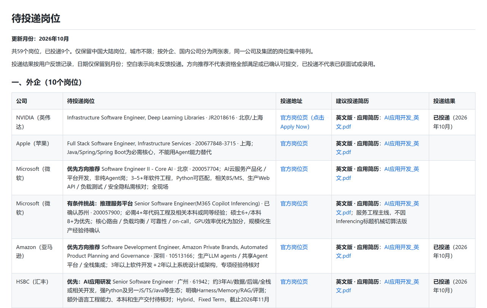

> **增补课时**　·　**面试技巧**　·　约 40–45 分钟
> 同步自飞书原文 2026-10 更新：简历投递技巧
>
> 学完标准：合上笔记，能讲清本节在问什么、你怎么答、以及如何套到自己的项目上。

---

## 3 简历投递技巧

我会结合自己的投递经历，分享常用渠道、用 AI 管理求职的方法，以及一些踩过的坑。核心想法是：**多找机会，但不要盲投；主动出击，但不要把找工作压缩成一次临时冲刺。**

找机会这件事，就是行情越不好，越缺机会，就越要用更多时间，搜索更多的渠道来去寻找。我总结了下面的渠道，发现其实各有优缺点，尽管最开始我觉得AI+官网搜索很好，强烈介绍给大家这个方法，亲测了以后，发现这种方法也有它的弊端。

建议还是各个渠道都使用起来，多留意。

### 3.1 投递渠道

我自己的体会是，求职不只是能力的竞争，也有信息差。同样的背景，多发现一些真正匹配的岗位，就多一些尝试的机会。

如果你觉得机会不够，不妨同时使用几种渠道，而不是只在一个软件里反复刷新。下面按渠道分别介绍，先讲我最常用的 AI 搜索及具体操作。

#### 3.1.1 AI 搜索

AI 搜索是我最想推荐的方法。我在 2026 年 9 月开始的这轮求职中，也用它来寻找岗位。它不只是帮我搜几个链接，还可以把岗位整理成清单，持续记录投递状态。下面接着讲我的具体做法。

我更推荐把 AI 当作一个持续协作的招聘助手，而不是用完一次就关闭的搜索框。

我的流程是：**说明背景 → 搜索岗位 → 补充查漏 → 整理表格 → 自己确认并投递 → 更新状态。**

这里说的“用 AI 投递”，主要是让 AI 辅助找岗位、整理信息和管理进度，不是让它未经确认就替我批量提交。岗位是否合适、用哪份简历、表单内容是否准确，最后都要自己把关。

**第一步：说明求职背景**

我会为求职单独建立一个文件夹，把背景说明、不同版本的简历和岗位清单放在一起。

背景说明里写清楚个人经历、擅长的方向、目标岗位，以及地点等限制条件。写在Agent.md或者claude.md的长期记忆里，因为以后基本上每次搜索，他都需要这些内容。

**第二步：搜索公司和岗位**

如果已经有目标公司，可以直接提出任务。比如下面这段是按“只看中国大陆岗位”组织的示例，使用时换成你自己的条件：

> 请搜索谷歌、英伟达、微软、腾讯的官方招聘网站，寻找符合我背景和求职要求的中国大陆岗位。请给出公司、岗位名称、地点、岗位编号和官方投递入口；没有找到的公司单独说明，不要用海外岗位凑数。

如果还不知道有哪些公司值得看，可以先让 AI 扩展公司范围，再逐家查岗位：

> 请先找出在中国大陆有软件研发或 AI 业务、值得我关注的公司，再逐家检查官方招聘网站。不要只列我已经知道的几家，也不要仅凭公司规模判断岗位是否适合我。

我不建议只问一句“帮我找几个工作”就结束。更有效的方式是把范围讲清楚，再围绕搜索结果继续追问。

**第三步：补充查漏**

我自己使用时，会遇到 AI 找到了一些岗位，但搜索范围还不够完整的情况。这时可以追问，而不是默认第一轮就是全部结果：

> 请检查是否遗漏了其他城市、相近岗位名称或同一公司的其他招聘入口。请说明已经覆盖的范围，以及哪些页面无法访问或仍然不确定。补充结果时不要重复已有岗位。

我的原意不是让 AI 为了“多找几个”硬凑结果，而是让它真正扩大检索范围。找不到就是找不到，访问不了就说明，不要把猜测当成已经查到的岗位。

**第四步：整理岗位表**

我会让 AI 把结果写进“待投递岗位.md”，直接保留官方投递入口，方便自己逐个打开。

我的真实记录里使用了五列：**公司、待投递岗位、投递地址、建议投递简历、投递结果。** 岗位这一列还会记录地点、岗位编号、匹配方向和需要核对的条件。

下面是我实际使用的岗位清单。原文件按外企和国内公司分成两张表，记录了 59 个岗位、9 个已投递；这些数字是该文件 2026 年 10 月的记录，不代表所有岗位目前仍开放，也不代表已投递就获得了面试。

**第五步：投递并更新记录**

拿到清单以后，我会自己打开岗位页面，确认要求，填写信息，上传相应版本的简历。如果页面失效、地点不合适，或者存在明显不满足的硬性条件，也要让 AI 更新清单，而不是继续把它当成可投岗位。

投递完成后，可以这样告诉 AI：

> 我已经投递了某公司的某岗位，岗位编号是某某，时间是 2026 年 10 月，使用的是英文应用开发版简历。请更新清单；其他没有反馈的岗位不要改成已投递。

之后收到筛选结果、面试通知或面试反馈，也可以继续补充。这样 AI 才能逐步帮助你看清：哪些方向更有反馈，哪些简历版本需要调整，下一步该补岗位还是补准备。

这里的重点是持续记录，而不是靠几次投递就给自己下结论。怎样根据反馈修改简历，前面的“简历编写技巧—反馈修改”已经讲过，这里不再重复展开。

使用这个方法的**优点**： 你能够快速找到一些你都没想到的公司和岗位。比如我让AI搜索一下，发现什么西门子，宁德时代，美的，中国移动都有相关的岗位。如果你对某个公司特别感兴趣，可以快速地找到对应的和你匹配的岗位。同时AI帮助你管理整个投递的进度，方便追踪，分析。

**缺点：太麻烦了。**一个公司就得注册一个账号，同时需要填写很多表格，很多公司简历筛选不通过，连感谢信都没有，还要自己去查。最后是有一些官网上的一些岗位信息可能已经过时了。

#### 3.1.2 官网投递

找招聘官网时，可以尝试搜索“公司名 + careers”或“公司名 + 招聘”，再确认页面是否属于公司官方渠道。我身边也有同事通过官网投递外企，不过上面那个AI搜索的方法，其实就和这个方法重叠了。

#### 3.1.3 招聘软件

招聘软件方面，**国内最主流的，机会最多的应该就是Boss**.。**如果你关注外企，也可以把 LinkedIn（领英）纳入搜索范围**。

猎聘、前程无忧、智联招聘等，也可以作为补充。

#### 3.1.4 官方公众号

可以关注意向公司的官方招聘公众号，尤其留意与你的城市、岗位方向和招聘批次有关的推送。这样就不必每次都从零搜索，也可能在日常刷手机时发现合适的机会。

#### 3.1.5 社区信息

脉脉、小红书、牛客、LeetCode 等社区，也可以留意招聘或内推线索。

#### 3.1.6 HR

通常Boss上 有一些联系人是公司直接的HR，面试多了加了微信，微信列表中也有一些HR的信息，找工作的时候可以直接和他们大哥招呼，问问有没有合适的。

#### 3.1.7 熟人内推

如果能找到了解你的师兄师姐、前同事或朋友，也可以请他们帮忙看看岗位，再做内推。我更看重的是对方能否提供岗位信息、帮助判断匹配度，而不是单纯拿到一个内推码。大家如果找到我所在公司的合适岗位，我也愿意在能力范围内帮忙内推。

#### 3.1.8 猎头

**缺点:**

有的猎头可能喜欢两边骗，为了完成自己的业绩，不惜把你推向火坑。比如明明不是特别好的岗位，他为了劝你去，可以各种扭曲事实。另外对于社招，猎头推荐成功，可以拿挺大一笔费用的。企业可能把这个预算算在你的招聘成本上，对应着你要价可能就会有劣势。

**优点：**

他们手上的机会其实都是有效的，同时可以帮助你筛选岗位，甚至能给你提供一些面试真题，面试前的准备。

### 3.2 投递策略

**先用真实面试积累经验，再逐步推进最想去的公司。**

如果你很久没有面试，或者还没有面试过，我建议先从优先级稍低、但确实有可能接受的岗位开始。在真实面试里检查自己的表达、项目理解和临场状态，面完及时复盘，再逐步投递最想去的公司。

这比一开始就把最看重的机会全部投完更从容。但也不要为了练手，专门去面试已经确定完全不会接受的岗位，或者把“练习”变成迟迟不投目标公司的理由。

**投递前尽量了解公司招聘流程**

大部分公司都是有面评的，所以你面试了以后的面试反馈，这个公司的下一个部门面试你的时候会参考。

有些公司有冷冻期，比如大疆，投递了一个部门挂掉后，半年不能面试任何其它公司。

字节好像是半年1面挂了3次，半年内不给面试了。

英伟达据说是可以无限复活的，没有锁定期。

尽量了解更多信息，有策略地投。

### 3.3 时间安排

**校招：围绕自己的毕业年份，提前安排实习和正式招聘。**

校招同学就是卡时间节点，通常比如27年毕业，26年的3月就开始暑期实习投递。

25年年末开始准备，3月份尽量达到面试的能力，去面试，这时候岗位多，不要等到3月才开始面试暑期实习。

拿到暑期实习，按部就班，秋招，春招，不要太晚开始，是我的建议。

另外如果你要求更高，秋招时候准备有两份实习经历，那么就要更早规划了。

**社招：如果条件允许，长期看机会，不要只押一个月。**

我不建议等到必须马上离职、或者被迫找工作时，才第一次看市场；也不建议给自己设定一个很死的期限，比如“我一定要在某个月找到工作”。

更适合我的方式是把观察和求职的窗口拉长，比如在条件允许时，用 **3～6 个月持续留意机会**。因为现在**金三银四**也没那么明显了，不是说招聘的机会都集中爆发在某几个月。最适合你的那个机会，不知道在什么时候放出，所以给自己更长的时间留意机会，找到**合适的岗位概率更大。**

### 3.4 视频讲解

今天这期内主要介绍了我的一些个人经验，了解的信息，岗位投递的技巧。

如果你不想看文字，也可以看我的视频讲解把本节内容介绍一遍，顺便聊了一下我个人找工作时的一些趣事，感受等等。

https://www.bilibili.com/video/BV1BJnr6AEh2/?spm_id_from=333.1387.homepage.video_card.click&vd_source=144bec9c3f54e465073138bed788be1b

---
