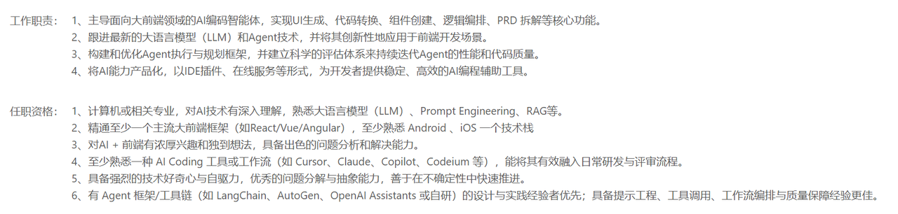

> **课时** 116/132　·　**面试真题实战**　·　约 50 分钟
> [上一课：2025.11 Deepwisdom · 2025.11 象映技术 · 2025.12 加速进化 · 2025.](../10-面试实战/09-2025.11 Deepwisdom · 2025.11 象映技术 · 2025.12.md)　·　[下一课：2025.12 阿里夸克千问](../10-面试实战/11-2025.12 阿里夸克千问.md)
>
> 学完标准：合上笔记，能讲清本节在问什么、你怎么答、以及如何套到自己的项目上。

---

## 2025.12 小红书

### 岗位介绍

### 反思

整个面试基本上围绕： **量化  +  Multi-agent框架 + RAG数据库 + 模型选型**上四个方面展开。

面评：对量化模型和结构有一定了解，但应用比较简单，技术和方案设计能力单薄了些。

其实面试官说的也没有问题，不过对于方案设计的题，我没有答出最优解，好歹也和面试官在讨论，说了一些解决思路，但是面试官还是无情挂了我，甚至是写题的机会都不给（小红书的面试，写题的界面都准备好了，但是最后他不让我写），挂的很坚定，可以看出小红书的要求还是挺严格的。

反思：

1.我一直和大家说的是，做RAG系统的时候，你就要把你的文档弄得复杂一些，用上专业的数据，而不是像我一样，用了一个简单的文档，没有啥复杂的召回策略，都没有专业数据库，这也是面试官觉得我的项目很简单的原因，大家在设计项目上就应该避免。

2.方案设计这一块，之前面试官问方案/架构设计的比较少，这块确实薄弱了一些。不过最近面试几个大厂，多少还是在讨论方案和架构设计能力的，这块需要我们针对于面试题，整理提升下，如果有好的架构的资料，到时候我也会分享，总之这次面试是一个很好的机会，提升对于多Agent 架构设计的思维能力。

3.我可以看出来，面试官对量化/推理这一块并理解不深，你看他也都是问的一些概念性问题，相反应用模块，都是问的比较深入和细致。 这个其实反映了，对于现在市面上既要求应用，又要求算法的情况，大家不用太慌张，因为通常应用岗位的面试官，他就是问算法相关，他懂得也不深入。所以我们大胆复习，先把推理加速/训练的框补起来，面试的时候大概就够了。你看我对于量化这块也不是专家，不算懂得特别多，但是面试官的反馈还是说我对量化有一定理解。所以推理/微调这块不要怕，先按笔记资料学起来，把一套流程跑通，面试自信地讲就好了。

### 一面

1. 自我介绍？

2.看机会的理由什么？

3.你的两个项目你觉得哪一个挑战更大呀？项目做了多久呀？

4.可以详细展开讲一下这个项目吗？

5.我停下来它的核心的功能还是比较简单的，但是你又跟上了做了微调/蒸馏/量化/推理加速的技巧，我理解目前主流的模型是都可以做到的？为什么你还有做微调呢？

（这个也是一个和项目相关的问题，不太涉及知识点，大家看看就好）

  这个其实是因为虽然主流模型完全可以完成相关功能，但是由于我的项目是要在资源受限的设备上（CPU）上去跑，所以需要加速推理速度同时不损失太大的精度

6.最终用了多少B的模型？

7.你是怎么做的量化的？

（说实话，我不能说对量化精通，这里我就是准备了自己做推理加速的一套方案，把这里的东西搞懂，去讲就好了，比如我总结的方案，**采用Q4_K_M,Attention层保持5-bit精度，FFN层压缩到4-bit，输出层用6-bit确保质量 **这几个关键地方弄清楚，一般其实应用的岗位面试官也不深入懂量化的，你回答到这里就差不多了，他也不会深入问和你问细节）

笔记部分  你的项目是如何做推理加速的？

8.量化的好处是什么，优缺点是什么？

（这个算是一个八股内容了，我总结在八股笔记量化部分。自己当时答确实可以答出来一些推理精度下降的问题，但是还是没有事后总结的答案好，因为现在我总结的答案，可以从**模型的结构，网络上深层次**地指出量化带来问题的原因，对于好处的总结也完整。所有有时问题虽然回答出来了，但是确实需要时候总结，反思，迭代出更好的答案，下次回答的更专业。）

  8.1 你说到量化会降低精度，那么降低精度会有什么问题吗？

   参考笔记  [量化的好处和坏处](https://my.feishu.cn/docx/GikId1snboM6LyxxGPXc0kDdnub#doxcnwYdsgL8xDERealRKbemLwe)

9.量化在KV - Cache中起到一个什么作用呢？

 （我觉得这两技术没啥太大联系，是两个不同的技术，我这么回答的，面试官也没反对。不过这两概念还是值得记一下，kv-cache和量化的定义，自己回答肯定答得没有这么专业。）

**KV-Cache **在 Transformer 推理中缓存 Key 和 Value，避免重复计算，提升长序列推理速度。

**量化**：降低**权重或激活的精度**，减少显存占用和计算量。它们是两种不同的优化技术，但它们可以结合使用，目的都是为了**降低资源消耗、提高推理效率**。

10. 说到模型，对模型来说，他会产生幻觉吗?

（这个问题用笔记部分如何减少模型的幻觉就够用了，这个笔记不光总结了幻觉如何解决，还总结了幻觉产生的本质）

参考笔记 [如何减少模型的幻觉](https://my.feishu.cn/docx/GikId1snboM6LyxxGPXc0kDdnub#FeVQdVbpLoKeFPxyjerckggNnzh)

11.多Agent 时，要怎么设计这个多Agent系统？

参考笔记 [6.1 设计多Agent的原则](https://my.feishu.cn/docx/GikId1snboM6LyxxGPXc0kDdnub#doxcnGvgXtj7F4xK9suRXYun3Tc)

12.你的项目中使用的是什么多Agent的一个架构？

13.如果说你的子Agent膨胀变成20个，或者说是50个，你应该怎么去优化呢？

  （这个问题我不太确定面试官想要的最终的答案是什么？这个问题其实就是在 多Agent的主管模式下，如果子Agent不断膨胀，那么这个Supervisor的压力可能会很大，这时如何解决，如果不知道什么是多Agent的Supervisor模式，请看这里：https://github.com/fzy2012/rhzl-Agentic-Design-Patterns-cn/blob/feature/interactive-website/13-Chapter-07-Multi-Agent-Collaboration.md。我的回答中，提出了使用Hierarchical的模式，但是面试官继续挑战这种模式如果一个分类错误，会导致后面都出错，然后我说可以分类的时候采用多Agent投票决策分类，加强分类准确性，面试官又挑战这样性能开销大，于是我说这个投票的策略可以是多个Agent并行的，但是面试官还是不满意，总之这题大家看到其实是面试官会不断和你探讨架构设计上的问题，需要有一些知识储备，才能像最优解靠近，我这个回答显然面试官并没有觉得最终探讨到了他最满意的解决方案。复习这个题请先掌握好八股部分多Agent相关资料，这是你回答这个问题的知识来源和储备。）

   13.1如果说这个分类Agent，子Agent膨胀成20个，那么分类Agent需要分成20个，那么它的压力就会比较大了，这时该怎么办呢？

   13.2举个例子，比如市面的元宝，豆包，它的咨询机器人，是会面向不同的行业的，每个行业的特性可能是不一样的，这样这个子Agent一下子就会膨胀的，这样怎么办？

   （我这里回答了采用树型的结构，层级分类）

    13.3 这是一个思路，这会导致一个问题，就是一旦第一层分错了，后面会全错，这怎么办？

    （我这里又说了每一层采用投票机制，加强分类的准确性，导致每一层分类出错概率降低）

     13.4 如果采用了这个方案，性能上开销很大，这怎么解决？

      （我提到了说做一些并行化的优化）

（本题答案总结如下，需要多Agent八股部分的前置知识，比如中心化架构中，性能开销，优缺点，这些在八股部分都总结了）

在使用中心化多Agent架构时，系统复杂度会随着**r, n, k**增大。r表示主管和子Agent的回合数，n 是子Agent数量，k是子Agent迭代数，所以如您所说，子Agent 数量n增大时，系统复杂度增加，主管Agent确实会成为瓶颈，这也是这种架构的弊端。

为了解决这个问题，首先我们可以思考 是否一定要用**这个架构**：

比如**动态环境下（网络导航/检索）** 更适用去中心化，不会存在单点瓶颈。

     **强推理，长推理链 **任务更适用于 单Agent。

可拆分且需要**统一口径与质量控制**的任务 适合中心化架构，如果确实是需要使用这种架构，我们可以采取以下措施来缓解单点Agent压力。

      **1. 动态负载均衡**

主管不直接管理所有子 Agent，而是通过**调度池**或**任务队列。**简单来说主管只负责任务分类，将任务丢到调度池中，然后采用专门的**调度器来解决任务的分配问题**。调度器本身就是处理高并发，自动化调度的，所以可以很好处理子Agent膨胀导致分类/调度任务增大的情况。

     **2. 采用分布式系统**：

 将这个Agent跑在多个节点，提高并发和容灾性。

     **3. 可以采用混合型架构**

     使用混合型架构，仍然保留了中心化的骨架，但是中心Agent管理的不是单独的Agent，而是若干小组，将顶层单点Agent压力从子Agent个数n下降到了小组数g，减缓顶层Agent压力。

    **4. 控制k，r**

如上面所说，这种系统Agent压力和k,n,r相关，单点Agent可能会成为性能瓶颈是它的特点。因此我们设计的时候，就需要**尽量减少交互轮数 r 和 k**，缓解单点瓶颈问题。

14 你有提到小型的RAG,那么RAG的流程是怎样的？

（这个问题答案我不具体讲了，因为和我项目强相关，这个题主要有两个启示：

1. 我的项目用的sqlite做存储，因为我的文本简单。但是如我之前和大家说的，自己项目建议还是专门用专业向量数据库，做切块，用专业的召回策略去召回。 
1. 面试官其实问的非常的细致。之前很少面试官问这么细的，包括你存，存了什么表头，怎么query的，因为我写的代码我都有点忘了，我自己都没那么细致，答的不是很好。这块告诉大家你需要在这个RAG存储的地方，了解的非常非常细致，包括你如何存的，表头是啥，甚至是向量模型的参数（14.3），这些都要弄清楚）
14.1 你当前的数据是怎样的？

      14.2 你具体存储的数据结构是怎样子的？

          （存了表头吗）

      14.3 你用什么向量模型，用的多大的size？

      14.4 相当于说检索出来之后，用什么对他匹配的？你的query是什么来着？

15 这个项目为什么要用GPT4?

15.1你现在觉得你在这个过程中你应该选择什么模型？有更新的为啥不用更新的，而且mini的消耗还是比较低的？

  （这个问题我总结在了笔记 [**不同模型的对比和选择**](https://my.feishu.cn/docx/GikId1snboM6LyxxGPXc0kDdnub#doxcnvNgivSlYxj47X6UlkzLGfc)**，**对应的笔记和复习思路请参考笔记。 这里我回答的不好，因为在我的项目中其实没有专门做模型对比然后选型，相信大家自己做项目，可能前期也不会有专门的选型，但是即使你的项目选模型没有精心考虑，但是在回答这个问题的时候，还是需要你对主要的模型有一个对比，不同模型能力区别有一个了解，然后结合你的项目自圆其说）

     具体请参考笔记：[不同模型的对比和选择](https://my.feishu.cn/docx/GikId1snboM6LyxxGPXc0kDdnub#doxcnvNgivSlYxj47X6UlkzLGfc)

### 视频讲解

https://www.bilibili.com/video/BV1aToUBwEBX/?vd_source=144bec9c3f54e465073138bed788be1b
