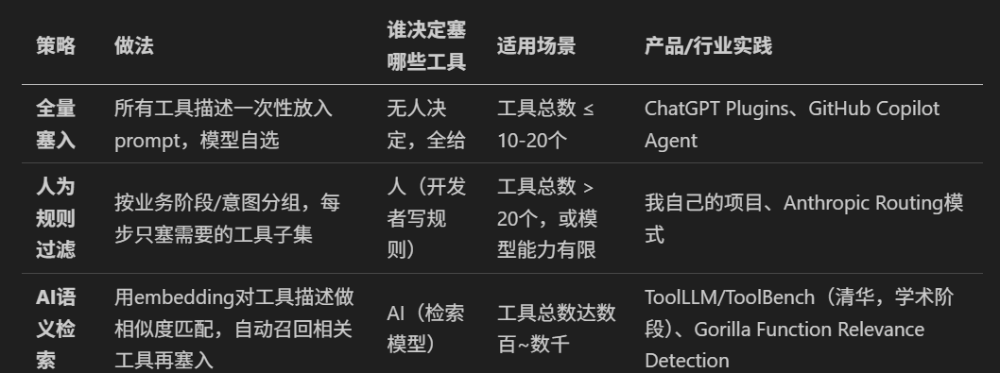

> **课时** 121/132　·　**面试真题实战**　·　约 50 分钟
> [上一课：2025.12 阿里国际站](../10-面试实战/14-2025.12 阿里国际站.md)　·　[下一课：2026.05 字节大模型开发暑期实习一面](../10-面试实战/16-2026.05 字节大模型开发暑期实习一面.md)
>
> 学完标准：合上笔记，能讲清本节在问什么、你怎么答、以及如何套到自己的项目上。

---

## 2025.12 盛大AI

### 岗位介绍

JD 我没有找到了，不过我从HR给我介绍的内容以及面试内容去分析，来带大家分析一下了解一下这个岗位。

盛大公司其实听着是一个大公司，给我们的印象可能是游戏公司，很早之前也许你玩过它的很火的游戏：泡泡堂，传奇世界等，之前还是挺有名的。现在盛大公司也在投入AI赛道，下面有两条AI产品线，大家可以去查一查：

1. Tanka: 偏应用，做应用，做产品

      2. MiroMind ：偏研究，也就是我们这次面试的岗位。面试官明确说，他们是不做应用的，主要做的模型的前后训练，来提升模型的能力。虽然不做应用，训练模型后的效果要结合工程去评测，所以其实需要了解Agent的框架之类的东西。 

总结这个岗位： 整体偏研究，训练，推理，模型都做，但是也需要应用。虽然盛大听着也不是小公司，不过研究AI的产品线的人数确实没多少，这个部门可能就几十人，所以也确实和很多规模不大的公司类似，很多事情都要做，不是局限在一个方向。 很多大公司对于岗位的分类是非常界限分明的，比如千问C端，他们做工程就纯工程，不用太管算法，但是这其实也有一个显著的弊端就是做工程其实又苦又累，公司不高，还是慢慢转到算法更有前途。所以相比下，这个部门虽然不大，但好处真的是模型训练，部署，工程都能做，对自己的提升肯定更大。另外整体又背靠是一个相对来说的大公司，资金链还是比较充足。

### 反思

第一个感受： 这个行业很多岗位还是需要我们交叉的能力。虽然纯工程的岗位有，但精工程，善训练，懂部署的人一定更吃香且前景。

第二个感受：这其实也再次验证了我们的路线，从应用精通，带一点算法的学习。首先是最容易上手的，入行最快的，另外这么复习，还是有机会去面试算法岗，甚至是拿到offer的。从我们面试这么多家来看，很多岗位其实是算法岗，其实我都没有专门的训练，部署项目，但是他们还是有很多算法的机会。 所以我的思路更加觉得大家是按这个路线学，先精应用，带着算法去学。 学的差不多了，再深入算法，如果时间不够，先学好应用先入行，慢慢再向训练，算法这条路深入。

面试内容分析

1. 其实可以从面试官的问题看出来，有些问题（离职原因，职业规划）这些其实是反映忠诚度和匹配度的，除了面试的知识的硬性技巧之外，有些内容比如问你想去什么样的公司，职业规划这些其实是 想考察忠诚度的。很多面试官其实在意忠诚度，如果他问你你的职业规划，但是你的回答和这个岗位不匹配，这些都是减分的。所以大家可以去思考一下怎么样展示自己的忠诚度，比如我在面试技巧，自我介绍中就提到了展示忠诚度的技巧，结合这次面试问题的回答，大家也可以自己感受一下。

2.环境准备问题。 面试的时候，有的时候让你在本地编译器中写代码（但我用的个人机，没有本地编译器），这次面试让你打开github链接（但我用的个人机没有梯子），有时网络信号断开了，信号差，麦克风不好等。这些其实都特别影响面试体验的。面试官有时候虽然嘴上说理解，但是根据我的经验，但最后都被减分，通过率降低。所以其实大家也要尽量避免一些这种问题的发生，把环境真的准备好。

### 一面

1.自我介绍

2.职业选择动机

3.当时为什么考虑从腾讯去微软呢，然后你现在的base是在北京，是在深圳吗？

4.项目介绍

   4.1 在这个Agent项目当中，你觉得什么是比较难的？

 （其实这个问题是非常常考的，而且是完全给你机会让你去总结的。我在做之前的面经分析的过程中，就提到过。 有的时候，其实做完一个项目，其实我觉得好像没什么难的，甚至有面试官问的时候，我好像说过类似的话 "其实整个项目也没啥特困难的"，闭着眼睛想，这就不是一个好的回答。 我不知道大家有没有类似的困惑，但是这个问题是需要挖掘和思考的。你需要挖掘，思考，包装你的项目到底有哪些地方比较困难，你要提前想好，挖掘好，这个需要提前准备，我之前复盘我就说这个问题很重要，所以我总结了对应的知识在笔记

     其他问题- 4你在项目中遇到的最难的问题

     之前总结是工具调用失败问题的排查和解决。借助今天的机会，我再在第4部分再增加一个例子，就以我们笔记中的这个RAG项目再总结一个例子。这个问题的回答请直接跳转到上面笔记部分。另外在本期视频的讲解中，我其实讲了一下我是如何挖掘项目深度，总结出的这个答案的，感兴趣的小伙伴可以看一下本期视频讲解）

   4.2 你的项目中Agents对于工具的处理是怎样的？

（这里其实是在聊如何把工具塞入到LLM中。我提到的是根据业务规则，每一步过滤指定的和业务阶段相关的工具，然后输入到大模型中。 然后面试官接着总结，以下是他的原话："相当于也是没有完全是一个agent的自己决定的workflow，就是你也是有一些固定的流"。

最开始我复盘的时候其实在想这是不是我做的太简单了，但是我做了一些调研，其实现在行业普遍没有说让AI达到一个完全自动筛选工具，自动定义生成工具的路径，特别是在生产项目中。这是我们的目标，是未来AI发展的趋势，但是在25年这个Agent元年生产项目并没有达到如此智能。所以如果有的面试官就想因为这个说你做的简单，其实你不妨和他深入聊一下下面我总结的行业现状，让他能够清醒一点。）

目前常见的大模型获取工具的方式有3种：

       首先是**全量塞入**，很多聊天工具如Copilot都是这么做的。原因也很简单，因为这些产品其实用的是远端的模型，现在远端模型的上下文容量越来越大，所以他一次性塞入也并没有问题。

       然后是**根据业务场景和规则，筛选对应项目加入的**。 原因也非常合理，因为我们用的本地模型，模型上下文本身有限。OpenAI官方文档都建议：单次API调用工具不超过20个，理想不超过10个。

最后是 让**AI动态决定工具。**这个现在更多的其实是处于Demo，学术阶段才这么做，商业落地项目很少这么做。在25年12月份UC Berkeley 发布的论文

《Measuring Agents in Production》中明确调研了现在的商业化Agent，也证明了一点, 根据论文： "商业的生产级的Agent，一般都将执行步骤限制在10步以内，允许数十步的仅有 16.7%，无限制的仅 6.7%。并且还会专门通过给工具添加封装层，减少工具数量来简化模型的负担。

感兴趣的同学可以参考论文原文：https://arxiv.org/abs/2512.04123

     （我说这么多是想要大家：

       1：了解行业现状和相关知识

       2：有的面试官可能也真的不太懂，拍脑袋就觉得你的项目某处简单的时   候，你可以拿出你的依据，告诉他行业现状和你使用这个策略的考虑来说服他，而不是被他带着跑）

5 然后我看你还有写到一些推理加速的部分，那地方做的多吗？

（结合我们分析的这个岗位性质，面试官其实问推理加速这一块应该很符合预期，因为本身他们就是做训练的。我比较担心的是他问的很深，因为按照我们的学习路线，我们是把算法这里带着走一遍。我按照我的笔记里的路线。 速度慢->量化->选择合适的推理框架->微调->强化学习讲了一遍。面试官也并没有追问，具体答案还是请看我笔记 你的项目是如何做推理加速的？）

6. 现在我给你一个我们在做的开源项目，请你现场阅读，然后告诉我大概这个项目在讲啥？然后如果我要添加一个工具，怎么做？

      （我还是第一次遇到这样考察的，这个问题完全是相当于把问题引入到面试官最熟悉，而你完全陌生的场景，需要你现场发挥，现场快速学习。大家可以自己打开这个链接，看一下这个项目，自己能不能用5~10分钟弄清楚这个问题的答案。另外咱们也不白学，针对这个问题，我总结出以下这开源项目是在做啥的，感兴趣你可以深入学这个项目，到时候有其他面试官问你你最近看了什么开源项目，也可以把这个拿出来讲

我在真正复盘这个面试题的时候，觉得也不用把他想的特别难，这个项目是一个deep research agent, 如果你了解deep research 的概念，结合它的readme,可以快速了解这是一个什么项目。 第二个问题如果添加一个工具，怎么做？结合现有的一些工程经验，比如我们RAG项目怎么增加一个新的模块，或者就是和这个类似的Git项目，如果有相关经验了，那么其实你也能很快回答。 借助这个机会，我们学一下开源项目，学一下deep research（其实deep research面试还是挺多人问的，可能很多公司他们研究这个，所以需要了解一下）， 学一下工程知识，我觉得这是一个很好的问题。

另外，我惊喜地发现这个问题其实不是最有价值的，最有价值的是这个项目。包含了Agent框架的知识，包含了训练，公开了数据集，训练方法。整套项目也有7.6k 个stars。完全开源，如果我们学下来，相当于是一个从训练 到Agent 都覆盖了的一个最好的实践的例子。我有初步想法准备把它当成我们的素材，26年3月开始，用它作为基础来学习，往算法方面扩展。如果这个计划执行，我也会把相关经历都写在笔记中，大家一起学习。）

项目地址：https://github.com/MiroMindAI/MiroThinker/tree/main

第一个问题，项目干啥，更像是读了Readme做总结，如果你熟悉相关领域，可能回答不难，但你不熟悉，可能这题就难了：

MiroThinker 是一个**开源的 Deep Research Agent**，目标是让模型能像研究员一样，自主地搜索信息、阅读网页、执行代码，最终完成复杂的研究任务。

项目包含**四个部分**：

- **MiroThinker 模型**——基于 Qwen3 做后训练的 Agent 专用大模型，经过 SFT、DPO、RL 三阶段训练，让模型学会了什么时候该搜索、怎么读网页、怎么写代码分析
- **MiroFlow 框架**——自研的轻量级 Agent 框架，基于 ReAct 范式，通过 MCP 协议接入工具，核心特色是 keep-5 上下文管理策略
- **MiroVerse 数据集**——147K 条 Agent 交互轨迹的训练数据
- **技术论文**——详细描述了训练方法
它的核心创新点是提出了 **Interactive Scaling**——认为除了模型规模和上下文长度之外，**交互深度**是提升 Agent 性能的第三个维度。通过 RL 训练，模型学会了在 256K 上下文窗口内进行最多 400 次工具调用，在 GAIA 等多个 benchmark 上达到了开源最优。

第二个问题：如果我要添加一个工具，怎么做？

       这个问题面试现场肯定看不了代码那么细，需要结合目录大概分析。我们在目录中发现目录有microflow_tools目录，然后下面有各种mcp_server，所以估计可以推测出来大概是通过mcp的方式引入tools，深入研究具体回答为：

从目录结构可以看出，这个项目的工具是通过 MCP 协议以插件式的方式接入的，加一个新工具基本上分三步：

第一步，在 libs/miroflow-tools/src/miroflow_tools/mcp_servers/ 目录下新建一个 Python 文件，用 FastMCP 框架定义工具。每个文件就是一个独立的 MCP Server，用 @mcp.tool() 装饰器注册工具函数，最后通过 stdio 方式启动。

第二步，在 apps/miroflow-agent/conf/agent/ 目录下的 YAML 配置文件中，把新的 Server 注册进去。框架里有一个 ToolManager（manager.py）负责统一管理所有 Server 的连接和调用，配置里加上就能被发现。

第三步，如果新工具需要 API Key，在 .env 文件中配置对应的环境变量。

整体设计思路是每类工具一个独立的 MCP Server 进程，好处是依赖隔离、进程隔离、可以按需启动。比如项目里视觉理解就有两个版本——一个调 Anthropic API，一个用开源模型，文件名带 _os 后缀，在配置里切一下就行，不需要改任何框架代码。

7. 算法题 - 岛屿数量（LC:200)

8.你想做哪一块啊，我不知道你对这个感不感兴趣，或者说你觉得你比较想在agent这个方面想自己想做的内容

说实话这问题就是要完全顺着面试官说，一定要说自己想要去做这个方向，还有原因说的具体点，不要看着像编的。我一直强调面试中表现出的意向度，是很重要的!

9. 反问

笔记中，面试技巧也有专门的反问技巧，大家去看笔记 ： 面试技巧 - 反问

### 视频讲解

https://www.bilibili.com/video/BV1pSR5BmEWp/?vd_source=144bec9c3f54e465073138bed788be1b
