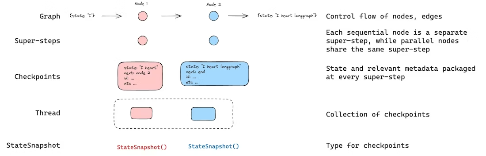

> **课时** 124/132　·　**面试真题实战**　·　约 50 分钟
> [上一课：2026.04 腾讯AI Agent暑期实习](../10-面试实战/17-2026.04 腾讯AI Agent暑期实习.md)　·　[下一课：2026.05 安克暑期实习](../10-面试实战/19-2026.05 安克暑期实习.md)
>
> 学完标准：合上笔记，能讲清本节在问什么、你怎么答、以及如何套到自己的项目上。

---

## **2026.05 虾皮 AIAgent暑期实习面经**

### 点评

这是粉丝朋友投递给我的暑期实习的面经。我分析的时候，有两点印象比较深：

1. 这个同学在自己讲解的时候，介绍项目讲了自己的Agent的记忆设计模块。长短记忆如何设计，如何写入的，如何整理的记忆。 讲到这一点，其实相对于很多人的项目已经比较深入了。很多同学的项目设计是不是没有一个精心编排的设计模块？我必须坦诚，2025年6月，作为一个社招，我拿的Agent项目就没有记忆模块的设计，即使当时我都收获了很多Offer。所以我的第一印象是，这个同学的项目做的还是不错的，虽然就听到这一点。
1. 面试官很懂细节，你可以看到，前面很多问题都是围绕记忆模块的设计来谈的。面试官可以很快抓住里面的细节冲突：比如同学讲完他的系统的存储模块后，面试官发现漏洞，这样是不是无法恢复？比如同学讲到了他的记忆模块的整理的时候，面试官挑战这样会不会存在并发压缩导致数据竞争的问题。面试对于细节的深入以及面试官能够快速抓住细节提问，是比较少见的。
基于此，我也是觉得这个同学面试准备的应该是不错的，而且他为啥专门投递这个面经，我觉得也是因为这一次的面试比较难，与众不同，比较难分析。

我也确实又专门和他询问具体内容，看看我猜想的对不对，我和他的交流也验证了我的猜想。他说面了很多中小厂，面试官都不太懂，面试问题笔记里也都有，基本面一个给一个。（他的原话）。这一次是他见到的比较少见的如此深入的（当然对我来说也是，我社招很多面试官也不会问这么深入）。

那么，问这么深入，对于大家是不是借鉴意义不大？我认为不是。分析本期面经：

1. **可以加深我们对于ClaudeCode记忆系统的理解。** 虽然面试官是针对于这个同学的项目问的，但这个同学的设计，或者整体行业对于记忆模块的设计是类似的，后面的问题，我们不妨从CC的角度来想？比如面试官问：你的Agent存了哪些东西（你就想CC存了哪些东西），你的系统如何重建会话（CC如何重建会话）。通过这些帮我们检验是否对于CC记忆模块深入掌握。

2. **从包装的角度。**如果你的Agent没有亮点可以写，你不妨和这个同学一样加这么一句**：负责 Agent 记忆与会话恢复模块设计，实现长短期记忆管理、会话 Transcript 持久化、上下文重建与运行状态恢复能力。**写上去了，对于今天面试的具体问题，你就必须想清楚，包括ClaudeCode的章节的笔记和参考资料。

3. 其他的角度，也有一些启发，大家可以看面经和讲解视频。

总体点评：

1. 细节把控严格，**讨论深入细节**，要求对于自己的Agent项目细节考虑清晰。整体面试基本围绕项目：求职者讲了Agent记忆，主要问题都是围绕记忆模块展开提问。

2. 其他只问了一个RAG的新方向，属于简单考察下对于当前的新技术有没有**了解。**

3. 算法题1道，仍然要求我们不能停止刷题。

### 岗位介绍

jd是广告监控，广告投流，优化广告方面的agent效果。

相关要求是：

1. 良好的代码能力，精通Python编程语言，了解C++/C/JAVA编程；
2. 良好的数据结构算法基础，有一定的离在线系统开发实践经验；
3. 对大模型，Al Agent，Rag等新兴技术有一定了解，熟悉常用的langgraph,langchain等开发框架及相关解决方案，有相关实践经验；
### 一面

> 前景：求职者介绍了自己项目的记忆模块，大家就把他当成ClaudeCode，来思考，回答这些问题。
>

1. 最近10轮的会话记忆，然后多余的会压缩，那你的话如果超过10轮之后，你这个历史性拿的到吗？

这里一个是面试官问具体的压缩过程，可以参考CC的压缩机制，可以看[ 4.4.3.4 压缩](https://my.feishu.cn/docx/GikId1snboM6LyxxGPXc0kDdnub#doxcnGka4IcbrrRnDUp6NuiOlId)

历史记录可以拿到吗，可以参考笔记CC部分面试真题： [你的Agent可以拿到历史会话记录吗](https://my.feishu.cn/docx/GikId1snboM6LyxxGPXc0kDdnub#doxcnYpcvR9GhgpaaJdz8D10jae)？

> 前景：面试官抓到了同学讲述的逻辑，因为他讲了压缩，但是并没有讲到保存历史记录这一层级的操作，所以面试官后来都针对于这一问题再拷打，询问他是如何恢复会话的？实际这里应该是漏了一层，实际会话恢复，一般都会存一个会话账本，用来恢复，详细见：[4.4.3.2 会话账本](https://my.feishu.cn/docx/GikId1snboM6LyxxGPXc0kDdnub#doxcn8myMmrzWguk7BHJPmMaymb)
>

**1.1 你页面可以刷新吗？你刷新也刷新不了吧？**

    参考笔记CC部分面试真题：[你的项目是如何重建会话的？](https://my.feishu.cn/docx/GikId1snboM6LyxxGPXc0kDdnub#doxcn08kSA7IBUVp74jIlZ7lRkq)

> 前景：还是因为没有回答到储存本地会话账本的问题，所以面试官在追问。
>

**1.2 那你这个记忆是存在哪里的呢？短期的话也是储存在数据库里面的，然后长期的话才会进行压缩，是你自己存的吗？”**

这题理解清楚了笔记CC 4.4.3的[记忆功能](https://my.feishu.cn/docx/GikId1snboM6LyxxGPXc0kDdnub#doxcnWwYvQib6i3M4DGD1sGRVIh)就可以回答。

这个答案也可以参考 [你的项目长短期记忆是如何存的？](https://my.feishu.cn/docx/GikId1snboM6LyxxGPXc0kDdnub#doxcnYxLmITc1t87QwZtvGMeCge)

**1.3 你用户的回答的数据和AI的回复是存在了不同的数据库表中吗？那你重建会话的时候，是怎么配对的？**

其实到这里，面试官一直都在围绕记忆功能展开。1.3其实本质上还是在挑战这个同学，是如何重建的会话？这个同学前文中回答说： 用户回答的内容和AI的回复是分开存的，所以面试官才有了这个疑问。

不深究里面的细节，本质上还是这里同学没有讲清楚，到底是如何存的，如何重建的会话。其实这个问题，如果按照我们上面讲的，是很容易的，就是整个会话信息都是存在了JSONL中，不存在配对的问题。

> 前景：同学和面试官在讨论压缩的问题，同学回答具体项目的压缩策略，采用的异步压缩。也就是一边对话，一边压缩。但是面试官询问，那么两个操作同时进行，那么可能会有覆盖和冲突。
>

**2 你压缩是异步的，但是如果压缩的时候如果我正在新的会话，那岂不是覆盖了？**

其实这是一个典型的两处并发操作同一块数据，就必须做并发一致性保障（比如加锁、锁段、或追加不变量、或者只用追加状态事件）的问题。面试官厉害的一点是他是真的理解了细节，在和求职者讨论。能做到这样：面试官首先比较懂，第二反应和理解能力都比较强。不过这样的接近细节的追问，也很容易答不上来把人心态弄崩。这提醒我们的是，我们的项目细节要想清楚，设计方案要完善，可以和面试官推敲，经得起推敲，就算设计不足，也能够和他进行探讨和讨论方案。就算被问蒙，也尽量调整心态，积极思考和回答。

回到问题本身，CC的压缩是同步的，包括像Copilot，当会话过长，我们都可以看到，压缩的时候，主界面会卡死对吧。所以大家这里也不要设计成异步的，除非你有更好的思路和理由，想清楚各种问题，要不就用开源的框架里的方法呗。所以这里就不讲了。

> 前景：其实就是面试官聊了这么多，觉得奇怪，看上去这些功能（回溯，会话重建，记忆存储),同学没有答的特别清晰，但是这些功能Langgraph都有，面试官就问他为啥不用Langgraph做。后面的反馈面试官也有给到建议：如果有一些开源的框架的能力，尽量复用，不要自己重新做。
>

**3.**** ****你的记忆的功能的实现，会话重现，回调的能力，都是怎么实现的？是自己单独存的吗？没有用Langgraph的结构化能力吗？**

这个题给我们的启发就是在我们做项目实现的时候，去了解一下框架，是否有类似的功能，**能否复用。当然我不是说一定要复用。 **比如我看有很多团队，他们写Agent项目就是手搓的，他们其实有他们的考虑，比如稳定性啊，效率等。但是大家实现的时候，最少要做技术选型，xx框架有整个功能，**你为啥不用？你不用的理由是啥？**这里同学比如在整个会话重建功能这里答的没有很好，但是langgraph又提供了相关功能，所以就被挑战。

这里，我们以Langgraph为例，他有提供具体的**节点回退功能（Time Travel)。**本质来说，也是持久化存储了一份对话历史，这个历史不同于记忆模块，就和我们讲的ClaudeCode一样，分为两个层级。实现细节，比如如何重建的，存储的形式，存储的数据库可能不同，但思想是一样的。我就不深入讲解了，当你把这些能力（会话重建，回退）写在简历上了，你可以从**CC也好，Langgraph也好**，看一下别人是如何实现的，把细节想清楚（最好的方法是自己做一遍），因为既然你写在简历了，细节要经得起问。

LangGraph的持久化记忆，可以看[官方文档 Persistence章节](https://docs.langchain.com/oss/python/langgraph/persistence)：

**4. 你看过什么开源代码吗？你这个东西没实现，但你更应该关注业内标准方案？**

我慢慢也觉得看开源项目很有用，我在学习路线也把看开源项目写成学习路线的一个环节。

我们笔记解析了：[ ClaudeCode](https://my.feishu.cn/docx/GikId1snboM6LyxxGPXc0kDdnub#doxcn1nrn0PkaCt5nbbKuEwlOSc).[ OpenClaw](https://my.feishu.cn/docx/GikId1snboM6LyxxGPXc0kDdnub#doxcnRO3JEVYUxCpOFXhA3urpPc)[ Hermes Agent](https://my.feishu.cn/docx/GikId1snboM6LyxxGPXc0kDdnub#doxcnaVYbROSAPviSkFiHok3c3b)

其中ClaudeCode我想作为最精读的内容，各种参考资料，面试真题，都结合在里面，这个小节也会不断根据面试内容来完善。

**5.RAG传统方案肯定有一些不足，比如语义分割，二维三维丢失，没有办法跨文档关联，有什么好的方案？**

我的看法是：rag传统方法得会，这是基础。对于新方案，比如Agentic RAG, GraphRAG, 要了解，知道行业痛点和趋势。但是你说要不要深入，只能说学有余力再深入吧，先把其他的做好，因为深入的方向其实不是每个岗位都会做的，面试官不做，自然问的也不会深入。所以可以先了解一下大概。

本节内容可以参考笔记： [RAG新方向](https://my.feishu.cn/docx/GikId1snboM6LyxxGPXc0kDdnub#doxcns8i7SWEW7WDaSdq82dAJCf)，从Agentic RAG和GraphRAG两个维度来回答。

**参考答案:**

传统 RAG 的问题本质在于它把知识‘压扁’了——将原本拥有版面结构、多维表格或跨文档关系的复杂资料，粗暴切成了孤立的一维文本 chunk。要解决这个问题，目前业界最前沿也最有效的方案是将 GraphRAG 与 Agentic RAG 进行融合。

首先，GraphRAG 负责重构‘知识网络’。它通过大模型提取文档中的实体、关系和事件，构建出知识图谱。这不仅可以把二维表格、标题层级等版面结构利用实体和边重新连接，防止语义切断，更通过‘关系推理’和‘社区摘要’实现了跨文档的深度关联与全局总结。

其次，Agentic RAG 则负责重构‘检索行为’。它将传统的一步式相似度检索，升级为由 Agent 主导的多轮规划、多数据源路由和答案验证。Agent 可以把复杂问题拆解为多个子模块分别检索，遇到冲突信息能进行比对，甚至像人类专家一样在生成答案后回看原文进行事实核对。

总结来说，GraphRAG 解决了知识表达局限的问题，而 Agentic RAG 解决了检索过程被动的问题。两者的结合，代表了 RAG 从‘相似片段匹配’向‘结构化关系检索与主动推理’的范式转变的必然趋势。

**6.**** ****算法题**

LeetCode 88. 合并两个有序数组

写完后会问具体细节。

**7.**** ****反问**

### **视频讲解**

https://www.bilibili.com/video/BV1BkVk6DEx3/?spm_id_from=333.1387.homepage.video_card.click&vd_source=144bec9c3f54e465073138bed788be1b
