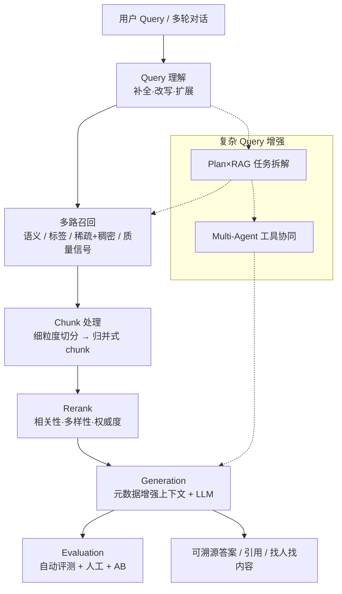

# 知乎直答技术架构详细报告

> 基于公开资料整理（非官方白皮书全文复述）。产品正式名：**知乎直答**（`https://zhida.ai/`）。  
> 调研日期：2026-10-26

---

## 1. 产品定位与演进

### 1.1 产品是什么

知乎直答是知乎推出的 **通用 AI 搜索 / 智能问答产品**，具有强社区属性，但官方强调「并非简单的社区版 AI 搜索」。核心价值主张：

| 维度 | 公开表述 |
|------|----------|
| 内容可信 | 依托知乎经用户校验的内容，降低幻觉、可溯源 |
| 连接创作者 | 可关注创作者、「找内容 / 找人」、不满意可一键向知友提问 |
| 多元数据源 | 知乎图文 + 全网公开内容 + 维普等论文库 + 公开英文文献 |
| 交互形态 | 「简略 / 深入」等回答模式；通用搜索 + 专业搜索；追问与多轮 |

### 1.2 时间线（公开节点）

| 时间 | 事件 | 技术含义 |
|------|------|----------|
| 2023 | 发布「知海图 AI」（与面壁智能合作，基于 CPM-Bee 路线） | 自研/共研大模型底座起步 |
| 2024 初 | 「发现·AI 搜索」社区尝鲜 | AI 搜索产品化前身 |
| 2024-06 | 盐 Club 正式发布「知乎直答」，独立域名 `zhida.ai` | AI 搜索正式产品化 |
| 2024-10/11 | 「专业搜索」：接入维普等 5000 万+ 中英文文献 | 垂直 RAG + 文档解析 + 多智能体 |
| 2024-12 | 技术沙龙：王界武分享直答从 0→1；开源 **ZhiLight** | RAG 工程化与推理引擎公开化 |
| 2025-02 | 接入满血版 **DeepSeek-R1**；上线个人知识库 | 强推理模型 + 私有知识 RAG |

### 1.3 产品形态分层

```text
┌─────────────────────────────────────────────────────────┐
│  入口层：知乎 App / Web / zhida.ai / 开放平台 API·MCP   │
├─────────────────────────────────────────────────────────┤
│  产品能力层                                              │
│   · 通用搜索（社区+全网）                                 │
│   · 专业搜索（论文库/知乎精选等可勾选知识库）               │
│   · 个人知识库（上传 PDF/网页/RSS/收藏夹）                 │
│   · 深度阅读（单篇文档问答）                               │
├─────────────────────────────────────────────────────────┤
│  智能编排层：DAG 算子编排 / Multi-Agent / Plan×RAG        │
├─────────────────────────────────────────────────────────┤
│  RAG 核心：Query → Recall → Chunk → Rerank → Generate   │
├─────────────────────────────────────────────────────────┤
│  数据与索引层：社区内容 · 论文库 · 全网 · 用户私有文档     │
├─────────────────────────────────────────────────────────┤
│  模型与推理层：生成 LLM · Embedding · Reranker · ZhiLight│
└─────────────────────────────────────────────────────────┘
```

---

## 2. 总体技术路线：为什么选 RAG

知乎 AI 算法负责人王界武在公开分享中明确：构建 AI 问答时对比了两条路线——

1. **LLM 持续 pretrain + posttrain**（把知识尽量灌进模型）
2. **检索增强生成（RAG）**

最终选择 **RAG**，公开给出的胜出维度包括：

- **成本**：不必为时效知识反复重训超大模型  
- **时效性**：索引可分钟级更新（开放平台亦宣传实时索引能力）  
- **准确性 / 幻觉控制**：答案锚定外部证据  
- **可解释性 / 溯源**：可引用社区回答、论文原文  
- **可扩展性**：新增论文库、全网源、用户知识库无需改模型权重  

**核心范式**：用户提问 → 从知识库检索相关材料作为上下文 → 大模型基于上下文生成回答。

对复杂问题，进一步演进为：

- **Plan × RAG**：任务拆解 → 子任务检索/推理 → DAG 式执行  
- **Multi-Agent**：信息查询、内容分析、数学计算等由专用模型/工具分工（Function Calling）

---

## 3. 端到端流水线（核心架构）

公开分享将链路拆为六大环节：**Query / Retrieval / Chunk / Rerank / Generation / Evaluation**，外加工程与成本层。



---

## 4. 分模块技术细节

### 4.1 Query 理解

**问题形态（生产环境）**

- 表述不完整 → **语义补全**  
- 多重意图混杂 → **基于上下文改写**  
- 过短 / 意图不清 → **多轮扩展**

**关键实践**

| 实践 | 说明 |
|------|------|
| 多轮 Query 理解 | 初版仅单轮；根据反馈迭代多轮上下文理解 |
| 微调改写模型 | 专门微调模型做 query rewrite |
| Query 扩展内嵌搜索引擎 | 扩展在搜索引擎内执行，避免多次外呼；更好控制相关性/多样性，降成本 |
| 定向训练扩展模型 | 单独训练模型完成 query expansion |
| 专业搜索侧 | 「基于推理的意图理解」：NLU 积累 + LLM 推理，多角度召回 |

### 4.2 召回（Retrieval）

公开描述为 **多策略召回**：

#### （1）语义召回

- 基于知乎问答场景 **深度调优 BGE Embedding**  
- 按任务（检索 / 语义相关 / 聚类分类）调整损失函数与负采样  
- **长短文模型融合**：  
  - Base  
  - 长文微调模型（TextBgeFTQuery2Long）  
  - 短文微调模型（TextBgeFTQuery2Short）  
  - 融合模型（TextBgeFTMixed）在多项任务上更均衡  

**探索/提及的相关技术**

| 技术 | 公开评价 |
|------|----------|
| Matryoshka 表征学习 | 一次训练多维度输出 |
| BGE-M3 dense + sparse | 长文表现好、可降索引压力 |
| ColBERT 延迟交互 | 精度高、成本高，适合高精度场景 |
| 1-bit 量化 | 提速，召回损失小，有研发潜力 |

专业搜索侧更明确写成：**Sparse Retrieval + Dense Retrieval 混合检索**。

#### （2）标签召回

- **两阶段标签抽取**：  
  1. 召回模型拿候选标签  
  2. LLM 做深度语义分析与最终标签选择  
- 标签匹配场景训练 **轻量级模型**（极短文本匹配）  
- 优势：高效、语义强、可扩展、零样本新增标签

#### （3）向量空间对齐

- 解决 **非对称索引**（query 短、doc 长）  
- 通过对文档理解 **合成标题索引**，实现更接近 query→query 的检索空间，提升准确率

#### （4）质量信号（社区护城河）

召回/排序融入：

- 内容可信度  
- 答主专业度  
- 回答完整性  
- 社区投票 / 互动等权威信号  

这是相对「纯网页搜索 RAG」的差异化能力。

### 4.3 Chunk（上下文构造）

**目标**

- 压缩上下文 → 降成本与延迟  
- 缓解 Lost-in-the-Middle，提高有效信息密度  

**演进路径（公开踩坑史）**

| 方案 | 结果 | 原因/经验 |
|------|------|-----------|
| 固定窗口切分 | 早期可用但不理想 | 文档多样，难同时兼顾语义完整与效率 |
| 生成式 Chunk（End2End 抽相关子串） | **未成功落地** | 延迟高；LLM recency bias；评分模型对「相关/无关前缀」区分差 |
| **归并式 Chunk（落地）** | 采用 | 细粒度切分 → 相关度打分 → Rank → Merge → 边界外推 → **每文档一个 chunk** |

专业搜索表述为：**动态文本切片 + Reranker 评分排序 + 智能组合多个文本块**（自适应上下文重排）。

### 4.4 Rerank

关注三点：

1. **关键信息感知**：控噪声，避免淹没 LLM 注意力  
2. **多样性控制**：抑制冗余  
3. **权威度**：结合知乎投票等机制加权  

专业搜索侧强调训练的 **Reranker** 对分块内容打分排序。

### 4.5 Generation（生成）

**上下文增强**

喂入模型的上下文加入可验证元数据：

- 来源、时间  
- 用户互动数据  
- 创作者专业背景  

**复杂问题：Plan × RAG**

传统单跳 RAG 的局限：多步推理弱、幻觉、难整合多源上下文。公开方案：

- 任务拆解、逐层推理  
- 优化生成 **DAG**  
- **预检索** 降低错误累积  
- 精细化子任务管理  

**提示工程（专业搜索）**

- Chain-of-Thought  
- Few-shot / 思维过程示例  

**模型对齐训练（公开提及）**

- DPO、step-DPO、PPO、GRPO  
- 样本增强、拉齐  
- 持续 badcase 驱动微调  

**产品侧生成能力**

- 简略 / 深入模式  
- 引用溯源  
- 接入 DeepSeek-R1 后强化逻辑推演与结构化输出  

### 4.6 Evaluation（评测体系）

公开指出「离线评测 ≠ 线上体验」的偏差来源：语言风格偏好、评测人主观差异、错误偏好等。

**多层次体系**

1. **自动化评估**：LLM 打分、偏好模型、历史 badcase 集合  
2. **多维人工评估**：多机盲评、专员复检、GSB  
3. **线上 AB 实验** 最终确认  

---

## 5. 专业搜索、知识库与文档解析

### 5.1 专业搜索

- 可勾选公开知识库：中文论文库、英文论文库、知乎精选等  
- 文献规模公开数字：**超 5000 万篇**中英文高质量文献（维普等）  
- 支持预览、暂存参考文献，再限定范围继续追问  
- 可上传本地文件当作读论文工具  

### 5.2 个人知识库（2025 起公开强化）

公开模块包括：

- 本地文件上传  
- 网页收藏  
- RSS 订阅  
- 知乎收藏夹  

可用 DeepSeek-R1 等对论文/文档/网页/问答做提取、分析、分享。

### 5.3 智能 PDF / 文档解析

- 为「深度阅读」自研智能 PDF 解析方案（公开未披露具体 OCR/版面引擎名称）  
- 单轮交互最多支持较多文档（公开提到专业版单轮最多约 99 个文档量级）  
- 通用 RAG 文档链路的公开通用做法（社区技术讨论中常见，不特指内部实现）：版面识别 → Markdown → 目录正则切块 → 向量/关键词索引 → Rerank  

---

## 6. 模型体系与推理基础设施

### 6.1 模型演进（公开）

| 阶段 | 模型/能力 | 角色 |
|------|-----------|------|
| 早期 | 知海图 AI（CPM-Bee 基础、宣称千亿级参数量级） | 社区 AI 搜索 / 直答早期底座 |
| 中期 | 定制 LLM + Function Calling | 多智能体工具调用 |
| 2025 | DeepSeek-R1（满血版） | 通用/专业搜索可选；强化推理 |
| 配套小模型 | Query 改写/扩展、Embedding、Reranker、标签模型 | 降延迟与成本 |

开放平台对外暴露的直答模型档位（公开 API）：

| model | 定位 |
|-------|------|
| `zhida-fast-1p5` | 快速回答 |
| `zhida-thinking-1p5` | 深度思考 |
| `zhida-agent` | 智能检索与回答 |

### 6.2 推理服务栈

**内部并行使用（公开）**

- **vLLM**、**SGLang**：广泛用于知乎内部推理服务  
- **ZhiLight**（知乎 + 面壁，2024-12 开源）：面向 Llama-like，尤其优化 PCIe 多卡场景  

**ZhiLight 公开技术要点**

| 能力 | 说明 |
|------|------|
| 接口 | OpenAI Chat Completions 兼容；metrics 与 vLLM 对齐 |
| Dual Streams | Prefill 计算与 All-Reduce overlap；单层 Transformer 计算时间降幅公开称 40%+ |
| 量化通讯 | Int8 等低精度 all-reduce |
| 注意力 | FlashAttention、Chunked Prefill、Prefix Cache、Paged KV、Fused batch attention |
| 并行 | 单机 TP/PP（推荐 TP）；后续支持多机 TP、DeepSeek MoE/MLA 等 |
| 量化 | Native INT8 / SmoothQuant / FP8 / AWQ / GPTQ（Marlin）等 |
| 依赖集成 | FlashAttention、Marlin、TensorRT、exllama 等 |
| 语言实现 | C++/CUDA + Python serving |

**专业搜索延迟优化（公开）**

- Prefix Cache  
- Chunk Prefill  
用于降低 TTFT、提升吞吐。

### 6.3 成本优化（公开数字）

- 模型量化：效果基本不掉的前提下，成本约 **降 50%**  
- 垂直场景：大模型方案 **迁移/蒸馏为专用小模型**，尺寸缩小且保持约 **95%+** 专业性能  

---

## 7. 工程架构与可观测性

### 7.1 任务编排

- **基于 DAG 的任务编排**  
- 核心模块 **算子化**，便于新增需求、提升研发效率  
- 与 Plan×RAG 的 DAG 生成相呼应：算法侧规划 + 工程侧执行图  

### 7.2 监控

- **全链路监控体系**：缩短问题定位时间  
- ZhiLight 监控指标对齐 vLLM metrics，便于对比稳定性与性能  

### 7.3 动态资源调度

专业搜索公开提到 **动态资源调度**（细粒度调度策略未开源披露）。

### 7.4 多智能体协同

- 定制 LLM 的 **Function Calling**  
- Agent 分工：检索、分析、计算等  
- 产品负责人公开观点：搜索任务应拆成多部分，多智能体是 AI 搜索必由之路  

---

## 8. 数据与开放平台能力（对外可见架构）

知乎数据开放平台将「内容检索 + 直答生成」产品化为 API / Skill / MCP，可侧面印证内部能力边界：

### 8.1 搜索类

| API | 能力要点 |
|-----|----------|
| `zhihu_search` | 站内问答/文章等；含赞同、评论、作者认证、权威等级等信号 |
| `global_search` | 全网搜索；可按 host、publish_time 过滤；索引库 `all` / `realtime` / `static` |
| 宣传指标 | 百亿级索引量级表述；实时索引；平均延迟约 600ms 量级（平台宣传） |

### 8.2 直答类

| 能力 | 说明 |
|------|------|
| `POST /v1/chat/completions` | OpenAI 风格；`stream: true` 支持 SSE |
| MCP `zhida` | Streamable HTTP：`https://developer.zhihu.com/api/mcp/zhida/v1/stream` |
| 鉴权 | Bearer Access Secret + `X-Request-Timestamp` |

内容运营侧公开提到 **L1–L5 内容分级**、专家创作者、结构化沉淀与溯源要求——这些信号可进入检索排序与生成元数据。

---

## 9. 技术栈全景汇总

### 9.1 已由公开资料点名或高度确认

| 层级 | 技术 / 组件 |
|------|-------------|
| 产品范式 | AI Search + RAG + Citation |
| 编排 | DAG 算子编排；Plan×RAG；Multi-Agent + Function Calling |
| 检索 | BGE 系 Embedding（场景微调）；Dense+Sparse；标签召回；合成标题对齐；质量信号融合 |
| 相关技术探索 | BGE-M3、Matryoshka、ColBERT、1bit 量化 |
| Chunk / Rerank | 动态切片；归并式 chunk；训练 Reranker；社区权威加权 |
| 生成与对齐 | CoT / Few-shot；DPO / step-DPO / PPO / GRPO |
| 模型 | 知海图 AI（历史）；DeepSeek-R1（现网可选）；专用小模型族 |
| 推理 | ZhiLight、vLLM、SGLang；Prefix Cache；Chunk Prefill；FlashAttention 等 |
| 数据源 | 知乎社区、全网、维普/英文文献、用户知识库 |
| 文档 | 自研智能 PDF 解析 |
| 对外 | OpenAI 兼容 Chat API、搜索 API、MCP、Skills |
| 硬件 | 多种 NVIDIA GPU（公开 benchmark 含 A800 / H20 / 消费级 PCIe） |

### 9.2 公开未明确披露（勿当作事实）

| 项 | 状态 |
|----|------|
| 向量库具体产品（Milvus / ES / 自研等） | 未点名 |
| 在线服务框架（具体 RPC/网关栈） | 未点名 |
| 特征存储 / 实时特征平台 | 未点名 |
| PDF 解析是否用特定 OCR/版面模型 | 仅称「自研」 |
| 现网默认主力生成模型权重细节 | 多模型可选，默认策略未完全公开 |
| 知识图谱是否作为主链路 | 营销文偶有「知识图谱」表述，核心技术分享以 RAG 为主，需谨慎引用 |

---

## 10. 架构设计要点（归纳）

1. **RAG 优先于「把世界塞进参数」**，用索引与质量信号解决时效与可信。  
2. **检索质量是护城河**：社区投票、答主专业度、标签体系、长短文 Embedding 融合。  
3. **上下文工程决定上限**：归并式 chunk + 元数据增强 + 自适应重排。  
4. **复杂问题走规划与多智能体**，而不是单次「超长 prompt」。  
5. **推理与成本工程同等重要**：ZhiLight dual-stream、量化、小模型迁移、Prefix Cache。  
6. **评测闭环**：自动 + 盲评 + AB，对抗「评测好看、线上翻车」。  
7. **产品与社区闭环**：找人、追问、提问回流创作者，区别于纯搜索引擎。  

---

## 11. 下一步公开规划（官方表述摘要）

- 与知乎社区更深融合  
- 多模态交互与富媒体结果  
- Reasoning 能力「o1 化」/ 更强复杂问题求解  
- 专业版持续优化科研场景  

（接入 DeepSeek-R1 后，强推理路线已部分落地。）

---

## 12. 结论

从公开资料看，**知乎直答的技术架构是一条以 RAG 为中轴、以社区质量信号与专业文献为差异化数据飞轮、以 DAG/多智能体做复杂任务编排、以 ZhiLight 等推理引擎做成本与延迟优化的 AI 搜索系统**。其「技术栈」不是单一框架名，而是：

> **Query 理解模型族 × 混合检索 × 上下文构造 × 对齐后的生成 LLM × 推理加速引擎 × 全链路评测与编排**

若用于面试或复盘，建议抓住三条主线：**为什么 RAG、检索如何做强、工程如何控成本与延迟**。
